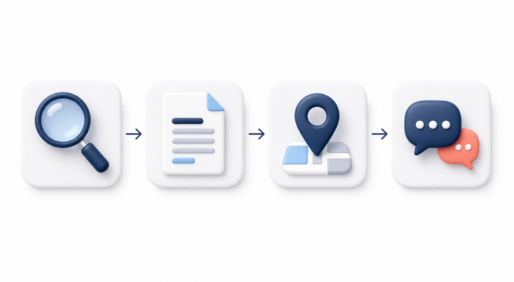

"조회수는 올랐는데 예약이 없다"는 상담은 거의 매주 들어옵니다. 이때 대부분은 글을 더 써야 한다고 답하지만, 노티스랩의 진단은 다릅니다. 문의가 없는 이유는 한 가지가 아니고, 원인마다 손대야 할 곳이 다르기 때문입니다.

아래는 상담 자리에서 실제로 확인하는 순서입니다. 읽고 나면 우리 매장이 어느 지점에서 멈춰 있는지, 다음에 받을 보고서에서 무엇을 물어야 하는지 스스로 판단하실 수 있습니다.

## 문의가 없다는 말은 네 가지 문제를 함께 담고 있습니다

같은 문장이라도 속을 열어 보면 원인이 다릅니다. 순서대로 확인하시면 됩니다.

1. **검색이 일어나지 않는 경우.** 대표 키워드로 검색했을 때 우리 글이 한 페이지 안에 보이지 않습니다. 이때는 글의 숫자보다 키워드 선정이 문제입니다.
2. **검색은 되는데 글이 선택되지 않는 경우.** 순위는 있는데 클릭이 적습니다. 제목과 썸네일이 검색자의 조건을 담지 못한 상태입니다.
3. **글이 읽히는데 다음 화면으로 넘어가지 않는 경우.** 체류는 있는데 플레이스나 예약 페이지로의 이동이 없습니다. 비교에 필요한 값이 본문에 없습니다.
4. **넘어왔는데 연락이 닿지 않는 경우.** 전화를 받지 못하거나 예약 링크가 오래된 주소를 가리킵니다. 이 경우는 콘텐츠가 아니라 운영의 문제입니다.

네 가지 중 어디인지 정해지면 다음에 할 일이 하나로 좁혀집니다. 반대로 이 구분 없이 "글을 더 쓰자"로 결론을 내리면, 이미 충분한 단계에 자원을 더 넣게 됩니다.

## 조회수와 매출 사이에는 세 번의 판단이 있습니다

조회수는 검색 결과에서 우리 글이 눌린 횟수를 셉니다. 매출은 그 사람이 실제로 와서 결제한 결과입니다. 둘 사이에는 검색자가 내리는 세 번의 판단이 끼어 있습니다.

처음은 목록에서 우리 글을 고르는 판단입니다. 다음은 글을 읽고 플레이스나 예약 화면을 열지 정하는 판단입니다. 마지막은 열린 화면에서 전화를 걸거나 예약 버튼을 누를지 정하는 판단입니다.

이 셋 중 하나가 어긋나면 조회수는 그 자리에서 멈춥니다. 그래서 조회수가 큰 글과 문의가 나온 글이 서로 다른 일이 흔하게 생깁니다. 넓게 걸리는 정보성 글은 읽히지만 읽는 사람의 목적이 우리 매장이 아닐 수 있고, 검색 범위가 좁은 글은 조회수가 적어도 문의 비율이 높게 나옵니다. 숫자의 크기보다 그 숫자가 어떤 조건에서 만들어졌는지를 먼저 보셔야 하는 이유입니다.

## 대행사 보고서에서 확인할 세 줄

보고서를 펼쳤을 때 이 세 가지가 있는지 보시면 됩니다.

1. 이번 달에 처음 등장한 검색어는 무엇인가
2. 글에서 플레이스로 넘어간 사람이 몇 명인가
3. 다음 달에 바꿀 항목이 한 줄로 적혀 있는가

세 번째가 비어 있으면 그 보고서는 지난달 자료를 다시 출력한 것입니다. 앞의 두 줄이 채워져 있어도 다음 달 행동이 없으면 결정을 대신해 주지 못합니다. 반대로 세 줄이 모두 있으면 서식이 투박해도 쓸모 있는 보고서입니다.

### 노출과 순위가 먼저 적히는 이유

노출 수와 순위는 발행하면 자동으로 생기는 숫자입니다. 반면 문의와 예약은 매장의 통화 기록, 예약 시스템, 플레이스 통계를 각각 열어 대조해야 나옵니다. 시간이 들고, 성과가 나쁠 때 설명하기도 어렵습니다.

그래서 계약서에는 발행 편수가, 보고서에는 노출 횟수가 앞자리에 놓입니다. 의도가 나쁘다고 보기는 어렵지만, 그 숫자만으로는 다음 달에 무엇을 바꿀지 알 수 없습니다. 지표는 넘치는데 결정은 남지 않는 상태가 됩니다.

## 문의가 생기는 글의 세 단계

매출로 이어지는 글은 문장이 화려해서가 아니라, 읽는 사람의 다음 행동을 미리 정해 두었기 때문에 만들어집니다.

### 조건을 제목에 넣습니다

검색자는 업종과 지역만으로 찾지 않습니다. "수지 미용실"에서 한 걸음 더 나아가 "수지 미용실 주말 예약"처럼 상황을 붙입니다. 주차가 되는지, 예약을 받는지, 가격대가 어떤지가 함께 따라붙습니다.

이 조건을 제목과 첫 문단에 그대로 담아야 검색 결과에서 만날 수 있습니다. 조건을 빼고 분위기만 남기면 읽히기는 해도 검색에는 걸리지 않습니다.

### 결정에 필요한 값을 본문에 둡니다

검색자는 가격대, 주차 가능 여부, 영업시간, 휴무일, 예약 방법, 사진을 확인하려고 글을 엽니다. 이 값이 없으면 뒤로 가기를 누릅니다. 사진이 좋아도 결정에 필요한 숫자가 비어 있으면 비교가 끝나지 않습니다.

가격을 정확히 밝히기 어렵다면 범위라도 적어 두세요. "점심 1만 원대"처럼 폭만 있어도 판단 속도가 달라집니다.

### 마지막 문장에 행동을 하나만 남깁니다

글 끝에는 전화, 예약 링크, 저장, 길찾기 가운데 하나만 둡니다. 여러 개를 나란히 놓으면 아무것도 눌리지 않습니다. 예약을 받을 글인지, 저장을 유도할 글인지, 문의를 받을 글인지 먼저 정하면 마지막 문장은 자연스럽게 결정됩니다.

## 한 달에 한 번, 사장님이 직접 보는 다섯 가지

대행사에 맡기고 있어도 이 다섯 가지는 직접 확인할 수 있습니다.

- 대표 키워드 세 개를 고정하고, 매달 같은 조건에서 순위를 적어 둡니다. 키워드가 매번 바뀌면 비교할 기준이 사라집니다.
- 플레이스와 블로그의 영업시간·가격·주차·휴무일을 같은 값으로 맞춥니다. 두 곳의 정보가 어긋나면 손님은 양쪽 다 의심합니다.
- 글마다 마지막 행동을 하나만 둡니다. 두 개 이상이면 없는 것과 비슷합니다.
- 문의가 어디로 들어왔는지 기록합니다. 전화인지, 예약인지, 저장인지. 다음 달 기획은 이 기록에서 출발합니다.
- 한 달에 한 번, 문의가 있었던 글과 없었던 글의 제목과 도입부를 나란히 놓고 비교합니다. 차이가 다음 달에 쓸 기준이 됩니다.

## 발행 계획은 네 편이면 충분합니다

편수를 늘리는 것보다 목적을 나누는 편이 남습니다. 한 달을 네 주로 나눠 이렇게 배치해 보세요.

1. 첫째 주에는 대표 키워드로 정보를 정리한 글을 씁니다.
2. 둘째 주에는 가격과 주차, 예약 방법처럼 비교에 쓰이는 글을 씁니다.
3. 셋째 주에는 보유한 사진으로 실제 이용 장면을 정리합니다.
4. 넷째 주에는 그달에 들어온 문의를 소재로 짧은 글을 씁니다.

특히 마지막 주의 글이 다음 달 기획의 재료가 됩니다. 어떤 질문이 반복되었는지, 어떤 표현에 반응이 왔는지가 그 안에 남기 때문입니다. 지역 글을 함께 운영한다면 키워드를 생활권 단위로 나누는 작업이 앞에 와야 합니다. 그 방법은 [용인 블로그 마케팅, 생활권별 키워드 설계](/insights/yongin-blog-marketing-living-areas/)에 따로 정리했습니다.

## 노티스랩이 일하는 순서

첫 상담에서는 원고를 쓰지 않습니다. 위의 네 갈래 가운데 어디에서 멈췄는지부터 확인합니다. 진단이 끝나면 그 결과에 맞춰 첫 달 작업 순서를 정합니다.

자료는 업체가 가진 것에서 출발합니다. 매장 사진, 메뉴판, 외관, 짧은 영상 안에서 쓸 장면을 골라 기획하고 편집하며, 현장 촬영은 기본 서비스에 포함하지 않습니다. 촬영이 필요하다고 판단되면 기본 서비스가 아니므로 별도로 협의합니다. 촬영 일정을 기다리지 않고 다음 주부터 발행할 수 있다는 점이 이 방식의 장점입니다.

보고서는 한 장으로 만듭니다. 위에서부터 유입, 행동, 문의를 놓고 발행 편수는 맨 끝에 진행 상황으로만 적습니다. 회의에서 실제로 읽을 문장은 마지막 한 줄, 다음 달에 바꿀 항목입니다.

## 시작하기 전에 알아둘 한계

- 마지막 칸은 업종마다 다릅니다. 식당은 전화와 플레이스, 병원·뷰티는 예약 시스템, B2B와 시설은 상담 신청이 끝에 놓입니다. 다른 업종의 사례를 그대로 옮기면 어긋납니다.
- 조회수를 버릴 지표는 아닙니다. 어느 검색어에 수요가 몰리는지 알려주는 신호입니다. 다만 그것만으로 다음 달 계획을 세우면 방향이 흐려집니다.
- 요일과 시간대도 변수입니다. 예약형 업종은 목요일까지 문의가 몰리고 주말에 줄어드는 리듬이 있습니다. 이 리듬을 모르면 좋은 글도 타이밍을 놓칩니다.
- 매출 보장은 어떤 방식으로도 할 수 없습니다. 보장을 앞세운 제안은 산출 근거와 계약 조건을 먼저 확인하세요.

## 자주 묻는 질문

### 대행사를 바꾸면 문의가 늘어나나요?

바꾸는 것만으로 늘지는 않습니다. 지금 멈춘 지점이 무엇인지에 따라 결과가 달라집니다. 콘텐츠가 아니라 플레이스 정보나 응대가 원인이라면 대행사를 바꿔도 같은 자리에서 멈춥니다. 먼저 진단을 받고 판단하시길 권합니다.

### 조회수 말고 무엇을 보면 되나요?

플레이스 저장, 길찾기, 전화 클릭, 예약 완료처럼 글이 만든 행동을 봅니다. 이 네 가지가 글별로 기록되면 어떤 글이 일하고 있는지 구분됩니다. 조회수만 보면 읽힌 글과 팔린 글이 섞입니다.

### 촬영 없이도 콘텐츠가 나오나요?

나옵니다. 매장 사진, 메뉴판, 외관, 짧은 영상이 있으면 첫 달부터 발행할 수 있습니다. 다만 사진이 거의 없거나 품질이 낮다면 촬영이 필요할 수 있고, 이 경우는 기본 서비스에 포함되지 않으므로 별도로 상의합니다.

## 마무리: 이번 달에 물어볼 세 가지

글을 더 쓰기 전에 대행사에 이렇게 물어보세요. 이번 달 새로 들어온 검색어가 무엇인지, 그 글에서 플레이스로 넘어간 사람이 몇 명인지, 다음 달에 무엇을 바꿀지. 세 가지가 바로 답으로 나오지 않는다면 보고서의 형식을 손볼 때입니다.

운영 중인 블로그와 플레이스 주소를 보내주시면 어느 지점에서 흐름이 끊겼는지 정리해 드립니다. [네이버 톡톡으로 진단 요청하기](https://talk.naver.com/ct/w5z4wz?frm=mblog#nafullscreen)
