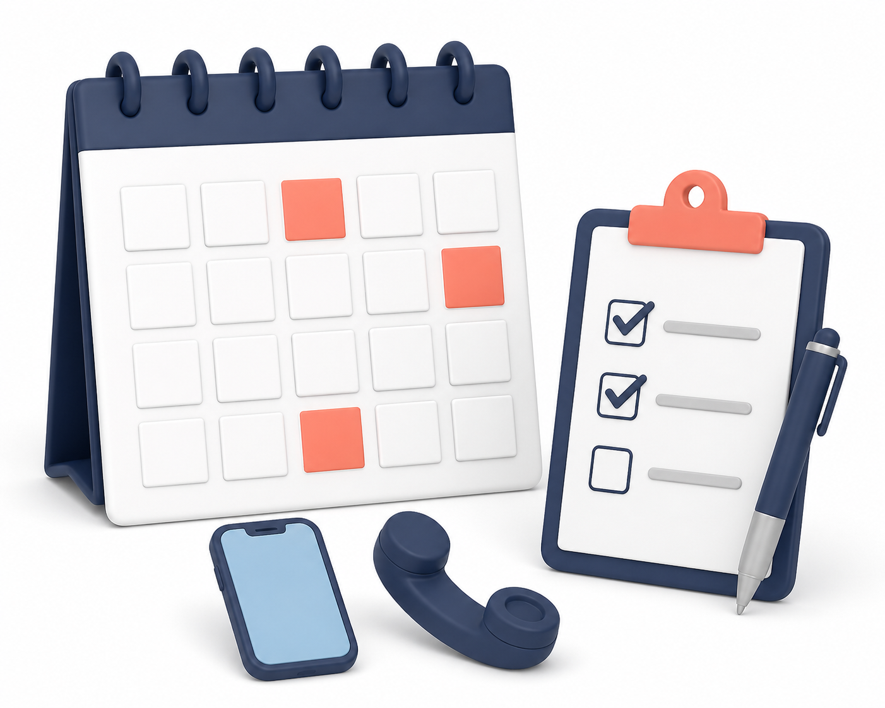

11월 18일 한국은행이 3분기 가계신용 잠정치를 내놓았습니다. 카드 결제로 대표되는 판매신용이 한 분기 만에 5조 원 늘어 증가 폭이 역대 두 번째였습니다. 그런데 같은 분기 민간소비는 0.2% 줄었습니다.

결제는 늘고 소비는 줄었다는 이 어긋남이 이 글의 출발점입니다. 숫자를 우리 매장의 언어로 다시 읽고, 매일 쓰는 블로그에서 무엇을 바꿔야 하는지 정리합니다.

## 2026년 3분기, 숫자 네 개

- **가계신용 잔액 2,030조 5,000억 원.** 석 달 동안 9조 8,000억 원 늘었고, 1년 반 만에 가장 작은 증가 폭입니다.
- **판매신용 133조 7,000억 원.** 3개월 사이 5조 원 늘었습니다. 분기 증가 폭으로는 역대 두 번째입니다.
- **가계대출 4조 7,000억 원 증가.** 판매신용 잔액은 1년 전보다 8.5% 늘었습니다.
- **3분기 민간소비 전 분기 대비 0.2% 감소.** 결제는 늘었는데 소비는 줄었습니다.

빚은 덜 늘었고 카드로 긁은 돈은 크게 늘었으며 소비는 줄었습니다. 세 문장이 서로 맞지 않아 보이는 까닭은 다음 항목에 있습니다.

> 출처: 한국은행 [「2026년 3/4분기 가계신용(잠정)」 보도자료](https://www.bok.or.kr/portal/bbs/B0000501/view.do?nttId=11066748&menuNo=201264)(2026.11.18), [「2026년 3/4분기 실질 국내총생산(속보)」](https://www.bok.or.kr/portal/bbs/B0000170/view.do?nttId=11065963&menuNo=200060)(2026.10.27). 수치는 발표 시점 기준이며 잠정치가 이후 조정될 수 있습니다.

## 늘어난 결제의 정체는 할부와 판촉입니다

한국은행이 든 배경은 세 가지입니다. 일부 기업의 가전 환급 행사, 장기 무이자 할부, 스마트폰 판매 증가입니다. 돈이 동네 전체로 퍼진 것이 아니라 특정 품목에 집중됐다는 뜻입니다.

증가 폭의 변화가 성격을 말해 줍니다. 2분기 1조 1,000억 원이던 판매신용 증가는 3분기에 5조 원이 됐습니다. 소비 심리의 변화라기보다 특정 시점의 행사 효과로 보는 편이 자연스럽습니다.

이 구분 없이 뉴스를 읽으면 내 가게 이야기로 착각하게 됩니다. 카드 결제가 늘었다는 사실은 내 가게 앞을 지나는 사람이 늘었다는 뜻이 아닙니다. "경기가 살아난다는데"와 "우리 동네는 조용하다"가 동시에 사실일 수 있는 이유입니다.

## 결제 통계와 내 가게 매출이 어긋나는 이유

가전과 스마트폰은 계획적으로 큰 금액을 쓰는 소비입니다. 음식점, 미용실, 학원, 카페에서 오가는 돈은 대부분 반복되는 작은 결제입니다. 판매신용 통계는 앞쪽 소비를 크게 반영하고 뒤쪽은 작게 담습니다.

그래서 이번 분기 숫자가 좋아 보인다고 해서 우리 업종이 회복되었다고 읽을 수는 없습니다. 결제가 늘어난 지점과 우리 매출이 만들어지는 지점이 서로 다르기 때문입니다.

## 매일 쓰는 글에서 비어 있는 세 칸

글을 꾸준히 올리는 일 자체가 어렵습니다. 그런데 그 노력이 매출로 이어지지 않는다면, 원인은 대개 태도가 아니라 글의 설계에 있습니다.

### 검색 조건이 빠져 있습니다

오늘 손님이 몇 명 왔는지, 날씨가 어땠는지는 단골에게는 반가운 소식입니다. 검색하는 사람에게는 쓸모가 없습니다. 검색자는 주차가 되는지, 예약을 받는지, 얼마인지, 몇 시까지 하는지를 조건으로 넣습니다. 그 조건이 글에 없으면 읽힐 기회 자체가 생기지 않습니다.

### 결정 직전의 정보가 없습니다

홈판에서 우연히 본 사람은 감상하고 지나갑니다. 내일 예약할 곳을 정하는 사람은 비교하고 결정합니다. 뒤쪽 사람에게 필요한 값을 주지 않으면 아무 일도 일어나지 않습니다. 홈판 글도 제목과 첫 문단에 조건을 넣으면 검색까지 함께 노릴 수 있습니다.

### 마지막에 남기는 행동이 없습니다

글의 끝이 비어 있으면 읽고 지나갑니다. 전화를 걸게 할지, 예약 링크를 누르게 할지, 저장하게 할지 하나만 정해 두세요. 정하지 않으면 독자도 정하지 않습니다.

근황 글을 쓰지 말라는 뜻은 아닙니다. 단골에게는 반가운 소식입니다. 다만 신규 손님을 만드는 글과 단골을 붙잡는 글은 목적이 다르니 한 편에서 둘을 동시에 기대하지 마세요.

## 이번 주에 바꿀 네 가지

1. **글마다 행동을 하나 정합니다.** 글을 쓰기 전에 '이 글을 본 사람이 다음에 할 일'을 한 문장으로 적으세요. 예약, 전화, 저장 가운데 하나입니다. 정해지면 마지막 문장은 저절로 따라옵니다.
2. **소재를 시즌으로 옮깁니다.** 11월 19일 수능이 끝나면 이번 주말부터 연말까지가 모임과 예약의 구간입니다. 연말 촬영과 미용 예약, 가족 식사, 송년 모임, 단체 예약, 선물처럼 날짜가 정해진 수요는 검색 시점도 분명합니다.
3. **마감 시점을 정합니다.** 연말 키워드는 12월 중순을 넘기면 효율이 급격히 떨어집니다. 예약 글은 11월 넷째 주까지, 잔여 일정과 마감 안내는 12월 첫째 주에 올리는 식으로 순서를 나눕니다.
4. **글마다 확인할 숫자를 하나 붙입니다.** 조회수는 그대로 두고 저장, 길찾기, 전화 클릭을 같이 봅니다. 이 셋이 움직이면 글이 일한 것이고, 조회수만 올라가면 읽히기만 한 것입니다.

## 연말 글은 순서가 절반입니다

연말 글은 많이 쓰는 것보다 시점이 중요합니다. 같은 내용이라도 늦게 올리면 팔리지 않습니다.

- 11월 넷째 주: 송년 모임·단체 예약·연말 운영 시간을 정리한 예약 글
- 12월 첫째 주: 예약 마감일과 잔여 일정, 포장·배송 마감 안내
- 12월 둘째 주: 연휴 운영 공지와 재방문 안내

이 순서를 지키면 12월에 같은 설명을 반복하지 않아도 됩니다. 헛걸음을 줄이고 재방문을 만드는 것도 이 공지에서 출발합니다.

## 노티스랩이 홈판에서 보는 것

홈판에서 클릭을 받는 일과 손님이 문을 여는 일은 별개입니다. 클릭 다음에 저장, 그다음에 길찾기, 마지막에 예약과 방문이 이어집니다. 중간이 비어 있으면 클릭이 많아도 매출로 이어지지 않습니다.

노티스랩이 먼저 보는 것은 이 흐름에서 비어 있는 칸입니다. 제작은 업체가 보유한 사진과 영상으로 하고, 현장 촬영은 기본 서비스에 두지 않습니다. 매일 쓸 재료가 없어 발행을 못 하는 상황을 먼저 없애는 방식입니다.

같은 관점은 지역 글에도 적용됩니다. 생활권 단위로 검색과 방문을 나누는 방법은 [용인 블로그 마케팅, 생활권별 키워드 설계](/insights/yongin-blog-marketing-living-areas/)에, 보고서에서 무엇을 확인할지는 [블로그 조회수는 오르는데 문의가 없을 때](/insights/blog-traffic-without-inquiries/)에 정리해 두었습니다.

## 읽을 때 조심할 점

- 결제 통계를 업종 회복 신호로 읽지 마세요. 이번 증가는 가전·스마트폰과 할부 판촉이 만든 숫자입니다.
- 수능 이후 수요는 업종별로 갈립니다. 학원·식당·술집·여행·미용은 바로 반응하지만 무관한 업종도 많습니다. 어느 쪽인지부터 확인하셔야 합니다.
- 매일 쓰는 습관은 유지하세요. 바꿀 것은 횟수가 아니라 글마다 남기는 행동입니다.
- 응대가 끊기면 글도 멈춥니다. 영업 중 전화를 받기 어려운 업종은 글 마지막에 예약 링크나 메시지 채널을 두세요.
- 수치는 2026년 11월 18일 한국은행 발표 기준입니다. 다음 분기 발표가 나오면 같은 방식으로 다시 읽어 보시면 뉴스와 자기 매장을 구분하는 기준이 조금씩 선명해집니다.

## 자주 묻는 질문

### 매일 쓰지 못하면 효과가 없나요?

꼭 그렇지는 않습니다. 중요한 것은 빈도가 아니라 한 편에 담기는 조건과 행동입니다. 다만 예약이 몰리는 시즌에는 노출 기회를 늘릴 필요가 있어 그 구간만 횟수를 올리시길 권합니다.

### 홈판에서만 노출되는 글도 검색에 도움이 되나요?

도움이 됩니다. 단, 홈판에서만 보이는 글은 제목과 도입부에 검색 조건을 넣어야 검색으로 이어집니다. 시의성은 클릭을, 조건은 검색을 만듭니다.

### 연말 준비는 어디서부터 시작하면 되나요?

날짜가 정해진 것부터입니다. 연말 운영 시간표를 확정하고, 단체·송년 예약의 마감일을 정하고, 선물 포장 가능 여부를 안내하세요. 11월 안에 이 셋을 정리하면 12월 응대가 훨씬 짧아집니다.

## 마무리: 지난달 글 중 몇 편이 문의로 이어졌습니까

매일 쓰는데 손님이 늘지 않는다면, 이번 달에는 편수 대신 지난달에 올린 글 가운데 예약이나 전화로 이어진 편이 몇 개였는지 세어 보세요. 그 숫자가 다음 달 계획의 출발점이 됩니다.

12월 첫째 주에는 운영 일정을 공지하세요. 쉬는 날과 예약 마감일, 두 줄이면 충분합니다. 이 공지가 헛걸음을 줄이고 재방문을 만듭니다.

가게 업종과 운영 중인 블로그를 알려주시면 이번 연말에 어떤 글부터 올려야 하는지 순서를 정리해 드립니다. [네이버 톡톡으로 상담하기](https://talk.naver.com/ct/w5z4wz?frm=mblog#nafullscreen)
