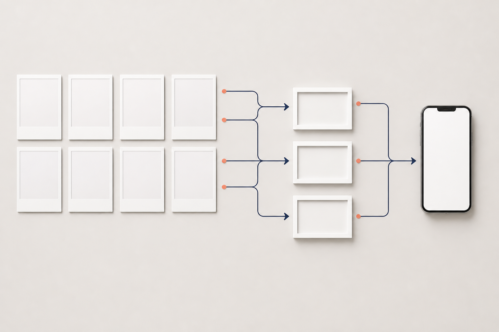

결론부터 적으면 만들 수 있습니다. 다만 10장이 어떤 장면을 담고 있느냐에 따라 결과가 갈립니다. 음식 클로즈업 열 장으로는 글 세 편은 되지만 릴스는 약해지고, 외관과 내부, 음식, 사람이 섞여 있으면 글과 영상을 함께 만들 수 있습니다.

노티스랩은 업체가 제공한 기존 사진과 영상을 바탕으로 기획하고 제작합니다. 별도 현장 촬영은 기본 서비스에 포함하지 않습니다. 그래서 첫 상담에서 가장 먼저 하는 일이 보유 사진을 세는 것이 아니라, 어떤 장면이 있는지 확인하는 것입니다.

## 10장이면 되는 경우와 안 되는 경우

사진의 수보다 구성이 중요합니다. 아래 항목이 골고루 있으면 10장으로도 첫 회차를 만들 수 있습니다.

- **찾아가는 장면.** 외관, 간판, 입구, 주차 안내. 처음 오는 손님이 헤매지 않게 하는 컷입니다.
- **들어서는 장면.** 내부 전경, 좌석이나 진열, 조명이 보이는 사진.
- **대표 상품.** 메뉴나 상품을 정면에서 찍은 컷. 가격표가 함께 보이면 더 좋습니다.
- **만드는 장면.** 조리, 작업, 포장 과정. 손이 나오는 사진이 있으면 영상에서 힘이 생깁니다.
- **사람.** 사장님, 직원, 손님이 이용하는 모습. 얼굴 사용 동의가 확인된 사진만 씁니다.
- **디테일.** 식재료, 소품, 재료 이름표처럼 가까이 찍은 컷.

반대로 열 장이 모두 음식 접시 클로즈업이라면, 글은 쓸 수 있어도 영상은 비슷한 컷이 반복되어 지루해집니다. 이때는 매장 외관 한 장, 내부 한 장만 추가로 받아도 결과가 달라집니다. 촬영이 필요하다고 판단되면 기본 서비스가 아니므로 비용과 일정을 따로 협의합니다.

## 받은 사진을 먼저 분류합니다

바로 편집에 들어가지 않습니다. 사진을 세 칸으로 나누는 작업이 먼저입니다.

1. **그대로 쓸 수 있는 사진.** 초점이 맞고 밝기가 무난하며, 최근 모습입니다.
2. **손보면 쓸 수 있는 사진.** 기울어졌거나 어둡지만 구도가 살아 있는 경우. 잘라내기와 밝기 보정으로 살립니다.
3. **쓰지 않을 사진.** 흔들렸거나 해상도가 낮은 사진, 다른 업체 로고나 상표가 크게 보이는 사진, 이미지 출처를 확인할 수 없는 사진입니다.

이 단계에서 함께 확인하는 것이 개인정보입니다. 손님 얼굴, 차량 번호판, 예약 명단, 직원 연락처가 찍혀 있으면 가리거나 제외합니다. 다른 곳에서 가져온 사진은 사용 권한을 확인하기 전에는 넣지 않습니다.

## 사진 10장을 글 세 편으로 나눕니다

같은 사진을 세 편에 반복해서 쓰면 글이 아니라 사진첩이 됩니다. 열 장을 역할별로 배분하는 편이 낫습니다.

- **첫째 글 — 정보형.** 외관, 내부, 대표 상품 두세 장. 영업시간, 주차, 위치, 예약 방법처럼 처음 찾는 사람에게 필요한 값을 담습니다.
- **둘째 글 — 비교형.** 대표 상품과 디테일 컷. 무엇이 다른지, 어떤 상황에 맞는지를 설명합니다. 가격대와 인원, 소요 시간이 들어가면 비교가 끝납니다.
- **셋째 글 — 상황형.** 사람과 만드는 장면. 누구와 와서 무엇을 하는 곳인지, 단체석이나 아이 동반처럼 조건이 붙는 상황을 다룹니다.

이렇게 나누면 한 번 받은 사진으로 한 달치 글의 뼈대가 생깁니다. 사진이 부족한 글은 컷 수를 줄이고 설명을 늘리는 편이, 없는 사진을 다른 사진으로 채우는 것보다 낫습니다.

## 릴스 한 편으로 묶는 법

릴스는 길게 만드는 것보다 순서가 중요합니다. 노티스랩이 기본으로 잡는 구성은 20초 안팎입니다.

### 첫 3초에 무엇을 보여줄지 정합니다

사진으로 만드는 영상은 첫 장면에서 대부분의 이탈이 생깁니다. 완성된 음식보다 만드는 과정, 정면보다 살짝 당겨 찍은 디테일이 첫 컷으로 낫습니다. 첫 화면에 매장 이름과 한 줄 설명을 얹으면 무슨 영상인지 바로 전달됩니다.

### 컷은 1.5초에서 2.5초로 끊습니다

열 장을 모두 쓰면 컷이 너무 짧아 정신이 없고, 다섯 장만 쓰면 화면이 오래 멈춰 지루합니다. 8~12컷을 기준으로 하고, 한 컷은 1.5초에서 2.5초 사이에 둡니다. 사진은 그대로 두지 않고 천천히 확대하거나 옆으로 밀어 움직임을 만듭니다.

### 자막은 문장이 아니라 단어로 씁니다

소리 없이 보는 사람이 많기 때문에 자막이 사실상 본문입니다. 한 줄에 12자에서 15자, 한 화면에 두 줄을 넘기지 않습니다. "저희는 매일 아침 반죽을 시작합니다"보다 "매일 아침 6시, 반죽 시작"이 읽힙니다. 가격과 영업시간은 촬영 시점의 값이므로, 넣기 전에 현재 값과 맞는지 한 번 더 확인합니다.

### 세로 화면에서 잘리는 부분을 먼저 봅니다

가로로 찍은 사진을 세로 영상에 넣으면 위아래가 아니라 좌우가 잘립니다. 인물이나 간판이 잘리는 사진은 그대로 쓰지 말고, 여백을 살려 다시 배치하거나 다른 컷으로 바꿉니다. 이 작업을 편집 마지막에 하면 처음부터 다시 해야 합니다.

## 편집에서 정하는 세부

편집은 예쁘게 만드는 일이 아니라, 보는 사람이 멈추지 않게 만드는 일입니다. 노티스랩이 편집 단계에서 기준으로 삼는 것은 네 가지입니다.

- **자막이 가려지지 않는 위치.** 화면 아래쪽은 채널 인터페이스에 가립니다. 자막은 조금 위로 올리고, 안전한 영역 안에 둡니다.
- **한 가지 색과 한 가지 글자체.** 매장의 대표 색 하나와 읽기 쉬운 글자체 하나만 씁니다. 화면마다 색이 바뀌면 브랜드가 아니라 편집이 먼저 보입니다.
- **로고는 작게, 한 번만.** 처음이나 마지막 중 한 곳에 둡니다. 모든 컷에 로고를 넣으면 사진이 가려집니다.
- **마지막 화면에 행동 하나.** 예약, 전화, 저장 중 하나만 남깁니다. 두 개를 나란히 놓으면 아무것도 눌리지 않습니다.

배경음악은 채널이 제공하는 음원 안에서 고르는 편이 안전합니다. 음원 사용 권한이 확인되지 않은 음악은 나중에 영상이 내려갈 수 있습니다.

## 작업 순서와 사장님이 정할 것

실제 작업은 자료 수집, 분류와 보정, 기획안, 원고 작성, 컷 구성, 자막과 편집, 검수, 납품 순서로 진행됩니다. 이 가운데 사장님이 정해야 하는 것은 세 가지입니다.

1. **이번 달에 알리고 싶은 한 가지.** 신메뉴인지, 예약 가능 시간인지, 주차 안내인지 하나로 정합니다. 세 개를 한 편에 담으면 아무것도 남지 않습니다.
2. **글과 영상의 마지막 행동.** 예약, 전화, 저장, 길찾기 가운데 하나만 고릅니다.
3. **가격과 운영 정보의 최신 값.** 편집 단계에서 바뀌면 다시 만들어야 하므로, 자료를 넘길 때 확정된 값으로 주시는 편이 빠릅니다.

## 이 방식의 한계

- **없는 장면은 만들 수 없습니다.** 신메뉴, 바뀐 인테리어, 계절 풍경은 자료가 없으면 반영되지 않습니다.
- **해상도가 낮으면 확대할수록 손실이 보입니다.** 원본 파일이 작은 사진은 큰 화면에서 흐려집니다.
- **사진이 오래되면 계절과 가격이 어긋납니다.** 특히 연말·명절 시즌 글은 최근 사진인지 확인해야 합니다.
- **얼굴과 간판 사용에는 동의가 필요합니다.** 손님 사진은 초상권 문제가 생길 수 있어 확인된 것만 씁니다.
- **릴스는 한 편이 기본입니다.** 열 장을 재구성해 두 편을 만들 수는 있지만, 컷이 반복되어 반응이 떨어집니다.

## 자주 묻는 질문

### 사진이 10장보다 적으면 어떻게 하나요?

장수가 적어도 역할이 겹치지 않으면 시작할 수 있습니다. 외관, 내부, 대표 상품, 사람이 각각 한 장씩 있으면 첫 회차는 가능합니다. 다만 글 세 편과 릴스를 동시에 만들면 컷이 반복되므로, 첫 달은 글 두 편에 집중하고 사진이 쌓이면 늘리는 편이 낫습니다.

### 스마트폰으로 찍은 사진도 괜찮나요?

충분합니다. 밝은 곳에서 흔들리지 않게 찍은 원본이면 됩니다. 다만 메신저로 주고받으며 압축된 파일은 해상도가 줄어들기 때문에, 가능하면 원본 파일이나 클라우드 링크로 받습니다. 화면 캡처본은 확대했을 때 손실이 커서 권하지 않습니다.

### 릴스는 몇 편까지 나오나요?

열 장 기준으로 한 편이 기본입니다. 같은 사진을 다른 순서와 다른 자막으로 재구성하면 두 편까지 만들 수 있지만, 두 편을 연달아 올리면 같은 영상처럼 보입니다. 다음 편은 새 사진이 들어왔을 때 만드는 편이 좋습니다.

## 마무리: 사진을 세는 대신 역할을 세어 보세요

보유 사진을 정리할 때는 장수보다 역할을 세어 보시면 됩니다. 찾아가는 장면, 들어서는 장면, 대표 상품, 만드는 장면, 사람, 디테일. 이 여섯 칸이 채워지면 글과 영상이 함께 나옵니다.

지금 가지고 계신 사진 목록이나 폴더를 보내주시면, 어떤 사진으로 글 몇 편과 릴스 몇 편이 가능한지, 추가로 필요한 컷이 무엇인지 정리해 드립니다.
