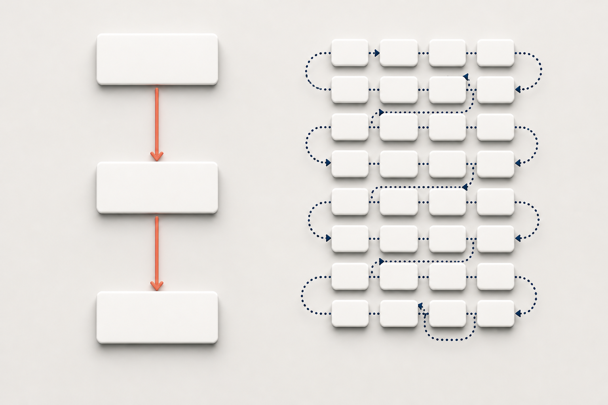

노티스랩 사무실은 처인구 포곡읍에 있습니다. 같은 용인에서도 수지구 매장을 상담할 때와 포곡읍 매장을 상담할 때 준비하는 질문이 다릅니다. 지역 이름이 같아도 손님이 집을 나서는 이유와 검색하는 시점이 다르기 때문입니다.

이 글은 두 상권을 나란히 놓고, 왜 같은 제목과 같은 사진, 같은 발행 시간으로는 양쪽 모두에서 힘을 잃는지 정리했습니다. 특정 업종의 사례가 아니라 상권의 구조를 비교하는 글입니다.

## 포곡: 목적이 있어야 움직이는 상권

포곡읍은 차로 오는 손님이 중심입니다. 주거지가 넓게 퍼져 있고, 큰 도로를 따라 이동하는 거리가 깁니다. 에버랜드를 비롯한 테마 시설과 체험·레저 시설이 있어 주말에는 목적을 가진 방문이 몰리고, 평일에는 그 흐름이 크게 줄어듭니다.

이 상권에서 손님이 검색하는 시점은 집을 나서기 전입니다. 오늘 갈 수 있는지, 몇 시까지 하는지, 차를 어디에 세우는지, 아이와 함께 가도 되는지, 예약을 받는지. 검색어에는 목적과 조건이 함께 붙습니다.

- 주차가 되는지, 주차장이 넓은지
- 영업시간과 휴무일, 라스트오더
- 예약이나 대기 방식
- 아이·반려동물 동반 가능 여부
- 코스나 체험의 소요 시간

그래서 포곡 매장의 글은 **가기 전에 확인하는 정보**가 본문에 있어야 합니다. 사진이 좋아도 주차 안내가 없으면 검색자는 뒤로 가기를 누릅니다. 평일과 주말의 운영이 다르다면 그 차이를 따로 적는 편이 좋습니다.

## 수지: 매일 지나가는 상권

수지구는 반대입니다. 아파트 단지가 밀집해 있고, 죽전역과 수지구청·성복·동천·상현 일대의 역을 중심으로 도보와 대중교통 이동이 많습니다. 차 없이도 생활이 되는 구조라, 손님은 집에서 가까운 곳을 반복해서 찾습니다.

이 상권의 검색은 결정 직전에 일어납니다. 지금 문을 열었는지, 대기하지 않고 들어갈 수 있는지, 포장이 되는지, 오늘 저녁에 배달이 되는지. 같은 손님이 한 달에 여러 번 검색하고 여러 번 방문합니다.

- 지금 영업 중인지, 브레이크 타임은 언제인지
- 포장과 배달 가능 여부, 최소 주문 금액
- 대기 시간과 예약 방식
- 단골 혜택이나 재방문 쿠폰
- 아이와 유모차가 들어갈 수 있는지

수지 매장의 글은 **오늘 갈 수 있는 이유**를 만들어야 합니다. 먼 곳에서 일부러 오게 하는 설명보다, 지금 이 시간에 맞는 정보가 반응을 만듭니다. 영업시간과 가격이 플레이스와 어긋나면 반복 손님이 가장 먼저 이탈합니다.

## 검색어가 갈리는 지점

두 상권의 키워드는 층이 다릅니다. 아래는 설명을 위한 예시이며, 실제 검색량은 업종과 시기에 따라 달라집니다.

- **포곡·처인 쪽 예시.** 포곡 카페 주차, 처인구 아이랑 갈 만한 곳, 에버랜드 근처 점심, 포곡 체험 예약
- **수지 쪽 예시.** 죽전역 점심, 수지구청역 커피, 성복역 미용실 예약, 수지 포장 되는 곳

포곡 쪽은 목적지나 시설을 기준점으로 삼고, 그 주변에서 조건을 붙입니다. 수지 쪽은 역과 단지 이름을 기준점으로 삼고, 지금 이용할 수 있는 조건을 붙입니다. 같은 "용인"이라는 단어를 앞에 붙이면 양쪽 모두에서 어중간해집니다.

## 같은 매장이 두 곳에 있다면

지점이 둘이면 글도 둘로 나눠야 합니다. 지역 이름만 갈아 끼운 같은 글을 두 번 올리면 검색에서도 중복으로 평가받기 쉽고, 손님도 차이를 알 수 없습니다. 같은 사진을 두 지점에 함께 쓰는 것도 피하는 편이 좋습니다.

플레이스도 각각 관리해야 합니다. 영업시간, 주차, 휴무일, 가격이 지점마다 다르다면 그 차이가 글과 플레이스에 동시에 반영되어야 합니다. 한쪽 정보를 복사해 다른 쪽에 붙이면 두 곳 모두에서 신뢰를 잃습니다.

## 상권을 판단하는 세 가지 질문

지역 이름만 보고 상권을 정하지 않으려면 세 가지를 물어보면 됩니다.

1. **손님은 무엇을 보고 움직이나요.** 목적지가 이미 정해져 있는지, 집 근처에서 고르는지에 따라 검색 시점이 달라집니다. 목적이 있으면 며칠 전부터, 없으면 당일에 검색합니다.
2. **무엇을 타고 오나요.** 차로 오는 상권은 주차와 진입로가 글에 있어야 하고, 걸어서 오는 상권은 역과 단지에서 오는 길이 있어야 합니다.
3. **한 달에 몇 번 올 수 있나요.** 한 번 오는 손님에게는 방문의 가치를, 여러 번 오는 손님에게는 다시 올 이유를 먼저 보여줘야 합니다.

이 세 답이 포곡과 수지를 갈라놓습니다. 같은 용인이라는 이름은 이 답을 대신하지 못합니다.

## 상권별로 글을 짜는 예시

포곡 매장이라면 이렇게 석 편을 나눌 수 있습니다. 첫째, 오는 길과 주차, 영업시간을 정리한 안내 글. 둘째, 주말에 아이와 함께 할 수 있는 코스를 설명한 글. 셋째, 예약이 필요한 시점과 방법을 다룬 글입니다.

수지 매장이라면 순서가 달라집니다. 첫째, 지금 바로 이용할 수 있는 메뉴와 포장 안내. 둘째, 역에서 걸어오는 길과 대기 시간을 다룬 글. 셋째, 단골이 반복해서 찾는 이유를 정리한 글입니다.

두 상권 모두에서 통하는 것은 하나입니다. 글을 쓰기 전에 손님이 어디서 출발해 무엇을 확인하고 움직이는지 정하는 일입니다. 이 순서는 [용인 블로그 마케팅, 생활권별 키워드 설계](/insights/yongin-blog-marketing-living-areas/)에 다섯 단계로 정리해 두었습니다.

## 이 구분이 통하지 않는 경우

- 상권 단위 자료는 평균입니다. 같은 포곡읍 안에서도 도로변과 안쪽 골목은 방문 방식이 다르고, 같은 수지구에서도 역 앞과 단지 안쪽은 다릅니다.
- 고객이 동네 밖에서 오는 업종은 지역 키워드의 효율이 떨어집니다. B2B 납품, 시공, 시설 임대처럼 거래 범위가 지역과 무관한 경우입니다.
- 테마 시설에 의존하는 상권은 시즌에 따라 검색이 크게 흔들립니다. 방학과 축제가 끝나면 같은 글도 다른 반응을 냅니다.
- 배달 비중이 큰 매장은 노출 반경을 따로 계산해야 합니다. 배달 앱의 범위는 플레이스 검색 범위와 다릅니다.

## 자주 묻는 질문

### 포곡 매장인데 수지 손님도 오게 하려면 어떻게 해야 하나요?

일부러 움직일 이유를 제목에 넣는 것이 먼저입니다. 주차가 넓다, 아이와 함께 갈 수 있다, 주말에 예약이 가능하다처럼 이동의 이유가 되는 조건을 앞세우면 생활권 밖에서도 검색이 생깁니다. 다만 거리가 멀수록 방문 빈도는 낮아지므로, 재방문보다 한 번의 방문 가치를 높이는 구성이 맞습니다.

### 수지에서도 용인 키워드를 써야 하나요?

쓰지 않아도 됩니다. 수지 손님은 보통 역 이름이나 단지 이름으로 검색합니다. '용인'은 지역 전체를 대상으로 하는 업종이나 행정·시설 안내에 가깝습니다. 대신 글 안에 수지구라는 사실을 한 번 밝혀 두면 지역 정보가 정리됩니다.

### 두 지점을 운영하면 블로그를 따로 해야 하나요?

플레이스는 반드시 따로 관리하고, 블로그는 한 채널에 지점별 글로 나누는 방법과 지점별 채널을 두는 방법이 있습니다. 어느 쪽이든 같은 원고를 두 번 올리는 것은 피해야 합니다. 손님이 검색하는 이름이 지점마다 다르기 때문에 제목과 소재도 달라야 합니다.

## 마무리: 같은 용인, 다른 출발점

포곡은 목적과 차량 이동, 수지는 생활권과 도보 이동이 중심입니다. 이 차이를 인정하면 키워드, 글의 순서, 플레이스에 넣을 정보가 자연스럽게 갈립니다. 반대로 같은 전략을 두 번 적용하면 두 상권 어디에서도 선명해지지 않습니다.

매장이 있는 동네와 업종을 알려주시면, 어느 쪽 상권인지에 따라 첫 달에 쓸 키워드와 글의 순서를 정리해 드립니다.
