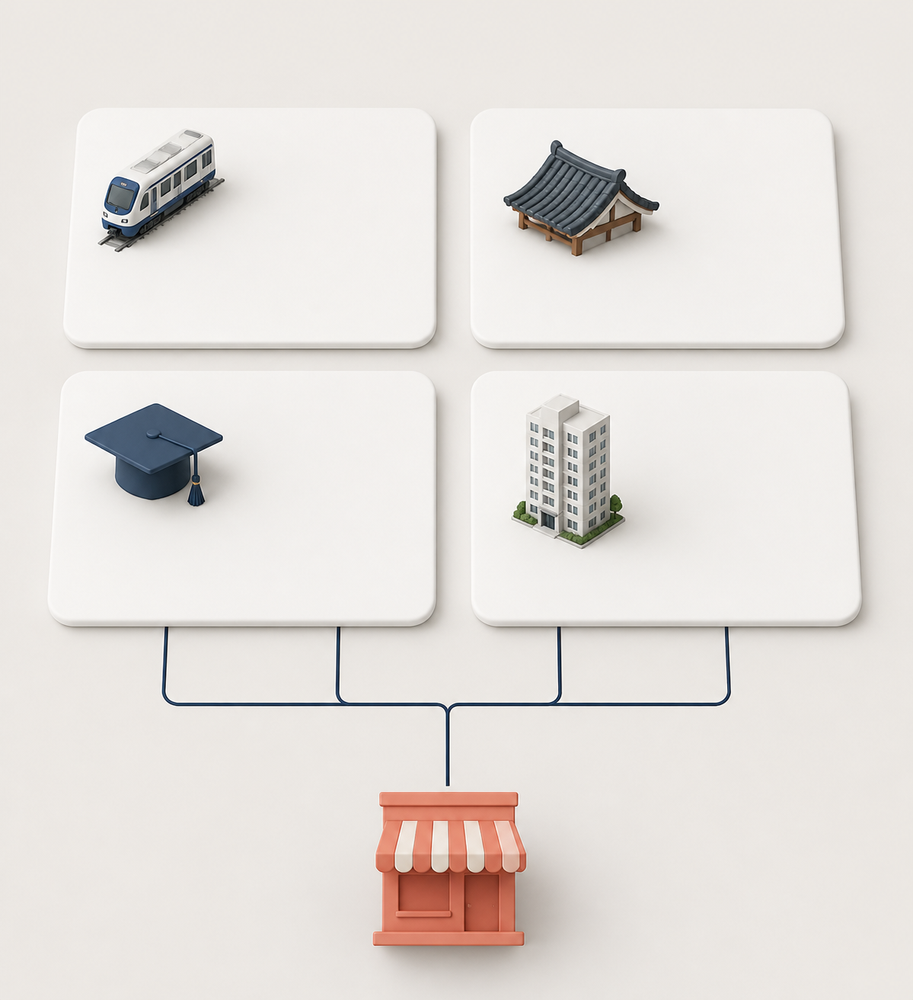

수원에서 매장을 운영하는 분들이 자주 하는 말이 있습니다. "동네에서는 우리 가게를 모르는 사람이 없는데, 수원으로 검색하면 나오지 않는다." 이 말을 들으면 두 가지를 먼저 확인합니다. 손님이 정말 '수원'이라는 큰 단어로 검색하는지, 그리고 그 검색이 우리 동네까지 닿는지입니다.

답은 대체로 두 번째에서 갈립니다. 수원은 118만 명이 사는 한 도시지만, 손님이 움직이는 단위는 시가 아니라 동네와 역, 학교, 단지입니다. 이 글은 수원을 네 개의 이동권으로 나눠 보고, 각 권역에서 어떤 정보가 먼저 보여야 하는지를 정리했습니다.

## 수원의 크기부터 정리합니다

2026년 10월 행정안전부 주민등록 인구통계 기준으로 수원시 인구는 118만 6,417명입니다. 권선구가 36만 3,510명으로 가장 많고, 영통구 36만 418명, 장안구 26만 9,622명, 팔달구 19만 2,867명이 뒤를 잇습니다. 행정동은 44개입니다.

이 도시의 특징은 낮에 사람이 빠져나간다는 점입니다. 수원시정연구원이 통계청 자료를 바탕으로 산출한 2020년 주간인구지수는 91.3으로 100을 넘지 못합니다. 시민 10명 가운데 9명 가까이(88.7%)가 경기도 안에서 일하거나 공부하러 다닌다는 뜻입니다.

이 숫자를 놓고 보면 시 단위 홍보가 왜 어긋나는지 이해가 됩니다. 낮의 수원과 밤의 수원에 있는 사람이 다르고, 평일과 휴일에 사람이 나서는 이유가 다릅니다. 하나의 문장으로 이 모두를 설득하려면 아주 넓고 흐린 말밖에 남지 않습니다.

## 네 개의 이동권, 네 가지 검색

수원시가 사람이 몰리는 곳으로 지목한 네 지점은 인계동 중심상가, 수원역의 로데오거리, 행궁동의 행궁거리, 화서역 쪽 지하보도입니다. 수원시가 이 일대에 인파 밀집 구역용 AI 카메라를 설치한 것도 사람이 몰리는 때를 데이터로 보려는 시도였습니다(2025년 3월 보도자료). 같은 시 안에서도 사람이 모이는 이유가 이렇게 다릅니다.

### 인계동·수원역 — 확인형 검색이 많은 곳

수원시 데이터 포털 기준 2024년 12월 유동인구 1위 행정동은 인계동입니다. 이 일대에서 손님은 대개 갈 곳을 이미 정한 상태입니다. "수원역 맛집"이나 "인계동 술집" 같은 검색은 후보를 추리는 과정이라기보다 영업 여부와 조건을 확인하는 과정에 가깝습니다.

그래서 여기서는 긴 설명보다 플레이스의 첫 화면이 중요합니다. 오늘 문을 몇 시에 닫는지, 단체석이 있는지, 주차는 어떻게 하는지, 1인 예상 금액이 얼마인지가 한눈에 들어와야 합니다.

### 행궁동 — 출발 전에 미리 정하는 곳

행궁동은 반대로 움직입니다. 한국관광데이터랩 자료에서는 2025년 방문객이 1,198만 9,946명, 하루 3만 2천 명 안팎으로 나타났습니다. 경기데이터드림 자료로 공휴일 오후 2시 체류 인원을 보면 1만 735명이고, 평일 같은 시간은 9,231명입니다. 수원시정연구원 조사 결과 방문객 가운데 75.5%가 2시간 넘게 머문다고 답했고, 44%는 승용차로 왔습니다.

체류 시간이 길면 결정도 천천히 이뤄집니다. 이곳 손님은 집을 나서기 전에 사진과 리뷰를 몇 장씩 살피고, 주차가 되는지를 확인합니다. 목적지 이름이 검색어에 함께 붙는 까닭도 여기에 있습니다. 사진 순서와 주차 안내가 방문을 가르는 경우가 흔합니다.

### 대학가 — 학사 일정이 검색을 만든다

장안구의 성균관대 자연과학캠퍼스, 영통구 원천동의 아주대 주변은 학기와 방학이 다른 동네처럼 느껴집니다. 개강, 시험, 축제, 졸업이 검색의 계기가 되고, 같은 가게라도 3월과 8월에 필요한 정보가 달라집니다.

이곳에서 먼저 보이는 것은 값과 시간입니다. 학생은 쓸 수 있는 돈과 시간이 한정되어 있어서, 메뉴 가격과 운영 시간이 흐리면 목록에서 밀립니다. 학기 중에만 적용되는 조건은 적용 기간까지 적어 두는 편이 좋습니다.

### 광교·영통 — 같은 생활 동선을 도는 손님

영통구 광교1동은 2026년 9월 기준 5만 3,856명이 사는 큰 행정동입니다. 이 일대 손님은 집과 직장 사이의 같은 길을 매일 지나갑니다. 검색어도 점심이나 피부과 같은 생활 단어 앞에 동네 이름이 붙은 형태이고, 이동 거리는 짧습니다.

그래서 이 권역의 목표는 첫 방문보다 두 번째 방문입니다. 반복 방문이 매출을 만듭니다. 저장과 리뷰, 예약, 단골 혜택이 쌓이지 않으면 광고를 할 때마다 처음 보는 손님을 새로 사야 합니다.

## 키워드 범위를 낮추는 순서

1. **시 이름을 빼고 동네·역·시설 이름을 넣습니다.** "수원 맛집"은 경쟁이 가장 치열하고, 검색한 사람 가운데 절반은 우리 동네까지 오지 않습니다. "행궁동 데이트 카페", "광교 점심", "수원역 회식"처럼 좁히면 검색자가 원하는 것이 또렷해집니다.
2. **걸어서 오는 범위와 차로 오는 범위를 나눕니다.** 앞에는 도보·역세권 키워드를, 뒤에는 주차와 목적 키워드를 붙입니다. 두 범위를 한 편에서 다루면 양쪽 모두 어중간해집니다.
3. **글과 플레이스의 역할을 나눕니다.** 글은 그 동네에서 이 가게를 고르는 이유를 다루고, 플레이스는 방문 직전에 확인하려는 조건을 채웁니다. 같은 손님이 두 화면에서 다른 정보를 만나면 신뢰가 떨어집니다.

## 유동인구 숫자의 한계

유동인구는 추정치입니다. 특정 시간에 그 지역에 있었을 것으로 계산한 사람 수이고, 하루 동안 스쳐 간 사람을 모두 합한 값도 아닙니다. 관광 데이터의 방문객 수도 같은 사람이 여러 번 잡힐 수 있습니다.

그래서 이 수치는 "어느 쪽이 더 붐비는가"를 가늠하는 데 쓰고, 매출 예상으로 환산해 읽는 것은 피하세요. 업종과 객단가가 다르면 같은 사람 수가 만드는 매출도 달라집니다.

자리를 옮길지 결정하는 일은 마케팅의 몫이 아닙니다. 임대 조건과 시설 투자가 함께 얽혀 있으므로, 이 글의 자료는 이사 판단보다 현재 자리에서 바꿀 것을 고르는 데 쓰는 편이 맞습니다.

## 노티스랩이 상담에서 확인하는 것

상담이 시작되면 매출부터 묻지 않습니다. 최근 문의가 어느 동네에서 왔는지, 검색과 지도 중 어느 쪽으로 들어왔는지, 플레이스에서 손님이 전화를 거는지, 길찾기를 누르는지도 확인합니다. 이 세 가지가 정리되면 키워드와 글의 순서는 자연스럽게 따라옵니다.

자료는 업체가 보유한 사진과 영상에서 출발합니다. 촬영은 기본 제공 범위가 아니고, 필요하면 일정과 비용을 따로 정합니다. 촬영 날짜 때문에 발행이 밀리지 않는 것도 이 방식이 가진 이점입니다.

수원에서는 이 확인이 특히 중요합니다. 같은 시 안에서 전략을 네 번 복사하면 비용만 네 배가 되고 효과는 한 곳에 남기 어렵습니다.

## 자주 묻는 질문

### 수원이 들어간 키워드는 모두 버려야 하나요?

버릴 필요는 없습니다. 시 이름이 들어간 키워드는 브랜드 소개나 지역 전체를 상대로 하는 업종에 어울립니다. 개별 매장의 문의를 늘리는 글이라면 동네 단위가 더 효율적이고, 두 층을 한 글에 섞으면 어느 쪽도 또렷해지지 않습니다.

### 동네 이름을 몇 개까지 넣어야 하나요?

걸어서 갈 수 있는 범위부터 정하고, 다음으로 차로 10분 거리를 정하세요. 앞에는 도보 키워드를, 뒤에는 주차와 목적 키워드를 붙입니다. 행정동 이름이 낯선 손님을 위해 역 이름이나 큰 시설 이름을 함께 쓰면 도달 범위가 넓어집니다.

### 플레이스만으로 충분한가요?

플레이스는 이미 우리 가게를 아는 사람에게 힘을 발휘합니다. 낯선 손님을 설득하는 일은 글의 몫입니다. 예약 비중이 높은 업종일수록 두 역할이 분명하게 나뉩니다.

### 동네별 매출 순위는 없나요?

업종별 매출 순위나 업체별 점유율은 공개된 자료가 없습니다. 근거 없는 수치를 쓰면 다음 판단도 흔들리므로, 이 글은 출처가 확인되는 인구·유동인구·방문객 자료만 사용했습니다.

## 마지막으로

수원에서 마케팅이 어긋나는 까닭은 대개 키워드가 아니라 범위입니다. 시 전체를 향해 말하면서 동네 손님을 기다리면, 검색은 생겨도 방문으로 이어지지 않습니다.

문의 응대 기록에서 두 가지만 뽑아 적어 보세요. 손님이 어느 동네에서 왔는지, 그때 어떤 검색어로 들어왔는지입니다. 이 두 줄이 있으면 다음 글의 주제와 담을 정보가 거의 정해집니다.
