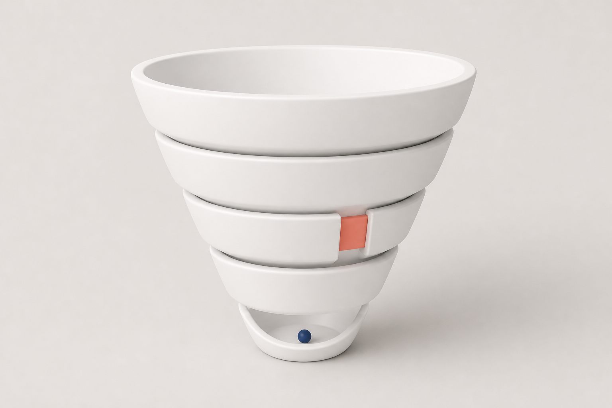

플레이스 통계에서 조회가 늘었는데 예약과 전화가 그대로라면, 손님은 우리 매장에 관심을 가지고 들어온 것입니다. 문제는 그다음 화면에서 생깁니다. 조회는 관심의 크기를 보여주지만, 방문으로 바뀌는지는 페이지 안의 정보가 결정합니다.

아래는 손님이 멈추는 지점을 다섯 단계로 나눈 점검 순서입니다. 플레이스 기능과 요금은 2026년 11월 네이버가 안내한 내용을 기준으로 했습니다. 업종별 전환율처럼 확인되지 않은 수치는 쓰지 않았습니다.

## 점검 순서 한눈에 보기

1. 검색 결과에서 우리 매장이 눌리는가
2. 상세 화면에서 필요한 조건이 보이는가
3. 손댈 수 있는 버튼이 충분한가
4. 문의에 답이 돌아가는가
5. 방문한 손님이 다시 오는가

이 순서를 바꾸면 안 됩니다. 뒤 단계의 문제를 앞에서 고치면 시간만 쓰고 결과는 그대로입니다.

## 1단계 — 목록에서 선택되는가

목록 화면에서 손님의 눈에 들어오는 것은 네 가지입니다. 대표 사진과 상호, 평점과 리뷰 수, 거리. 여기서 밀리면 상세 페이지는 열리지도 않습니다. 사진이 어둡거나, 상호만으로 업종을 알 수 없거나, 마지막 리뷰가 몇 달 전에 끊겼다면 손은 옆 항목으로 갑니다.

비교할 값은 노출과 조회의 비율입니다. 노출은 그대로인데 조회가 줄었다면 고칠 곳은 상세 페이지가 아니라 목록입니다.

## 2단계 — 상세 화면에서 결정이 미뤄지는가

페이지에 들어온 손님이 찾는 것은 분위기 사진보다 조건입니다. 영업시간, 예상 비용, 주차, 예약 가능 여부. 이 네 가지가 없으면 사진이 아무리 좋아도 결정은 뒤로 밀립니다.

특히 가격을 숨긴 페이지는 손님을 다시 검색으로 내보냅니다. 그 검색에서 경쟁 매장을 만나게 됩니다. 정확한 금액이 어렵다면 구간이라도 보여 주세요.

## 3단계 — 버튼이 충분한가

플레이스에서 손님이 할 수 있는 행동은 정해져 있습니다. 전화 걸기, 길찾기, 저장. 연결한 경우에는 예약과 톡톡이 더해집니다. 이 중 하나만 열어 두면, 그 하나를 쓰기 어려운 손님은 아무것도 하지 않고 나갑니다.

- 전화만 있을 때: 통화가 어려운 시간대에 방문을 검토하던 손님이 이탈합니다.
- 예약만 있을 때: 단체 문의나 특수 요청이 들어올 통로가 없습니다.

업종에 따라 우선순위는 다르지만, 두 개 이상은 열어 두는 편이 안전합니다.

예약 버튼을 붙이려면 단계가 있습니다. 먼저 스마트플레이스에서 서비스를 개설하고, 상품을 등록한 다음, 검수를 신청합니다. 검수 기간은 신청일을 빼고 2~3영업일입니다. 검수가 끝나면 예약받기를 켠 뒤 플레이스에 연결한 다음에야 버튼이 생깁니다. 연결 후 노출까지 최대 3시간이 걸린다는 값은 네이버 도움말이 아니라 업계 자료에서 나온 것이니 일정에 여유를 두세요. 예약받기만 켜 둔 상태에서는 예약 페이지는 열려도 버튼은 생기지 않습니다.

또 한 업체에서 버튼은 하나만 붙일 수 있습니다. 예약과 주문 가운데 무엇을 먼저 걸지 정해 두어야 합니다.

## 4단계 — 답이 돌아가는가

전화가 새는 자리입니다. 스마트콜 통화 통계를 보면 전체 통화 수와 매장 연결, 평균 통화시간, ARS 응대, 부재중·통화 중 같은 실패 사유, 10초 넘게 이어진 통화가 확인됩니다. 이 값을 보면 "문의가 없다"는 판단이, 받지 못한 전화가 있다는 쪽으로 바뀝니다.

톡톡은 신청과 해지가 즉시 반영됩니다. 응대할 사람 없이 켜면 문의만 남고 답은 밀립니다. 답이 느린 채널은 차라리 없느니만 못합니다.

## 5단계 — 다시 오는가

예약과 방문까지 끝났는데 그 뒤가 없으면 새 손님을 계속 사들여야 합니다. 확정 안내, 방문 뒤 리뷰를 부탁하는 안내, 다음 방문에 쓸 혜택 안내가 이 단계에서 빠져 있는 경우가 많습니다. 여기까지 갖추면 한 번의 조회가 여러 번의 방문으로 이어집니다.

## 통계로 원인 좁히기

통계 화면은 최근 1년을 기준으로 유입량, 성별과 연령, 시간대와 요일별 조회, 유입 경로와 검색어를 나눠 보여줍니다. 네 가지를 겹쳐 보면 원인이 거의 좁혀집니다.

- 검색어에 상호가 많다 → 이미 아는 사람이 정보를 확인하는 단계입니다. 새 손님은 동네·업종 검색어에서 옵니다.
- 특정 시간대에 조회가 몰린다 → 그 시간에 전화를 받을 수 있는지 봅니다.
- 유입 경로가 지도에 몰린다 → 대표 사진과 평점의 무게가 커집니다.
- 조회만 늘고 나머지 행동이 그대로 → 2단계와 3단계를 고칩니다.

기록은 주 1회 같은 요일에 남기세요. 하루 단위로 보면 요일과 날씨에 따라 값이 출렁여서, 그 출렁임에 맞춰 설정을 계속 고치게 됩니다.

## 결제와 수수료 구조

예약 기능만 쓰는 경우 이용료는 받지 않습니다. 요금은 Npay 결제가 발생할 때 붙습니다. 예약 상품 기준 수수료율은 등급별로 1.80%(영세, 연 매출 3억 원 이하), 2.35%(중소1, 5억 원 이하), 2.50%(중소2, 10억 원 이하), 2.75%(중소3, 30억 원 이하), 2.90%(일반, 30억 원 초과)이고 부가세는 별도입니다(2026년 11월 현재 공식 안내). 카드사 수수료는 따로 붙지 않습니다.

그래서 실제 선택은 예약 기능을 켜느냐가 아니라 예약금이나 선결제를 받느냐입니다. 노쇼가 잦다면 예약금이 도움이 됩니다. 현장 결제가 일반적이라면 예약만 사용해 수수료 부담을 0원으로 둘 수 있습니다.

## 통계 밖의 문의, 쓸 수 없는 기능

휴대폰에 저장된 번호로 직접 걸려온 통화는 스마트콜 통계에 남지 않습니다. 인스타그램처럼 앱 안에서 링크를 눌렀다가 중간에 닫으면 조회에 잡히지 않을 수 있습니다. 통계가 실제 문의보다 작게 보이는 이유입니다.

예약 버튼을 쓸 수 없는 업종도 있습니다. 호텔·모텔·콘도·리조트와 공연·전시·행사·축제 업종은 예약 버튼을 플레이스에 띄울 수 없습니다. 도입 전에 확인해야 합니다.

## 노티스랩이 보는 세 가지

상담이 들어오면 유입 검색어, 조회 다음에 누른 것, 그 뒤 응답 여부를 먼저 봅니다. 세 가지가 확인되면 손볼 곳은 한두 개로 줄어듭니다.

플레이스 설정을 대행하더라도 소유 권한은 사장님 계정에 남깁니다. 노티스랩은 초대받은 관리자로만 참여합니다. 계약이 끝나도 누적된 통계와 자료가 그대로 남도록 하기 위해서입니다. 버튼을 붙이는 데는 30분이면 충분하지만, 무엇을 먼저 붙일지 결정하는 데 시간이 더 걸립니다. 제작은 보유한 사진과 영상으로 진행하고, 촬영은 별도 협의 사항입니다.

버튼을 달면 예약이 늘어난다는 자료는 근거가 되지 않습니다. 네이버 안내문도 설정 절차를 설명할 뿐, 예약이 몇 건 늘어난다는 약속은 하지 않습니다.

## 자주 묻는 질문

### 조회는 느는데 예약이 없습니다. 어디부터 보나요?

두 개 이상의 버튼이 열려 있는지, 상세 화면에 가격·영업시간·주차가 있는지 순서대로 확인하세요. 이 두 가지가 갖춰지지 않으면 사진 교체만으로는 예약이 늘기 어렵습니다.

### 예약과 톡톡, 어느 쪽을 먼저 켜나요?

시간과 날짜를 정해 파는 곳은 예약이, 상담이 긴 곳은 톡톡이 어울립니다. 둘 다 켜려면 누가 언제 응대할지부터 정하세요. 응대 계획 없는 채널은 문의만 쌓입니다.

### 전화를 놓치는 시간대가 많습니다.

부재중이 많은 시간대를 스마트콜 통계에서 찾아, 그 시간만 톡톡이나 예약 안내로 대신하는 방법이 있습니다. 24시간 응대를 약속하기보다 받을 수 있는 시간을 분명히 밝히는 편이 낫습니다.

### 예약 수수료는 얼마인가요?

예약 기능만 쓸 때는 이용료가 없습니다. Npay 결제를 받을 때 등급별 수수료가 붙고, 영세 1.80%부터 일반 2.90%까지이며 부가세는 별도입니다. 요율은 바뀔 수 있으니 결제를 붙이기 전에 공식 안내를 다시 확인하세요.

## 정리: 세 숫자

플레이스는 손님이 방문을 결심하는 마지막 화면입니다. 이 단계에서 흘린 문의는 광고비를 더 써도 되돌리기 어렵습니다.

먼저 할 일은 통계 화면에서 이번 달과 지난달의 세 숫자(조회·전화·길찾기)를 표로 옮겨 적는 것입니다. 셋 중 하나만 눈에 띄게 멈춰 있으면 그 자리가 오늘 손볼 곳입니다.
