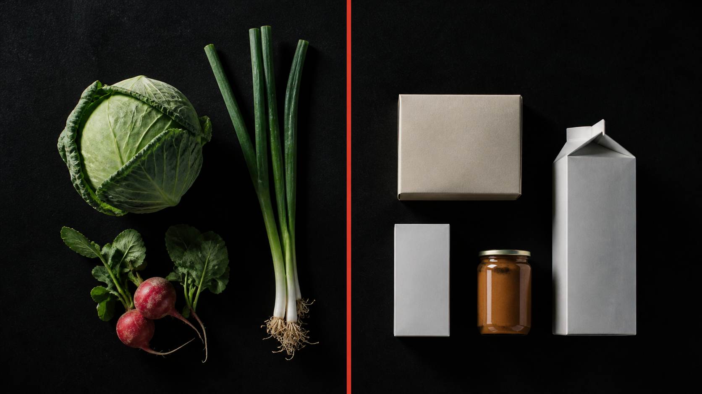

10월 외식 물가는 1년 전보다 2.9% 올랐고, 같은 달 채소류는 11.2% 내렸습니다(국가데이터처, 2026년 11월 3일). 한 달 안에서도 오른 재료와 내린 재료가 갈렸다는 뜻입니다. 그래서 연말 메뉴판은 통째로 올리는 결정이 아니라, 어느 줄을 건드릴지 고르는 일이 됩니다.

지난달 숫자는 사장님의 장부와 다릅니다. 다만 방향은 알려 줍니다. 채소와 배추는 내렸고, 무와 가공식품, 외식, 전기와 도시가스는 올랐습니다. 이 갈림만 붙잡아도 이번 달에 손댈 메뉴가 보입니다.

## 숫자부터 정리합니다

- **소비자물가.** 10월 지수는 120.73(2020년=100)으로 1년 전보다 2.8% 올랐습니다. 1~10월 평균은 2.7%입니다.
- **외식.** 2.9% 올라 올해 2월 이후 가장 높은 상승률을 기록했습니다. 가공식품도 2.9%로 오름폭이 커졌습니다.
- **장바구니.** 생활물가지수는 2.6% 올랐지만, 신선식품지수는 6.2% 내렸습니다. 채소류가 11.2%, 배추가 11.8% 내린 영향입니다. 무는 출하량이 줄어 12.5% 올랐습니다.
- **고기와 생선.** 축산물 4.8%, 수산물 5.4% 올랐습니다. 수산물 상승률은 올해 1월 이후 가장 높습니다.
- **에너지.** 석유류는 14.9% 올랐습니다. 재정경제부는 석유 최고가격제가 없었다면 10월 물가가 3.6%였을 것으로 추정했습니다.

생산 단계도 같은 방향입니다. 9월 생산자물가지수는 1년 전보다 7.7% 올랐고(한국은행, 2026년 10월 21일), 같은 달 주택용 전력은 전월보다 13.4%, 산업용 도시가스는 6.6% 올랐습니다. 중간재 가격 부담이 쌓이면 몇 달 뒤 외식 원가로 넘어옵니다.

## 지수는 전국 평균입니다

같은 2.9%라도 우리 매장이 사는 재료와는 상관이 없을 수 있습니다. 급식용으로 들여오는 채소는 시장 가격과 다르게 움직이고, 본사에서 공급받는 품목은 인상 시기가 따로입니다.

그래서 지표는 방향을 잡는 데만 쓰고, 판단은 세 줄짜리 원가표로 합니다. 주재료, 부자재, 포장재. 이 셋의 지난 분기 단가와 이번 달 단가를 적으면, 올릴 메뉴와 그대로 둘 메뉴가 갈립니다. 이 표가 없는 상태에서 지표만 보고 가격을 올리면, 내린 재료까지 함께 올리게 됩니다.

## 세 가지 원칙

### 1. 오른 것만 올립니다

원가표에서 5% 넘게 오른 품목을 먼저 표시합니다. 그 품목이 주재료인 메뉴만 후보에 올립니다. 채소처럼 내린 재료가 주재료인 메뉴는 이번에 건드리지 않습니다. 다음에 오를 때를 위해 카드 한 장을 남겨 두는 셈입니다.

인상 폭은 한 번에 정합니다. 500원씩 두 번 올리는 것보다, 계산이 되는 선에서 한 번에 올리는 편이 손님에게도 설명하기 쉽습니다.

### 2. 시기는 매출이 좋은 주가 아니라 그 앞 주에

연말은 예약이 미리 들어오는 시기입니다. 예약을 받은 뒤에 가격을 바꾸면, 예약자와 현장 손님이 같은 메뉴를 다른 값에 먹게 됩니다. 이 불일치는 리뷰에서 가장 자주 문제가 되는 부분입니다.

그래서 달력에 두 날짜를 적습니다. 가격을 바꿀 날, 공지를 올릴 날. 공지는 시행 최소 일주일 전, 예약이 몰리기 전에 냅니다. 이미 예약된 건은 예약할 때 안내한 값으로 두고, 그 사실을 문장에 적습니다.

### 3. 온라인과 오프라인을 같은 날 바꿉니다

메뉴판만 바꾸고 플레이스 메뉴, 구글 프로필, 배달앱, 주문 링크를 그대로 두면, 손님은 다른 값을 보고 왔다가 계산대에서 처음 알게 됩니다. 이때 생기는 감정은 가격 인상 자체보다 큽니다.

당일 할 일을 다섯 줄로 적어 두면 빠뜨리지 않습니다.

- 매장 메뉴판
- 네이버 플레이스 메뉴와 가격
- 구글 비즈니스 프로필의 메뉴 또는 상품 정보
- 배달앱과 예약 페이지
- 문의 응대 때 쓰는 안내 문구

## 공지 문구는 세 문장이면 됩니다

길게 쓰면 사과문처럼 읽히고, 짧게 쓰면 통보처럼 읽힙니다. 사실과 시점, 예외만 담으면 됩니다.

> 11월 27일부터 일부 메뉴 가격이 조정됩니다. 재료 원가가 오른 품목만 반영했고, 구성과 양은 그대로입니다. 그 전에 예약하신 분은 예약 당시 안내드린 가격으로 적용됩니다.

여기에 이유를 길게 덧붙이지 마세요. 원가가 올랐다는 사실은 손님도 이미 알고 있습니다. 알아야 하는 것은 언제부터, 무엇이, 얼마나인지입니다.

## 가격표 대신 구성으로 푸는 방법

올리기 어려운 메뉴는 값이 아니라 구성을 조정합니다. 반찬 수를 하나 줄이고 그 자리에 음료를 붙이거나, 단품을 세트로 묶어 객단가를 올리는 방식입니다. 손님이 보는 것은 총액이 아니라 무엇을 얼마에 받는지입니다.

다만 이때도 표기는 정확해야 합니다. 구성이 바뀌면 메뉴판과 앱의 설명을 함께 고치고, 이전 구성과 혼동되지 않게 사진도 바꿔 주세요. 같은 이름에 다른 구성이 오가면, 그 불일치가 다음 문의가 됩니다.

## 예약금과 선결제도 같은 원칙입니다

연말 모임처럼 인원이 미리 정해지는 예약은 가격표보다 예약금이 문제가 됩니다. 예약금을 받을 때는 금액과 환불 기준을 예약 화면에 같이 적습니다. 전화로만 안내하면, 나중에 취소할 때 서로 다른 기억을 꺼내게 됩니다.

선결제를 받는 메뉴라면 가격 변경일을 예약 마감일보다 앞에 두세요. 이미 결제한 건에 다른 값을 적용하면, 환불과 재결제가 따라붙습니다.

## 이 판단으로 안 되는 것

지표는 전국 평균이라 우리 동네와 다를 수 있고, 품목별 등락은 다음 달에 다시 뒤집힙니다. 배추는 김장철 수요로 11월에 다시 오를 수 있습니다. 10월의 11.8% 하락을 12월까지 전제로 삼으면 안 됩니다.

가격을 올린 뒤 매출이 어떻게 될지는 통계로 알 수 없습니다. 손님이 줄어 인상분을 상쇄하는 경우도, 반대로 단가가 올라 매출이 늘어 보이는 경우도 있습니다. 최소 한 달은 같은 조건으로 두고 손님 수와 객단가를 함께 봐야 합니다.

내년 전망도 확정이 아닙니다. 한국개발연구원은 11월 18일 발표한 하반기 경제전망에서 내년 소비자물가 상승률이 상반기 2.9%에서 하반기 1.9%로 낮아질 것으로 봤습니다. 다만 이는 유가 하락을 전제로 한 전망입니다.

## 자주 묻는 질문

### 메뉴 가격을 올리면 손님이 떠나지 않나요?

한 번에 크게 올릴 때 떠납니다. 오른 재료가 들어간 메뉴만, 계산이 되는 폭으로, 시기를 미리 알리면 대부분 남습니다. 반대로 내린 재료까지 함께 올리면 설명이 안 되고, 그때 신뢰가 깎입니다.

### 일부 메뉴만 올려도 되나요?

됩니다. 다만 손님이 자주 시키는 메뉴와 이익이 적은 메뉴를 구분해서 보세요. 잘 팔리는데 마진이 얇은 메뉴부터 손보는 것이 순서입니다. 세트 구성으로 값을 맞추는 방법도 있습니다.

### 배달앱 가격도 같이 올려야 하나요?

매장과 배달의 원가 구조가 다르니 같이 올릴 필요는 없습니다. 다만 두 값이 다른 이유를 설명할 수 있어야 합니다. 포장과 배달 비용이 포함된 가격이라는 안내를 앱 안에 두면, 문의가 줄어듭니다.

### 물가 지표는 어디서 확인하나요?

소비자물가는 국가데이터처가 매월 초에 내는 소비자물가동향, 생산자물가는 한국은행이 매월 20일경 내는 생산자물가지수에서 봅니다. 발표일과 기준월을 함께 적어 두면, 다음에 비교할 때 헷갈리지 않습니다. 시즌에 맞춰 가격과 공지 시점을 잡는 방법은 [시즌 검색 달력](/insights/season-search-calendar-timing/)에 더 자세히 적었습니다.

## 마무리: 이번 주에 할 한 가지

가격을 올릴지 말지는 이번 주에 정하지 않아도 됩니다. 대신 원가표 세 줄을 오늘 채우세요. 주재료와 부자재, 포장재의 지난달 단가와 이번 달 단가입니다.

그 표를 보면 올릴 메뉴는 두세 개로 줄어듭니다. 나머지는 그대로 두면 됩니다. 어떤 메뉴를 어떻게 바꿀지 막막하면, 매장 메뉴판 사진과 최근 발주서를 보내주세요. 어느 줄부터 손대면 되는지 정리해 드립니다. [카카오톡 채널](https://pf.kakao.com/_xdMIvX/chat)로 연락 주셔도 됩니다.
