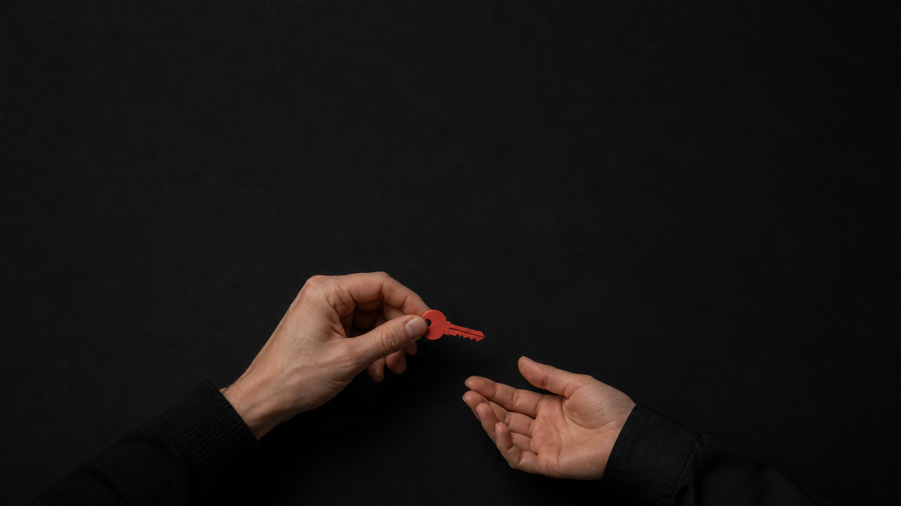

대행을 그만두기로 정했다면 남는 일은 인사가 아니라 넘겨받는 일입니다. 계정, 자료, 문의 기록, 응대 순서, 다음 달 일정 다섯 가지를 30일 안에 받아 두면 혼자서도 굴러갑니다. 반대로 이 다섯 가지가 없으면, 그동안 쌓은 것을 다시 사야 합니다.

그만둘지 말지는 그 다음 문제입니다. 먼저 세 가지만 확인하세요. 지금 대행이 매주 하는 일을 내가 말로 설명할 수 있는지, 내가 쓸 수 있는 시간이 주 몇 시간인지, 끊겼을 때 한 달에 얼마가 사라지는지. 이 셋에 답이 나오면 결정은 대개 따라옵니다.

## 인수인계에서 새는 것은 권한입니다

현장에서 가장 자주 보는 장면은 이렇습니다. 원고는 잘 쌓여 있는데, 플레이스 관리자 권한이 대행 계정에만 있습니다. 사진 원본은 대행사 드라이브에 있고, 우리 쪽에는 발행된 이미지뿐입니다. 문의 응대 기록은 개인 휴대폰에 남아 있습니다.

이 상태에서 계약이 끝나면 문제가 두 가지로 나뉩니다. 하나는 이어서 할 수 없다는 것, 다른 하나는 증명할 수 없다는 것입니다. 그래서 인수인계는 파일을 받는 일이 아니라, 손잡이를 넘겨받는 일입니다.

## 넘겨받을 다섯 가지

### 1. 계정 소유자 — 가장 먼저 확인할 것

- **네이버 플레이스.** 사업자 계정이 소유자여야 합니다. 대행은 초대받은 관리자로만 들어와 있어야 하고, 계약이 끝나면 그 초대를 해제합니다.
- **구글 비즈니스 프로필.** 소유자와 관리자가 나뉘어 있습니다. 구글 고객센터는 액세스 권한에서 소유자와 관리자를 추가하고, 관리를 그만둘 때는 기본 소유권을 이전하도록 안내합니다.
- **카카오톡 채널과 블로그.** 채널 관리자와 블로그 공동 관리자 목록을 확인합니다.
- **도메인과 호스팅.** 등록 정보의 소유자 이름과 갱신 결제 수단이 누구 것인지 봅니다.
- **분석 도구.** 방문 통계의 관리자 권한이 없으면 지난 기록을 이어 볼 수 없습니다.

확인 방법은 간단합니다. 각 서비스 설정 화면에서 관리자 목록을 열어, 내 계정이 맨 위에 있는지 봅니다. 목록에 낯선 계정이 남아 있으면 그 자리에서 정리합니다.

### 2. 산출물 원본 — 발행본이 아니라 편집본

발행된 글과 이미지는 결과물이고, 원본은 다시 쓸 수 있는 재료입니다. 원고 파일, 사진 원본, 영상 프로젝트 파일, 로고와 폰트를 받습니다. 사진은 누가 찍었는지와 사용 범위를 함께 적어 두면 나중에 다른 채널로 옮길 때 문제가 없습니다.

### 3. 문의 기록 — 손님 정보가 담긴 파일

문의 목록에는 이름과 연락처가 들어 있습니다. 이 파일을 넘겨받는 일은 개인정보를 주고받는 일입니다. 개인정보 보호법 제26조는 개인정보 처리 업무를 위탁할 때 목적 외 처리 금지, 보호조치, 안전한 관리에 관한 사항을 문서로 정하도록 하고 있습니다(시행 2026년 9월 11일).

계약이 끝날 때는 반대 방향도 정해야 합니다. 대행 쪽에 남은 사본을 파기하는지, 우리 쪽으로 어떤 형식으로 넘어오는지, 넘긴 뒤 보관 기간은 얼마인지. 이 세 줄이 계약서에 없으면 마지막에 말로 정리하게 됩니다.

### 4. 응대 순서 — 누가 언제 답하는지

문의가 들어왔을 때 누가, 몇 시간 안에, 어떤 문장으로 답하는지 적어 둡니다. 전화를 못 받는 시간대에 어떻게 할지, 예약과 상담 중 어느 쪽을 먼저 볼지도 여기에 포함됩니다. 이 순서가 없으면 권한을 다 받아도 문의는 다시 새기 시작합니다. 응대가 끊기는 지점은 [플레이스 예약 다섯 구간](/insights/place-booking-five-gates/)에 정리해 두었습니다.

### 5. 다음 달 일정 — 끊긴 자리를 메우는 표

발행일, 시즌이 시작되는 날, 예약이 몰리는 주를 한 장에 적습니다. 대행이 하던 주기를 그대로 이어받을 필요는 없습니다. 다만 어느 주에 무엇이 나가야 하는지는 알아야 첫 달에 빈자리가 생기지 않습니다.

## 30일 일정

- **1주 차.** 다섯 가지 목록을 만들고, 지금 누가 갖고 있는지 표시합니다. 이 단계에서는 아무것도 요청하지 않습니다.
- **2주 차.** 계정 권한을 넘겨받습니다. 소유자 이전과 관리자 해제를 같은 날 처리합니다.
- **3주 차.** 원본과 문의 기록을 받고, 내가 직접 한 편을 씁니다. 이 과정에서 빠진 자료가 드러납니다.
- **4주 차.** 새 업체나 내가 운영하는 방식으로 한 주를 돌려 보고, 그 뒤에 종료일을 정합니다.

한 달을 두고 보는 이유는 검증 때문입니다. 권한만 받고 끝내면, 실제로 굴러가는지는 다음 달에 알게 됩니다. 그때는 이미 늦습니다.

## 대행을 유지하는 편이 나은 경우

인수인계를 정리해 두고도 계속 맡기는 쪽이 나은 경우가 있습니다. 예약과 문의가 하루에도 몇 건씩 오는데 응대할 사람이 없는 경우, 신메뉴가 자주 나와서 사진과 원고를 계속 새로 만들어야 하는 경우입니다. 이때는 범위를 줄여 유지하는 방법이 있습니다.

다섯 가지 중 두세 가지만 맡기는 계약도 가능합니다. 원고는 직접 쓰고 사진과 발행만 맡기거나, 플레이스 관리만 남기는 식입니다. 줄일 때도 위의 다섯 가지는 그대로 확인하세요. 범위가 작아졌다고 권한의 원칙이 바뀌지는 않습니다.

## 이 방식으로 안 되는 것

계약 형태는 업체마다 다릅니다. 월 단위 관리만 하는 계약도 있고, 제작물 납품이 끝나면 종료되는 계약도 있습니다. 위 다섯 가지는 어느 쪽에도 필요한 최소한이지, 모든 계약에 같은 조항이 들어 있다는 뜻은 아닙니다.

이 글은 법률 자문이 아닙니다. 개인정보 처리나 손해 배상처럼 판단이 갈리는 문제는 계약서 원문과 전문가 검토가 필요합니다. 계약을 시작하기 전에 볼 항목은 [대행 계약 전 확인 목록](/insights/agency-checklist-before-hiring/)에 따로 정리해 두었습니다.

## 노티스랩이 권한을 두는 방식

노티스랩은 플레이스와 프로필의 소유 권한을 사장님 계정에 두고, 초대받은 관리자로만 참여합니다. 정리된 자료도 사장님 계정에 남깁니다. 계약이 끝나도 통계와 기록이 그대로 남게 하려는 것이고, 동시에 저희가 없어도 굴러가게 만들자는 뜻입니다.

같은 원칙을 트랙 B에서도 지킵니다. 신진 예술가와 청년 초기 창업자, 자립준비청년의 첫 전시와 첫 사업을 도울 때도 계정과 자료는 본인 이름으로 남깁니다. 처음 시작하는 사람이 홍보 대행을 끊는 순간 모든 것을 잃는 구조는, 애초에 돕는 방식이 아니라고 봅니다.

제작은 업체가 제공한 기존 사진과 영상으로 진행하며, 별도 현장 촬영은 기본 서비스가 아닙니다. 그래서 인수인계 때 넘길 원본도 대부분 매장이 이미 갖고 있던 자료입니다.

## 자주 묻는 질문

### 대행이 권한 이전을 미루면 어떻게 하나요?

종료일을 서면으로 정하고, 그 날짜에 무엇을 넘길지 목록으로 남기세요. 대부분은 미루는 것이 아니라 잊고 있는 경우입니다. 그래도 진행이 안 되면 플랫폼의 소유권 요청 절차를 직접 밟을 수 있습니다. 네이버와 구글 모두 이런 절차를 두고 있습니다.

### 직접 운영하면 시간이 얼마나 들까요?

한 달 원고 네 편과 플레이스 관리 정도라면, 주 3~4시간을 잡으면 됩니다. 대신 첫 달은 이 시간의 두 배가 듭니다. 순서를 익히는 기간이기 때문입니다. 이 시간을 낼 수 없는 달에는 대행을 유지하는 편이 낫습니다.

### 계약 중간에 그만둘 수 있나요?

계약서의 해지 조항에 달려 있습니다. 남은 기간 관리비를 정산하는 조항이 흔하고, 광고비는 이미 집행된 부분이 달라 별도로 계산합니다. 그만두기로 마음먹기 전에 이 두 줄을 먼저 읽어 보세요.

### 문의 기록은 꼭 받아야 하나요?

받는 편이 좋습니다. 지난 문의를 보면 어떤 검색어로 들어온 손님이 예약까지 갔는지 보입니다. 이 기록이 다음 달에 무엇을 고칠지 알려 줍니다. 다만 받을 때는 파기와 보관 기간을 함께 정하세요.

## 마무리: 표 한 장

인수인계는 감정이 아니라 표의 문제입니다. 다섯 줄짜리 표를 만들어 왼쪽에 항목, 오른쪽에 지금 가진 사람을 적어 보세요. 이름이 비어 있거나 대행사 이름으로 채워진 칸이 이번 달에 정리할 자리입니다.

지금 대행 계약서와 각 서비스의 관리자 화면을 함께 보내주시면, 넘겨받아야 할 항목을 정리해 드립니다. [카카오톡 채널](https://pf.kakao.com/_xdMIvX/chat)로 연락 주셔도 됩니다.
