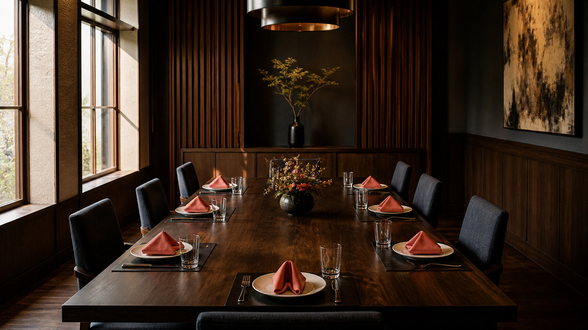

단체 예약 문의는 '송년회'라는 단어로 들어오지 않습니다. 손님은 "수원 20명 룸", "용인 단체석 주차"처럼 지역과 인원, 조건을 붙여 검색합니다. 그래서 이번 달에 늘려야 하는 것은 글의 개수가 아니라 우리 가게 화면에 적힌 네 칸이고, 그 칸이 비어 있으면 12월 목록에서 먼저 빠집니다.

작년 12월에 상담한 가게는 예약 전화가 끊이지 않았습니다. 문제는 바로 옆 가게였습니다. 같은 골목, 비슷한 평수, 음식도 나쁘지 않은데 12월 둘째 주가 통째로 비어 있었습니다. 이유는 단순했습니다. 손님이 '20명'을 붙여 검색했을 때 나오는 화면에 수용 인원이 없었습니다. 손님이 전화를 걸려면 먼저 우리 가게를 찾아야 하는데, 찾는 단계에서 빠지면 응대 실력은 쓰일 기회조차 없습니다.

## 12월 예약은 어디로 몰리나 — 확인된 세 가지

- **시기.** 한국외식업중앙회 설명으로는 외식 예약이 12월 둘째 주부터 넷째 주까지 금요일과 토요일 저녁에 집중됩니다. 단체석을 갖춘 한식당과 코스 요리를 내는 레스토랑은 12월 초순이면 예약 문의가 평소의 두 배 이상으로 늘어난다고 합니다(소상공인미디어, 2026년 11월 19일).
- **규모.** 올해 눈에 띄는 변화는 크기가 아니라 '중간 크기'입니다. 대형 연회장 대신 20명 안팎이 들어가는 중소형 룸을 찾는 기업 단체가 늘었습니다(같은 기사).
- **시간대.** 인크루트가 2025년 12월 직장인 회원 888명에게 물은 조사에서 20대 36%, 30대 37.7%가 근무시간 중 송년회를 선호했습니다(한국경제, 2026년 11월 10일). 퇴근 후 술자리 대신 점심으로 끝내는 쪽이 늘었다는 뜻입니다.

세 가지를 겹쳐 보면 지도가 하나 나옵니다. 금요일 저녁은 경쟁이 가장 센 자리이고, 목요일 저녁과 평일 점심은 상대적으로 덜 붐빕니다. 그런데 대부분의 가게 화면에는 금요일 저녁 정보만 있습니다. 영업시간, 점심 단체 가능 여부, 룸과 홀 구분이 없으면 손님은 비교를 못 하고, 비교를 못 하면 문의하지 않습니다.

## 예약자는 네 조합으로 검색합니다

- **지역 + 인원.** "수원 20명 단체", "용인 10명 룸". 손님은 인원을 먼저 정하고 지역을 좁힙니다. 페이지에 최소·최대 인원이 숫자로 없으면 이 검색에서 빠집니다.
- **지역 + 공간.** "룸 있는 식당", "단독홀", "조용한 방". 룸과 홀을 같은 말로 섞어 쓰면 손님은 어느 쪽인지 알 수 없습니다.
- **조건.** "보증인원 없는 곳", "콜키지 가능", "주차 되는 단체". 12명이 넘으면 보증 인원과 최소 주문 금액을 거는 곳이 많아, 조건부터 확인하는 손님이 늘었습니다.
- **상황.** "송년회", "연말 모임", "점심 회식". 가장 늦게 붙고, 가장 많이 붙는 단어입니다.

순서가 중요합니다. 상황 키워드는 경쟁이 가장 세고, 조건 키워드는 상대적으로 한산합니다. 그런데 사장님은 상황 키워드부터 씁니다. "송년회 예약 받습니다" 한 줄을 고민하는 시간에 "20명 단체 가능, 주차 8대, 콜키지 1병"을 적는 편이 문의를 더 만듭니다. 전화가 오는 순서는 늘 그렇습니다. 조건을 확인한 손님이 먼저 겁니다.

## 화면에 먼저 적어야 하는 네 줄

- **수용 인원.** 최소 몇 명부터 받는지, 최대 몇 명까지 한자리에서 가능한지 숫자로 적습니다. "단체 환영"만으로는 아무것도 알 수 없습니다.
- **보증 인원과 최소 주문.** 12명 이상 단체는 보증 인원과 최소 주문 금액을 거는 곳이 흔합니다. 실제로 덜 왔을 때 어떻게 계산하는지도 같은 줄에 적습니다. 이 한 줄이 당일 계산대 분쟁을 줄입니다.
- **예약금과 취소 기한.** 한국소비자원은 예약금 환불 규정이 업체마다 달라 분쟁이 반복된다며, 예약하는 쪽에 계약 전 환불 조건을 문자나 서면으로 받아 두라고 권했습니다(소상공인미디어, 2026년 11월 19일). 가게도 같은 기준을 먼저 적어 두면 통화가 절반으로 줄어듭니다.
- **주차와 이동.** 몇 대까지, 몇 시간까지, 대중교통으로 오는 손님은 어디서 내리는지. 차로 오는 손님이 많은 경기 남부에서는 이 줄이 결정적입니다.

## 전화와 온라인을 나눠 쓰는 가게의 함정

일부 매장은 예약 플랫폼에 몇 자리만 열어 두고 단체석은 전화로만 받습니다. 매장 입장에서는 합리적인 선택입니다. 단체는 메뉴와 좌석 배치를 미리 정해야 하니까요. 그런데 손님 화면에서는 그 시간이 '예약 마감'으로 보입니다. 받을 수 있는 예약을 받을 수 없는 가게로 보이는 셈입니다.

정리하는 방법은 어렵지 않습니다. 플랫폼 재고와 전화 재고를 같은 날 한 번 맞추고, 업체 소개란에 "단체·룸 예약은 전화로" 한 줄을 넣습니다. 이 한 줄이 없으면 검색에서 이긴 손님도 다음 화면에서 돌아섭니다. 예약 화면에서 손님이 멈추는 지점은 [플레이스 예약 다섯 구간](/insights/place-booking-five-gates/)에 따로 정리해 두었습니다.

## 이 방식이 통하지 않는 경우

- **업종.** 객석이 여섯 개인 카페나 1인 운영 매장은 단체 예약 자체가 손해일 수 있습니다. 이때는 조건을 채우는 대신 "단체 예약은 받지 않습니다"를 분명히 적는 편이 낫습니다. 헛걸음하는 손님과 통화 시간이 함께 줄어듭니다.
- **지역.** 역세권과 외곽은 검색하는 시점이 다릅니다. 외곽은 주차와 이동 시간이 먼저 걸리고, 역세권은 도보 거리와 막차가 먼저 걸립니다. 같은 문장을 두 지역에 그대로 쓰면 둘 다에서 어긋납니다.
- **데이터.** 단체 예약 검색량은 지역별로 공개된 자료가 없습니다. 위 수치는 외식업중앙회의 업계 설명과 인크루트 조사, 기사에 담긴 인터뷰를 근거로 한 것이지, 우리 동네의 예약 건수를 뜻하지 않습니다.

## 자주 묻는 질문

### 단체 예약도 온라인 예약에 올리는 게 좋나요?

올려 두는 편이 낫습니다. 다만 단체는 인원과 메뉴 확정이 필요하므로, 플랫폼에는 소수만 열고 나머지는 전화로 받는 방식이 흔합니다. 어느 쪽이든 업체 소개란에 그 사실을 적어 두세요. 손님이 마감으로 오해하는 것이 가장 큰 손실입니다.

### 보증 인원은 몇 명부터 걸어야 하나요?

정해진 기준은 없고, 업계에서는 12명 이상 단체부터 거는 경우가 흔합니다. 기준을 정했다면 페이지와 예약 문자에 같은 숫자로 적으세요. 전화에서 다르게 안내하면 그 한 통이 리뷰로 남습니다.

### 12월 초에 고쳐도 늦지 않았나요?

금요일 저녁 인기 시간대는 이미 찼을 수 있습니다. 다만 목요일 저녁과 평일 점심, 1월 초 모임은 아직 남아 있습니다. 남은 자리를 조건 키워드로 채우는 편이, 찬 자리를 붙잡는 것보다 현실적입니다.

### 리뷰가 적은데 단체 예약을 받아도 되나요?

받아도 됩니다. 다만 단체 손님은 리뷰를 여러 개 남기는 대신, 실패했을 때도 여러 사람에게 말합니다. 첫 단체 예약은 규모를 조금 줄여 받고, 응대 순서를 미리 정해 두는 편이 안전합니다.

## 마무리: 오늘 고칠 네 줄

12월은 특별한 달이 아니라, 평소 정보가 부족했던 것이 드러나는 달입니다. 오늘 플레이스와 예약 화면을 열어 네 줄만 확인해 보세요. 인원, 룸과 홀 구분, 보증 인원과 예약금, 주차. 이 네 줄이 채워지면 남은 일은 응대입니다.

지금 운영 중인 플레이스와 예약 화면을 보내주시면, 손님이 어느 조합에서 우리 가게를 놓치는지 정리해 드립니다. [카카오톡 채널](https://pf.kakao.com/_xdMIvX/chat)로 연락 주셔도 됩니다. 지역 키워드를 동네 단위로 내리는 순서는 [수원 생활권 검색 설계](/insights/suwon-district-search-keywords/)에 이어서 정리해 두었습니다.
