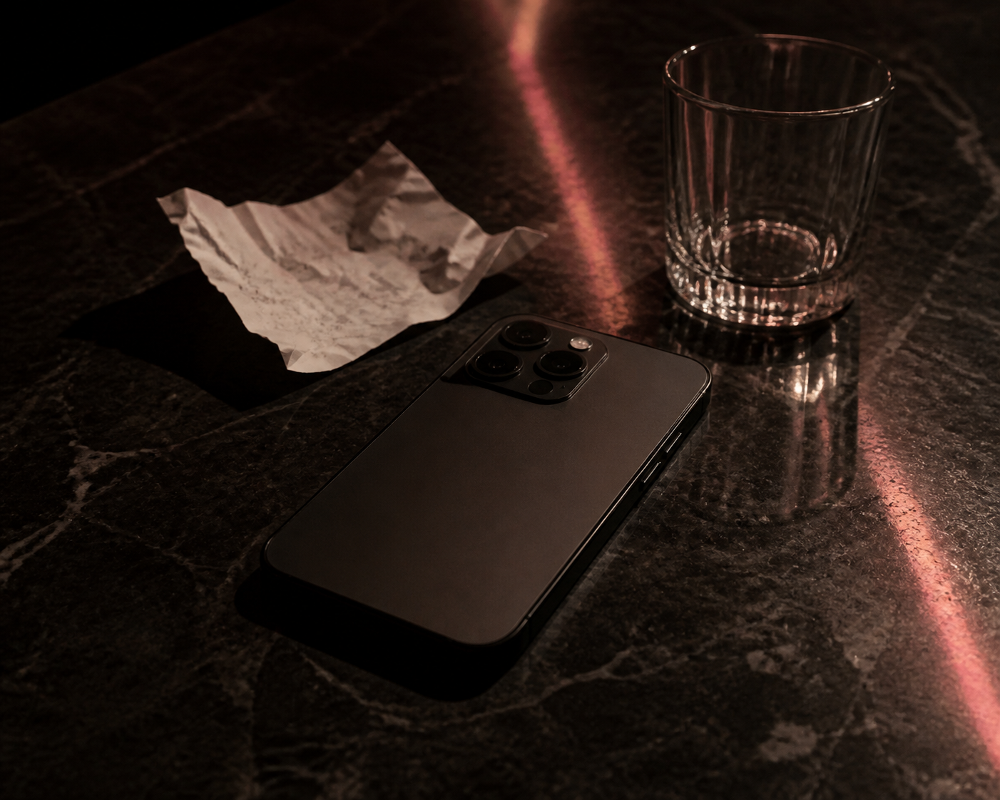

리뷰는 예약 버튼 바로 위에 있는 화면입니다. 그래서 리뷰를 늘리는 일은 전환을 늘리는 일처럼 보입니다. 그런데 2026년에 규칙이 두 번 바뀌었습니다. 별점이 돌아왔고, 조건을 건 리뷰에 대한 제재가 무거워졌습니다.

이 제도를 처음 확인했을 때 가장 놀란 부분은 과징금이 아니었습니다. 리뷰 탭이 통째로 사라질 수 있다는 조항이었습니다. 리뷰 하나가 문제가 되면 그 시점의 모든 리뷰가 미노출될 수 있습니다. 3년 동안 쌓은 리뷰가 한 건 때문에 같이 내려가는 구조입니다.

## 2026년에 바뀐 세 가지

- **1월 28일, 제재 기준.** 네이버 스마트플레이스는 가짜·조작 영수증을 통한 리뷰, 허위 예약을 통한 리뷰, 방문하지 않았거나 보상을 목적으로 쓴 리뷰를 비정상 행위로 안내했습니다. 확인되면 리뷰 탭을 일정 기간 블라인드 처리하고, 플레이스 AI 브리핑을 삭제하며, 확인 시점에 등록된 전체 리뷰를 미노출할 수 있습니다. AI 브리핑 정보는 한 번 삭제되면 다시 만들어지지 않는 경우도 있다고 네이버는 밝혔습니다. 대행사나 마케팅 업체를 통해 반복하면 추가 페널티가 붙습니다.
- **4월 6일과 7월 9일, 별점의 귀환.** 4월 6일 이후 방문 내역으로 쓰는 리뷰에 별점을 입력할 수 있게 됐고, 7월 9일부터 개별 리뷰 별점과 업체 평균 별점이 표시됩니다. 평균 별점은 별점을 남긴 리뷰어가 10명 이상 누적됐을 때 붙고, 사장님이 스마트플레이스에서 노출 여부를 고를 수 있습니다. 다만 개별 리뷰의 별점과 글, 사진은 끌 수 없습니다(네이버 보도자료, 2026년 6월 1일).
- **6월 1일, 대가 표시.** 공정거래위원회 「추천·보증 등에 관한 표시·광고 심사지침」(예규 제499호)이 이 날부터 시행 중입니다. 대가를 주고받은 리뷰는 금지 대상이 아니라 공개 대상이고, 표시는 위치·형태·내용·언어 네 가지 요건을 모두 갖춰야 합니다.

## '별점 5점 주시면 음료'는 어디에서 걸리나

지침에는 '영수증 리뷰'라는 말이 그대로 나오지 않습니다. 대신 가장 가까운 예시가 있습니다. 상품을 살 때 할인 혜택을 받고 후기를 쓰기로 한 경우, 상품을 받고 추천글을 쓰기로 한 경우입니다. 음료 한 잔도 할인 혜택입니다. 조건을 걸었다면 대가이고, 대가를 걸었다면 매 건마다 표시해야 합니다.

표시로 인정되는 말과 그렇지 않은 말도 갈립니다. '대가성 광고', '#광고', '#협찬', '디스카운트 받는 대가로 작성'은 인정됩니다. 반면 '체험 후기', '체험단', '선물', '사장님 감사합니다', '더보기를 눌러야 보이는 문구'는 표시로 보지 않습니다. 손님이 고마운 마음에 쓴 문장은 대가 표시가 되지 않는다는 뜻입니다.

책임은 손님에게만 있지 않습니다. 지침은 광고주 또는 추천·보증인 중 누구라도 공개하도록 하고, 이벤트를 건 가게가 광고주가 됩니다. 내부 직원이나 대행사 직원이 쓴 글도 같은 기준으로 봅니다. 가장 자주 놓치는 지점이 여기입니다.

## 대행이 리뷰 이벤트를 제안하면 물어야 할 세 가지

- **누가 대가를 주나요.** 가게가 직접 주는지, 대행사가 자기 이름으로 주는지. 대행사가 리뷰어를 모아 운영한 사실이 드러나면 반복 위반으로 업체 단위 추가 페널티까지 이어질 수 있습니다.
- **표시를 어디에 넣나요.** 본문 중간, 댓글, '더보기' 뒤는 찾기 어려운 위치로 봅니다. 글 제목이나 첫 부분, 사진 안, 첫 번째 해시태그가 기준입니다.
- **매 건마다 넣나요.** 한 번 쓰고 끝나는 캠페인이 아니라면 건별 표시가 원칙입니다. 캠페인을 '체험단'이라고 부르는 것은 자유지만, 공개 문구 자리에 그 말만 적으면 인정되지 않습니다.

세 질문에 답이 돌아오지 않으면, 그 제안은 보류하시는 편이 낫습니다. 리뷰가 늘어난 만큼 위험도 같이 늘어나는 계약은 대행 기준으로도 좋지 않습니다.

## 별점이 높으면 검색에서 위로 올라가나요?

네이버가 공개한 플레이스 순위 요소는 유사도, 인기도, 거리, 정보의 충실성입니다. 인기도는 언급 수와 이미지 수, 클릭 수로 설명됩니다. 별점은 이 목록에 없습니다. 손님이 비교할 때 보는 보조 지표이지, 순위를 올리는 재료로 안내되어 있지 않습니다.

그래서 "별점 이벤트로 상위노출을 만들겠다"는 설명은 근거를 확인하기 어렵습니다. 별점을 올리면 전환에 도움이 될 수는 있습니다. 다만 그것은 순위가 아니라 손님의 판단이 바뀌는 것이고, 판단을 바꾸려고 조건을 걸면 앞의 두 규칙에 닿습니다.

업계에서는 별점 재도입 자체를 두고 논쟁도 있었습니다. 소상공인연합회는 줄 세우기라며 개별 별점 비공개와 악성 별점 대응을 요구했습니다. 제도가 자리 잡는 동안은 정책 공지가 바뀔 수 있으니, 화면 설정을 바꾸기 전에 스마트플레이스 공지를 한 번 더 확인하시길 권합니다.

## 그럼 리뷰는 어떻게 받나 — 세 줄 원칙

- **조건 없이 부탁합니다.** 계산대에서 말로, 대가 없이. 이 한 줄이 가장 안전하고 가장 오래 갑니다.
- **낮은 별점에는 답글로 무엇을 고쳤는지 적습니다.** 평균 별점을 꺼도 개별 별점은 그대로 보입니다. 손님이 실제로 읽는 화면을 바꾸는 일은 답글 쪽입니다.
- **리뷰를 대신 만들어 주는 제안은 거절합니다.** 영수증 이미지를 만들어 올린다거나, 방문하지 않은 리뷰를 쓴다는 말이 나오면 그 자리에서 멈추세요. 대행사가 상습적으로 반복하면 업체가 아니라 가게 이름으로 제재가 남습니다.

## 이 글의 한계

지침은 대표적인 사례를 예시로 든 것이라, 목록에 없다고 모두 괜찮은 것도 아니고 예시에 해당해도 소비자를 오인시킬 우려가 없으면 부당하지 않을 수도 있습니다. 이 글은 법률 자문이 아닙니다. 개별 캠페인은 원문과 전문가 검토로 판단하셔야 하고, 실제 제재 범위는 네이버 공지와 운영정책, 그때의 판단을 따릅니다. 업종에 따라 규정이 하나 더 붙는 경우도 있습니다. 화장품은 의·약 분야 전문가의 추천 자체가 금지되어 표시로 해결되지 않습니다.

## 자주 묻는 질문

### 별점 리뷰가 하나도 없으면 평균 별점은 어떻게 되나요?

평균 별점은 별점을 남긴 리뷰어가 10명 이상 누적됐을 때 표시됩니다. 그 전에는 설정 항목 자체가 보이지 않을 수 있습니다. 2021년 이전에 쌓인 별점과 2026년 4월 6일 이후의 별점이 합산되므로, 오래된 가게는 이미 조건을 넘겨 있을 수 있습니다.

### 이미 걸어 둔 이벤트를 중단하면 기존 리뷰는 어떻게 되나요?

기존 리뷰가 자동으로 사라지지는 않습니다. 다만 대가를 받고 쓴 리뷰에 표시가 없다면 그 자체가 문제가 될 수 있습니다. 이벤트를 정리할 때는 표시 문구를 소급해 넣을 수 있는지, 손님에게 다시 안내할 수 있는지를 함께 판단하셔야 합니다.

### 대행사가 준 리뷰가 문제가 되면 책임은 누구에게 있나요?

플랫폼 제재는 업체 단위로 적용됩니다. 대행사의 잘못이어도 가게 이름으로 리뷰 탭이 내려갑니다. 그래서 계약서에 리뷰 운영 방식과 위반 시 책임 소재를 적어 두는 편이 안전합니다. 대행 계약 전 확인 항목은 [월 관리비보다 먼저 확인할 5가지](/insights/agency-checklist-before-hiring/)에 정리해 두었습니다.

### 리뷰 탭이 블라인드되면 풀리나요?

일정 기간이 지나면 다시 노출되는 구조로 안내되어 있지만, AI 브리핑처럼 삭제 후 재생성이 되지 않는 항목도 있습니다. 기간과 조건은 공지와 운영정책에 따르므로, 조치를 받은 뒤에는 스마트플레이스 공지를 직접 확인하시는 편이 정확합니다.

## 마무리: 리뷰는 화면이 아니라 기록입니다

리뷰를 늘리는 가장 빠른 방법은 이벤트가 아니라 응대입니다. 다녀간 손님이 다시 올 이유를 만들고, 그 이유를 계산대에서 한 번 말하는 것. 조건 없는 부탁은 느려 보이지만, 리뷰 탭이 내려가지 않는 유일한 방법입니다.

지금 운영 중인 리뷰 이벤트나 대행 제안서를 보내주시면, 표시 문구와 제안 구조를 함께 보고 정리해 드립니다. [카카오톡 채널](https://pf.kakao.com/_xdMIvX/chat)로 연락 주셔도 됩니다. 리뷰가 붙는 화면 뒤의 예약 흐름은 [플레이스 예약 다섯 구간](/insights/place-booking-five-gates/)에서 이어서 보실 수 있습니다.
