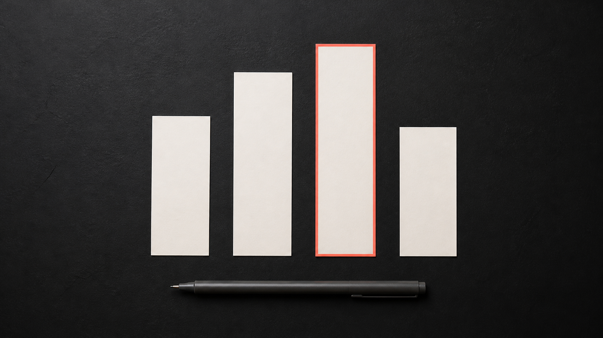

배달앱 수수료를 낮추는 일은 요율표에서 시작하지 않습니다. 정산서에서 "무엇에 요율이 붙었는지" 확인하는 일이 먼저입니다. 중소기업중앙회 조사에서 같은 배달앱에 들어간 가게들의 거래비용 부담률은 3.0%에서 45.0%까지 갈렸습니다. 조사만으로 그 이유를 확정할 수는 없지만, 정산서를 뜯어 보면 우리 가게가 어느 쪽에 가까운지는 보입니다.

사장님들이 자주 하시는 말이 있습니다. "중개수수료 7.8%라는데 왜 남는 게 없죠." 이 질문에 요율표로 답하면 대화가 끝나지 않습니다. 제가 대신 열어 보는 것은 지난달 정산서입니다. 숫자 네 줄이면 답이 나오는 경우가 많습니다.

11월에 이 구조가 흔들렸습니다. 배달의민족이 할인 비용에 붙던 수수료를 떼기로 했고, 공정거래위원회는 다른 플랫폼의 약관을 고치라고 했습니다.

## 확인된 숫자: 매출의 26.2%

중소기업중앙회가 2026년 9월 15일 발표한 '2026 온라인플랫폼 입점사 거래 실태조사'입니다. 지난 6월 18일부터 7월 3일까지 입점 중소기업·소상공인 1,250곳(배달앱 350곳)을 조사했습니다.

- **부담률.** 배달앱 입점사의 거래비용은 월평균 매출의 26.2%였습니다. 전년 21.0%에서 5.2%포인트 오른 수치로, 온라인쇼핑몰(20.6%)과 숙박앱(18.3%)보다 높습니다.
- **구성.** 중개수수료 42.0%, 배달비 29.9%, 광고비 15.6%, 결제대행수수료 12.4%입니다. 중개수수료와 배달비를 합치면 71.9%입니다.
- **편차.** 개별 업체 기준 최고 부담률은 45.0%(배달의민족·쿠팡이츠 입점), 최저는 3.0%(쿠팡이츠 입점)였습니다. 같은 플랫폼 안에서도 이만큼 벌어집니다.
- **체감.** 2025년 도입된 차등수수료제의 비용 절감 효과에 대해 '변화 없음' 49.4%, '도움 되지 않음' 35.4%였습니다. 두 응답을 합치면 84.8%가 절감을 체감하지 못했다는 뜻입니다.

매출 100만 원이면 거래비용이 평균 26만 2,000원이라는 계산이 됩니다. 다만 이것은 350곳의 평균을 단순 환산한 값입니다. 우리 가게 숫자와 같다고 볼 수는 없습니다.

## 11월에 달라진 두 가지

- **배민의 산정 기준 변경.** 우아한형제들은 입점업체가 부담하는 음식값 할인액과 배달팁 할인액을 중개수수료·결제정산수수료 산정에서 모두 제외하도록 약관을 바꾼다고 밝혔습니다(한국경제, 2026년 11월 12일). 회사는 할인 전 가격에 요율을 매기던 방식과 비교해 입점업체 전체로 연 1,100억 원 규모의 절감을 추산했습니다. 이 숫자는 개별 가게의 절감액이 아니라 전체 합산 추정치입니다.
- **공정위의 판단.** 공정위는 할인 부담액에 중개·결제수수료를 부과한 쿠팡이츠 약관을 시정하도록 했고, 배민에는 최혜대우 요구 등으로 잠정 과징금 3,311억 원을 부과하기로 했습니다(2026년 11월 9일 발표). 같은 달 20일에는 배달앱의 할인·광고·프로모션 비용을 포함한 실질 부담을 조사해 달라는 청원이 청원24에 올라왔습니다(뉴시스, 2026년 11월 20일).

요율을 몇 %로 정할 것인가에서, 어떤 금액에 요율을 매길 것인가로 논쟁이 옮겨갔습니다. 사장님 입장에서 이 변화는 정산서에서 확인해야 합니다.

## 정산서에서 볼 네 줄

- **첫째, 수수료 산정 기준 금액.** 할인 전 금액인지, 할인 후 결제 금액인지입니다. 2만 5,000원 주문에 점주가 3,000원을 할인했다면, 기준이 2만 2,000원일 때와 2만 5,000원일 때 수수료가 다릅니다. 중개 7.8%, 결제정산 3%를 적용하면 2,376원과 2,700원으로 324원 차이가 납니다(한국경제 예시). 주문이 하루 30건이면 한 달에 30만 원 가까이 벌어지는 차이입니다.
- **둘째, 할인이 누구 부담인지.** 우리가 부담한 할인액이 산정 대상에서 빠지는지 확인합니다. 배민은 이번 개편으로 음식값과 배달팁 할인을 모두 빼기로 했습니다. 다른 앱은 아직 기준이 다를 수 있습니다.
- **셋째, 광고비 비중.** 거래비용의 15.6%가 광고비입니다. 매출 대비 몇 %를 쓰고 있는지, 그 광고가 노출 순서를 얼마나 바꿨는지 스스로 확인할 수 있어야 합니다. 확인할 수 없는 광고는 다음 달에도 같은 금액이 나갑니다.
- **넷째, 배달비 부담분.** 소비자가 내는 배달료와 우리가 부담하는 배달비는 다른 항목입니다. 우리가 부담한 배달팁 할인까지 수수료 기준에 들어가 있었는지가 첫째 줄과 연결됩니다.

네 줄을 채우려면 정산자료를 항목별로 내려받아야 합니다. 플랫폼마다 이름이 달라서, 한 번 같은 기준으로 정리해 두면 그다음부터는 숫자만 비교하면 됩니다.

## 홀과 배달을 같은 가격으로 계산하면

배달 주문에는 매출 100만 원당 평균 26만 2,000원의 플랫폼 비용이 붙습니다. 홀 주문에는 그 비용이 없습니다. 같은 100만 원이라도 가게에 남는 금액이 다릅니다.

그래서 지역 검색과 플레이스, 카카오톡 채널로 홀 손님을 부르는 일은 광고가 아니라 마진 관리에 가깝습니다. 지도 필터 한 칸을 채우는 데 드는 비용은 0원이고, 그 손님이 매장에 오면 중개수수료가 붙지 않습니다. 필터와 예약 화면에서 손님이 빠지는 지점은 [지도 필터 다섯 칸](/insights/map-filter-five-switches/)에 정리해 두었습니다.

배달을 줄이라는 뜻은 아닙니다. 배달은 주방과 회전율이 감당하는 한도 안에서 매출을 늘리는 통로입니다. 다만 그 통로의 비용을 모른 채 가격을 정하면 팔수록 남는 게 줄어듭니다. 카드 결제는 늘었는데 매장이 조용했던 3분기 이야기는 [카드 결제와 매장 매출](/insights/card-spending-store-quiet-2026-q3/)에 따로 적었습니다.

## 이 글의 한계

- **표본.** 26.2%는 배달앱 입점 350곳의 평균입니다. 업종과 지역, 광고 참여 여부에 따라 차이가 큽니다. 100만 원 환산은 평균 비율을 그대로 적용한 단순 계산이고, 업체별 격차가 왜 생겼는지는 이 조사로 확정되지 않습니다.
- **항목 구분.** 배달앱에 내는 거래비용과 소비자가 결제 화면에서 보는 배달료, 라이더가 받는 배달료는 서로 다른 항목입니다. 이 조사로 소비자 배달료가 얼마나 올랐는지는 알 수 없습니다.
- **인과.** 수수료 부담이 늘었다고 해서 메뉴 가격을 올렸다는 관계는 이 조사로 확인되지 않습니다. 가격은 경쟁과 수요를 함께 보고 정하는 것이고, 그 판단은 가게마다 다릅니다.
- **진행 중.** 배민의 약관 변경과 공정위 제재는 진행 중입니다. 실제 정산에 적용되는 시점과 방식은 플랫폼 공지와 계약서로 확인하셔야 합니다.

## 자주 묻는 질문

### 26.2%면 수수료율이 26%라는 뜻인가요?

아닙니다. 중개수수료만이 아니라 배달비, 광고비, 결제대행수수료를 모두 합친 비율입니다. 요율표에 적힌 중개수수료율과는 다른 숫자입니다. 그래서 요율 인하만으로는 이 비율이 크게 내려가지 않는 경우가 많습니다.

### 배민 개편으로 우리 가게는 얼마나 돌려받나요?

할인 규모, 적용 요율, 주문량에 따라 다릅니다. 회사가 밝힌 1,100억 원은 입점업체 전체 합산 추정치입니다. 지난달 정산서와 이번 달 정산서의 산정 기준 금액을 비교하면 우리 가게 몫을 확인할 수 있습니다.

### 배달 비중을 줄이는 게 답인가요?

무조건 그렇지는 않습니다. 배달 매출이 절반을 넘는 가게도 많고, 그 매출이 임대료와 인건비를 받칩니다. 답은 비중을 줄이는 것이 아니라, 홀 손님이 오는 경로를 하나 더 만들어 두는 쪽입니다.

### 정산서는 어디에서 보나요?

각 플랫폼의 점주용 관리 화면에서 주문별·월별 정산 내역을 내려받을 수 있습니다. 항목 이름이 플랫폼마다 달라서, 처음 한 번은 엑셀로 옮겨 같은 기준으로 정리해 두시길 권합니다. 그다음부터는 숫자만 바꿔 비교하면 됩니다.

## 마무리: 이번 달 정산서 한 장

할 일은 요율 협상이 아니라 네 줄 확인입니다. 산정 기준 금액, 할인 부담 주체, 광고비 비중, 배달비 부담분. 이 네 줄을 채우면 우리 가게가 왜 3.0% 쪽인지 45.0% 쪽인지가 보입니다.

지금 받고 계신 정산서를 보내주시면, 항목을 같은 기준으로 다시 정리해 어디에서 새는지 함께 보겠습니다. [카카오톡 채널](https://pf.kakao.com/_xdMIvX/chat)로 연락 주셔도 됩니다.
