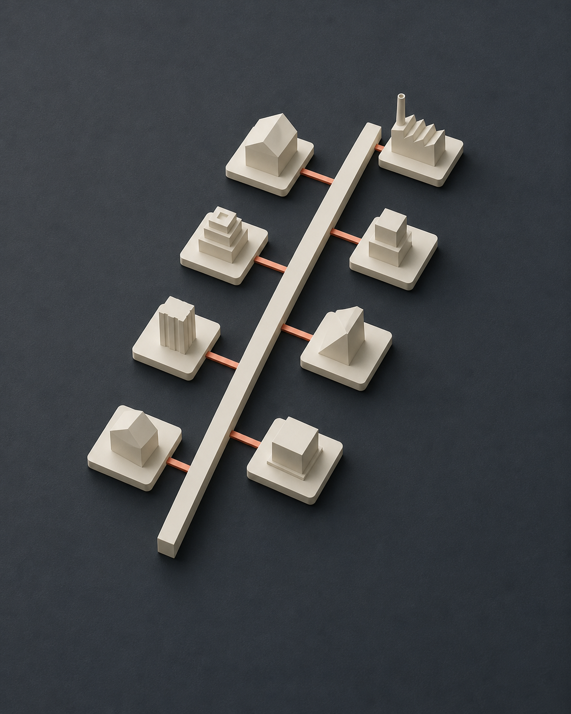

한 줄로 답하면 이렇습니다. 경기도와 여덟 개 시가 반도체 산업의 역할을 나눴고, 그 분담은 **동네마다 손님이 움직이는 시간표**를 만듭니다. 수원은 연구개발, 성남은 설계, 용인·화성·이천·평택은 제조, 안성·오산은 소재·부품·장비를 맡습니다(2026년 11월 17일 발표). 가게에 중요한 것은 산업 기사가 아니라, 그 옆에서 바뀌는 점심·저녁·주말의 리듬입니다.

## 확정된 것과 아직 아닌 것

11월 17일 경기도경제과학진흥원에서 열린 'K-반도체 초격차 비전선포식'에서 경기도와 8개 시가 공동 지정 추진에 합의했습니다(뉴시스·전자신문).

- **수원** — 연구개발(R&D)
- **성남** — 설계
- **용인·화성·이천·평택** — 제조
- **안성·오산** — 소재·부품·장비

경기도는 후속 계획도 함께 내놓았습니다. 2027~2031년 제3판교테크노밸리에 팹리스(반도체 설계 전문기업) 집적지를 조성하고, 전문인력 1만 4,400명을 기르고, 청년·신혼부부용 공공임대 2만 호를 공급하겠다는 목표입니다.

여기서 선을 그어야 합니다. 지금은 '추진' 단계이고, 산업통상부 공모가 남아 있습니다. 지정 시점도 확정되지 않았습니다. 용인시가 언급한 40만 명 규모의 인구 유입 역시 전망입니다(11월 18일 국무총리 주재 경기도권 지자체장 간담회에서 나온 발언, 뉴스프리존 2026-11-19 보도). 뉴스를 확정된 미래처럼 옮겨 적으면 글의 신뢰가 먼저 상합니다.

## 역할이 손님의 리듬을 바꾸는 방식

업종보다 근무 형태가 손님을 나눕니다. 출퇴근 시간이 다르면 배고픈 시간이 다르고, 배고픈 시간이 다르면 검색창을 여는 시각도 달라집니다.

- **설계·연구 (성남 판교·분당, 수원 광교)** — 점심이 짧고 몰립니다. 11시 30분~12시 30분에 검색이 집중되고, 저녁은 회의가 끝난 뒤인 18시 이후에 열립니다. 첫 화면에서 인원, 예약 가능 시간, 소요 시간이 먼저 답해져야 합니다.
- **제조 (용인·화성·이천·평택)** — 교대 근무와 차량 이동이 기본값입니다. 이른 아침과 늦은 밤, 주말 낮에 수요가 흩어집니다. 주차, 마지막 주문, 포장 여부가 방문 결정을 좌우합니다.
- **소부장 (안성·오산)** — 낮에 짧게 들르는 방문이 많습니다. 10시~16시 사이에 검색이 몰리고, 2~4인 좌석과 빠른 제공, 계산 방식이 중요합니다.

이 구분은 업종별 통계가 아니라 근무 형태에서 나온 추정입니다. 정확한 값은 우리 가게의 유입 검색어와 시간대별 방문 기록이 알려 줍니다. 다만 방향은 분명합니다. 검색이 점심에 몰리는 동네와 밤에 몰리는 동네는 같은 단어로 쓴 글이라도 반응이 갈립니다.

## 사람이 움직인 흔적은 숫자에 남습니다

계획과 별개로 인구는 이미 이동 중입니다. 한국부동산원이 11월 20일 내놓은 11월 셋째 주(16일 기준) 주간 아파트가격에서는 경기 매매가격이 0.21% 올라 서울(0.03%)보다 10주 연속 높은 상승률을 기록했습니다. 권역별로는 수원 권선구가 0.62%, 안양 동안구가 0.61%, 용인 기흥구가 0.55%로 앞섰습니다. 전세는 화성 동탄구 0.71%, 용인 기흥구 0.52%, 화성 병점구 0.54% 순으로 올랐습니다(아주경제, 2026년 11월 21일 보도).

반대 방향도 있습니다. 같은 주에 여주는 0.22%, 이천은 0.18% 내렸습니다. 경기 남부를 하나의 상권으로 묶을 수 없는 이유가 여기에 있습니다.

새로 이사 오거나 전세를 얻은 사람은 그 동네에서 밥을 먹고, 머리를 자르고, 세탁을 맡깁니다. 문제는 이들이 단골이 아니라는 점입니다. 단골은 가게 이름을 검색하지만, 새 손님은 "동네 이름 + 업종"이나 "역 이름 + 업종"으로 검색합니다. 그래서 인구가 느는 동네에서는 가게 이름보다 지역 이름이 먼저 검색됩니다.

## 지역 키워드를 다시 잡는 세 단계

**1단계, 유입 검색어를 세 층으로 나눕니다.** 사업주 통계의 검색어를 동·구·시 단위로 분류합니다. 시 단위 이름이 많다면 외부 방문 손님 비중이 크고, 동 단위 이름이 많다면 생활권 손님이 중심입니다.

**2단계, 문의와 방문의 시간대를 적습니다.** 2주만 적어도 패턴이 보입니다. 점심에 몰리면 직장 손님, 밤에 몰리면 교대·야근 손님, 주말 낮에 몰리면 가족 손님입니다. 그 시간표에 맞춰 영업시간과 예약 시간을 조정합니다.

**3단계, 첫 화면을 채웁니다.** 새 손님은 우리 가게를 모릅니다. 주차, 인원, 예약, 마지막 주문 시간 가운데 빠진 칸이 하나라도 있으면 그 자리에서 나갑니다. 지역 키워드로 들어온 방문은 대개 이 화면에서 문의로 바뀌거나 끊깁니다.

## 노티스랩이 보는 기준

지역 상담에서 먼저 보는 것은 뉴스가 아니라 세 가지 숫자입니다. 유입 검색어의 지역 층위, 상호명 대비 지역 조합 검색 비율, 조회 후 전화·길찾기·예약 중 무엇을 눌렀는지입니다. 이 세 가지를 확인한 뒤에 어느 이름을 쓰고 어떤 칸을 먼저 채울지 정합니다.

제작은 업체가 제공한 기존 사진과 영상을 바탕으로 기획하고 편집합니다. 별도 현장 촬영은 기본 서비스에 포함하지 않습니다. 촬영 일정을 기다리지 않고 다음 주부터 발행할 수 있다는 점이 이 방식의 장점이고, 동시에 한계입니다. 새로 생긴 공간이나 신메뉴처럼 기존 자료에 없는 장면은 반영이 늦어질 수 있습니다.

## 이 방식이 통하지 않는 경우

- **공장·연구단지와 거리가 먼 가게.** 통근 경로가 우리 가게를 지나지 않으면 인구 유입은 매출과 무관합니다. 이때는 배후 단지보다 기존 생활권 키워드가 우선입니다.
- **전국 단위 온라인 판매.** 지역 키워드보다 상품 키워드가 먼저입니다. 지역 글은 배송비·반품 안내가 정해진 뒤에 붙이는 것이 순서입니다.
- **업황 변동이 큰 시기.** 같은 주에 코스피가 5.21% 하락했습니다(11월 20일). 지역 계획은 연 단위로, 가게 숫자는 주 단위로 보는 편이 안전합니다.
- **임대료와 경쟁.** 사람이 늘면 같은 업종도 늘어납니다. 인구 증가와 함께 우리 업종 점포 수가 어떻게 변했는지 같이 확인해야 합니다.

## 자주 묻는 질문

### 클러스터가 지정되면 우리 동네 손님이 바로 늘어나나요?

아닙니다. 지정이 확정되더라도 기업 입주, 인력 유입, 생활 인구 증가까지는 시간이 걸립니다. 가게가 지금 할 수 있는 일은 유입 검색어와 시간대 기록을 쌓아 두는 것입니다. 그 기록이 없으면 사람이 늘어난 뒤에도 무엇을 바꿔야 할지 알 수 없습니다.

### 공장이나 연구단지가 없는 동네는 의미가 없나요?

그렇지 않습니다. 여덟 개 시 중 성남은 설계, 수원은 연구개발을 맡습니다. 공장이 아니라 사무실과 연구소가 들어오는 동네이고, 점심과 저녁의 높낮이가 뚜렷합니다. 통근 경로와 주차 동선만 확인해도 쓸 수 있는 정보가 나옵니다.

### 지역 이름은 시·구·동 중 어디까지 써야 하나요?

유입 검색어에 실제로 나온 이름부터 씁니다. 동 이름이 다수라면 동 이름 글이 먼저이고, 시 이름은 외부 손님을 노리는 두 번째 글의 몫입니다. 느낌으로 정하면 대개 틀립니다.

### 이 변화가 우리 업종에도 해당되나요?

업종보다 근무 리듬이 기준입니다. 같은 지역이라도 오피스 수요가 많은 블록과 주거 수요가 많은 블록은 시간표가 다릅니다. 우리 가게 3km 안에 무엇이 있는지부터 확인하는 편이 빠릅니다.

## 마무리

지역 뉴스는 지시문이 아니라 힌트입니다. 오늘 할 일은 하나입니다. 사업주 통계에서 지난달 검색어 열 줄을 옮겨 적고, 그중 우리 동네가 아닌 이름이 몇 줄인지 세어 보세요. 다음 지역 글의 제목이 거기서 나옵니다.

상담은 [카카오톡 채널](https://pf.kakao.com/_xdMIvX/chat)로 받습니다. 유입 검색어 열 개와 영업시간표만 보내주시면, 어느 지역 이름으로 어떤 글을 먼저 쓸지 정리해 드립니다.
