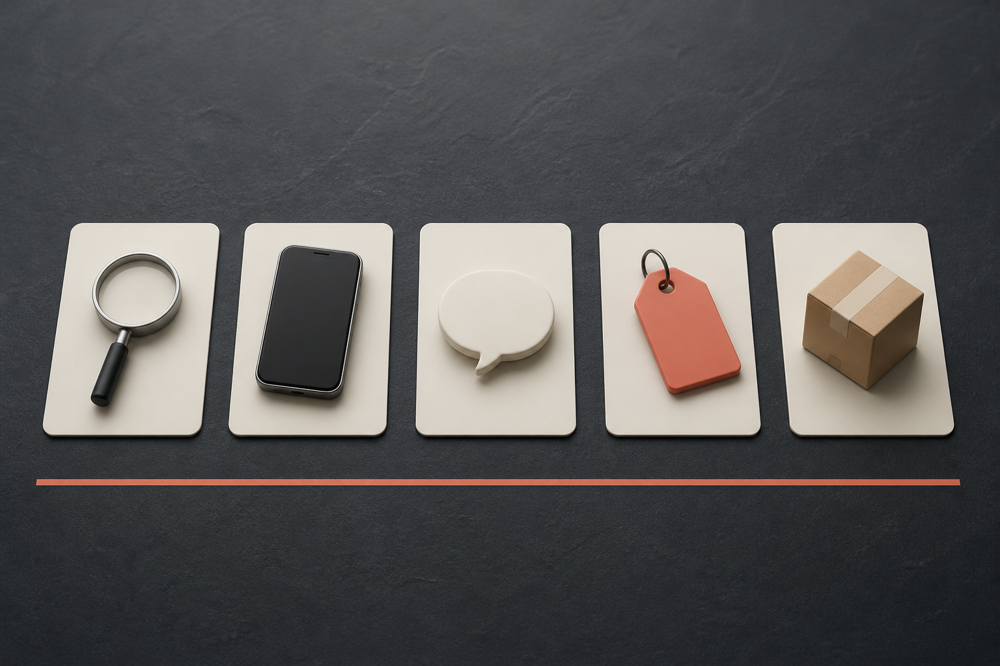

유통 상담이 길어지는 상품에는 공통점이 있습니다. 상담을 시작하기 전에 이미 설명이 끝나 있는 상품입니다. 반대로 상세페이지가 없거나 첫 화면이 비어 있으면 대화는 "사진부터 보내 주세요"에서 멈춥니다.

11월 20일부터 22일까지 서울 코엑스 1층 동문 로비에서 열리는 '소담마켓'은 이 차이를 그대로 보여 줍니다. 부스를 낸 60개사는 물건이 좋다는 이유만으로 뽑힌 가게가 아니라, 소담스퀘어 지원을 통해 **온라인에서 먼저 팔려 본** 가게입니다(연합뉴스, 2026년 11월 20일). 운영 시간은 매일 11시부터 18시까지입니다.

## 행사장에서 확인되는 것

소담마켓은 중소벤처기업부와 한국중소벤처기업유통원(한유원)이 함께 여는 사흘짜리 판촉 행사입니다. 부스는 소담스퀘어 사업을 거친 60개사가 채우고, 품목은 식품이 25개사로 가장 많습니다. 이어 뷰티 9개사, 패션잡화 9개사, 생활용품 7개사, 기타 7개사, 반려동물용품 3개사 순입니다.

판매만 하는 행사가 아닙니다. 현직 상품기획자(MD) 6명이 소상공인 22개사와 1대1로 판로를 상담합니다. 참여 유통사는 NS홈쇼핑, 지마켓, 농협식품, 우체국쇼핑, 그립, 롯데쇼핑 등입니다. 이 밖에 AI가 방문객 취향에 맞는 부스를 안내하는 체험과 스탬프 투어가 상시 열립니다.

보도된 참가 사례도 방향이 같습니다. 반려견 먹거리 브랜드 '롱런하개'는 초기에 제품힘은 있었지만 상세 페이지와 홍보에서 막혔습니다. 소담스퀘어 전주에서 전자상거래 입점을 지원받으며 매출이 늘었다고 대표가 전했습니다. 전통 향을 현대적으로 해석한 '인해일'은 5인 미만으로 개발과 마케팅을 같이 하다 대구 소담스퀘어의 '올인원 MD서비스'를 택했습니다.

두 사례는 노티스랩의 사례가 아니라 언론에 보도된 업체의 발언입니다. 다만 공통점은 분명합니다. 행사장에 서기 전에 온라인에서의 기록이 먼저 있었습니다.

## 유통 MD가 3분 안에 확인하는 다섯 가지

- **상품명 검색 결과** — 고객이 쓰는 단어로 검색되는지 봅니다. 준비되지 않았으면 "검색이 안 되네요"에서 상담이 멈춥니다.
- **상세페이지 첫 화면** — 누구에게 무엇을 파는지 즉시 읽히는지 봅니다. 비어 있으면 사진 재요청으로 다음 연락로 밀립니다.
- **리뷰와 문의** — 팔린 뒤 반복된 질문이 무엇인지 봅니다. 없으면 반품·CS 부담으로 먼저 판단됩니다.
- **가격과 재고** — 채널별 가격 일치와 공급 가능 물량을 봅니다. 불확실하면 물량·마진 협의로 다시 잡힙니다.
- **포장과 반품** — 파손·반품 사유가 관리되는지 봅니다. 관리되지 않으면 물류 비용 부담으로 보류됩니다.

이 다섯 가지는 행사장에서 길게 설명하지 않아도 확인됩니다. 상품이 온라인에 이미 올라가 있으면 링크 하나로 끝나고, 없으면 그 자리에서 설명해야 합니다. 상담 시간의 차이는 여기서 생깁니다.

## 첫 화면에 남길 세 가지와 사진 세 컷

**상품명에 검색어를 넣습니다.** 손님이 입력하는 말은 대개 "무엇 + 누구 + 상황"으로 조합됩니다. "간식"만으로는 결과에 걸리지 않습니다. "소형견 간식"처럼 대상이 붙어야 검색이 시작됩니다.

**근거는 확인 가능한 것만 적습니다.** 원재료, 만든 방식, 생산지처럼 검증할 수 있는 문장만 남깁니다. 효능·효과는 표시광고 기준에 따라 표현 범위가 정해져 있으므로 식품·화장품은 문구를 따로 검토해야 합니다.

**수령 조건을 숨기지 않습니다.** 배송 소요, 보관, 유통기한, 교환 조건입니다. 이 항목을 먼저 적어 두면 같은 질문이 반복되지 않습니다.

사진은 세 컷이면 됩니다. 제품 자체, 크기를 가늠할 수 있는 손 위의 모습, 개봉한 상태입니다. 새로 찍지 않고 매장에 있는 사진으로도 구성할 수 있습니다.

문의도 재료입니다. 최근 문의에서 반복되는 것을 모으면 대개 세 가지로 수렴합니다. 그 세 가지를 첫 화면에 넣으면 상담으로 오지 않습니다.

## 지원 제도는 행사장 밖에서 계속 돌아갑니다

판매 행사는 사흘이면 끝나지만 지원 사업은 상시 운영됩니다. 소상공인 디지털 전환과 판로 개척은 '소담인프라'로 묶여 있고, 세부 사업은 소담스퀘어(온라인 입점·마케팅)와 소담상회로 나뉩니다. 공고는 한유원이 운영하는 판로 지원 플랫폼 판판대로(fanfandaero.kr)에 올라오고, 신청도 거기서 합니다.

서류는 미리 모아 두면 신청이 빨라집니다. 사업자등록증, 제품 사진 원본, 가격과 원가, 온라인 판매 이력, 인증·원산지 자료입니다. 판매 이력이 없다면 그 사실을 어떻게 설명할지부터 정리해야 합니다. 이력 없이 시작하는 사업도 있으니 공고의 대상 조건을 먼저 읽으세요.

## 노티스랩의 제작 순서

판로는 채널을 늘리는 일이 아니라 검색되는 상품을 만드는 일에서 시작합니다. 상담이 들어오면 세 가지를 먼저 확인합니다. 고객이 실제로 쓰는 검색어가 상품명에 들어 있는지, 첫 화면이 3초에 읽히는지, 리뷰에서 되풀이되는 질문이 무엇인지입니다. 그다음에 사진과 글을 배치합니다.

제작은 업체가 가진 기존 사진과 영상으로 진행합니다. 별도 현장 촬영은 기본 서비스가 아니며, 촬영이 필요하다고 판단되면 비용과 일정을 따로 협의합니다. 매장 사진 열 장으로 어디까지 되는지는 [매장 사진 10장으로 블로그와 릴스까지](/insights/making-blog-and-reels-from-10-photos/)에 정리해 두었습니다.

## 이 방식이 통하지 않는 경우

- **가격이 결정 요인인 상품.** 상세페이지보다 가격 비교가 먼저라면 문구 개선 효과가 작습니다. 이때는 묶음·배송 조건이 먼저입니다.
- **재고가 불규칙한 상품.** 유통 상담에서 물량을 약속할 수 없으면 상담이 길어져도 결론이 나지 않습니다.
- **인증이 필요한 품목.** 식품·화장품·전기용품은 표시·인증 요건이 따로 있습니다. 상세페이지보다 서류가 먼저입니다.
- **행사 마감 이후.** 이번 행사는 11월 22일까지입니다. 이후에는 판판대로의 다음 공고를 확인하는 편이 빠릅니다.

## 자주 묻는 질문

### 이번 소담마켓에 참여하려면 어떻게 해야 하나요?

이번 행사의 부스는 소담스퀘어 지원을 받은 업체 중에서 선발된 60개사가 채웁니다. 다음 행사나 다른 지원 사업은 판판대로의 공고를 통해 신청합니다. 공고 열람에는 비용이 들지 않습니다.

### 온라인 판매를 한 번도 해 본 적이 없어도 지원할 수 있나요?

사업마다 대상과 제외 조건이 다릅니다. 온라인 입점처럼 초기 단계를 돕는 사업도 있으니, 공고문의 대상 조건을 먼저 확인하세요.

### 상세페이지만 잘 만들면 팔리나요?

아닙니다. 가격, 품질, 배송이라는 바탕이 먼저 갖춰져야 합니다. 상세페이지는 그 바탕을 보이게 하고, 첫 화면 세 줄은 상담 시간을 줄이는 역할을 합니다. 매출을 보장하는 도구는 아닙니다.

### 제작을 맡기면 촬영도 해 주나요?

기본 서비스에 포함하지 않습니다. 업체가 가진 사진과 영상으로 기획·편집하고, 촬영이 필요하면 별도로 협의합니다.

## 마무리

행사장에 선 가게들의 공통점은 팔기 전에 설명을 만들어 둔 가게라는 점입니다. 오늘 할 일은 하나입니다. 처음 보는 손님 앞에 놓일 문장 세 개를 종이에 적어 보세요. 그것이 첫 화면이 되고, 유통 상담에서 받을 첫 질문의 답이 됩니다.

상담은 [카카오톡 채널](https://pf.kakao.com/_xdMIvX/chat)로 받습니다. 제품 사진과 지금 파는 채널만 알려주시면, 상품명에 넣을 검색어와 첫 화면 세 줄을 정리해 드립니다.
