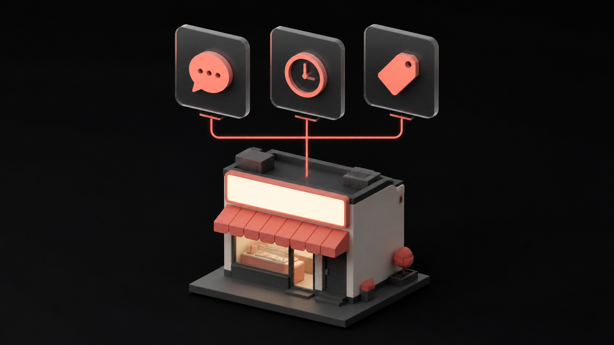

구글 지도에서 우리 가게를 눌렀을 때 '전화' 버튼 옆에 '메시지' 버튼이 생겼습니다. 11월 5일 구글 소상공인 게시판 공지로 확인된 변화이고, 대화 기능을 켜 둔 프로필에만 보입니다. 버튼이 생기는 것과 답이 오는 것은 다른 문제라서, 오늘 정할 것은 "누가 몇 분 안에 답하는가"입니다.

같은 달에 조용히 바뀐 것이 두 개 더 있습니다. 영업시간을 문장으로 적으면 채워 주는 칸, 그리고 내가 넣지 않은 할인이 가게에 붙는 혜택 칩입니다. 세 가지 모두 사장님이 직접 확인할 수 있는 화면에 있고, 돈은 들지 않습니다.

## 구글 지도: 전화 옆으로 올라온 메시지 버튼

구글이 11월 5일 소상공인 게시판에 올린 공지에 따르면, 안드로이드와 아이폰 구글 지도에서 업체 프로필을 열면 '전화' 바로 옆에 '메시지' 버튼이 보입니다. 이전에는 프로필 아래쪽으로 한참 내려야 찾을 수 있었는데, 위치가 위로 올라왔습니다.

버튼을 누르면 손님은 업체가 설정한 대화 창구로 넘어갑니다. 문자 메시지나 왓츠앱입니다. 여기서 알아 둘 것이 하나 있습니다. 두 가지를 모두 등록하면 손님에게는 문자 쪽만 보입니다. 그러니 "둘 다 해 두면 좋겠지"가 아니라, 실제로 가장 빨리 확인하는 창구 하나만 남기는 편이 낫습니다.

이 변화가 중요한 이유는 위치입니다. 손님이 매장 앞에서, 또는 밤에 폰으로 가게를 찾을 때 전화를 거는 일은 생각보다 부담스럽습니다. 대신 메시지를 누릅니다. 그때 답이 하루 뒤에 오면, 그 가게는 "전화를 안 받는 가게"가 아니라 "읽고도 답을 안 한 가게"가 됩니다.

응대는 사람을 정하는 일부터입니다. 사장님 혼자면 영업 중에는 알림을 끄고 하루 두 번(오전 11시, 오후 5시) 확인하는 식으로 정해 두세요. 첫 답장은 세 줄이면 충분합니다. 무엇을 물었는지 확인하고, 지금 답할 수 있는 것과 없는 것을 나누고, 언제 다시 연락할지를 적는 것입니다. 문의 답장 문장은 [문의는 오는데 예약은 안 됩니다](/insights/inquiry-reply-three-lines/)에 예시로 정리해 두었습니다.

한 가지 분명히 해 둘 점은, 이 버튼이 모든 나라와 모든 프로필에 보이는 것이 아니라는 것입니다. 구글은 공지에서 "일부 지역"이라고만 적고 지역 목록을 공개하지 않았습니다. 우리 가게에 버튼이 없다면 설정이 틀린 것이 아니라 아직 그 지역이 아닐 수 있습니다.

## 영업시간, 문장으로 적으면 채워 주는 칸

영업시간 편집기에 문장을 그대로 적으면 칸을 채워 주는 기능이 생겼습니다. "점심시간 1시부터 2시 30분까지 닫음"처럼 적으면 구글이 시간 칸을 만들어 주고, 저장 전에 직접 고칠 수 있습니다.

연말처럼 예외가 많은 달에 쓸 만합니다. 다만 생성된 값을 그대로 저장하지 마세요. 자정을 넘기는 영업은 날짜가 둘로 갈리고, 임시 휴무와 정기 휴무는 표시되는 방식이 다릅니다. 생성은 초안이고, 판단은 사장님 몫입니다. 12월 휴무를 다섯 곳에 맞추는 순서는 [연말 휴무는 2주 전에 보입니다](/insights/year-end-hours-two-week-rule/)에 따로 정리했습니다.

## 내가 넣지 않은 혜택이 붙을 수 있습니다

세 번째가 가장 조용합니다. 구글 고객센터의 혜택 관리 안내를 보면, 손님은 검색의 장소 시트에서 접었다 펼 수 있는 혜택 칩을 보고, AI 개요에서도 혜택이 표시될 수 있습니다.

혜택이 붙는 경로는 두 가지입니다. 하나는 내가 만든 혜택 게시물이나 연결된 소셜 계정이고, 다른 하나는 구글과 연동된 제3자 제공업체입니다. 문제는 두 번째입니다. 배달앱이나 예약 플랫폼에 걸어 둔 프로모션이, 또는 예전에 거래하던 업체의 할인이, 내 가게 장소 시트에 칩으로 붙을 수 있습니다.

구글은 제공업체가 **직접 계약을 맺은 비즈니스에만** 혜택을 제출할 수 있다고 안내합니다. 계약이 끝났거나 내가 승인한 적 없는 혜택이 보인다면, 구글 비즈니스 프로필 지원에 삭제를 요청할 수 있고, 요청을 받은 제공업체는 **영업일 기준 5일 안에** 내려야 합니다. 5일이 지나도 남아 있으면 위반 신고 양식으로 넘어갑니다. 이 기능 역시 일부 지역·언어에서만 제공됩니다.

확인은 간단합니다. 구글에서 우리 가게 이름과 동네를 함께 검색해 장소 시트를 열고, 예약·주문 버튼 옆이나 아래에 혜택 칩이 있는지 보세요. 내가 만든 것이면 문구와 조건이 지금도 맞는지 보고, 모르는 것이면 출처를 확인한 뒤 삭제를 요청합니다.

## 세 가지 변화, 오늘 할 일

| 바뀐 것 | 확인된 범위 | 손님이 보는 자리 | 오늘 할 일 |
|---|---|---|---|
| 메시지 버튼 | 대화를 켠 프로필, 일부 지역 | 지도 상단 '전화' 옆 | 담당자와 응답 시간을 정하고, 창구 하나만 남기기 |
| 영업시간 문장 생성 | 일부 지역·언어 | 검색·지도의 영업시간 | 생성은 초안으로만 쓰고 저장 전 직접 대조 |
| 혜택 칩 | 일부 지역·언어, AI 개요 포함 | 장소 시트, AI 개요 | 걸린 혜택 확인, 모르는 것은 삭제 요청 |

세 줄로 줄이면 이렇습니다. 메시지는 **켤지 말지를 정하고**, 영업시간은 **생성한 값을 검토하고**, 혜택은 **남의 것이 붙었는지 확인한다**.

## 참고로 알아 둘 실험

11월 10일 지역 검색 쪽에서 다른 화면이 목격됐습니다. AI 개요의 지역 결과에서 전화·길찾기 버튼과 리뷰·사진이 빠진 형태입니다. 지역 검색 전문가 조이 호킨스가 공개했고 서치엔진랜드테이블이 같은 화면을 재현해 보도했으며, 구글은 적용 범위에 대해 공식 입장을 내지 않았습니다.

이건 확정된 변경이 아니라 테스트입니다. 다만 방향은 읽힙니다. 버튼이 사라져도 남는 것은 프로필에 적어 둔 정보와 손님이 쓴 리뷰입니다. 그래서 새 기능을 쫓기 전에 기본 칸이 채워져 있는지가 먼저입니다. 다섯 칸 점검은 [구글 지도에서 우리 가게가 비어 보이는 이유](/insights/google-profile-five-fields/)에 있습니다.

## 이 방식이 통하지 않는 경우

- **지역·언어 제한.** 세 기능 모두 일부 지역에서만 제공된다고 안내되어 있습니다. 국내 노출 여부는 프로필마다 다를 수 있습니다.
- **공지와 도움말의 시차.** 워크스페이스 계정 연결은 "순차 적용 중"이라는 공지와 "현재 사용할 수 없음"이라는 도움말이 함께 있습니다. 급하면 개인 계정으로 확인하세요.
- **여러 프로필을 관리하는 계정.** 인증된 프로필을 여러 개 관리하면 일부 기능이 막힙니다. 대행사 계정에서 특히 그렇습니다.
- **효과의 크기.** 메시지 버튼을 켰을 때 문의가 몇 % 늘어난다는 공개 수치는 확인하지 못했습니다. 늘어난 문의가 예약으로 이어지는 비율도 업종마다 다릅니다. 저희가 말할 수 있는 것은 순서까지입니다.

## 자주 묻는 질문

### 메시지 버튼은 어디서 켜나요?

프로필의 채팅 설정에서 켭니다. 켜기 전에 받을 창구를 하나만 고르세요. 문자와 왓츠앱을 모두 등록하면 손님에게는 문자 쪽만 보입니다.

### 답장이 늦으면 검색 순위가 떨어지나요?

구글 고객센터는 지역 검색 순위가 주로 관련성, 거리, 인기도로 정해진다고 안내합니다. 응답 속도는 공개된 순위 요인이 아닙니다. 다만 버튼을 눌러 놓고 답이 없으면 그 손님은 다시 오지 않습니다.

### 혜택은 어디서 확인하나요?

구글에서 가게 이름과 동네를 검색해 장소 시트를 열고, 예약·주문 버튼 근처의 혜택 칩을 보세요. AI 개요에도 표시될 수 있습니다.

### 남의 혜택은 어떻게 내리나요?

구글 비즈니스 프로필 지원에 혜택 삭제를 요청합니다. 제공업체는 영업일 5일 안에 내려야 하고, 지키지 않으면 위반 신고로 넘어갑니다.

## 마무리

세 가지 중 오늘 할 수 있는 것은 하나입니다. 지도에서 우리 가게를 열고 상단 버튼 세 개를 보는 일, 그다음 혜택 칩이 내 것인지 아닌지 확인하는 일입니다. 15분이면 끝납니다.

확인하다가 화면이 헷갈리면 [카카오톡 채널](https://pf.kakao.com/_xdMIvX/chat)로 손님 폰 화면을 보내 주세요. 어느 칸을 먼저 손봐야 하는지 함께 보겠습니다.
