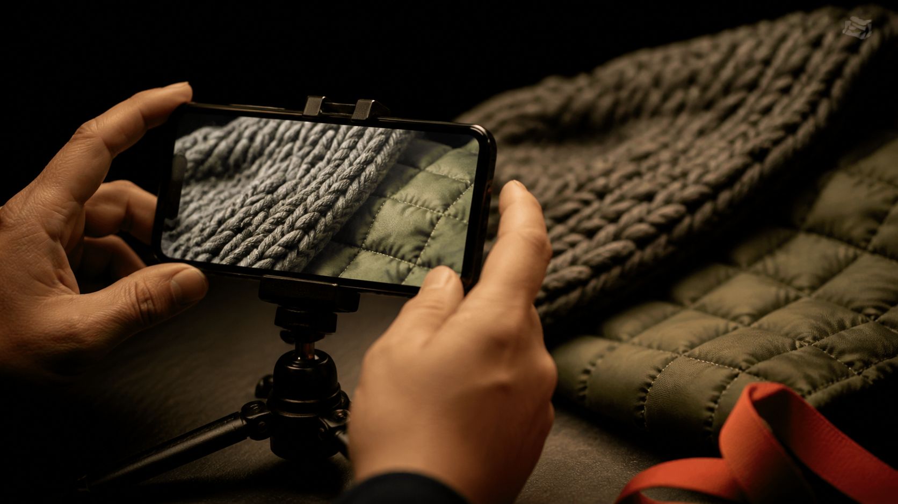

오늘 오전 구글 급상승 검색어 1위는 '패딩'이었습니다. 검색량 표기는 1만 건 이상이고, 함께 걸린 기사는 "이번 주부터 영하"였습니다. 겨울은 달력이 아니라 검색창에서 먼저 시작됩니다.

그런데 많은 가게의 콘텐츠는 아직 11월 초에 멈춰 있습니다. 지난 행사 사진을 올리고, 다음 행사는 12월에 준비하죠. 틱톡이 11월 10일 공개한 올해 트렌드 세 가지는 이 간격을 좁히는 데 쓸 수 있습니다. 핵심은 새로 만드는 것이 아니라, 이미 있는 것에 얹는 것입니다.

## 검색은 이미 겨울인데, 콘텐츠는 아직 11월

오늘(11월 21일) 오전 12시 기준 국내 구글 급상승 목록을 보면 '패딩'이 1만 건 이상으로 1위였습니다. 뒤에는 야구 FA 소식, 골프 중계, 화물열차 탈선 같은 뉴스가 이어졌습니다. 상품 검색이 뉴스 사이에 끼어 1위를 한 날은 많지 않습니다.

이 숫자를 그대로 믿고 "패딩을 팔아야겠다"로 가면 안 됩니다. 우리 가게가 옷가게가 아니라면 패딩은 소재가 아니라 신호입니다. 손님이 옷을 꺼내 입기 시작했다는 것은, 따뜻한 것과 실내에서 머무는 시간에 대한 검색이 함께 움직인다는 뜻입니다.

시즌 검색의 모양은 네이버 데이터랩에서 더 분명하게 보입니다. 데이터랩은 조회 기간 중 가장 많았던 시점을 100으로 두고 나머지를 상대값으로 보여 줍니다. 그래서 같은 키워드도 기간을 1년으로 잡느냐 2년으로 잡느냐에 따라 그래프가 달라집니다. 그리고 키워드를 하나씩 따로 조회하면 검색량이 수십 배 차이 나도 둘 다 100까지 올라가 비슷해 보입니다. 비교하려면 같은 조회에 함께 넣어야 합니다.

지난 2년간 '블랙프라이데이'와 '블프'를 묶어 주 단위로 본 기록을 보면, 두 해 모두 10월 마지막 주에 값이 두 배 넘게 뛰었고 12월 첫 주에 바로 내려갔습니다. 시즌 검색의 정점은 행사 주간이고, 그 전에 콘텐츠가 쌓여 있어야 정점을 받습니다. 검색이 오르기 시작한 뒤에 글을 쓰면 늦습니다. 이 순서는 [시즌 콘텐츠, 정점에 올리면 늦습니다](/insights/season-search-calendar-timing/)에 더 자세히 적어 두었습니다.

오늘 할 일은 30분입니다. 데이터랩에 우리 상품 검색어 세 개와 '패딩'을 함께 넣고, 최근 2년을 주 단위로 봅니다. 우리 검색어가 꺾이는 주를 찾고, 그 두 주 전에 올릴 것 하나를 달력에 적습니다.

## 틱톡이 뽑은 세 가지: 만드는 법이 아니라 붙이는 법

틱톡코리아와 대학내일이 11월 10일 '틱톡 트렌드 토크'에서 올해 국내 콘텐츠 흐름을 세 가지로 정리했습니다. 텍스처 플레이, 드라마피케이션, 카피 투 크리에이트 사이클입니다.

**텍스처 플레이**는 촉감과 식감을 보여 주는 콘텐츠입니다. 화장품 브랜드가 퍼프를 얼려 부수는 장면을 짧게 찍었고, 젤리처럼 말랑한 제품의 질감을 앞세운 사례도 소개됐습니다. 기능 설명보다 소리와 단면이 먼저라는 뜻입니다. 생성형 AI가 이미지를 쉽게 만들어 내는 환경에서, 오히려 직접 만질 수 있는 것이 눈에 띈다는 분석이 붙었습니다.

**드라마피케이션**은 드라마 대사와 상황을 일반인이 짧게 연기하는 흐름입니다. 유행한 대사 한두 줄에 배경음만 있으면 되고, 잘하는 연기보다 어설픈 연기가 오히려 재미가 됩니다. 그래서 진입 장벽이 낮습니다.

**카피 투 크리에이트 사이클**은 따라 하는 데서 끝나지 않고 자기 방식으로 바꿔 다시 올리는 구조입니다. 누군가의 대사가 다른 사람의 콘텐츠가 되고, 그게 다시 다음 사람의 출발점이 됩니다. 교육 크리에이터가 유행 대사를 자기 주제로 바꾼 사례, 그 음성을 브랜드가 자기 캐릭터에 붙인 사례가 함께 소개됐습니다.

세 가지의 공통점은 '잘 만드는 법'이 아니라 '가져다 붙이는 법'이라는 점입니다. 그래서 촬영 장비가 없고 모델도 없는 가게에 오히려 유리합니다.

## 가게에 있는 사진·영상으로 오늘 한 편

노티스랩은 현장 촬영을 기본으로 제공하지 않습니다. 이미 가게에 있는 사진과 영상으로 만듭니다. 아래 표는 세 흐름을 우리 매장 소재에 얹은 예시입니다.

| 흐름 | 가게에 있는 소재 | 첫 3초 | 첫 문장 예 |
|---|---|---|---|
| 텍스처 플레이 | 갓 나온 메뉴 클로즈업 | 김이 오르는 순간, 젓가락이 닿는 소리 | "이 소리 때문에 오시는 분이 있습니다" |
| 드라마피케이션 | 마감 10분 전 매장 상황 | 직원끼리 주고받는 짧은 대사 | "9시 50분에 오시면 이렇게 됩니다" |
| 카피 투 크리에이트 | 손님이 가장 많이 하는 질문 | 그 질문을 그대로 읽는 얼굴 | "이거 진짜 되나요?" |

만드는 순서는 다섯 단계입니다.

1. **쓸 사진·영상을 먼저 고릅니다.** 새로 찍지 않습니다. 지난 석 달 치 중에서 손에 잡히는 것 열 개면 충분합니다.
2. **첫 3초를 정합니다.** 결과나 질감이 먼저 보여야 합니다. 설명은 그다음입니다.
3. **첫 문장에 숫자나 손해를 넣습니다.** "맛있습니다"가 아니라 "9시 50분"처럼 구체적인 것이 손가락을 멈춥니다.
4. **자막은 한 줄에 한 가지만.** 두 줄이 되면 아무것도 안 읽힙니다.
5. **같은 소재로 세 번 변주합니다.** 첫 장면만 바꿔 올립니다. 이게 카피 투 크리에이트입니다.

해시태그는 욕심내지 마세요. 11월 3일 기준 국내 틱톡 트렌딩 보드 상위에는 #shorts(조회 6,750만), #뉴스(6,730만), #korea(5,930만) 같은 넓은 태그가 올라 있었고, 영상 수가 적은 #kdrama는 영상 한 개당 조회가 약 1만 8,700회로 계산됐습니다. 넓은 태그에 우리 업종과 동네 태그를 하나씩 붙이는 정도가 현실적입니다.

## 이 방식이 통하지 않는 경우

- **트렌드의 수명.** 숏폼 트렌드는 발견 후 24~48시간 안에 올려야 통하는 경우가 많습니다. 계절 검색처럼 미리 준비하는 것과 당일 유행은 다르게 다뤄야 합니다.
- **업종별 차이.** 뷰티·식품·패션은 숏폼과 구매가 붙기 쉽다고 분석되지만, 예약이나 상담이 필요한 업종은 영상보다 정보가 먼저입니다.
- **조회수와 매출은 다릅니다.** 조회수가 올라도 예약이 늘지 않는 경우가 많고, 동네 가게 숏폼의 예약 전환율에 대한 공개 통계는 확인하지 못했습니다.
- **손님 얼굴과 목소리.** 동의 없이 손님이 나온 영상을 쓰면 안 됩니다. 직원끼리 찍거나, 제품과 손만 담으세요.
- **뉴스성 급등과 계절 검색의 구분.** 오늘의 '패딩'은 계절 신호지만, 연예·사건 키워드는 하루 이틀이면 사라집니다. 우리 가게가 얹을 것은 두 번째가 아니라 첫 번째입니다.

## 자주 묻는 질문

### 촬영 장비가 없는데 만들 수 있나요?

만들 수 있습니다. 폰 하나와 창가 빛이면 됩니다. 조명보다 중요한 것은 거리입니다. 제품 30cm 안으로 들어가서 찍으면 질감이 살아납니다.

### 트렌드는 얼마나 빨리 따라야 하나요?

발견한 날로부터 24~48시간이 기준입니다. 그보다 늦으면 이미 식은 것으로 보입니다. 반대로 계절 검색은 두세 달 전에 준비해야 정점을 받습니다.

### 조회수가 안 나오면 어떻게 하나요?

조회수 대신 저장 수, 프로필 방문, 문의 수를 봅니다. 셋 중 하나라도 움직이면 형식은 맞은 것입니다. 셋 다 그대로면 첫 3초를 바꿔 다시 올립니다.

### 겨울 시즌 키워드를 우리 가게에는 어떻게 쓰나요?

상품이 아니면 소재로만 쓰세요. 겨울 검색이 올라왔다는 신호로 받아들이고, 우리 메뉴와 공간이 따뜻해지는 장면을 그 키워드 옆에 두는 방식입니다. 억지로 다른 상품을 파는 글은 읽히지 않습니다.

## 마무리

오늘은 사진 열 장을 새로 고르는 데 20분, 첫 3초를 정하는 데 10분이면 한 편이 나옵니다. 그 한 편이 다음 주 검색을 받는 자리가 됩니다.

어떤 사진부터 써야 할지 모르겠으면 [카카오톡 채널](https://pf.kakao.com/_xdMIvX/chat)로 매장 사진 몇 장을 보내 주세요. 새로 찍지 않고 쓸 수 있는 조합부터 찾아 드립니다.
