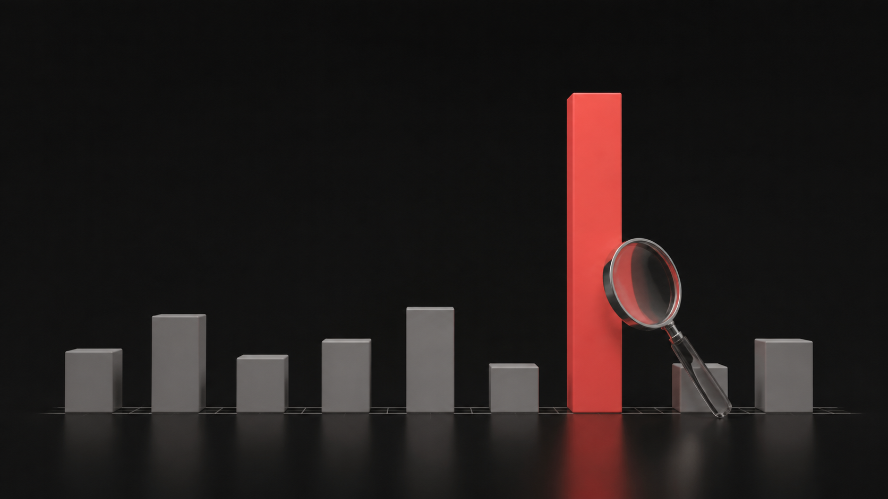

대행사가 "광고 수백 개 돌리고 있습니다"라고 하면, 그 숫자는 대개 사실입니다. 메타 광고 라이브러리에서 지금 집행 중인 광고를 누구나 볼 수 있기 때문입니다. 그런데 그 화면에 지출도, 클릭률도, 전환도 없습니다. 확인할 수 있는 것은 소재·문구·시작일·게재 플랫폼이고, 그래서 봐야 할 것은 개수가 아니라 **가장 오래 켜 둔 소재 하나**와 **무슨 말로 파는지**입니다.

라이브러리를 처음 열면 "활성 광고 68개" 같은 숫자가 먼저 눈에 들어옵니다. 그 숫자는 예산도 성과도 아닙니다. 같은 문구에 크기만 바꾼 변형이 여러 개로 세어지기도 합니다.

## 라이브러리에서 보이는 것과 안 보이는 것

| 항목 | 공개 여부 | 비고 |
|---|---|---|
| 지금 집행 중인 광고의 소재·문구 | 공개 | 이미지·영상·카피, 게재 시작일, 플랫폼 |
| 종료된 광고 | 비공개 | 광고를 끄면 라이브러리에서도 사라집니다 |
| 지출액·노출수 | 비공개 | 정치·사회 이슈 광고만 범위가 공개됩니다 |
| 타깃(연령·성별·지역) | 비공개 | 유럽연합에 게재된 광고는 공개됩니다 |
| 광고주 페이지 정보 | 공개 | 페이지 생성일, 이름 변경 이력 등 |

이 표는 메타 고객센터와 투명성 센터, 광고 라이브러리 API 문서를 2026년 10월에 확인해 정리한 것입니다. 요점은 하나입니다. **성과는 라이브러리에 없고, 흔적만 있습니다.** 그 흔적이 게재 기간입니다.

## 숫자 세 개로 읽는 시장

첫째, 오래 도는 소재는 생각보다 오래 돕니다. 11월 16일 기준 국내에서 집행 중인 메타 광고 가운데 가장 오래된 소재는 1,817일째였고, 상위 20개의 평균은 1,467일이었습니다. 20개 모두 1년을 넘겼습니다. 이 20개 문구를 성격으로 나누면 4개가 '고민에서 해결로' 가는 구조, 3개가 할인·가격 제시였습니다.

둘째, 새 소재는 빠르게 쏟아집니다. 11월 첫째 주(2~8일)에 새 광고를 올린 광고주는 966곳, 새 소재는 3,748종이었고, 가장 많이 올린 상위 20곳의 광고 중 62%가 영상이었습니다.

셋째, 대부분의 광고는 두 주를 넘기지 못합니다. 국내 뷰티 브랜드 107곳의 광고 5,902건을 46일간 살핀 조사에서는 절반이 올라온 지 2주가 안 됐고, 두 달을 넘긴 광고는 10%가 되지 않았습니다. 형식별 게재 기간 중앙값은 캐러셀 20일, 영상 15일, 이미지 13일이었습니다. 단, 이 조사는 "그 기간에 살아 있어야 집계되는" 구조라 오래 도는 광고가 더 잘 잡힙니다. 실제 비율은 이보다 낮을 수 있습니다.

그래서 "우리 광고는 오래 돌고 있습니다"라는 말은 그 자체로 좋은 말이 아닙니다. **무엇이 오래 도는지**를 봐야 합니다.

## '싸다'는 말이 가장 흔하고, 가장 짧게 삽니다

한 업종(사주·운세)의 집행 중 소재 416개를 설득 방식으로 나눈 자료가 있습니다. 2026년 10월 17일 기준, 광고주 156곳입니다.

- **값이 싸다** — 광고의 11%가 사용, 평균 71일
- **공짜로 준다** — 15%가 사용, 평균 94일
- **써 본 사람 말** — 10%가 사용, 평균 100일
- **빨리 된다** — 5%가 사용, 평균 138일
- **책임져 준다(보장·환불)** — 1%가 사용, 평균 120일

가장 많이 쓰는 말이 가장 짧게 살아남았습니다. 반대로 적게 쓰는 '빨리 된다'는 두 배 가까이 오래 갔습니다. 이 자료를 만든 쪽의 해석은 이렇습니다. 경쟁이 적고 오래 가는 말이 노려 볼 자리라는 것입니다.

이 숫자를 우리 가게에 그대로 옮기면 안 됩니다. 한 업종, 집행 중인 소재만 센 표본이고, 지속기간은 성과의 대리 지표일 뿐입니다. 다만 방향은 남습니다. **할인 문구는 손님이 이미 어디서나 보고 있어서, 우리 가게만의 이유가 되지 못합니다.**

## 대행사에 물을 세 줄

계약 전이든 진행 중이든, 아래 세 가지는 라이브러리와 광고 관리자 화면을 함께 보면서 확인할 수 있습니다.

1. **"가장 오래 켜 둔 소재가 무엇이고, 언제 시작했나요?"** 시작일은 라이브러리에 그대로 나옵니다. 대행사가 말한 기간과 화면의 날짜가 다르면 그 차이부터 물어보세요.
2. **"지난달에 새로 올린 소재는 몇 개이고, 그중 몇 개를 껐나요?"** 개수보다 교체 주기가 중요합니다. 껐다면 왜 껐는지, 남겼다면 무엇이 달라졌는지가 다음 달 계획의 근거가 됩니다.
3. **"보고서의 숫자는 어디서 나왔나요?"** 노출과 클릭은 광고 관리자에서 나옵니다. 문의와 예약은 우리 가게 채널에서 나옵니다. 두 숫자를 한 표에 섞어 놓으면 원인을 알 수 없습니다. 기간과 캡처를 함께 받으세요.

여기에 하나를 더하면 좋습니다. **"광고를 누르면 어디로 가나요?"** 카피가 "오늘 주문, 내일 수령"이라고 약속하는데 링크가 홈으로만 열리면, 소재가 아무리 좋아도 성과로 이어지지 않습니다. 휴대폰으로 링크를 직접 열어 첫 화면을 확인하세요.

## 계약서와 보고서에서 남길 것

- **광고 계정 소유자.** 비즈니스 관리자 소유가 대행사로 되어 있으면, 계약이 끝날 때 데이터를 가져오기 어렵습니다. 소유자는 우리 쪽, 운용 권한만 대행사로 두는 편이 안전합니다.
- **소재 권리와 사용 범위.** 우리가 준 사진·영상이 어디까지 쓰이는지, 계약 종료 후 언제 내려야 하는지 적어 두세요.
- **행동 지표 하나.** 노출·클릭만 있는 보고서로는 판단할 수 없습니다. 문의, 예약, 저장, 전화 중 하나를 정해 매달 같은 방식으로 기록합니다.
- **종료 소재 목록.** 어떤 소재를 언제 내렸는지 남겨야 다음 달에 같은 실험을 반복하지 않습니다.
- **인수인계 목록.** 계약 종료 시 넘겨받을 항목은 [대행을 그만두기로 했다면, 30일 안에](/insights/agency-handover-thirty-days/)에 정리해 두었습니다.

대행을 고르는 기준 자체는 광고만으로 정해지지 않습니다. 견적과 범위를 먼저 보려면 [블로그 대행 맡기기 전, 월 관리비보다 먼저 확인할 5가지](/insights/agency-checklist-before-hiring/)를 함께 보세요.

## 이 방식이 통하지 않는 경우

- **광고 수 ≠ 소재 수 ≠ 예산.** 변형이 하나로 묶이기도 하고 따로 세어지기도 합니다. 개수로 규모를 짐작하면 틀립니다.
- **사라진 실패.** 종료된 광고는 볼 수 없습니다. 지금 보이는 것만 세면 잘된 소재만 남아 보이는 착시가 생깁니다.
- **업종이 다르면 비교가 안 됩니다.** 전국 배송 상품과 동네 방문형 매장은 가격도 행동 경로도 다릅니다. 같은 표에 놓으면 결론이 뒤집힙니다.
- **지속기간은 성과가 아닙니다.** 예산이 남아 도는 소재, 손댈 사람이 없어 방치된 소재도 있습니다. 기간은 질문을 만들기 위한 단서입니다.
- **확인하지 못한 것.** 국내 소상공인 업종별로 장기 집행 소재의 전환율이 어느 정도인지 공개된 자료는 찾지 못했습니다.

## 자주 묻는 질문

### 경쟁사 광고를 그대로 쓰면 안 되나요?

안 됩니다. 사진·영상·문구에는 권리가 있고, 그대로 옮기면 성과가 난 이유도 알 수 없습니다. "완성품을 첫 장면에 둔다"처럼 원리만 뽑아 우리 소재로 다시 만드세요.

### 광고가 오래 떠 있으면 잘 되는 건가요?

가능성이 높다는 뜻이지 확인된 성과는 아닙니다. 성과가 나쁜 광고는 보통 빨리 꺼지지만, 예산이나 관리 공백으로 남는 경우도 있습니다. 기간은 대화를 시작하는 질문으로 쓰세요.

### 종료된 광고는 왜 볼 수 없나요?

메타가 종료된 광고를 라이브러리에서 내리기 때문입니다. 그래서 경쟁사 광고를 볼 때는 날짜를 적어 두고 2~4주 뒤 다시 확인해야 합니다.

### 광고비는 알 수 없나요?

일반 상업 광고의 지출은 공개되지 않습니다. 정치·사회 이슈 광고만 범위가 공개됩니다. 우리 광고의 지출은 광고 관리자 결제 내역에서 직접 확인하는 수밖에 없습니다.

## 마무리

대행사에 물을 것은 "광고 몇 개 돌리나요"가 아니라 "가장 오래 켜 둔 소재가 무엇인가요"입니다. 그 한 문장이면 대화의 기준이 달라집니다.

지금 돌고 있는 우리 가게 광고부터 같이 보고 싶으면 [카카오톡 채널](https://pf.kakao.com/_xdMIvX/chat)로 광고 관리자 화면을 보내 주세요. 무엇을 남기고 무엇을 끄면 되는지 한 장으로 정리해 드립니다.
