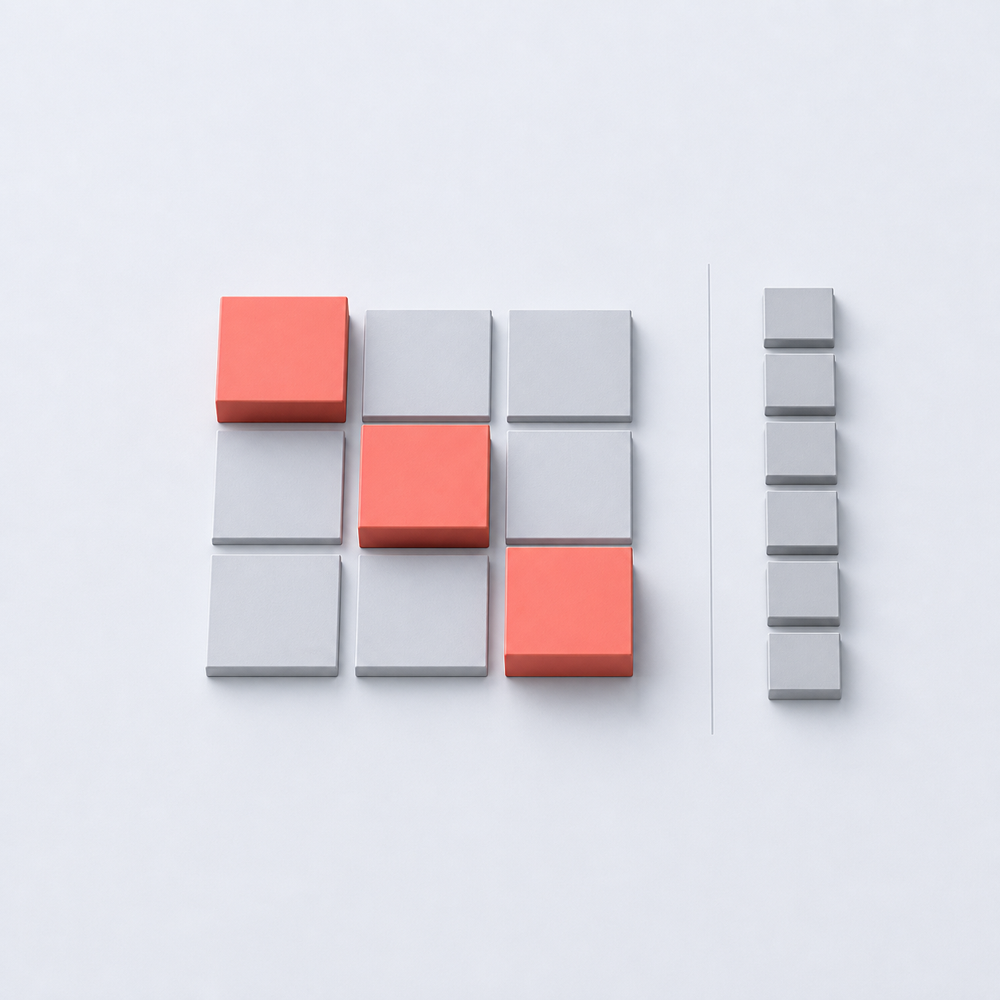

네이버가 11월 5일부터 플레이스광고 노출 개수와 구성을 바꾸는 테스트를 진행하고 있습니다. 모바일 통합검색은 광고 최대 6개에서 **9개**, 모바일 플레이스·지도앱과 PC 지도검색은 18개에서 **20개**로 늘어나는 구성입니다. 대상은 음식점·뷰티·병의원·숙박·명소 등 전 업종입니다.

슬롯이 늘면 노출 기회가 늘어납니다. 동시에 같은 화면을 사려는 광고도 늘어납니다. 그래서 지금 필요한 판단은 "켤까"가 아니라 **"얼마로, 어떤 방식으로, 무엇을 보고"**입니다. 이 글은 세 가지를 순서대로 정리합니다.

## 지면별로 달라지는 것

| 지면 | 이전 구성 | 변경 구성 |
|---|---|---|
| 모바일 통합검색 | 광고 최대 6개 | 광고 최대 9개 |
| 모바일 플레이스·지도앱 | 광고 최대 18개 | 광고 최대 20개 |
| PC 지도검색 | 광고 최대 18개 | 광고 최대 20개 |

통합검색은 목록 사이에 광고가 끼어드는 방식이라, 한 화면에 보이는 광고 수가 늘면 일반 결과는 그만큼 아래로 밀립니다. 지도 지면은 광고와 일반 결과의 배열이 바뀌는 형태입니다.

네이버는 이번 테스트로 **광고 등록·랭킹·과금 기준은 기존과 동일**하며, 노출 개수는 검색어와 경쟁 환경에 따라 다르고, 테스트 결과에 따라 **기존 방식으로 환원될 수 있다**고 밝혔습니다. 화면의 개수를 전제로 장기 계획을 세우기보다, 우리 계정의 숫자를 2주 단위로 기록하는 편이 오래갑니다.

## 규격부터 확인합니다

플레이스광고는 클릭당 과금(CPC)입니다. 등록과 노출은 무료이고, 클릭이 일어날 때만 비용이 나갑니다. 광고주센터 도움말 기준으로 확인한 값은 아래와 같습니다.

| 항목 | 값 | 비고 |
|---|---|---|
| 과금 방식 | CPC | 등록·노출 무료 |
| 기본 입찰가 | 50원~5,000원 | 부가세 별도, 10원 단위 |
| 입찰가 미설정 시 | 50원으로 입찰 | 광고그룹 단위 설정 |
| 하루 예산 | 광고그룹·캠페인 단위 | 만들기 화면 기본값 3만 원 |
| 키워드 | 직접 등록 없음 | 업체·업종·지역에 자동 매칭 |
| 제외검색어 | 광고그룹 단위 | 수동 운영에서 관리 |

하루 예산 상한은 도움말에 따라 안내가 갈립니다. 한 문서는 광고그룹·캠페인 각 10만 원으로, 다른 문서는 입력 범위를 50원~30만 원으로 적고 있습니다. 어느 쪽이든 **내 계정 화면에 적힌 값**이 기준입니다. 화면을 확인하지 않고 남의 블로그 숫자를 그대로 쓰면 계획이 어긋납니다.

입찰가는 "한 번 클릭될 때 낼 의사가 있는 최대 금액"입니다. 실제 결제액은 그보다 낮을 수 있지만, 예산 계산은 최대값으로 보수적으로 잡는 편이 안전합니다.

## 자동 운영과 수동 운영

새 광고그룹을 만들면 운영 방식을 고릅니다. 9월 16일부터 기본값은 자동 운영(ADVoost 플레이스, 베타)입니다.

| 구분 | 수동 운영 | 자동 운영 |
|---|---|---|
| 입찰가 | 직접 설정 | 설정 불가, 실시간 자동 조정 |
| 타겟팅 | 지역·매체·성별·연령·요일·시간대 | 요일·시간대만 직접 설정 |
| 소재 | 홍보문구 16자, 이미지 최대 3장 | 스마트플레이스 정보로 자동 생성 |
| 제외검색어 | 사용 가능 | 사용 불가 |
| 과금 | CPC | CPC |
| 조건 | 없음 | 이미지 1장 이상 필요, 병·의원 업종 불가 |

자동 운영의 가장 큰 위험은 **하루 예산이 전액 소진될 수 있다**는 점입니다. 입찰가를 직접 만질 수 없고, 자동입찰 광고그룹에는 캠페인의 하루 예산 균등 배분 옵션도 적용되지 않습니다. 손댈 시간이 없고 사진과 정보가 잘 채워져 있다면 편한 선택이지만, 처음 시작한다면 예산을 낮게 잡고 켜야 합니다.

수동 운영은 손이 갑니다. 대신 입찰가, 시간대, 제외검색어를 직접 관리할 수 있어 "무엇이 비용을 만들었는지"를 알 수 있습니다. 12월처럼 예산을 촘촘히 봐야 하는 달에는 수동이 유리합니다.

## 클릭으로 세어지는 것들

여기서 성과 해석이 갈립니다. 과금되는 클릭은 업체 페이지로 가는 클릭만이 아닙니다.

| 클릭 | 손님이 한 행동 | 전환과의 거리 |
|---|---|---|
| 전화 | 지금 물어보려는 상태 | 가까움 |
| 예약 | 시간을 정하려는 상태 | 가장 가까움 |
| 길찾기 | 오려는 상태 | 가까움 |
| 저장하기 | 나중에 보려는 상태 | 중간 |
| 방문자 리뷰·플레이스 플러스 | 비교하는 상태 | 멀리 |

그래서 "클릭이 늘었다"와 "손님이 늘었다"는 다른 말입니다. 저장하기가 늘고 전화가 그대로라면 광고는 잘 돌지만 마지막 한 걸음이 막힌 것입니다. 이때 볼 것은 광고가 아니라 상세 페이지입니다. 사진, 메뉴, 가격, 영업시간, 예약 버튼이 손님을 붙잡고 있는지요.

## 하루 예산을 역산하는 식

**하루 예산 = 하루 목표 클릭 수 × 평균 클릭비**

목표 클릭 20회, 평균 클릭비 300원이면 하루 6,000원입니다. 한 달 18만 원 수준입니다. 클릭비는 업종·지역·경쟁에 따라 크게 달라서, 처음 1~2주는 작게 돌려 우리 상권의 실제 단가를 확인해야 합니다.

광고그룹을 만들 때 노출이 예상되는 검색어 목록을 볼 수 있습니다. 이때 우리 가게와 상관없는 검색어를 걸러 두면 초반 낭비가 줄어듭니다. 광고를 켠 뒤에는 노출된 검색어를 보고 제외검색어를 정리합니다. 비용을 줄이는 1순위 수단은 입찰가를 내리는 것이 아니라 **관련 없는 검색어를 빼는 것**입니다.

## 노출·클릭·문의·예약을 나눠 봅니다

광고가 살 수 있는 것은 앞의 두 칸입니다. 문의와 예약은 광고 밖에서 만들어집니다.

| 단계 | 광고가 하는 일 | 사장님이 준비할 것 |
|---|---|---|
| 노출 | 자리를 사는 단계 | 대표 사진, 업종 카테고리 |
| 클릭 | 관심을 확인하는 단계 | 홍보문구, 첫 화면 |
| 문의 | 응대가 시작되는 단계 | 전화 수신, 채팅 가능 시간 |
| 예약 | 시간이 확정되는 단계 | 예약 상품 시간, 인원, 취소 규정 |

그래서 광고를 켜기 전에 확인할 것이 있습니다. 전화를 못 받는 시간대가 있는지, 카카오톡 채널이나 톡톡의 채팅 불가 안내가 언제로 되어 있는지, 예약 상품의 시간이 실제 운영과 맞는지. 이 세 가지가 어긋나 있으면 광고비는 노출과 클릭까지만 쓰이고 끝납니다. 응대 문구는 [문의는 오는데 예약은 안 됩니다](/insights/inquiry-reply-three-lines/)에 정리해 두었고, 예약 화면 점검은 [플레이스 예약이 늘지 않을 때 확인할 다섯 구간](/insights/place-booking-five-gates/)에서 볼 수 있습니다.

## 이 방식이 통하지 않는 경우

- **노출 개수는 내 마음대로 정해지지 않습니다.** 같은 동네에서도 업종과 검색어에 따라 3개만 보이는 자리가 있고 9개가 보이는 자리가 있습니다.
- **하루 예산은 완벽한 상한이 아닙니다.** 예산에 도달해 광고가 중지되어도 검색 결과에서 빠지기까지 시간이 걸려, 그사이 클릭이 생기면 예산을 넘겨 과금될 수 있습니다.
- **부가세 기준이 다릅니다.** 입찰가는 부가세 별도, 보고서의 광고비는 부가세 포함으로 표시됩니다.
- **테스트는 진행 중입니다.** 슬롯 구성이 환원될 수 있으므로, 2주 단위로 노출·클릭·전화 수를 기록해 두세요.
- **확인하지 못한 것.** 업종·지역별 평균 클릭 단가와 광고 수익률은 공개 자료로 확인하지 못했습니다. 우리 계정의 보고서가 유일한 기준입니다.

## 자주 묻는 질문

### 하루 예산은 얼마로 시작하면 되나요?

목표 클릭 수를 먼저 정하고, 우리 업종의 평균 클릭비를 곱해 정하세요. 감이 없으면 만들기 화면의 기본값인 3만 원보다 낮게, 하루 5,000~10,000원으로 2주 돌려 단가를 확인하는 편이 안전합니다. 기본값을 그대로 두면 한 달 최대 90만 원까지 나갈 수 있는 설정입니다.

### 자동 운영을 켜 두면 편한가요?

사진과 정보가 잘 채워져 있고 손댈 시간이 없다면 편합니다. 다만 입찰가를 만질 수 없고 하루 예산이 전액 소진될 수 있으며, 제외검색어도 쓸 수 없습니다. 예산을 촘촘히 관리해야 하는 달에는 수동 운영이 낫습니다.

### 광고를 끄면 바로 문의가 끊기나요?

보통 몇 주에 걸쳐 서서히 줄어듭니다. 그래서 끄기 전에 최소 두 달치 문의·예약 건수를 정리해 두어야 판단이 가능합니다. 한 달 성과만 보고 끄면 다음 달에 다시 켜게 됩니다.

### 슬롯이 늘면 우리 가게에 유리한가요?

노출 기회는 늘지만 같은 자리를 두고 경쟁하는 광고도 늘어납니다. 유리한지는 우리 계정의 노출·클릭·전화 수가 어떻게 움직이는지로 판단해야 합니다. 개수보다 숫자를 보관하는 편이 오래갑니다.

## 마무리

광고를 켜기 전에 정할 것은 숫자 하나입니다. 하루에 몇 번 클릭을 받을 것인가. 그 숫자에 우리 업종의 클릭 단가를 곱하면 하루 예산이 나옵니다. 2주 뒤에 제외검색어를 정리하고, 전화·예약 클릭 수를 노출 수와 함께 적어 두세요.

지금 돌리는 광고의 하루 예산과 최근 2주 노출·클릭 수를 [카카오톡 채널](https://pf.kakao.com/_xdMIvX/chat)로 보내 주시면, 목표 클릭 기준으로 예산을 다시 계산해 드립니다. 상세 페이지에서 막힌 곳과 응대 시간대도 함께 짚어 드립니다.
