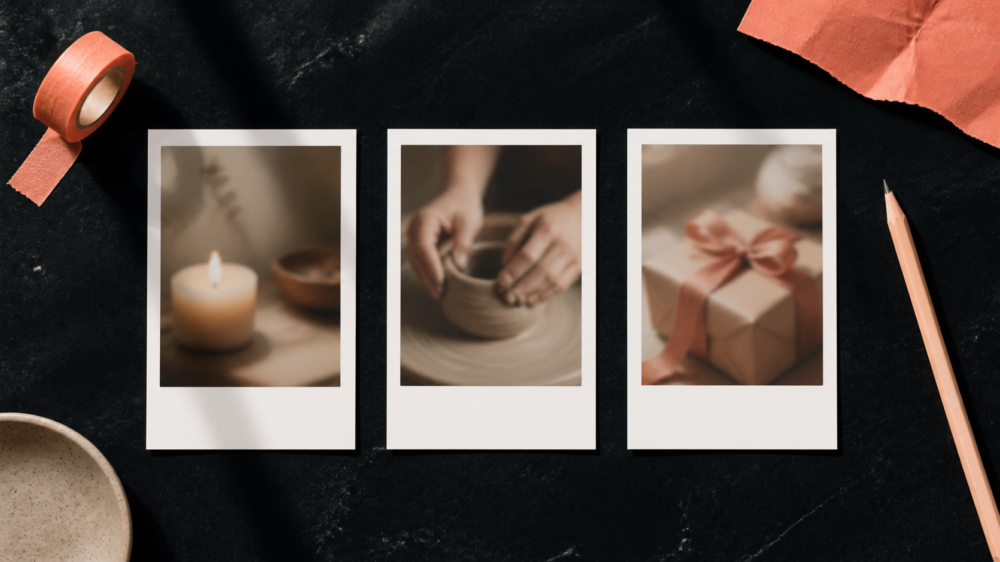

2025년 10~12월, '크리스마스·연말·12월'이 들어간 키워드의 검색량은 전년 같은 기간보다 16.6% 줄었습니다. 그런데 같은 기간 지방 크리스마스 마켓·빌리지 검색은 161.5%, 크리스마스 테마 공연은 165.1% 늘었습니다. 연말 소비가 줄어든 게 아니라, '무엇을 살까'가 '어디서 무엇을 하며 보낼까'로 옮겨 간 것입니다.

이 숫자는 리스닝마인드가 관련 키워드 43,016개를 묶어 2026년 10월 30일 공개한 분석입니다. 판매 상품을 준비하던 가게와, 시간을 준비하던 가게가 갈린 한 해였습니다.

## 숫자부터: 줄어든 것과 늘어난 것

| 구분 | 2024년 10~12월 | 2025년 10~12월 | 증감 |
|---|---|---|---|
| 연말 관련 전체 | 6,449만 건 | 5,378만 건 | -16.6% |
| '크리스마스' 포함 | 5,087만 건 | 4,075만 건 | -19.9% |
| '연말' 포함 | 409만 건 | 330만 건 | -19.2% |
| '12월' 포함 | 909만 건 | 828만 건 | -8.8% |

테마별로 나누면 방향이 더 선명합니다. 늘어난 쪽은 밖에서 직접 하는 일입니다. 크리스마스 테마 공연 +165.1%, 지방 크리스마스 마켓·빌리지 +161.5%, 12월 마라톤 +56.6%입니다. 반대로 와인·샴페인 -32.3%, 홈파티 -21.2%, 크리스마스 데이트 -18.7%, 호텔·호캉스 -17.9%처럼 집 안이나 둘만의 소비는 줄었습니다.

지역 편차도 큽니다. 크리스마스 마켓 검색에서 지방은 161.5% 늘어 서울의 22.4%를 크게 앞질렀습니다. 부산 크리스마스 빌리지는 1만 6,950건에서 16만 290건으로, 강릉 크리스마스 축제는 5,240건에서 2만 9,760건으로 늘었습니다. 전체에서 지방이 차지하는 비중은 2023년 15.7%에서 2025년 37.2%가 됐습니다.

서울 한 곳만 보고 연말을 준비하면, 이 변화는 눈에 띄지 않습니다. 손님이 우리 동네로 오고 있다는 뜻이기도 합니다.

## '체험'이 우리 가게에서는 무엇입니까

체험이라고 하면 팝업스토어를 떠올리기 쉽지만, 동네 가게가 실제로 팔 수 있는 형태는 세 가지로 좁혀집니다.

1. **시간을 파는 것** — 원데이 클래스, 대관, 정해진 시간에만 여는 코스. 재료와 자리를 미리 정해야 하므로 가격이 명확합니다.
2. **구경거리를 만드는 것** — 포토존, 작은 전시, 계절 장식. 손님이 사진을 찍어 올리는 일이 콘텐츠가 됩니다.
3. **같이 하는 것** — 단체 모임, 소규모 파티, 동호회 프로그램. 인원이 정해지면 매출이 먼저 확정됩니다.

셋의 공통점은 **취소가 곧 손실**이라는 점입니다. 물건은 재고로 남지만 자리는 남지 않습니다. 그래서 체험을 팔기로 했다면 예약금과 취소 기준을 같은 날 정해야 합니다. 이 부분은 [네이버 플레이스 예약이 늘지 않을 때 확인할 다섯 구간](/insights/place-booking-five-gates/)에 순서대로 정리해 두었습니다.

## 오늘 아침 검색창은 절기부터 움직입니다

2026년 11월 22일은 절기로 소설, 첫눈이 온다는 날입니다. 이날 오전 실시간 검색어를 기록하는 집계 사이트에는 '소설'과 '김장채소'가 나란히 올라 있었습니다. 검색량 순위가 아니라 신호를 조합한 자체 지표라 단정할 수는 없지만, 계절 검색이 절기와 함께 움직인다는 점은 매년 반복됩니다.

연말 키워드도 마찬가지입니다. 키워드 분석 자료(NAEO, 2026.11.19)가 연말 모임 키워드 218개를 작년 흐름으로 훑어보니, 193개의 상승 시작일이 이미 지나 있었습니다. 상승 시작일의 중앙값은 10월 21일, 작년 정점은 12월 1~7일이 가장 많았고 12월 중순이 지나면 사실상 닫혔습니다.

지금은 12월 정점을 열흘 앞에 둔 시점입니다. 새로 준비하기에는 늦었지만, 이미 있는 것을 바꿔 걸기에는 충분히 이릅니다.

## 경쟁 가게의 '체험' 문구는 라이브러리에서 무료로 봅니다

무엇을 강조할지 막막하면 메타 광고 라이브러리를 씁니다. 집행 중인 광고의 소재와 문구, 게재 시작일은 누구나 볼 수 있고, 지출과 전환은 공개되지 않습니다. 우리 동네에서 체험 프로그램을 파는 가게의 광고를 다섯 개만 찾아, 첫 문장만 그대로 적어 보세요.

- 결과 사진부터 보여 주는가, 사람이 참여하는 장면부터 보여 주는가
- 가격을 쓰는가, 시간을 쓰는가
- 예약을 어디로 보내는가

세 줄이면 우리 가게 문구의 출발점이 됩니다. 남의 문구를 그대로 쓰면 권리도 성과도 남지 않습니다. 구조만 가져오세요.

## 사진 세 장으로 오늘 한 편

새로 찍지 않아도 됩니다. 지난 석 달 사진에서 세 장을 고릅니다.

1. **결과** — 완성된 모습. 손님이 얻는 것을 첫 장에 둡니다.
2. **과정** — 손이 움직이는 장면. 체험은 과정이 상품입니다.
3. **안내** — 가격, 걸리는 시간, 예약 방법. 사진 위에 짧게 얹습니다.

숏폼으로 돌릴 때는 같은 소재로 첫 3초만 바꿔 세 번 올립니다. 틱톡 크리에이티브 센터 보드를 정리한 2026년 11월 15일 자료에서는 #먹방(9,190만 회)과 #mukbang(6,940만 회)이 나란히 1위와 5위였습니다. 연말에 사람들이 보는 것은 결국 먹고 즐기는 장면입니다. 우리 가게의 그 장면이 이미 사진에 있습니다.

## 이 숫자를 그대로 믿으면 안 되는 이유

- **분석 범위가 좁습니다.** '크리스마스·연말·12월'이 들어간 키워드만 모은 결과입니다. 홈파티나 와인 카테고리 전체가 줄었다는 뜻이 아닙니다.
- **작년까지의 데이터입니다.** 2024년과 2025년 10~12월을 비교한 자료이고, 2026년 연말은 아직 끝나지 않았습니다.
- **원인이 아닙니다.** 검색이 늘었다고 그 가게 매출이 늘었다는 뜻은 아닙니다. 체험형 소비가 늘어난 배경에는 연휴 구조나 회식 방식 변화 같은 조건이 함께 있을 수 있습니다.
- **조회수와 매출은 다릅니다.** 숏폼 조회수는 노출의 크기이고, 문의·예약과는 다른 숫자입니다.
- **검색량은 '몇 건'이 아닙니다.** 이 분석의 모수는 리스닝마인드가 수집한 검색 데이터이고, 네이버 데이터랩을 함께 볼 때도 값은 상대 지수입니다. 기간 안의 최대치를 100으로 두기 때문에 몇 번 검색됐는지는 알 수 없고, 검색량이 적은 말은 값이 거의 나오지 않습니다.

## 자주 묻는 질문

### 연말 매출이 줄고 있다는 뜻인가요?

아닙니다. 연말 테마 검색이 줄었다는 것이고, 같은 기간 밖에서 하는 체험 검색은 두 배 가까이 늘었습니다. 무엇을 파느냐에 따라 방향이 갈립니다.

### 어떤 업종이 체험을 팔 수 있나요?

공방·클래스·카페·식당·미용실·꽃집처럼 사람이 직접 오는 업종은 대부분 형태를 만들 수 있습니다. 재료나 자리, 시간이 필요한 곳일수록 유리합니다.

### 사진을 새로 찍어야 하나요?

아닙니다. 노티스랩은 현장 촬영을 기본으로 넣지 않습니다. 이미 가진 사진에서 결과·과정·안내 세 장을 고르는 방식으로 진행합니다.

### 지금 시작해도 늦지 않았나요?

연말 모임처럼 예약이 먼저 차는 주제는 이미 늦었습니다. 대신 12월 25~27일 연휴와 1월 초는 아직 남아 있습니다. 지금 올리면 그 구간을 겨냥할 수 있습니다.

## 마무리

연말에 손님이 사는 것은 물건이 아니라 하루입니다. 우리 가게가 그 하루를 어떻게 만들어 줄 수 있는지, 사진 세 장으로 먼저 보여 주세요.

어떤 사진을 첫 장에 둘지 고민되면 [카카오톡 채널](https://pf.kakao.com/_xdMIvX/chat)로 사진 몇 장을 보내 주세요. 새로 찍지 않고 조합을 잡아 드립니다.
