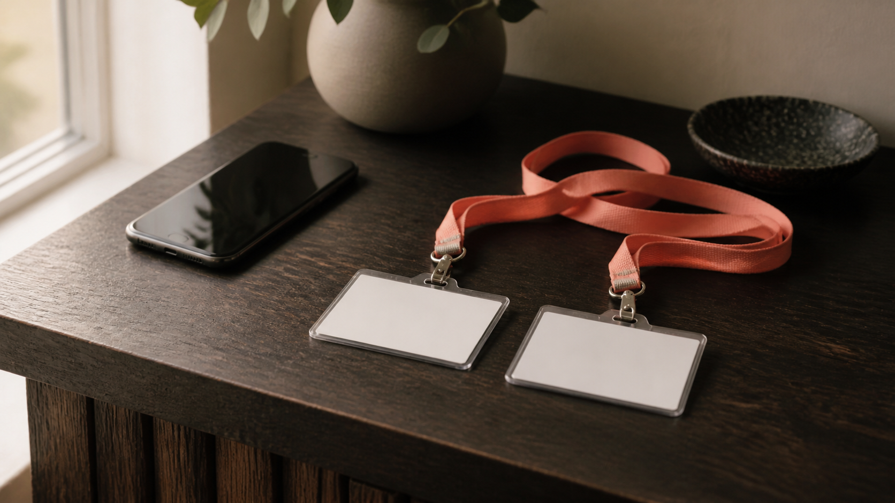

2026년 11월 26일(목)부터 네이버 스마트플레이스의 예약자·주문자 이름과 전화번호가 기본으로 가려집니다. 예약 확인과 완료 처리는 그대로 되지만, 전화를 걸려면 로그인한 계정 명의자의 본인인증을 거쳐야 합니다. 사장님 명의의 네이버 아이디를 직원과 함께 쓰는 가게는 그날부터 손님 번호를 볼 수 없습니다.

네이버가 10월 29일 올린 공지 한 장이 원인입니다. 개인정보보호 관련 고시가 개정되면서, 예약·주문 화면의 고객 정보 표시 방식이 바뀝니다. 남은 시간은 나흘입니다.

## 무엇이 가려지고, 무엇은 그대로입니까

| 항목 | 바뀐 뒤 화면 | 확인 |
|---|---|---|
| 이름 | 김예약 → 김\*약 (두 글자 이하는 예\*) | 기본 가려짐 |
| 전화번호 | 010-1234-5678 → \*\*\*-\*\*\*\*-5678 | 기본 가려짐 |
| 이메일 | smartplace@naver.com → sm\*\*\*\*\*\*\*\*@naver.com | 기본 가려짐 |
| 예약 확인·완료 처리 | 그대로 가능 | 인증 불필요 |
| 주문 접수, 목록·상세 조회 | 그대로 가능 | 인증 불필요 |
| 전화번호 확인, 고객에게 연락 | 인증 후 가능 | 명의자 본인인증 |

대상 화면은 예약자관리·예약현황, 주문자관리·주문현황, 발급쿠폰관리 안의 예약·주문 상세, 고객 메뉴의 예약·주문입니다. 화면 위의 [개인정보 조회] 버튼을 누르고 휴대폰 인증이나 네이버 인증서를 고르면 됩니다.

중요한 것은 **재인증 조건**입니다. 한 번 인증하면 화면을 옮길 때마다 다시 하지 않아도 되지만, 마지막 이용 후 24시간 동안 쓰지 않으면 다시 가려집니다. 주말에 몰아서 처리하는 가게라면, 하루 쉬는 날마다 인증부터 다시 시작하는 셈입니다.

## 사장님 계정을 함께 쓰는 가게가 걸립니다

공지에서 가장 눈에 띄는 부분은 이 두 줄입니다.

- 사장님 명의의 아이디를 직원과 함께 쓰는 경우, 직원은 사장님 명의 아이디로 본인 인증을 할 수 없습니다.
- 단체아이디는 실명 확인이 되지 않아 인증이 불가능합니다.

작은 매장일수록 이 구조가 흔합니다. 사장님이 결제와 예약을 한 아이디로 관리하고, 직원이 같은 아이디로 로그인해 예약을 확인해 왔다면 26일부터는 번호가 보이지 않습니다. 손님이 예약 시간을 바꾸겠다고 전화를 걸어 왔을 때, 되걸 전화번호를 찾지 못하는 상황이 생깁니다.

해결책은 공지에 함께 적혀 있습니다. 직원 각자의 네이버 아이디를 **운영자**로 등록하고, 그 아이디로 로그인해 본인 인증을 하게 하는 것입니다.

1. 스마트플레이스 > 전체설정 > 권한관리 > 예약·주문 운영자 관리로 이동합니다.
2. 운영자 추가에서 직원의 네이버 아이디를 입력해 초대합니다.
3. 직원이 네이버 알림에서 [동의하기]를 누르면 등록됩니다.
4. 직원이 본인 아이디로 로그인해 휴대폰 또는 네이버 인증서로 인증합니다.

운영자는 업체당 최대 60명까지 등록할 수 있습니다. 퇴사자는 목록에서 지우라고 공지에 적혀 있습니다. 이건 보안 문제이자, 그 아이디로 남은 접근 권한을 정리하는 일입니다.

## 26일 전에 끝낼 세 가지

1. **예약·주문 화면을 여는 사람을 셉니다.** 사장님 혼자인지, 직원이 함께 보는지. 알바가 시간대별로 바뀌는 가게라면 명단이 더 길어집니다.
2. **각자의 네이버 아이디를 확인합니다.** 아이디가 없으면 이번 주에 만들어야 합니다. 초대와 동의에 시간이 걸립니다.
3. **인증 수단을 미리 시험합니다.** 휴대폰 본인인증이 막히는 번호도 있습니다. 26일에 처음 시도하지 말고, 오늘 한 번 [개인정보 조회]를 눌러 보세요.

여기에 하나를 더하면 좋습니다. **예약자에게 먼저 보낼 문장을 정해 두는 것.** 전화번호가 바로 안 보이는 상황에서는 문자나 카카오톡 채널로 먼저 닿는 편이 빠릅니다. 문의 응대의 첫 세 줄은 [문의는 오는데 예약은 안 됩니다](/insights/inquiry-reply-three-lines/)에 정리해 두었습니다.

## 응대가 한 시간 늦으면 무엇이 달라집니까

연말 예약은 취소와 변경이 몰립니다. 작년 흐름을 분석한 2026년 11월 19일 자료에서는 연말 모임 키워드의 정점이 12월 1~7일에 가장 많이 몰렸습니다. 그 주에 예약 변경 전화를 받고도 번호를 못 찾아 되걸지 못하면, 손님은 다음 가게를 누릅니다.

전환은 화려한 유입이 아니라 이 한 번의 응대에서 갈립니다. 26일 이후를 대비하는 일은 마케팅이 아니라 운영입니다. 그래도 이 운영이 갖춰진 가게는, 같은 광고를 돌려도 문의가 예약으로 남습니다.

## 헷갈리기 쉬운 것

- **스마트스토어 전체 주문이 아닙니다.** 이번 공지는 스마트플레이스의 예약·주문 화면에 관한 내용입니다.
- **인증이 없어도 되는 일이 더 많습니다.** 예약 확인·완료 처리, 주문 접수, 목록 조회는 가려진 상태로 그대로 됩니다. 인증은 연락이 필요할 때만 합니다.
- **상세 조회는 명의자만.** 대표자 한 명이 모든 매장을 관리하는 구조라면, 매장마다 운영자를 따로 정리해야 합니다.
- **우리가 확인하지 못한 것.** 인증이 반복해서 실패할 때의 대체 절차, 운영자 초대가 제한되는 계정 유형, 모바일 앱과 PC 화면의 차이는 공지에 없었습니다. 26일 전에 한 번 직접 눌러 보시는 편이 안전합니다.

## 자주 묻는 질문

### 예약 확정과 완료 처리도 인증이 필요한가요?

아닙니다. 가려진 상태에서도 예약 확인, 완료 처리, 주문 접수, 목록·상세 조회는 그대로 됩니다. 인증은 전화번호 확인처럼 개인정보 상세 조회가 필요할 때만 합니다.

### 직원이 사장님 아이디로 로그인해 쓰고 있습니다. 그대로 두면 안 되나요?

직원은 사장님 명의 아이디로 본인 인증을 할 수 없습니다. 직원이 연락처를 봐야 한다면 직원 본인 아이디를 운영자로 등록해야 합니다.

### 한 번 인증하면 계속 볼 수 있나요?

마지막 이용 후 24시간 동안 쓰지 않으면 다시 가려집니다. 매일 아침 첫 예약 확인 때 인증하는 흐름이 됩니다.

### 단체아이디는 왜 안 되나요?

실명 확인이 되지 않는 계정이라 본인 인증 자체가 불가능합니다. 개인 명의 아이디로 운영자를 구성해야 합니다.

## 마무리

바뀌는 것은 화면 한 줄인데, 달라지는 것은 전화 한 통입니다. 26일 전에 운영자 명단과 인증 수단만 정리해 두면 예약 응대는 끊기지 않습니다.

우리 가게 화면이 어떻게 보일지 막막하면 [카카오톡 채널](https://pf.kakao.com/_xdMIvX/chat)로 예약자관리 화면을 보내 주세요. 어디까지 가려지고 무엇부터 준비하면 되는지 확인해 드립니다.
