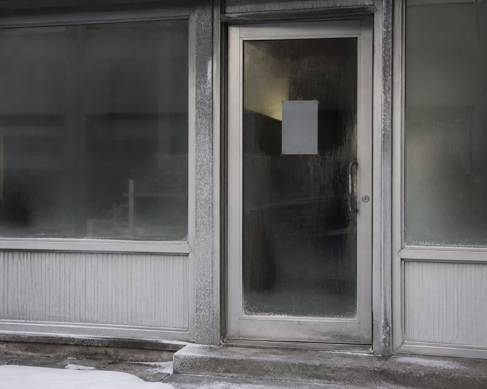

11월 5일 구글이 소상공인 공지에서 비즈니스 프로필 이의신청 도구를 바꿨다고 알렸습니다. 어떤 정책을 어겼는지, 이의신청이 가능한 사안인지 먼저 보여 주고, 증빙 서류를 제출 전에 올릴 수 있게 했습니다. 그런데 그 공지의 마지막 줄에 이런 문장이 있습니다. "이의신청은 한 번만 제출할 수 있으므로, 최종 제출 전에 사업자 증빙이 프로필 정보와 일치하는지 확인하세요."

한 번입니다. 되돌릴 수 없습니다.

## 무엇이 바뀌었나

| 항목 | 이전 | 11월 5일 이후 |
|---|---|---|
| 위반 사유 확인 | 문의 후에야 알 수 있었음 | 도구가 위반한 정책과 이의 가능 여부를 먼저 표시 |
| 클릭 수 | 여러 단계를 거쳐야 했음 | 절차가 줄었음 |
| 증빙 제출 | 제출 후 별도로 요청 | 제출 전에 미리 업로드 |
| 제출 횟수 | 명시 없음 | 1회 제한, 재제출 불가 |

증빙으로 인정되는 서류는 공과금 고지서, 사업자등록증처럼 **상호와 주소가 프로필과 일치하는** 것입니다. 증빙은 선택 사항이지만, 없이 제출하면 심사에서 불리할 수 있습니다.

## '한 번'이 계약 문제가 되는 이유

이 도구를 누르는 사람은 그 프로필에 접근 권한이 있는 사람입니다. 관리자 권한을 가진 대행사 직원도 누를 수 있습니다. 사장님이 상황을 모르는 사이에 대행사가 먼저 제출해 버리면, 그 한 번은 사라집니다.

프로필이 정지된 상태에서 그 한 번을 잘못 쓰면, 다음 선택지는 남은 것이 거의 없습니다. 지원팀에 다시 문의하는 경로가 있기는 하지만, 도구가 주는 정식 절차는 이미 닫힌 상태입니다.

정지 대행을 유료로 해 주는 업체도 있습니다. 다만 그들이 대신 눌러 주는 것과, 서류의 상호·주소를 프로필과 맞춰 주는 것은 다릅니다. 후자가 실제로 통과를 가르는 부분인데, 그 작업은 가게 서류를 가진 사람만 할 수 있습니다.

## 리뷰 이의신청은 지금 밀려 있습니다

프로필 정지와 별개로, 리뷰 이의신청도 느려졌습니다. 10월 중순 구글 담당자가 비즈니스 프로필 도움말 포럼에 "리뷰 관련 이의신청이 많아 처리 기간이 늘어났다"고 적었습니다. 기간은 안내할 수 없다고 했고, 이미 제출한 이의신청을 **두 번 보내지 말라**고 덧붙였습니다. 다시 보내도 추가 조치는 없고 대기만 길어진다는 뜻입니다.

그래서 리뷰 하나를 지우는 데 몇 주가 걸릴 수 있습니다. 그동안 별점은 그대로 보이고, 그 별점은 검색하는 손님에게 그대로 노출됩니다. 이의신청을 기다리는 동안 할 수 있는 일은 답글을 다는 것입니다. 답글은 심사 대상이 아니라 지금 바로 보이는 자리입니다.

## 계약 전에 확인할 세 가지

| 확인 항목 | 물어볼 말 | 문서로 남길 것 |
|---|---|---|
| 소유자 계정 | 프로필 소유자가 우리 계정인가, 대행사 계정인가 | 계약 종료 시 소유자 이전 절차와 시점 |
| 이의신청 권한 | 정지·이의신청을 누가 제출하는가 | 제출 전 사장님 확인을 받는다는 조항 |
| 복구 책임 | 정지됐을 때 누가 며칠 안에 무엇을 준비하는가 | 서류 준비 주체와 보고 기한 |

세 번째 항목은 계약서에 거의 없습니다. 그래서 정지가 일어난 날부터 서로 말이 달라집니다. 대행사는 "서류를 달라"고 하고, 사장님은 "관리비에 다 들어 있는 것 아니냐"고 합니다. 미리 한 줄 넣어 두면 그 대화가 10분으로 끝납니다.

프로필 권한과 계약 종료 시 넘겨받을 항목은 [대행을 그만두기로 했다면, 30일 안에 넘겨받아야 할 다섯 가지](/insights/agency-handover-thirty-days/)에, AI가 대신 쓰는 업무와 사람이 판단하는 업무를 나누는 기준은 [리뷰 답글은 이제 제미나이가 씁니다](/insights/gemini-profile-management-agency-scope/)에 정리해 두었습니다.

## 프로필이 멈추면 무엇이 같이 멈추나

프로필이 정지되면 검색과 지도에서 가게 정보가 사라지거나, 정보가 제대로 뜨지 않습니다. 전화 버튼, 길찾기, 예약 버튼, 영업시간이 한꺼번에 사라집니다. 매출이 얼마나 줄어드는지는 가게마다 다릅니다. 다만 손님이 문의를 넣을 창구 하나가 그 기간만큼 닫히는 것은 분명합니다.

이미 가게를 아는 단골은 다시 옵니다. 문제는 처음 찾는 손님입니다. 검색해서 나오지 않는 가게는 처음 찾는 사람의 후보 목록에 들지 못합니다.

## 적용할 때 조심할 점

이 도구가 국내 계정에서 그대로 보이는지는 확인하지 못했습니다. 11월 5일 공지는 영어로 게시됐고, 도움말에는 지역별 적용 범위가 적혀 있지 않습니다. 계정에 들어가 도구가 보이는지 직접 확인해야 합니다.

증빙은 상호와 주소가 프로필과 맞아야 합니다. 간판 사진보다 공과금 고지서나 사업자등록증이 낫습니다. 주소 표기가 '경기도 용인시 처인구 포곡읍 ○○로 12, 1층'처럼 프로필과 다르면, 그 차이를 먼저 정리하고 제출하세요.

리뷰 이의신청의 결과는 보장되지 않습니다. 구글이 정책 위반으로 판단하지 않으면 그대로 남습니다. 삭제를 약속하는 대행 계약은 그 약속을 어떻게 이행할지 문서로 요구하세요.

## 자주 묻는 질문

### 이의신청을 이미 한 번 했는데 다시 할 수 없나요?

도구 기준으로는 1회입니다. 추가로 지원팀에 문의하는 경로가 있지만, 도구를 통한 재제출은 안내되지 않습니다. 그래서 첫 제출 전에 서류를 다 맞춰 두는 것이 중요합니다.

### 대행사가 관리자로 들어와 있으면 어떤 문제가 생기나요?

이의신청 제출 권한을 함께 갖게 됩니다. 사장님이 모르는 사이에 한 번의 기회가 쓰일 수 있습니다. 소유자와 관리자를 구분하고, 제출 전 확인 절차를 계약서에 넣어 두세요.

### 리뷰 삭제는 보통 얼마나 걸리나요?

지금은 기간을 안내할 수 없다는 것이 구글의 입장입니다. 리뷰 관련 이의신청이 몰려 처리 기간이 늘었다는 공지가 10월 중순에 있었습니다. 기다리는 동안 답글로 대응하는 편이 현실적입니다.

### 프로필이 정지되면 매출은 얼마나 줄어드나요?

숫자로 단정할 수 없습니다. 다만 검색과 지도에서 전화·길찾기·예약 버튼이 함께 사라지므로, 처음 찾는 손님이 문의를 넣을 창구가 그 기간만큼 닫힙니다.

## 마무리

계약서에 들어가야 할 문장은 결국 하나입니다. "프로필 관련 이의신청은 제출 전에 소유자의 확인을 받는다." 이 한 줄이 없으면, 정지된 날 가장 급한 사람이 가장 되돌릴 수 없는 버튼을 누르게 됩니다.

지금 계정 소유자가 누구로 되어 있는지, 관리자 권한이 몇 명에게 있는지 확인하고 싶으시면 [카카오톡 채널](https://pf.kakao.com/_xdMIvX/chat)로 프로필 화면을 보내 주세요. 권한 구조와 계약서에 남길 문장을 함께 정리해 드리겠습니다.
