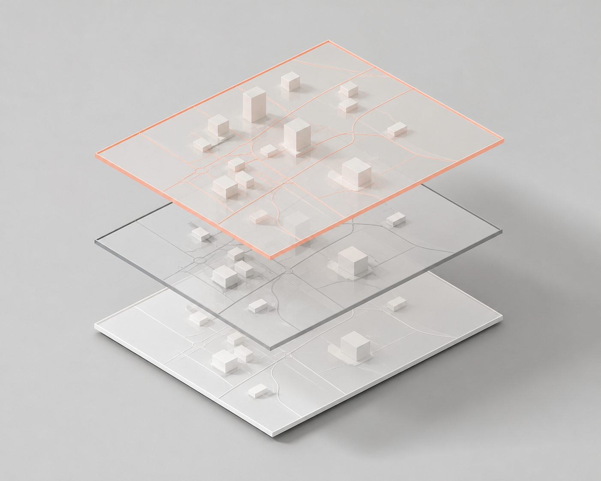

가게를 찾아오는 손님은 주소를 검색하지 않습니다. 자기가 부르는 동네 이름을 검색합니다. 그래서 **서류에 적힌 지명, 행정 구역의 지명, 사람들이 입에 올리는 지명이 세 겹으로 갈라져 있을 때**, 가게 정보에는 보통 첫 번째 것만 남습니다. 이 글은 세 겹의 이름을 한 장의 표로 맞춰 놓는 순서를 다룹니다.

## 지명은 왜 세 겹으로 갈라져 있나

행정은 서류를 기준으로 움직이고, 사람은 발걸음을 기준으로 움직입니다. 개발 단계에서 붙은 택지지구 이름은 주민들 입에 먼저 오르지만, 주소 체계는 그 아래 법정동 이름으로 남습니다. 행정동은 그 사이에서 주민센터 단위로 묶여 있습니다. 세 겹이 일부러 어긋난 것이 아니라, 각자 다른 목적으로 만들어진 이름이라서 겹치지 않는 것입니다.

이 구조를 이해하면 몇 가지 혼란이 사라집니다. 주소를 정확히 말했는데 손님이 못 찾는 일, 손님이 말하는 동네 이름이 등기부와 다른 일, 같은 동네 안에서 검색어가 여러 갈래로 나뉘는 일은 모두 같은 원인입니다.

## 바뀐 지명은 검색 혼선을 남깁니다

화성특례시는 2026년 3월 1일부터 동탄6동 관할 법정동 **'오산동'을 '여울동'으로** 바꿨습니다. 시가 안내문에 적은 배경이 결정적입니다. 인접한 오산시에 같은 이름의 '오산동'이 있어 우편물이 잘못 가고 주소 착오가 반복됐고, **지도 검색에서는 오산시 오산동이 우선 노출되는** 혼선이 계속됐다는 것입니다. 지도와 검색이 지명을 기준으로 움직인다는 사실을 지자체가 직접 확인한 사례입니다. 주민 설문 응답자 83%가 변경에 찬성했고, 주민등록 등·초본부터 등기부등본까지 공부상 명칭이 함께 바뀌었습니다.

명칭이 바뀐 동네에서 장사하는 사장님이라면 확인할 순서가 있습니다. 서류가 먼저이고, 가게 정보가 다음입니다.

| 순서 | 대상 | 확인할 것 |
|---|---|---|
| 1 | 사업자등록증·임대차계약서 | 새 지명으로 정정됐는지, 시행일 전후 자료 보관 |
| 2 | 플레이스·지도 서비스 주소 | 새 지명 반영 여부, 옛 지명 표기 잔여 |
| 3 | 예약 상품·안내문·영수증 | 옛 지명과 새 지명이 섞여 있는지 |
| 4 | 블로그·SNS 소개글 | 제목과 첫 문단에 쓴 지명 |

플랫폼마다 지명 변경을 반영하는 시점이 다를 수 있어, 옛 지명을 즉시 지우기보다 새 지명과 함께 두는 편이 안전합니다. 이 부분의 반영 시점은 각 서비스 화면에서 확인해야 합니다.

## 한 지명이 두 도시에 걸친 경우

광교신도시는 수원시 영통구 이의동·원천동·하동과 용인시 수지구 상현동 일원(기흥구 영덕동 일부 포함)에 걸쳐 있습니다. 면적 기준으로 수원시가 88%, 용인시가 12%이고, 2005년 착공해 2024년 12월 31일 준공됐습니다. '광교'라는 한 이름 안에서 주소를 열어 보면 시와 동이 갈라져 있습니다.

이런 지역에서 생기는 실무 문제는 명확합니다. 손님은 '광교'로 말하고, 서류는 '하동' 또는 '상현동'으로 적고, 검색은 양쪽 모두에서 들어옵니다. 가게 정보가 한 겹만 가지고 있으면 나머지 겹에서 오는 손님은 전부 흘러나갑니다.

## 세 이름을 한 장에 정리하는 방법

종이 한 장에 세 줄을 그으세요.

- **법정동 주소.** 도로명 주소와 지번 주소. 사업자등록증과 임대차계약서에서 확인합니다.
- **행정동.** 관할 주민센터 이름. 주민센터 안내와 시·구 홈페이지에서 확인합니다.
- **생활권 이름.** 손님이 실제로 말하는 동네·역·단지 이름. 자료에는 없습니다. 최근 3개월 리뷰에 쓰인 표현, 전화로 길을 물어오는 방식, 배달 주문서 요청사항에서 뽑아냅니다.

세 번째 줄이 실무의 핵심입니다. "광교상현역 근처", "○○아파트 뒷골목"처럼 손님이 남긴 표현이 곧 우리 가게의 검색 이름입니다. 이 표가 있으면 플레이스 소개, 글 제목, 예약 확인 문자를 쓸 때마다 기준이 고정됩니다.

## 어디에 어떤 겹을 쓰나

- **플레이스 소개 첫 두 줄.** 생활권 이름과 법정동을 이어 적습니다. "광교상현역 3분, 하동 소재"처럼요.
- **글 제목과 첫 문단.** 소재에 맞는 겹을 하나씩 고릅니다. 주차 이야기에는 역 이름이, 단체 예약 이야기에는 단지 이름이 자연스럽습니다.
- **리뷰 답글.** 손님이 쓴 지명을 그대로 받아 적으면 다음 손님이 그 표현으로 검색했을 때 걸릴 재료가 됩니다.
- **예약 확인 문자와 영수증.** "광교상현역 3번 출구에서 200m(하동)"처럼 한 줄로 두 겹을 함께 씁니다.

생활권 이름을 문단마다 반복하면 광고로 읽힙니다. 한 글에 두세 번이면 충분합니다. 지명별 검색량 비교 같은 수치는 공개 자료로 확인되지 않으니 추정하지 말고, 우리 가게에 실제로 들어온 검색어를 기준으로 삼으세요.

## 이 방법으로 해결되지 않는 것

- **서류와 화면의 시차.** 명칭 변경 시행일 이전에 발급된 서류는 옛 이름입니다. 정정 절차가 필요한지 해당 기관에 확인해야 합니다.
- **플랫폼 반영 시점.** 지도·검색 서비스가 새 지명을 언제 반영하는지 공개 자료로 확인하지 못했습니다. 화면에서 직접 확인하세요.
- **상호 중복.** 생활권 이름을 상호에 넣을 때는 같은 상권의 유사 상호와 상표 문제를 먼저 확인해야 합니다.
- **지역별 검색량.** "광교"가 "하동"보다 몇 배 검색된다는 식의 숫자는 확인되지 않습니다.

## 자주 묻는 질문

### 법정동과 행정동 중 무엇을 검색에 써야 하나요?

둘 다 쓰되 역할을 나누세요. 서류와 인증에는 법정동이 기준이고, 손님이 찾아오는 경로에는 생활권 이름이 효과적입니다. 가게 정보의 소개 문구에는 생활권 이름을 먼저, 법정동을 괄호로 함께 두는 방식이 양쪽 손님을 모두 받습니다.

### 동네 이름이 바뀌었는데 가게 정보를 바로 고쳐야 하나요?

서류부터 확인하세요. 사업자등록증과 임대차계약서가 새 지명으로 정리되기 전에 가게 정보만 고치면 나중에 인증·정산 단계에서 설명할 일이 생깁니다. 서류 정리 후 플레이스 주소, 예약 안내문, 영수증 순서로 고치는 편이 빠짐이 적습니다.

### 생활권 이름이 무엇인지 어떻게 알 수 있나요?

공식 자료에 없는 이름이라 손님의 말에서 뽑아야 합니다. 최근 리뷰에 반복되는 동네 표현, 전화 문의에서 손님이 말하는 위치 표현, 배달 주문서의 요청사항을 3개월치 모아 보면 세 개 안쪽으로 좁혀집니다.

## 마무리

지명 세 겹을 한 장의 표로 정리해 두면 글을 쓸 때마다 동네 이름을 다시 고민하지 않아도 됩니다. 법정동 주소, 행정동, 손님이 부르는 이름. 세 줄만 적어 보내 주시면 [카카오톡 채널](https://pf.kakao.com/_xdMIvX/chat)에서 플레이스 소개·글 제목·예약 문자에 쓸 표현을 정리해 드립니다. 노티스랩은 업체가 제공한 기존 사진·영상을 바탕으로 콘텐츠를 제작하며, 별도 현장 촬영은 기본 서비스로 제공하지 않습니다.
