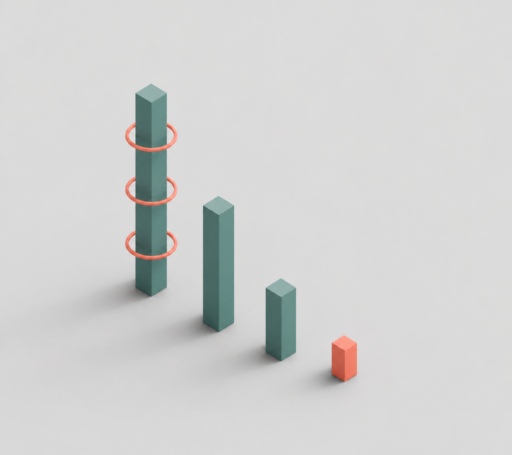

2026년 11월에 나온 지표들은 방향이 하나가 아닙니다. **수출은 연간 1조 달러를 넘었는데, 3분기 소매판매는 0.5% 줄었고 음식업 사업자는 79만 4,088명으로 5년 4개월 만에 최소가 됐습니다.** 같은 나라의 같은 분기에서 이 괴리가 실제로 있었고, 12월 운영 판단은 수출 지표가 아니라 내수 지표를 기준으로 세워야 합니다. 이 글은 세 지표가 각각 우리 가게의 무엇을 뜻하는지를 다룹니다.

## 지표 하나 — 사업자 수는 경쟁의 수가 아닙니다

국세청 국세통계포털 기준 9월 말 음식업 가동사업자는 79만 4,088명입니다. 1년 전보다 1만 5,582명(1.9%) 적고, 2023년 11월 정점 82만 8,545명 대비 2년 10개월 동안 3만 4,457명(4.2%) 빠졌습니다. 전년 동월 대비 감소는 29개월째입니다.

"가게 수가 줄면 남은 가게 몫이 늘지 않나"라는 질문이 흔하지만, 가동사업자 감소의 의미는 다릅니다. 이 숫자가 줄었다는 것은 **새로 문을 연 곳보다 문을 닫거나 쉬는 곳이 많았다**는 뜻이고, 그 동네에서 쓰이던 소비 총량이 함께 줄었을 가능성을 함께 봐야 합니다. 손님이 옮겨 오는 것이 아니라 손님 자체가 줄어드는 국면일 수 있습니다.

구성의 변화도 눈여겨볼 가치가 있습니다. 개업 6개월 미만 사업자는 6만 465명(-6.8%), 30세 미만은 3만 8,581명(-10.9%)으로 줄었고, 70세 이상은 5만 581명(+13.3%)으로 늘었습니다. 신규 진입이 약해지고 고령 운영자 비중이 커지는 시장에서는, 첫 방문 손님의 진입 장벽을 낮추는 기본기가 이전보다 중요해집니다.

## 지표 둘 — 수출 호황은 골목까지 오지 않았습니다

산업통상부 집계로 11월 19일 오후 연간 누적 수출액이 1조 달러를 돌파했습니다. 전년 같은 기간 대비 62.7% 증가이고, 1~10월 반도체 수출은 193.1% 늘었습니다. 같은 시기 3분기 소매판매는 -0.5%(2025년 2분기 이후 5분기 만의 감소), 숙박·음식점업은 -2.2%, 도소매업은 -0.2%였습니다.

KDI의 설명은 이 괴리를 잇는 다리가 됩니다. 성장을 끄는 산업의 고용 비중이 낮아 수출이 늘어도 임금과 소비를 끌어올리는 효과가 크지 않다는 것입니다. 올해 상반기 전체 근로자 평균 실질임금은 +0.3%에 그쳤고, 반도체를 포함한 전자부품 제조업 명목임금은 +21.6%, 금융·보험 관련 서비스업은 +12.3%였습니다. 실질임금이 떨어진 산업에서 일하는 근로자가 전체의 53.2%였습니다.

| 지표 | 값 | 기준 | 가게에서 볼 것 |
|---|---|---|---|
| 음식업 가동사업자 | 79만 4,088명 (-1.9%) | 2026년 9월 말, 국세청 | 같은 상권의 개업·폐업 |
| 소매판매 | -0.5% | 2026년 3분기, 국가데이터처 | 월별 방문 수 추이 |
| 숙박·음식점업 | -2.2% | 2026년 3분기, 국가데이터처 | 업종 평균과의 차이 |
| 실질임금 | +0.3% | 2026년 상반기, KDI | 객단가와 세트 구성 |

## 지표 셋 — 손님의 지갑은 제자리입니다

실질임금 +0.3%가 사장님께 주는 신호는 단순합니다. 평균적인 손님의 쓸 수 있는 돈이 늘지 않았다는 것입니다. 이 국면에서 정가 인상은 판매량을 먼저 움직입니다. 반면 임금이 크게 오른 업종이 밀집한 지역은 사정이 다를 수 있으니, 같은 경기 남부라도 상권별로 표정이 갈립니다.

12월에 적용할 수 있는 대응은 세 가지입니다.

1. **광고 예산의 무게를 단골 쪽으로 옮깁니다.** 신규 유입 단가가 오르는 국면에서는 재방문 안내와 예약 리마인드가 같은 예산으로 더 많은 확정을 만드는 경우가 많습니다.
2. **가격 인상을 구성 변경으로 대체합니다.** 점심 세트, 소량 메뉴, 포장 할인처럼 같은 지출로 만족이 커지는 방식이 인상보다 먼저 시도할 만합니다. 인상이 불가피하면 1월로 미루고 2주 전에 안내하는 편이 낫습니다.
3. **손님 연령 구성의 변화를 받아들입니다.** 메뉴판 글자 크기, 전화 주문 응대, 주차 안내처럼 알아듣기 쉬운 기본이 유행하는 표현보다 예약으로 이어집니다.

## 지표를 읽는 순서

순서는 우리 가게가 먼저입니다. 최근 3개월의 매출, 방문 수, 재방문 비중, 광고비, 채널별 문의 건수를 한 장에 적고, 그 위에 오늘의 지표를 겹칩니다. 반대로 하면 "경기 탓"이라는 결론이 먼저 나오고 우리가 고칠 수 있는 부분이 가려집니다. 지표는 방향을, 우리 가게 숫자는 위치를 알려 줍니다.

## 이 해석이 맞지 않는 경우

- **전국 지표입니다.** 지역·업종 편차가 크고, 우리 상권의 실제 움직임과 다를 수 있습니다.
- **가동사업자는 매출이 아닙니다.** 영업 중 사업자의 수이며, 규모·수익성은 다른 지표입니다.
- **3분기 자료는 이미 지난 분기입니다.** 12월 판단에는 11월 우리 가게 숫자를 함께 놓아야 합니다.
- **수출과 골목 매출의 인과는 확인되지 않았습니다.** 방향에 대한 해석이지 매출 예측 공식이 아닙니다.
- **증시 변동의 소비 영향은 알 수 없습니다.** 11월 20일 코스피 -5.21%와 주말 정부 대책(증안펀드 가동 준비, 자사주 매입 한도 완화, 공매도 특별감시)이 12월 소비를 어떻게 바꿀지는 확인된 자료가 없습니다.
- **임금 통계는 근로자 기준입니다.** 사업주 소득·자영업 소득과는 다른 지표입니다.

## 자주 묻는 질문

### 수출이 좋은데 가게가 안 되는 게 이상한 건가요?

이상하지 않습니다. 성장이 특정 산업에 집중되면 그 혜택이 임금과 소비로 고르게 퍼지지 않는다는 것이 KDI 분석의 요지입니다. 체감 경기와 거시 성장률의 간극은 최근 몇 해 이어져 왔고, 이번 수출 기록도 그 구조 안에서 읽는 편이 맞습니다.

### 12월 광고비를 줄여야 하나요?

줄이거나 늘리기 전에 두 가지를 먼저 나누세요. 신규 유입에 쓰는 비용과 기존 손님을 다시 부르는 비용입니다. 내수가 약한 국면에서는 후자의 효율이 상대적으로 좋아지는 경우가 많으므로, 같은 총액 안에서 배분을 먼저 바꾸는 편이 안전합니다.

### 사업자 수 감소가 우리 동네에도 그런지 어떻게 확인하나요?

지도와 플레이스에서 같은 업종 매장 수를 지금과 1년 전 기록과 비교하고, 상권분석 도구의 매장 수 증감 항목을 함께 보세요. 전국 통계는 배경이고, 상권 단위의 개업·폐업 흐름이 우리 가게의 위치를 알려 줍니다.

### 임금이 0.3%밖에 안 올랐는데 가격을 못 올리면 어떻게 하나요?

인상 대신 구성을 먼저 바꾸세요. 세트 구성, 소량 메뉴, 포장 조건으로 같은 지출 대비 만족을 높이는 방식이 판매량을 지키면서 단가를 관리합니다. 인상이 필요하면 1월에, 손님에게 2주 전에 알리는 순서로 진행하는 편이 반발이 적습니다.

## 마무리

거시 지표는 12월에 무엇을 할지 직접 알려 주지 않습니다. 대신 어느 방향이 유리한지를 알려 줍니다. 신규보다 재방문, 인상보다 구성, 유행보다 기본. 이 세 방향이 이번 분기 지표가 주는 결론입니다. 우리 가게 최근 3개월 숫자를 [카카오톡 채널](https://pf.kakao.com/_xdMIvX/chat)로 보내 주시면 지표와 함께 놓고 12월에 남길 항목과 줄일 항목을 정리해 드립니다.
