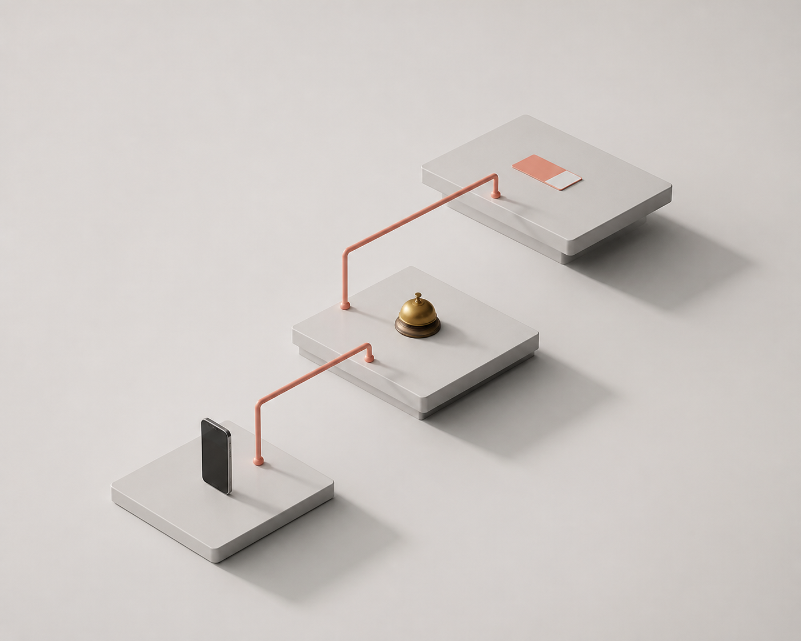

예약 문의가 많은데 확정이 약하다면, 문제는 예약을 받는 화면이 아니라 **확정된 뒤의 세 지점**일 가능성이 큽니다. 확정 직후의 불안, 전날 밤의 혼자 판단, 당일 아침의 마지막 변심. 이 세 지점에 각각 다른 준비가 필요하고, 예약금은 그중 마지막 수단입니다. 이 글은 네이버 예약의 확인된 규칙을 바탕으로 순서를 정리합니다.

## 예약이 깨지는 세 지점

첫째, **확정 직후**입니다. 예약을 넣은 손님은 그날 밤 "맞나?"를 다시 묻습니다. 이때 아무 안내가 없으면 날씨가 나빠질 때 가장 먼저 취소하는 손님이 됩니다.

둘째, **전날 밤**입니다. 다음 날 일정을 정리하는 시간에 취소가 몰립니다. 우리가 아무 말도 하지 않으면 손님은 혼자 결정합니다.

셋째, **당일 아침**입니다. 교통과 날씨를 보고 마지막으로 판단합니다. 이때는 전화를 받을 사람이 있어야 합니다.

## 1단계 — 확정 직후의 세 줄

예약을 받은 그날 안에 세 줄을 보냅니다.

1. 일시, 인원, 예약 이름
2. 오시는 길, 주차, 그날 날씨에 대한 한 줄 안내
3. 취소·변경을 알릴 창구와 시한

세 번째 줄이 핵심입니다. "취소는 하루 전까지 이 번호로 알려 주세요"라는 한 줄이 연락 없는 부재를 문자가 남는 취소로 바꿉니다. 연락을 받은 취소는 자리를 다시 채울 시간을 벌어 주는 정보입니다. 카카오톡 채널이나 톡톡 자동답변에도 같은 세 줄을 넣어 두면 전화를 받지 못한 시간에도 같은 안내가 나갑니다.

## 2단계 — 전날의 리마인드는 도달율을 계산해서 보냅니다

네이버 예약의 리마인드 알림은 원칙적으로 **밤 10시부터 다음 날 오전 9시 사이에 나가지 않습니다.** 네이버·지도 앱을 쓰지 않거나 알림을 끈 손님에게는 도달하지도 않습니다. 즉 자동 알림을 보냈다고 해서 전원에게 전달된 것이 아닙니다.

그래서 전날 오후에 한 번 더 확인하는 편이 안전합니다. 문구는 짧게, 날씨와 교통만 덧붙입니다. "내일 오전 비 예보가 있어 주차장이 붐빌 수 있습니다. 10분 일찍 출발하시면 좋습니다." 같은 한 줄입니다. 전화로 받은 예약에는 자동 알림이 나가지 않으므로, 예약장에 '전화' 표시를 두고 문자를 따로 보내야 합니다.

## 3단계 — 취소 기준은 미리 보여 줍니다

여기까지 해도 자리가 비는 날은 있습니다. 그때 쓰는 것이 환불 기준과 예약금입니다. 설정 전에 확인할 규칙은 다섯 가지입니다.

| 규칙 | 내용 |
|---|---|
| 적용 범위 | 환불 기준은 **Npay로 결제한 예약에만** 적용. 현장 결제·전화 예약에는 걸 것이 없음 |
| 설정 단위 | **예약 상품별 설정 불가**, 업체 단위 한 벌 |
| 비율 규칙 | 방문일이 가까울수록 **같거나 작게만** 설정 가능 |
| 변경 시점 | 기준을 바꾸면 **바뀐 뒤 들어온 예약부터** 적용 |
| 되돌리기 | 취소·노쇼 처리는 **되돌릴 수 없음**, 사유는 필수 입력이며 손님 화면에 그대로 표시 |

추가로 알아 둘 것은 세 가지입니다. 취소수수료 100%인 날에는 손님 화면의 취소 버튼을 숨기는 설정이 있습니다. 부분 취소를 켜 두면 노쇼 버튼을 쓸 수 없고, 미용실·병의원 같은 유형은 부분 취소 설정 자체가 되지 않습니다. 2026년 8월 약관 개정으로 손님이 예약 시 'Npay 매장결제'를 선택하면 노쇼·취소 위약금을 나중에 청구할 수 있는 길이 생겼는데, 금액은 사업자가 정하되 부당하게 과다하지 않은 범위여야 하고 다른 결제수단 사용을 강요할 수 없습니다.

## 예약금은 마지막에, 기록으로 결정합니다

예약금은 노쇼를 줄이지만 새 손님의 진입을 함께 높입니다. 처음 오는 손님일수록 결제 단계에서 멈칫합니다. 그래서 순서를 권합니다.

1. 4주 동안 취소·노쇼 건수를 기록합니다. 날짜, 요일, 날씨, 인원, 연락 여부.
2. 1·2단계를 적용하고 4주를 더 기록합니다.
3. 줄었다면 예약금 없이 유지합니다. 줄지 않았다면 **특정 요일·시간대에만** 예약금을 겁니다.

## 업종마다 잃는 것이 다릅니다

음식점은 당일 재료와 테이블 하나를 잃습니다. 미용실·공방은 시술 시간 한 칸을 잃고 다른 손님으로 채우기 어렵습니다. 숙박은 객실 한 실이 통째로 비고 당일 재판매가 거의 안 됩니다. 잃는 것이 다르면 기준점도 달라야 합니다. 테이블은 당일 오전, 시술 시간은 전날 오후, 객실은 며칠 전. 우리 사정에 맞게 조정한 뒤 손님에게 미리 보여 주세요.

## 이 순서로 해결되지 않는 것

- **날씨는 예측입니다.** 취소 안내는 단정하지 말고 가능성으로 쓰세요.
- **환불 기준의 업종별 조항은 다릅니다.** 공정거래위원회 소비자분쟁해결기준은 분쟁 때 쓰는 합의 기준이며, 금액이 큰 예약은 원문 확인과 별도 자문이 필요할 수 있습니다.
- **알림 시간대·화면 구성은 바뀔 수 있습니다.** 스마트플레이스 도움말과 화면 안내가 기준입니다.
- **확인하지 못한 것.** 업종별 노쇼율, 예약금 도입 후 취소율 변화에 대한 공개 통계는 찾지 못했습니다. 우리 가게 4주 기록이 유일한 기준입니다.

## 자주 묻는 질문

### 환불 기준은 어디서 설정하나요?

스마트플레이스에서 예약/주문 → 서비스 이름 → 솔루션으로 들어가 Npay의 '환불 기준 수정'에서 정합니다. 예약금 등록 화면이 아니라는 점이 헷갈리기 쉬운 부분입니다. 예약금을 걸기 전에 환불 기준 칸부터 채우는 순서를 권합니다.

### 전화로 받은 예약에도 취소 규칙을 적용할 수 있나요?

네이버 환불 기준은 Npay 결제 건에만 적용되므로 전화 예약에는 자동으로 걸리지 않습니다. 안내 문자로 같은 규칙을 알리고, 입금 기한과 취소 기한별 환불을 사장님이 직접 관리해야 합니다. 네이버 환불 칸과 같은 비율로 안내하면 어느 경로로 예약한 손님에게든 규칙이 하나로 맞습니다.

### 노쇼 버튼을 잘못 누르면 어떻게 하나요?

되돌릴 수 없습니다. 취소 사유는 필수 입력이고 손님 화면에 그대로 보입니다. 누르기 전에 결제·환불 금액을 확인하고, 실수 가능성이 있는 가게는 이용완료 코드 설정처럼 예방 기능부터 켜 두는 편이 안전합니다.

### 예약금을 걸면 손님이 줄어들까요?

줄어들 수 있습니다. 대신 4주 기록으로 판단하면 감이 아니라 숫자로 결정할 수 있습니다. 노쇼가 특정 요일·시간대에 집중되어 있다면 전체 예약금보다 그 시간대 한정 예약금이 새 손님의 진입 장벽을 덜 올립니다.

## 마무리

예약은 확정되는 순간이 아니라 확정된 뒤에 깨집니다. 확정 문자 세 줄, 전날 리마인드, 미리 보여 주는 취소 기준. 이 세 가지가 갖춰진 뒤에 예약금을 판단하세요. 이번 달 예약·취소·노쇼 건수와 예약 경로를 [카카오톡 채널](https://pf.kakao.com/_xdMIvX/chat)로 보내 주시면 어디부터 손볼지 순서를 정리해 드립니다.
