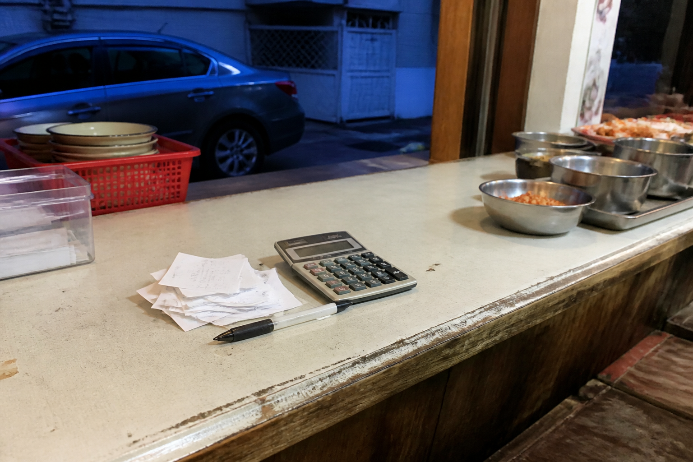

고림동 평균 연령은 39.3세, 이동읍은 49.3세입니다. 같은 용인시 처인구 안인데 딱 열 살 차이입니다. 그래서 처인구 가게가 '용인 맛집'이나 '처인구 맛집' 한 줄로 검색을 잡으려 하면, 두 동네 가운데 한쪽 손님에게는 계속 틀린 말을 보여 주게 됩니다.

숫자는 용인시가 올린 2026년 10월 말 주민등록 인구입니다. 시 전체가 111만 713명, 세대는 45만 814세대. 처인구는 29만 9,230명에 13만 2,005세대입니다. 포곡읍만 떼어 봐도 3만 1,977명, 1만 4,283세대니까 한 세대에 두 명꼴이지요.

여기에 하나 더 있습니다. 주민등록 세대 기준으로 처인구의 1인 세대 비중은 39.9%입니다. 용인 3개 구 가운데 가장 높습니다. 열 집 중 네 집이 혼자 사는 동네라는 뜻입니다. 가족 단위 사진과 4인 세트 메뉴로 채운 가게 페이지에는, 그 네 집 손님이 들어와도 머물 이유가 없습니다.

(동별 평균 연령과 1인 세대 비중은 행정안전부 주민등록 인구를 정리한 공개 통계를 2026년 10월 기준으로 본 값입니다.)

## 사람이 늘었는데, 늘어난 사람이 다릅니다

처인구 내국인 인구는 2022년 26만 930명에서 2026년 10월 28만 6,909명이 됐습니다. 4년 만에 2만 6천 명, 10%가 늘었습니다. 반도체 클러스터 쪽 일자리가 원인이라는 분석이 여러 매체에 나옵니다.

문제는 이 증가가 고르지 않다는 점입니다. 처인구 안에서도 동별로 사람이 늘어난 곳과 그대로인 곳이 갈립니다. 저희가 상담에서 자주 듣는 말이 여기서 어긋납니다. "처인구에서 장사하는데 요즘 손님이 달라졌어요." 손님이 달라진 게 아니라, 손님이 다른 동네에 사는 사람으로 바뀐 겁니다.

| 동네 | 평균 연령 | 인구 | 검색에서 먼저 붙는 말 |
|---|---|---|---|
| 고림동 | 39.3세 | 3만 6,018명 | 점심, 혼밥, 포장, 회사 근처 |
| 역북동 | 39.9세 | 3만 4,641명 | 퇴근 후, 한 잔, 늦은 시간 |
| 포곡읍 | 45.9세 | 3만 1,977명 | 주말 나들이, 주차, 가족 |
| 이동읍 | 49.3세 | 2만 132명 | 조용한 곳, 단체, 예약 |

오른쪽 칸은 제가 상담에서 주워 들은 말을 정리한 것이고, 왼쪽 두 칸은 주민등록 통계입니다. 통계가 손님의 말을 증명하는 건 아닙니다. 다만 39세 동네와 49세 동네가 같은 단어를 쓸 가능성은 낮습니다.

## 같은 '맛집'이 갈라지는 지점

39세가 많은 동네에서 '맛집'은 시간 문제입니다. 점심 한 시간 안에 들어갔다 나와야 하고, 혼자 가도 어색하지 않아야 하고, 포장이 되면 더 좋습니다. 그래서 검색창에는 업종보다 조건이 먼저 붙습니다. "고림동 혼밥", "역북동 점심 포장" 같은 식입니다.

49세가 많은 동네에서는 같은 '맛집'이 자리 문제가 됩니다. 가족이 앉을 테이블, 차를 댈 공간, 소리가 덜 새는 방. "이동읍 단체 예약", "포곡 주차 되는 식당"처럼 뒤에 조건이 붙지요.

가게는 하나인데 이 두 문장을 동시에 받아야 합니다. 한 페이지에 다 넣으면 둘 다 흐려집니다. 그래서 저는 페이지를 늘리라고 하지 않고, 사진과 문장을 나눠 배치하라고 말합니다. 대표 사진은 한 장이고, 그 아래 소개 첫 문단을 손님 유형별로 나누는 방식입니다.

## 사진부터 바꾸는 게 빠릅니다

1인 세대가 4할인 동네에서 가장 자주 틀리는 것이 사진입니다. 네 명이 둘러앉은 상차림, 가족 모임 단체 사진, 넓은 홀 전경. 예쁘지만 혼자 오는 손님에게는 "여기는 나 혼자 오는 곳이 아니다"라는 신호로 읽힙니다.

새로 찍을 필요는 없습니다. 이미 가진 사진 중에서 골라 순서만 바꾸면 됩니다.

- 혼자 앉을 수 있는 자리가 보이는 컷 (창가, 바 테이블, 한쪽 벽)
- 포장 용기나 봉투가 손에 들린 컷
- 사람이 적은 시간대의 매장 안쪽 컷
- 주차 동선이 보이는 입구 컷

이 네 장이 있으면 39세 동네의 검색에는 대응이 됩니다. 반대로 49세 동네에는 룸 안쪽, 단체 상차림, 입구 앞 정차 공간이 필요합니다. 같은 사진 더미에서 다른 네 장을 고르는 일입니다.

## 우리 동네 검색어를 다시 뽑는 순서

순서를 바꾸면 일이 줄어듭니다. 키워드 도구부터 열지 마세요.

1. 가게 주소의 동 이름을 확인합니다. 법정동과 행정동이 다른 경우가 흔합니다. 주민센터 이름과 택배 주소가 다르면 손님도 헷갈립니다.
2. 그 동의 평균 연령과 1인 세대 비중을 봅니다. 용인시 통계 페이지에 매달 올라옵니다.
3. 최근 한 달 문자·카톡·전화에서 손님이 실제로 쓴 말 다섯 개를 그대로 적습니다. "몇 시까지 해요", "혼자 가도 돼요", "주차 돼요" 같은 문장입니다.
4. 그중 세 개를 플레이스 소개, 블로그 글 제목, 사진 설명에 하나씩 나눠 넣습니다. 한 곳에 몰아넣으면 다시 흐려집니다.
5. 4주 뒤에 유입 검색어를 확인합니다. 늘었는지보다, 엉뚱한 동네 이름이 섞여 있는지부터 보세요.

## 이 방법으로 안 잡히는 손님

솔직하게 적어 둡니다.

주민등록 인구는 주소지 기준입니다. 에버랜드처럼 차를 타고 오는 방문객, 산업단지로 출퇴근하는 사람, 대학가에서 주소만 그대로 두고 사는 사람은 이 숫자에 제대로 안 잡힙니다. 통계청 인구총조사와 주민등록 인구가 벌어지는 이유가 이것입니다.

평균 연령도 마찬가지입니다. 그 동네에 사는 사람의 평균이지, 우리 가게에 오는 손님의 평균이 아닙니다. 20년 단골이 60대이고 신규 손님이 30대인 가게라면, 동네 통계보다 우리 장부가 정확합니다.

동네별 업종 검색량은 확인하지 못했습니다. 네이버 데이터랩은 상대값만 주고, '고림동 혼밥' 같은 좁은 조합은 표본이 얇아 그래프가 흔들립니다. 결국 4주 기록이 기준입니다.

## 자주 묻는 질문

### 주소는 고림동인데 손님은 역북동에서 더 많이 옵니다. 어느 쪽으로 써야 하나요?

두 동네를 다 쓰되 한 페이지에 섞지는 마세요. 대표 키워드는 주소지를 두고, 손님이 많이 오는 동네는 사진 설명이나 블로그 글 하나로 따로 만드는 편이 낫습니다. 검색은 '어디 사는 사람이 어디로 가는지'보다 '어디로 가려는 사람이 무슨 말을 치는지'로 걸립니다.

### 평균 연령이 높은 동네에서는 젊은 손님을 포기해야 하나요?

포기할 필요는 없습니다. 다만 첫 화면에서 설득할 대상을 하나 고르세요. 49세 동네에서 20대를 첫 화면에 세우면 양쪽 다 어색해집니다. 젊은 손님은 릴스나 인스타그램처럼 다른 채널에서 만나는 편이 효율적입니다.

### 1인 세대가 많으면 메뉴를 꼭 바꿔야 하나요?

메뉴보다 문장이 먼저입니다. "혼자 오셔도 괜찮습니다" 한 줄과 1인 좌석 사진 한 장이면 대부분 해결됩니다. 메뉴 개편은 원가와 준비 시간이 걸리는 일이라, 손님이 물은 말이 반복해서 나온 뒤에 결정하셔도 늦지 않습니다.

### 이 통계를 우리 가게 손님 숫자로 봐도 되나요?

안 됩니다. 동네 통계는 모집단이고 우리 가게는 표본입니다. 매출이나 방문객 수를 여기서 끌어내면 안 되고, '어떤 말로 검색할 가능성이 높은가'를 정하는 참고로만 쓰세요.

## 마무리

동네 이름을 크게 쓰는 것보다, 그 동네가 어떤 사람들로 채워졌는지 아는 게 먼저입니다. 고림동과 이동읍은 열 살 차이 나는 동네이고, 그 차이는 사진 네 장과 문장 세 줄로 갈립니다. 우리 동네 평균 연령과 1인 세대 비중을 확인하고 싶으시면 [카카오톡 채널](https://pf.kakao.com/_xdMIvX/chat)로 가게 주소만 보내 주세요. 어느 동네를 기준으로 잡아야 하는지, 어떤 사진부터 바꿔야 하는지 순서대로 짚어 드리겠습니다.
