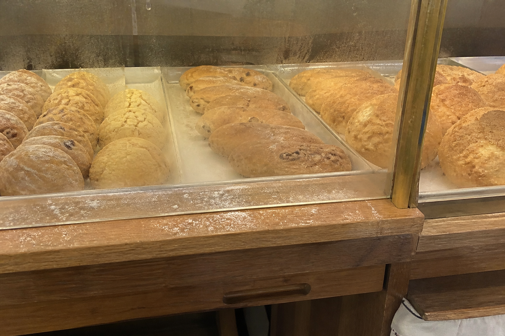

구글이 2026년 11월 9일 연말 선물 가이드 Holiday 100을 공개하면서 함께 소개한 검색어 열 개를 옮겨 봤습니다. 그중 '선물'이라는 단어로 오른 것은 하나도 없습니다. 대신 'classic toy train set'(240% 상승), 'kitten heel sandals'(295%), 'lymphatic sculpting face brush'(400%), 'podcast microphone'(115%)처럼 물건 이름과 쓰임이 그대로 들어간 말이 자리를 잡았습니다.

이건 우리 가게에도 그대로 적용되는 이야기입니다. 12월에 물건을 파는 가게라면, 손님이 검색창에 넣는 말이 '선물'이 아니라 '받는 사람'과 '쓸 상황'이라는 뜻이니까요.

## 상승률이 아니라 검색어의 모양을 보세요

구글 발표문에 실린 열 개를 옮기면 이렇습니다.

| 검색어 | 구글이 밝힌 변화 |
|---|---|
| lymphatic sculpting face brush | 400% 상승 |
| kitten heel sandals | 295% 상승 |
| classic toy train set | 240% 상승 |
| adjustable roller skates | 180% 상승 |
| cécred hair products | 160% 상승 |
| nike v5 rnr running shoes | 150% 상승 |
| podcast microphone | 115% 상승 |
| utility jacket | 역대 가장 많이 검색됨 |
| ski mug | 올해 급상승 검색어 |
| 향수 | 올해 가장 많이 검색된 선물 세트 종류 |

숫자보다 눈에 걸리는 건 형태입니다. '샌들'이 아니라 'kitten heel sandals', '마이크'가 아니라 'podcast microphone'. 카테고리 이름이 아니라, 그 카테고리 안에서 누가 무엇을 하려는지까지 붙어 있습니다.

한 가지 더 있습니다. 외신 보도를 보면 Holiday 100의 각 항목은 AI 모드 화면으로 이어집니다. 그 링크에서 검색어가 '2살 아이에게 맞는 나무 기차 세트를 찾고 있어요' 같은 문장으로 들어간다고 전한 분석도 있습니다. 목록이 문장으로 넘어가는 구조입니다.

## 국내 숫자도 같은 쪽을 가리킵니다

국내 흐름이 다르지는 않습니다. 구글 트렌드에서 2024년 1월부터 2026년 1월까지 국내 검색을 조회한 정리 자료를 보면, '블랙프라이데이'는 10월부터 오르기 시작해 11월에 정점을 찍고, '크리스마스'와 '선물'은 11월부터 가파르게 올라 12월에 정점을 찍습니다.

네이버 데이터랩도 비슷합니다. 2023년 11월부터 2026년 10월까지 월간으로 조회한 자료에서 '크리스마스 케이크'는 해마다 12월에 가장 높았습니다. 즉 12월은 검색이 가장 뜨거운 달이고, 동시에 우리가 준비할 시간이 가장 적은 달입니다.

그래서 결론은 '언제 올릴까'가 아니라 '무슨 말로 올릴까'입니다. 12월 첫 주가 아니라 지금 이 주에 정해야 하는 것은 문장입니다.

## 12월에 팔리는 문장은 세 칸으로 만듭니다

제가 꽃집, 베이커리, 문구점 상담에서 쓰는 틀입니다. 세 칸을 다 채우면 그게 곧 검색어가 됩니다.

| 칸 | 예 | 이 칸이 없으면 |
|---|---|---|
| 누구에게 | 중학생 조카, 회사 동료 다섯 명, 시어머니 | '선물'만 남아 아무에게도 안 걸림 |
| 무엇을 | 6호 원형 생크림, 30cm 리스, 이름 각인 머그 | 크기·재질을 다시 물어야 함 |
| 언제까지 | 24일 오전 수령, 22일까지 주문, 당일 픽업 가능 | 예약을 받고도 못 맞춤 |

이 세 칸은 그대로 글 제목이 됩니다. "중학생 조카 선물, 24일 오전에 받으려면 언제 주문해야 할까" 같은 제목이 '선물'보다 훨씬 좁고, 훨씬 잘 걸립니다.

여기에 하나만 더 붙이면 좋습니다. 받는 사람이 그 물건을 쓸 때의 장면입니다. 케이크라면 식탁, 꽃이라면 현관, 문구라면 책상. 12월 손님은 물건보다 장면을 사러 옵니다.

## 사진은 상황을 보여 주는 것부터

새로 찍지 않으셔도 됩니다. 이미 있는 사진 중에서 세 장을 고르세요.

- 손에 들린 상태의 컷 (포장 봉투, 리본, 상자 뚜껑)
- 여러 개가 나란히 놓인 컷 (색이 다른 것, 크기가 다른 것)
- 가게 안에서 손님이 고르는 장면 (등 돌린 뒷모습이면 더 좋습니다)

이 세 장이 있으면 '무엇을 파는지'보다 '어떤 상황에 쓰는지'가 먼저 보입니다. 보유 사진으로 블로그와 릴스를 만드는 방법은 [10장으로 만드는 글과 릴스](/insights/making-blog-and-reels-from-10-photos/)에 순서대로 적어 두었습니다.

## 이 숫자로 할 수 없는 것

Holiday 100은 미국 검색 데이터와 구글 내부 데이터를 바탕으로 만든 목록입니다. 발표문 각주에도 그렇게 적혀 있고, 한국의 인기 순위가 아닙니다. 'kitten heel sandals'가 국내에서도 295% 올랐다는 뜻이 절대 아닙니다.

상승률은 검색 관심의 증가율이지 판매량이 아닙니다. 작년에 거의 검색되지 않던 말이 올해 조금 늘어도 400%가 됩니다. 물건이 잘 팔린다는 증거로 쓰면 안 됩니다.

데이터랩과 구글 트렌드의 숫자도 상대값입니다. 한 조회 안에서 비교할 때만 뜻이 있고, 다른 날 다른 조건으로 뽑은 숫자와 견주면 틀립니다. 이 글에서는 방향만 인용했습니다.

마지막으로, 문장을 잘 써 두면 AI 검색이 우리 가게를 인용한다는 보장은 어디에도 없습니다. 인용될 확률을 높이는 준비일 뿐입니다.

## 자주 묻는 질문

### 우리 가게는 선물을 안 팔아요. 이 글도 해당되나요?

됩니다. 12월 검색이 상품명으로 갈라지는 건 파는 물건이 있는 곳의 이야기지만, 같은 원리가 음식점과 미용실에도 적용됩니다. '회식'이 아니라 '열 명 단체, 조용한 방', '미용'이 아니라 '결혼식 전날, 오전 예약'처럼 조건을 붙이는 일입니다.

### 상품명을 그대로 제목에 써도 되나요?

우리 물건을 손님이 뭐라고 부르는지 먼저 확인하세요. 사장님은 '생크림 케이크'라고 부르는데 손님은 '딸기 케이크'로 검색하는 일이 흔합니다. 최근 한 달 문의 문자에 나온 표현을 그대로 쓰는 게 가장 안전합니다.

### 12월 중순에 시작하면 늦나요?

픽업과 배송이 걸린 물건은 늦습니다. 손님이 주문 가능한 마지막 날을 먼저 정하고, 그 날짜를 글 제목과 사진 설명에 박아 두세요. 날짜가 적힌 글은 지나면 힘을 잃지만, 그 전까지는 다른 글보다 강합니다.

### 이 목록을 우리 업종에 그대로 적용해도 되나요?

목록 자체는 적용하지 마시고, 형태만 가져오세요. 구체적인 검색어, 상황이 붙은 문장, 받는 사람이 드러나는 이름. 이 세 가지가 이 목록에서 배울 전부입니다.

## 마무리

12월 손님은 '선물'을 검색하지 않습니다. 받는 사람과 쓸 장면을 검색합니다. 그래서 이번 주에 할 일은 광고를 켜는 게 아니라, 우리 가게에서 가장 많이 팔리는 세 가지를 골라 누구에게·무엇을·언제까지로 다시 적어 보는 것입니다. 세 줄이 안 나오면 [카카오톡 채널](https://pf.kakao.com/_xdMIvX/chat)로 가게 이름과 주력 상품만 보내 주세요. 12월에 쓸 문장 세 개를 같이 만들어 드리겠습니다.
