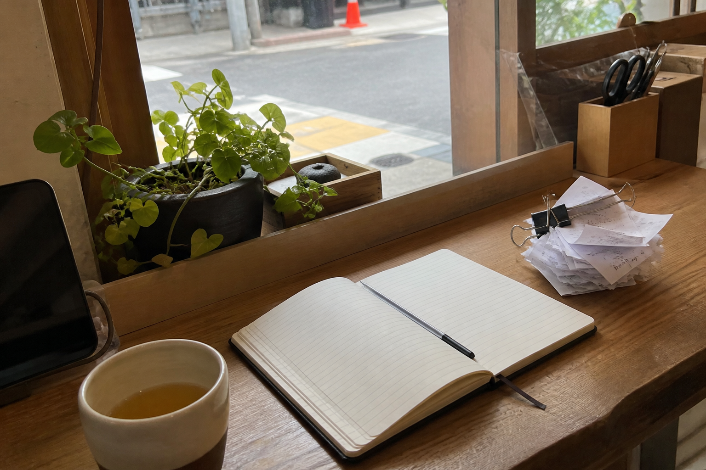

리뷰에 답글을 다는 사장님은 대개 그 리뷰를 쓴 손님 한 명을 떠올리며 씁니다. 그런데 그 답글을 실제로 읽는 사람은 예약을 앞두고 가게를 비교하는 다음 손님입니다. 그래서 답글은 사과문이 아니라, 아직 오지 않은 손님에게 보내는 안내문이어야 합니다. 세 줄이면 충분한 이유가 여기 있습니다.

한 가지 더 있습니다. 구글 답글은 쓰는 즉시 공개되지 않습니다. 구글이 콘텐츠 정책에 맞는지 먼저 검토하고, 승인되지 않으면 수정하라는 안내가 옵니다. 보통 10분이면 끝나지만 최대 30일이 걸릴 수 있다고 구글 고객센터에 적혀 있습니다.

## 답글이 안 보이는 이유는 세 가지입니다

사장님이 가장 자주 묻는 말이 "답글을 달았는데 왜 안 보이죠"입니다. 확인할 곳은 세 군데입니다.

| 상황 | 화면에서 보이는 모습 | 할 일 |
|---|---|---|
| 아직 검토 중 | 답글이 비어 있음 | 기다립니다. 길면 하루, 드물게 몇 주 |
| 반려됨 | 수정하라는 안내 | 같은 문장을 다시 넣지 않고 고쳐서 씁니다 |
| 다른 기기 | 폰에서는 보이는데 PC에서 안 보임 | 캐시 문제인 경우가 있습니다. 로그아웃 상태로 한 번 확인 |

두 번째가 핵심입니다. 반려는 삭제가 아닙니다. 구글 고객센터는 답글이 승인되지 않으면 답글을 수정하라는 메시지가 표시된다고 안내합니다. 같은 문장을 그대로 다시 올리면 같은 결과가 나옵니다.

## 반려되기 쉬운 한 줄

구글은 리뷰 답글을 쓸 때 홍보를 빼라고 안내합니다. 리뷰를 쓴 사람은 이미 손님이니 특가나 프로모션을 넣을 필요가 없다는 설명입니다. 그런데 현장에서는 이 한 줄이 자꾸 들어갑니다.

- "다음 방문 시 10% 할인해 드립니다"
- "이번 주 신메뉴 출시했습니다. 많이 찾아 주세요"
- "별점 수정해 주시면 서비스로 드립니다"

세 번째는 더 위험합니다. 리뷰를 고치거나 지우는 대가로 돈이나 할인, 무료 서비스를 주는 것은 구글이 금지하는 허위 참여에 해당합니다. 답글에서 이 조건을 꺼내는 순간, 그 리뷰 자체가 문제가 될 수 있습니다.

반대로 연락처는 무조건 피할 필요가 없습니다. 구글은 부정적인 리뷰에 답할 때 메일이나 전화로 직접 연락해 달라고 부탁하는 방법을 안내합니다. 문제를 풀기 위한 한 줄이면 됩니다. 다만 손님의 실명, 연락처, 방문 기록 같은 개인정보를 답글에 적으면 안 됩니다. 답글은 공개 글입니다.

## 세 줄이면 충분합니다

제가 상담에서 같이 써 보는 틀입니다. 리뷰 유형마다 첫 줄만 달라집니다.

| 리뷰 유형 | 첫 줄 | 둘째 줄 | 셋째 줄 |
|---|---|---|---|
| 칭찬만 있는 리뷰 | 손님이 쓴 구체적인 사실 하나를 되짚기 ("창가 자리에서 드신 것을 기억합니다") | 그 자리에 대해 우리가 신경 쓴 점 한 가지 | 다음에 오실 때 쓸 수 있는 정보 한 줄 |
| 지연·불친절 | 그날 있었던 일을 변명 없이 인정 | 우리 잘못인 부분과 아닌 부분 구분 | 직접 연락할 창구와 이름 |
| 사실과 다른 내용 | 손님이 겪은 일은 사실로 인정 | 기록에 남은 내용을 짧게 바로잡기 | 확인할 수 있는 방법 안내 |

셋째 줄에 사장님 이름이나 이니셜을 붙이면 훨씬 사람처럼 읽힙니다. 구글도 답글 끝에 서명을 넣는 방식을 권합니다.

길이는 짧을수록 좋습니다. 긴 답글은 읽는 사람에게 부담이고, 변명처럼 읽힐 위험도 커집니다. 세 줄, 길어도 다섯 줄을 넘기지 마세요.

## 답글 다섯 개를 점검하는 순서

1. 최근 답글 다섯 개를 시간 순으로 엽니다. 별점이 낮은 것부터 보지 않아도 됩니다.
2. 각 답글에 할인, 가격, 이벤트 문구가 있는지 봅니다. 있으면 지금 고쳐 두세요.
3. 첫 문장이 손님의 말을 되짚는지 확인합니다. "감사합니다"로 시작하는 답글이 다섯 개 연속이면 다시 써야 합니다.
4. 연락처를 넣었다면, 문제 해결을 위한 한 줄인지 확인합니다. 홍보 문장 뒤에 붙은 연락처는 빼세요.
5. 답글이 달리지 않은 리뷰 중 최근 석 달 것을 골라 두세 개만 답합니다. 별점만 있는 리뷰까지 다 답할 필요는 없습니다.

문의 응대 문장과 겹치는 부분은 [문의 답장 세 줄](/insights/inquiry-reply-three-lines/)에 따로 정리해 두었습니다. 리뷰 답글은 공개, 문의 답장은 비공개라는 차이만 기억하시면 됩니다.

## 이 방법으로 안 되는 것

답글이 별점이나 매출을 얼마나 올리는지에 대한 공개 연구는 찾지 못했습니다. 답글을 잘 쓴다고 순위가 오른다는 자료도 확인하지 못했습니다. 제가 말할 수 있는 건, 답글이 공개 글이고 다음 손님이 읽는다는 사실까지입니다.

업종에 따라 조심할 것도 다릅니다. 병원, 법률, 금융처럼 고객이었다는 사실 자체가 민감한 업종은 답글에서 손님을 특정하지 않는 편이 안전합니다. 그런 업종은 답글보다 직접 연락을 먼저 권합니다.

네이버 플레이스와 카카오 채널은 규칙이 다릅니다. 이 글의 절차는 구글 비즈니스 프로필 기준이고, 다른 채널은 각자 안내를 확인해야 합니다. 검토 시간과 화면 구성도 바뀔 수 있으니 지금 화면을 기준으로 판단하세요.

## 자주 묻는 질문

### 답글을 달면 손님에게 알림이 가나요?

갑니다. 구글 고객센터에 따르면 답글을 달면 리뷰를 작성한 고객에게 알림이 전송되고, 손님은 답글을 본 뒤에도 리뷰를 고칠 수 있습니다. 리뷰를 고치면 리뷰 날짜도 최신 날짜로 바뀝니다. 그래서 답글은 손님 한 명과의 대화이기도 합니다.

### 별점 1점 리뷰에는 꼭 답해야 하나요?

의무는 아닙니다. 다만 다음 손님이 그 리뷰를 열어 볼 가능성이 가장 높은 자리입니다. 답이 없으면 손님 말만 남고, 답이 있으면 우리 입장이 한 번 남습니다. 답을 달 거라면 감정이 가라앉은 뒤에, 세 줄로 쓰세요.

### 답글이 반려되면 다시 못 쓰나요?

다시 쓸 수 있습니다. 다만 같은 문장은 같은 결과가 나옵니다. 할인이나 이벤트 문구, 개인정보, 홍보 문장을 먼저 지우고 다시 올리세요. 사유가 계정이나 프로필 문제인 경우에는 문장을 고쳐도 해결되지 않습니다.

### 답글을 대신 써 주는 서비스도 있던데 써도 되나요?

쓸 수는 있습니다. 다만 답글은 결국 사장님 이름으로 공개되는 글이고, 같은 문장이 여러 리뷰에 반복되면 읽는 사람이 먼저 알아챕니다. 대행을 쓰시더라도 답글은 직접 검수하고, 최소한 마지막 서명은 직접 넣으세요.

## 마무리

리뷰 답글은 손님 한 명에게 쓰는 편지가 아니라, 예약을 앞둔 다음 손님이 읽을 공개 기록입니다. 세 줄, 할인 없이, 손님이 쓴 사실 하나에서 시작하면 충분합니다. 지금 달려 있는 답글 중 어디부터 손볼지 모르겠으면 [카카오톡 채널](https://pf.kakao.com/_xdMIvX/chat)로 프로필 화면을 보내 주세요. 반려 위험이 있는 문장과, 다시 쓸 세 줄을 함께 정리해 드리겠습니다.
