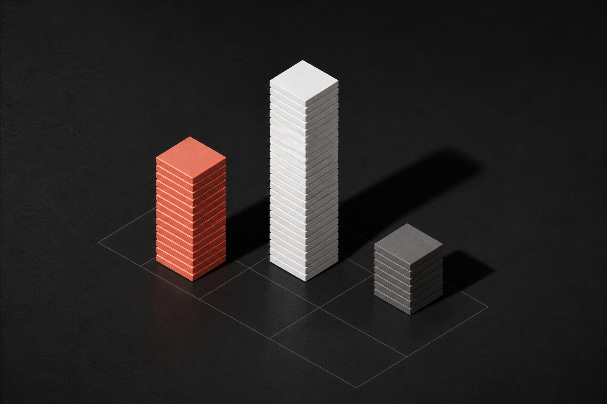

배달앱을 쓰는 가게의 정산서를 열어 보면, 매출의 20~34%가 여러 항목으로 빠져 있습니다. 그리고 지금 국회에서는 소상공인이 대기업과 거래 조건을 협의할 수 있는 권리를 두고 논의가 진행되고 있습니다.

다만 협상은 손님이 있을 때 힘이 생깁니다. 배달앱 안에서만 손님이 오는 가게는 조건을 바꿔도 선택지가 그대로입니다. 그래서 대행사를 고를 때 물어야 할 질문은 "광고를 얼마에 해 주나"가 아니라 **"플랫폼 밖에서 우리 가게를 찾는 손님을 몇 명 만들 수 있나"**입니다.

## 정산서에서 실제로 빠지는 돈

보도된 두 사례를 보면 구조가 보입니다.

| 구분 | 하루 매출 | 받은 금액 | 빠진 비중 |
|---|---|---|---|
| 한식당(서울 종로) | 966,000원 | 633,994원 | 약 34% |
| 카페(서울 동작) | 308,700원 | 176,056원 | 약 22% |

한식당 사례의 차감 항목은 할인·마케팅 136,755원, 배달비 98,600원, 중개이용료 64,873원, 부가세 17,981원, 결제·정산 수수료 13,797원이었습니다.

여기서 나눠 봐야 할 것이 있습니다. **할인·마케팅비는 우리가 정하는 돈**이고, **배달비·중개이용료는 우리가 정하지 못하는 돈**입니다. 협상권 논의가 힘을 쓰는 쪽은 뒤쪽입니다. 앞쪽은 오늘 당장 내가 줄일 수 있습니다.

## 협상권은 아직 법이 아닙니다

2026년 11월 24일 보도에 따르면, 소상공인 단체의 대표성과 협의 대상 범위를 구체화하는 작업이 진행 중이고, 배달앱 수수료와 납품단가를 협의 대상으로 검토하고 있습니다. 대기업의 협의 거부·보복조치를 금지하는 방안도 함께 검토되고 있습니다.

다만 **통과된 법이 아닙니다.** 배달앱 수수료 규제 법안 3건은 국회 상임위에 계류 중이고, 9월 심사소위에서 세 건 모두 안건 상정이 되지 않았습니다. 11월 26일에는 관련 소위 전체회의가 예정돼 있습니다.

제도가 바뀔 때까지 기다리는 동안 가게가 할 수 있는 일은 두 가지입니다. 정산서를 읽어서 새는 자리를 아는 것, 그리고 플랫폼 밖 손님을 한 명이라도 늘리는 것입니다.

## '플랫폼 밖 손님'을 세는 방법

어렵지 않습니다. 지난달 주문을 세 갈래로 나눠 보세요.

1. **배달앱에서 온 주문** — 수수료를 내고 산 손님
2. **검색·지도에서 온 손님** — 이름을 검색했거나 지도에서 찾아온 사람
3. **다시 온 손님** — 예약 이력, 적립, 단골

2번과 3번이 늘면 협상할 때 우리 편이 생깁니다. 1번만 늘면 매출이 늘어도 남는 돈은 그대로입니다.

세 갈래를 셀 때 정확하지 않아도 됩니다. POS에 채널 구분이 없으면, "이번 달 예약·전화 주문이 몇 건이었나"만 세도 방향은 보입니다.

## 대행사에 물을 문장 세 개

상담 자리에서 이렇게 물어보세요.

- "우리 가게 손님 중 배달앱 밖에서 오는 비중을 어떻게 늘릴 계획인가요?"
- "6개월 뒤에 우리가 직접 운영할 수 있게 무엇을 남겨 주나요?" (계정, 사진 원본, 글 목록)
- "첫 달에 무엇을 바꾸고, 무엇을 바꾸지 않을 건가요?"

첫 번째 질문에 "광고를 늘리면 됩니다"라고 답하면, 그건 플랫폼 안에서 돈을 더 쓰는 계획입니다. 두 번째 질문에 답이 흐리면 나중에 계정을 두고 다툴 수 있습니다.

세 번째가 실무적으로 가장 중요합니다. 첫 달에 모든 걸 바꾸겠다고 하면, 무엇이 효과가 있었는지 알 수 없습니다.

## 노티스랩이 이 이야기를 하는 이유

노티스랩은 배달앱을 쓰지 말라고 말하지 않습니다. 손님이 있는 곳에 가게가 있어야 한다는 것은 맞습니다. 다만 **한 곳에만 있으면 조건을 정하는 쪽이 우리가 아니게 됩니다.**

그래서 저희가 하는 일은 플랫폼 밖의 접점을 만드는 쪽입니다. 검색에 남는 글, 지도에 정리된 정보, 예약으로 이어지는 화면. 새로 촬영하지 않고 가게가 이미 가진 사진과 정보로 시작합니다.

이 작업의 성과는 조회수로 재기 어렵습니다. 대신 "전화·예약 주문이 몇 건이었나", "다시 온 손님이 몇 명이었나"로 셉니다.

## 주의할 점

첫째, **수수료율은 계약과 프로모션에 따라 다릅니다.** 위 사례는 보도된 개별 가게의 정산서이고, 모든 가게에 같은 비율이 적용되지는 않습니다. 우리 가게 정산서를 직접 보세요.

둘째, **협상권은 아직 제도가 아닙니다.** 보도된 내용은 검토 단계입니다. 확정 전에는 이를 전제로 계약하거나 가격을 정하지 마세요.

셋째, **플랫폼 밖 손님이 항상 이익은 아닙니다.** 직접 배달을 하면 인건비와 사고 위험이 생깁니다. 포장·픽업·예약처럼 배달이 필요 없는 형태부터 시작하는 편이 안전합니다.

넷째, **업종별 차이가 큽니다.** 배달 비중이 높은 업종(치킨·중식·분식)은 수수료 구조가 곧 수익 구조이고, 홀 중심 업종은 검색·예약 쪽 손실이 더 큽니다.

## 자주 묻는 질문

### 협의요청권이 생기면 수수료가 바로 내려가나요?

아닙니다. 협의를 요구할 수 있는 권리와 실제 인하 사이에는 협상이 있습니다. 게다가 법안 자체가 아직 통과되지 않았습니다. 당장은 정산서를 읽고 줄일 수 있는 항목부터 줄이는 편이 현실적입니다.

### 대행사가 배달앱 광고만 하겠다고 하면 거절해야 하나요?

거절보다 범위를 확인하세요. 배달앱 광고가 필요한 업종도 있습니다. 다만 그것만 하겠다고 하면, 플랫폼 밖 손님은 늘지 않는다는 점을 알고 계약해야 합니다.

### 자체 채널을 만들면 얼마나 걸리나요?

가게마다 다릅니다. 다만 검색·지도 정보를 정리하는 것은 빨리 끝나고, 글과 사진이 쌓여 검색에 남는 것은 몇 달이 걸립니다. 예약·전화 건수는 첫 달부터 셀 수 있습니다.

### 플랫폼 밖 손님은 어떻게 확인하나요?

주문을 받을 때 "어떻게 알게 되셨어요"를 한 번 묻고 종이에 표시하는 방식이 가장 정확합니다. POS에 채널 구분이 있으면 그 자료를 쓰세요. 완벽하지 않아도 방향은 보입니다.

## 마무리

수수료는 협상으로 바뀔 수 있습니다. 하지만 협상 테이블에 앉으려면 우리 가게를 찾는 손님이 어디서 오는지 알고 있어야 합니다.

지금 받아 둔 제안서나 정산서가 있다면 [카카오톡 채널](https://pf.kakao.com/_xdMIvX/chat)로 보내 주세요. 어느 항목이 우리가 정할 수 있는 돈이고 어느 항목이 아닌지, 그리고 플랫폼 밖에서 시작할 수 있는 한 가지를 짚어 드리겠습니다.
