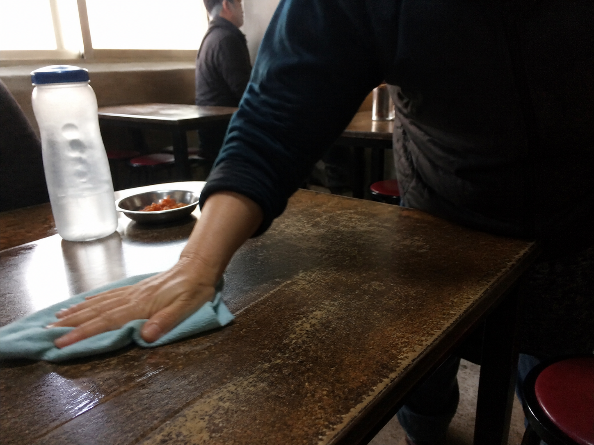

네이버에서 '성수 맛집'을 검색하면 화면이 세 칸으로 나뉩니다. 맨 위에 늘 보던 플레이스 목록, 그 아래 '테마별 추천', 한 칸 더 내리면 '인기 급상승 맛집'입니다. 이 두 칸은 10월 1일부터 대상 지역에 정식 적용됐고, 사장님이 쓴 소개글이 아니라 메뉴 정보와 손님이 누른 버튼을 보고 가게를 고릅니다.

그래서 요즘 상담에서 제가 가장 먼저 여는 화면이 소개글이 아니라 메뉴 칸입니다. 소개글은 아무리 고쳐도 아래 두 칸에는 잘 닿지 않습니다.

## 10월 1일부터 달라진 것

네이버 검색광고는 9월 23일 공지에서 10월 1일부터 모바일 통합검색의 음식점 업종 일부 검색어에 새 화면이 적용된다고 알렸습니다. 대상은 강릉, 경주, 광교, 광화문, 대전, 분당, 여수, 잠실, 해운대, 성수처럼 지역명에 '맛집'이 붙는 검색어입니다. 음식점 업종 전체가 아니라 일부 지역, 일부 검색어입니다. 대상 검색어는 바뀔 수 있다고 공지에 적혀 있습니다.

네이버 검색 공식 블로그(10월 2일)는 두 칸의 성격을 이렇게 설명합니다. 테마별 추천은 평소 취향과 지역, 메뉴, 시간대, 날씨, 방문 목적을 함께 본다고 합니다. 인기 급상승 맛집은 길찾기, 예약, 리뷰, 저장 같은 신뢰도 데이터를 바탕으로 최근 관심이 커지는 식당을 보여 준다고 합니다.

| 칸 | 무엇을 보는가 | 사장님이 손댈 수 있는 것 | 손댈 수 없는 것 |
|---|---|---|---|
| 기존 목록 | 정보 충실도, 인기도, 신뢰도 | 업체 정보, 사진, 리뷰 관리 | 순위 산식 |
| 테마별 추천 | 메뉴, 시간대, 날씨, 방문 목적 | 메뉴 이름과 구성, 리뷰에 남는 단어 | 테마가 뜨는 시점 |
| 인기 급상승 | 길찾기, 예약, 리뷰, 저장의 최근 흐름 | 예약 켜기, 리뷰 요청, 저장 유도 | 실제 방문 횟수 |

## 테마 칸의 이름은 대부분 메뉴입니다

한 플레이스 마케터가 테마 칸이 뜨는 지역 열 곳을 직접 검색해서 센 값이 있습니다. 테마 칸 40개 가운데 35개에 메뉴 이름이 붙어 있었고, 분위기 칸은 5개였습니다. 맨 위 한 칸만 시간대였습니다. 이 숫자는 한 사람이 특정 시점에 센 관찰값이라 전체를 대표하지는 않습니다. 다만 방향은 분명합니다. 네이버가 손님에게 메뉴로 가게를 권하고 있습니다.

그러면 네이버는 우리 가게 메뉴를 어떻게 알까요. 스마트플레이스 사진 탭 안내문에 답이 있습니다. 메뉴 태그는 업체가 등록한 메뉴를 기준으로 만들고, 메뉴에 맞는 사진을 방문자 리뷰와 블로그에서 모아 보여 준다고 적혀 있습니다. 재료가 두 군데라는 뜻입니다. 메뉴판에는 '생면 파스타'라고 써 있는데 플레이스 메뉴 칸에는 '파스타'만 적혀 있고 리뷰에도 그 단어가 없다면, 네이버가 우리 집을 생면 파스타 집으로 소개할 근거가 없습니다.

## 상황 키워드는 소개글에 못 씁니다

테마에는 '비 오는 날 생각나는 국물 요리'처럼 상황이 붙습니다. 이 상황은 사장님이 정하는 게 아닙니다. 소개글이나 메뉴 설명에 '비 오는 날'이라고 적어도 테마 칸에 쓰이지 않는다는 것이 실무자들의 공통된 관찰입니다. 손님 리뷰에 그 말이 남아야 근거가 생깁니다.

그래서 리뷰를 부탁할 때 문장을 조금 바꿔 보시길 권합니다. "리뷰 남겨 주세요"보다 "오늘 드신 메뉴랑 오실 때 어땠는지 한 줄"이 낫습니다. 메뉴 이름과 상황 단어가 같이 남으면 한 줄이 두 재료가 됩니다.

여기서 선을 하나 그어야 합니다. 리뷰에 혜택을 걸고 특정 문구를 강요하면 리뷰 조작으로 걸립니다. 네이버는 조작 영수증과 허위 리뷰를 단속한다고 공지했습니다. 테마 한 칸에 들려고 리뷰 탭을 잃는 거래는 하지 않는 게 맞습니다.

## 인기 급상승은 '요즘'만 봅니다

인기 급상승 칸은 쌓아 둔 숫자가 아니라 최근 움직임을 봅니다. 목록 옆 안내문에는 최근 일정 기간 행동이 많았거나 이전 기간보다 급격히 늘어난 업체를 정렬한다고 적혀 있습니다. 길찾기는 버튼만 누른 게 아니라 실제로 길찾기를 마친 횟수로 센다는 설명도 붙습니다.

이 말은 오래된 리뷰 200개보다 최근 한 달 리뷰 몇 개가 이 칸에 더 가깝다는 뜻입니다. 예약, 저장, 리뷰는 사장님이 손님에게 부탁할 수 있는 행동입니다. 길찾기만 손댈 수 없습니다. 그래서 이 칸은 '무엇을 더 받을까'보다 '요즘도 받고 있나'를 보는 칸입니다.

## 12월 검색은 11월에 이미 시작됩니다

네이버애즈가 11월 18일 뉴스레터에 담은 지난겨울 기록이 있습니다. 크리스마스 관련 광고 클릭의 98%가 12월에 몰렸고, 11월에도 이미 평소의 8배를 넘겼습니다. 겨울 나들이 검색은 60%가 1월에 몰렸습니다. 같은 자료에 '산천어축제2026', '다이어리2026'처럼 연도가 붙는 검색어 이야기도 있습니다. 작년 키워드를 그대로 두면 올해 손님을 만나지 못합니다.

이 숫자는 검색량이 아니라 광고 클릭 기준입니다. 그래도 순서는 같습니다. 테마 칸에 메뉴가 쌓여 있어야 12월에 그 칸을 연 손님의 후보에 우리 가게가 듭니다.

## 이번 주에 할 일 다섯 가지

- 메뉴 칸을 메뉴판과 같은 이름으로 맞춥니다. 줄임말, 띄어쓰기까지.
- 대표 메뉴 세 개에 사진을 붙입니다. 리뷰 사진이 모자라면 사장님 사진이 기준이 됩니다.
- 겨울 메뉴가 있으면 이름에 계절어를 넣습니다. '굴국밥', '팥죽'처럼 손님이 검색할 말로.
- 본인 휴대폰으로 '지역명+맛집'을 검색해 우리 가게가 어느 칸에 뜨는지 캡처합니다. 로그인 상태와 아닌 상태를 나눠서요.
- 예약을 쓰지 않으면 이번에 켤지 정합니다. 인기 급상승 신호 가운데 사장님이 직접 만들 수 있는 게 예약입니다.

지도 필터에서 빠지는 문제는 [지도 필터 다섯 칸](/insights/map-filter-five-switches/)에 따로 정리했고, 동네별로 같은 '맛집'이 다른 뜻이 되는 이야기는 [처인구 연령 격차](/insights/cheoin-age-gap-local-keywords/)에 적어 두었습니다.

## 이 방식이 안 통하는 곳

이 화면은 음식점 업종, 그중에서도 대상 지역의 '지역명+맛집' 검색어에만 붙습니다. 우리 동네가 아직 대상이 아니면 지금은 이 글의 앞부분이 해당되지 않습니다. 준비만 해 두면 적용되는 날 바로 후보에 듭니다.

테마가 뜨는 기준과 가중치는 공개되지 않았습니다. '이렇게 하면 반드시 이 칸에 오른다'는 말은 근거가 없습니다. 로그인한 손님에게는 취향이 섞여 사람마다 화면이 다르고, 시간대와 날씨에 따라 테마가 몇 분 만에 바뀝니다. 한 번 캡처한 화면으로 판단하지 마시고 며칠 나눠 보세요.

## 자주 묻는 질문

### 우리 지역은 아직 적용이 안 됐는데 미리 할 게 있나요?

있습니다. 메뉴 이름을 메뉴판과 맞추고, 대표 메뉴 사진을 채우고, 리뷰에 메뉴 이름이 남게 부탁 문구를 바꾸는 일입니다. 적용되는 날 이미 재료가 쌓여 있는 가게가 먼저 후보에 듭니다.

### 소개글에 계절 단어를 넣으면 도움이 되나요?

소개글은 손님이 읽는 글입니다. 테마 칸의 근거로 쓰인다는 공식 설명은 없습니다. 계절 메뉴는 소개글이 아니라 메뉴 칸에 넣으세요. 그쪽이 검색이 읽는 자리입니다.

### 리뷰를 많이 모으면 인기 급상승에 오르나요?

개수보다 최근 흐름을 본다고 안내되어 있습니다. 몇 년치 리뷰가 있어도 최근에 멈췄으면 밀립니다. 대신 매주 비슷한 양이 들어오게 만드는 편이 낫습니다.

### 광고를 켜면 테마 칸에도 나오나요?

광고는 별도 자리입니다. 네이버 검색광고 공지에도 이번 개편으로 플레이스광고 노출 개수와 위치는 그대로라고 적혀 있습니다. 테마 칸은 광고비가 아니라 정보와 반응으로 들어갑니다.

### 메뉴가 자주 바뀌는 가게는 어떻게 하나요?

바뀔 때마다 플레이스 메뉴 칸도 같이 고치세요. 계절 메뉴를 내리면 지난 시즌 이름이 남아 손님을 헷갈리게 합니다. 한 달에 한 번, 메뉴판 사진과 플레이스 메뉴를 나란히 놓고 보는 걸 권합니다.

## 마무리

검색 화면이 세 칸으로 갈라진 뒤로, 사장님이 쓰는 글보다 손님이 남긴 단어와 메뉴 칸의 이름이 더 자주 읽힙니다. 12월 손님은 이미 11월에 움직이기 시작했습니다.

우리 가게가 어느 칸에 뜨는지 궁금하면 '지역명+맛집' 검색 화면을 [카카오톡 채널](https://pf.kakao.com/_xdMIvX/chat)로 보내 주세요. 세 칸 중 어디가 비었는지, 메뉴 칸부터 무엇을 고치면 좋을지 짚어 드리겠습니다.
