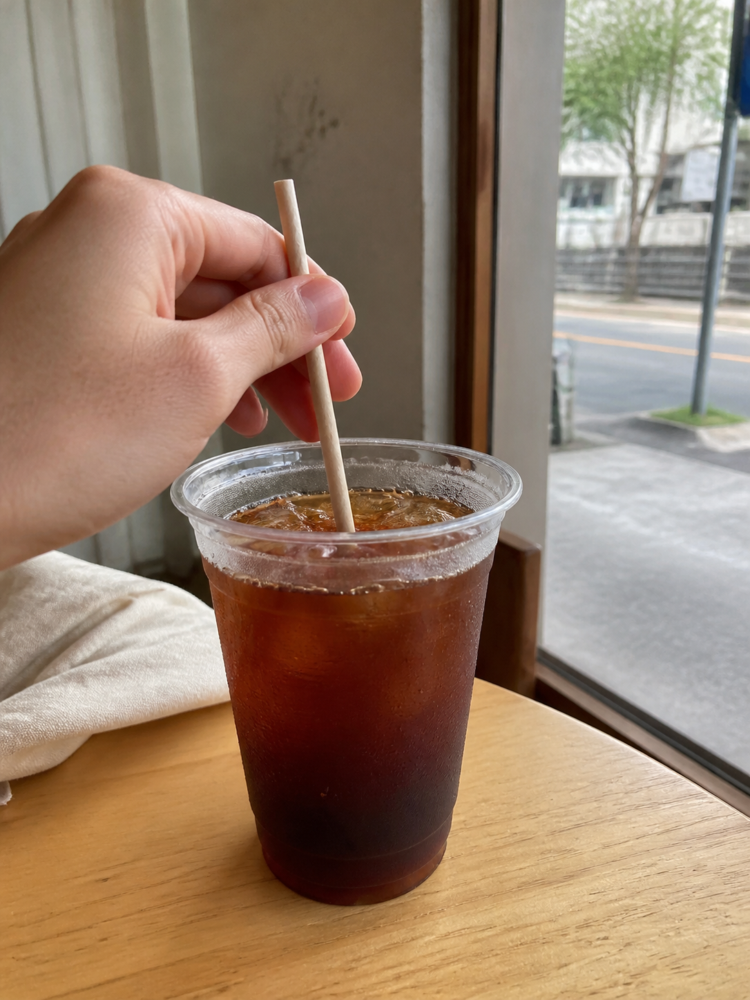

틱톡이 공개한 상위 광고 705개를 세어 보니 길이 중앙값이 26초였습니다. 15초 이하는 다섯 개 중 하나뿐이었고, 상품 광고로 좁히면 중앙값이 23초였습니다. 짧게 만들어야 잘 된다는 말은, 적어도 지금 상위에 올라 있는 광고들 사이에서는 근거가 약합니다.

대신 차이는 첫 1초에서 났습니다. 상품 광고의 76%가 1초 안에 상품을 화면에 띄웠습니다. 연말 소재를 준비한다면 길이를 줄이는 일보다 첫 장면을 무엇으로 채울지가 먼저입니다.

## 이 숫자가 나온 방법부터

틱톡 크리에이티브 센터의 Top Ads는 나라, 기간, 업종, 정렬 기준별로 광고를 보여 주는 공개 목록입니다. 국내 한 분석팀이 11월 12일에 최근 30일 기준 목록을 읽어 중복을 걷어내고 고유 광고 705개를 추렸습니다. 그중 662개는 첫 0.05초, 1초, 2.5초 프레임을 뽑아 분류했습니다. 로그인하지 않은 방문자에게는 목록 첫 페이지만 보이기 때문에, 전체 광고의 대표값이 아니라 공개된 목록의 성향으로 읽어야 합니다.

| 항목 | 전체 705개 | 상품 광고 472개 |
|---|---|---|
| 세로형 9:16 비율 | 97% | 비슷함 |
| 길이 중앙값 | 26초 | 23초 |
| 15초 이하 | 20% | 24% |
| 1초 안에 상품 노출 | 해당 없음 | 76% |
| 첫 화면에 자막 | 54% | 비슷함 |
| 2.5초 안에 컷 전환 | 해당 없음 | 50% |
| 캡션 길이 중앙값 | 80자 | 80자 |

나라별로도 차이가 있습니다. 한국 광고 38개의 길이 중앙값은 24초였고, 첫 화면에 자막이 있는 비율은 58%였습니다. 일본은 74%, 미국은 36%였습니다. 같은 영상을 여러 나라에 돌린다면 미국은 자막 없는 첫 장면, 일본은 자막 있는 첫 장면을 따로 시험해 볼 만합니다.

## 첫 장면에 무엇을 두나

상품 광고의 첫 프레임은 사람 얼굴이 39%, 얼굴 없이 손이나 몸이 27%, 상품만 19%였습니다. 로고나 제목 화면으로 시작한 광고는 6%뿐이었습니다. 가게 영상으로 옮기면 이렇게 됩니다.

- 로고 띠를 3초 깔지 마세요. 그 3초에 손님이 넘깁니다.
- 첫 장면은 손으로 만드는 장면이 편합니다. 젓가락이 국물에 닿는 순간, 사장님이 빵을 자르는 손, 뚜껑을 여는 동작.
- 첫 1.5초에 글자를 얹는다면 메뉴 이름이나 오늘의 가격처럼 손님이 판단에 쓰는 말로. "맛있습니다"는 판단에 쓰이지 않습니다.
- 질문으로 시작하는 광고는 전체의 4%였습니다. "이거 드셔 보셨어요?"가 나쁘다는 뜻은 아니지만, 유행처럼 권할 만큼 흔하지는 않습니다.

포맷은 손으로 보여 주는 데모가 상품 광고의 37%로 가장 많았고, 상품만 찍은 영상이 21%, 카메라를 보고 말하는 영상이 11%였습니다. 노티스랩이 현장 촬영을 기본으로 하지 않는 이유도 여기와 맞물립니다. 손과 제품, 매장 안쪽 컷은 이미 가게에 있는 사진과 영상으로도 만들 수 있습니다.

## 23초를 무엇으로 채우나

길이를 23초로 맞추면 대략 이렇게 나눕니다.

1. 0~1초, 손이 상품에 닿는 장면
2. 1~4초, 한 번 더 가까이. 여기서 자막 한 줄
3. 4~12초, 만드는 과정이나 먹는 소리. 2.5초마다 한 번씩 장면을 바꿉니다
4. 12~20초, 손님이 궁금해할 것 하나. 양, 재료, 먹는 순서
5. 20~23초, 어디로 오면 되는지 한 줄

컷을 빨리 바꾸는 게 정답은 아닙니다. 6초 시청률이 높은 광고 가운데 2.5초 안에 컷이 바뀐 비율은 43%로, 그렇지 않은 광고(54%)보다 오히려 낮았습니다. 한 장면을 오래 붙잡는 힘이 있으면 그대로 가도 됩니다. 다만 첫 장면이 심심하면 뒤를 채워도 소용이 없습니다.

캡션은 짧게 쓰는 쪽이 낫습니다. 705개 캡션의 길이 중앙값이 80자였고, 28%만 할인이나 가격, 무료 혜택을 언급했습니다. 숫자와 해시태그는 각각 42%에 들어 있었습니다. 한 문장으로 무엇을 파는지 적고, 가격이나 시간이 있으면 숫자로 적으세요.

## 연말 소재에 옮기면

올해 블랙프라이데이는 11월 27일입니다. 12월 첫 주가 지나면 연말 검색은 빠르게 식습니다. 틱톡코리아가 10월 20일 행사에서 밝힌 자료에 따르면 틱톡의 글로벌 하루 평균 이용 시간은 93분이고, 국내 광고 성장률은 같은 해 1분기 대비 3분기에 업계 평균의 1.8배였습니다. 시청 시간이 긴 채널일수록 23초가 길게 느껴지지 않습니다.

연말에는 장면을 새로 찍을 시간이 없습니다. 지난겨울 사진과 올해 쌓인 영상으로 위 다섯 칸을 채우는 편이 현실적입니다. 새로 만들 게 아니라 이미 있는 컷의 순서를 바꾸는 일에 가깝습니다.

## 이 숫자로 알 수 없는 것

Top Ads는 틱톡이 고른 목록입니다. 무엇이 성과를 냈는지는 보여 주지 않습니다. 그래서 "1초 안에 상품을 보여 주면 잘 된다"가 아니라 "지금 상위 목록의 상품 광고가 그렇게 생겼다"까지만 말할 수 있습니다. 표본은 11월 12일 하루의 스냅숏이고, 나라별 광고 수는 17개에서 102개로 적어 몇 퍼센트포인트 차이는 오차로 봐야 합니다. 소리는 분석에 들어가지 않았고, 프레임 세 장만 봤습니다.

가게마다 손님이 다릅니다. 40대 단골이 많은 동네 식당과 20대가 많은 카페는 같은 23초에서도 다른 결과가 납니다. 위 숫자는 정답지가 아니라 첫 실험의 출발점으로 쓰세요. 사진 몇 장으로 릴스를 만드는 순서는 [사진 10장으로 블로그와 릴스까지](/insights/making-blog-and-reels-from-10-photos/)에, 겨울 검색에 얹는 방법은 [겨울 콘텐츠 세 가지 흐름](/insights/winter-search-tiktok-three-flows/)에 적어 두었습니다.

## 자주 묻는 질문

### 15초로 만들면 안 되나요?

안 될 이유는 없습니다. 다만 상위 목록에서 15초 이하는 20%였습니다. 15초에 맞추느라 첫 장면을 로고로 채우면 손해입니다. 짧게 가려면 첫 1초를 더 세게 잡으세요.

### 폰으로 찍어도 되나요?

됩니다. 상위 광고의 37%가 사람이 직접 들고 쓰는 장면이었습니다. 다만 흔들림과 소리가 문제입니다. 테이블에 폰을 기대고, 조리대 위에서 20cm 거리로 찍는 편이 안정적입니다.

### 자막은 꼭 넣어야 하나요?

필수는 아닙니다. 전체의 54%, 한국 광고의 58%가 첫 화면부터 자막이 있었습니다. 소리 없이 보는 손님이 많으니 핵심 한 줄은 넣는 편이 안전합니다.

### 광고가 아니라 그냥 게시물도 같은가요?

이 조사는 광고만 봤습니다. 유기 게시물은 알고리즘이 다르게 움직입니다. 다만 첫 장면이 중요하다는 점은 같습니다.

### 몇 개를 만들어야 하나요?

한 번에 세 개를 권합니다. 첫 장면이 다른 세 개를 같은 예산으로 돌리고, 이틀 뒤 남은 하나에 몰아 주세요. 하나만 만들어서 잘 되길 기다리는 쪽이 더 비쌉니다.

## 마무리

길이는 23초 근처, 첫 1초는 손과 상품, 자막은 한 줄, 캡션은 80자 안쪽. 이 네 줄이면 연말 소재를 오늘 저녁에 만들 수 있습니다.

가게에 있는 사진과 영상으로 어떤 첫 장면을 만들 수 있을지 막막하면 [카카오톡 채널](https://pf.kakao.com/_xdMIvX/chat)로 매장 사진 몇 장 보내 주세요. 첫 1초에 쓸 컷부터 같이 골라 드리겠습니다.
