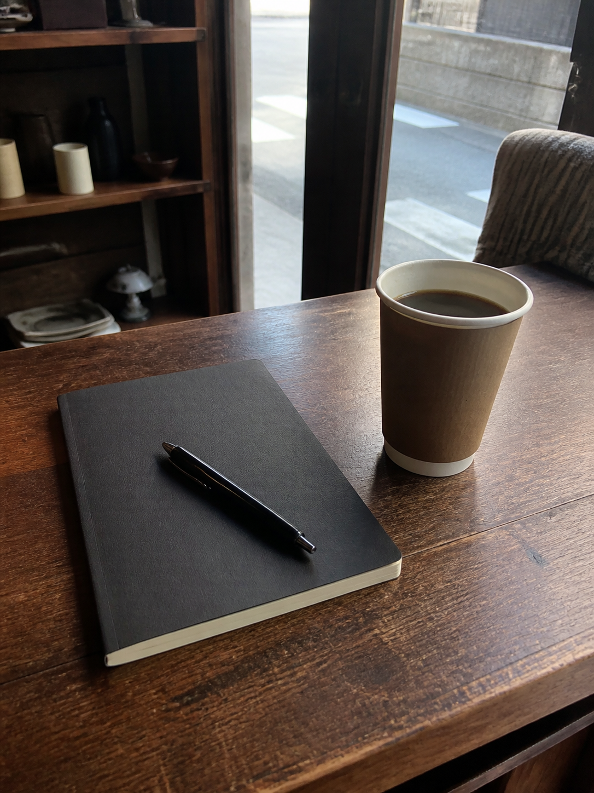

플레이스광고에 '알아서 하는' 운영 방식이 생겼습니다. 네이버 검색광고는 9월 16일부터 입찰과 타겟팅, 소재 구성을 자동으로 돌리는 ADVoost 플레이스를 열었고, 10월 15일부터는 스마트플레이스센터에서도 이 광고를 만들 수 있게 했습니다. 문제는 새 광고그룹을 만들면 이 자동 운영이 기본으로 선택된다는 점입니다.

자동 운영에서 사장님이 직접 정하는 값은 하루 예산과 요일·시간대, 두 가지뿐입니다. 나머지는 네이버가 정합니다. 회사도 공지에 적어 두었습니다. 하루 예산 안에서 클릭을 최대한 받는 쪽으로 입찰가를 조정하기 때문에, 예산이 전액 소진될 수 있다고요. 이걸 모르고 켜면 조용한 화요일 오후에 하루 예산이 다 나갑니다.

## 무엇이 자동이고 무엇이 아닌지

| 항목 | 사장님이 정하는가 | 실제 동작 |
|---|---|---|
| 하루 예산 | 정함 | 캠페인과 광고그룹에 각각 설정. 기본값 3만 원 |
| 요일·시간대 | 정함 | 휴무일과 영업 외 시간 제외 가능 |
| 입찰가 | 못 정함 | 예산 안에서 클릭 최대화로 자동 조정 |
| 지역·성별·연령·매체 | 못 정함 | 자동 판단 |
| 제외 검색어 | 못 정함 | 자동 운영 그룹에서는 설정 불가 |
| 광고 이미지와 홍보 문구 | 못 정함 | 스마트플레이스 업체 정보로 자동 생성 |

과금은 클릭당입니다. 여기서 한 가지를 짚어야 합니다. 플레이스 페이지로 가는 클릭만 과금되는 게 아니라 '전화', '예약', '저장하기', '길찾기', '방문자 리뷰' 같은 버튼 클릭에도 과금됩니다. 손님이 카드를 훑다가 저장 버튼을 눌러도 광고비가 나갑니다. 그래서 이 광고의 성적표는 노출이 아니라 전화와 길찾기, 예약 건수로 봐야 합니다.

## 스마트플레이스센터에서 만든 광고는 되돌릴 수 없습니다

이 대목이 상담에서 가장 자주 나옵니다. 스마트플레이스센터에서 만든 광고그룹은 자동 운영으로 고정됩니다. 나중에 입찰가를 직접 정하는 수동 운영으로 바꿀 수 없습니다. 반대로 광고주센터에서 만든 그룹은 자동과 수동을 오갈 수 있습니다.

그래서 순서를 이렇게 권합니다. 처음에는 광고주센터에서 수동 운영으로 작은 그룹을 하나 만들고, 같은 예산으로 자동 그룹을 하나 더 만들어 2주 붙여 보세요. 어느 쪽이 전화를 더 데려오는지 본 다음에 예산을 옮기면 됩니다. 스마트플레이스센터에서 바로 켜는 건 그 비교를 마친 뒤가 낫습니다.

자동 운영에도 조건이 있습니다. 스마트플레이스에 이미지가 최소 한 장 있어야 하고, 운영 중에 이미지를 모두 지우면 광고가 멈출 수 있습니다. 의료광고 사전심의가 필요한 병원과 의원은 이 방식을 쓸 수 없습니다. 캠페인 예산을 하루 동안 고르게 나누는 옵션도 적용되지 않습니다.

## 대행에 맡긴다면 계약서에 남길 세 줄

자동 운영은 편하지만, 그 편함이 사장님 통제권을 대신 사 주지는 않습니다. 대행사에 광고를 맡길 때 이 세 줄만 있으면 나중에 설명이 짧아집니다.

- "광고 계정은 사장님 명의로 개설하고, 관리 권한만 위임한다."
- "자동 운영과 수동 운영 중 무엇으로 돌리는지 계약서에 적고, 바꿀 때는 서면으로 알린다."
- "월 보고에 노출 수가 아니라 전화, 길찾기, 예약, 저장 건수를 채널별로 적는다."

첫 줄이 없으면 나중에 그만둘 때 계정을 못 받습니다. 둘째 줄이 없으면 어느 순간 자동 운영으로 바뀌어 있어도 알기 어렵습니다. 셋째 줄이 없으면 보고서에 숫자가 많아도 판단할 수가 없습니다.

예산을 얼마로 시작할지, 자리를 어떻게 나눌지는 [플레이스광고 예산 순서](/insights/place-ad-slot-budget-design/)에 적어 두었습니다. 12월에 대행을 시작할 때의 비교 기준은 [연말 대행 계약 기준](/insights/year-end-agency-contract-baseline/)에 따로 정리했습니다.

## 2주 시험 계획

| 기간 | 하는 일 | 확인할 것 |
|---|---|---|
| 시작 전 | 메뉴·가격·영업시간·사진 정리 | 광고에 실릴 정보가 지금과 맞는지 |
| 1주 차 | 자동 그룹 하루 2만 원, 영업시간만 노출 | 하루 예산이 언제 소진되는지 |
| 1주 차 | 같은 예산의 수동 그룹 하나 | 같은 돈에 클릭이 얼마나 다른지 |
| 2주 차 | 예산은 그대로, 결과만 관찰 | 전화·길찾기·예약이 늘었는지 |
| 2주 뒤 | 남는 쪽에 예산 이동 | 어느 방식이 손님을 데려왔는지 |

시간대 설정은 꼭 하세요. 자동 운영에서 사장님이 직접 정할 수 있는 거의 유일한 값입니다. 새벽에 우리 가게를 찾을 손님이 없다면 그 시간에 나가는 클릭은 그냥 비용입니다.

## 이 글의 한계

자동입찰이 항상 손해라는 뜻이 아닙니다. 손댈 시간이 없는 1인 가게에는 자동이 수동보다 나은 경우도 많습니다. 다만 그 경우에도 하루 예산과 시간대는 사람이 정해야 합니다. 공지에 나온 수치는 기본값과 동작 방식이고, 업종별로 적정 예산이 얼마인지는 네이버도 밝히지 않았습니다. 우리 가게의 클릭당 비용은 2주 돌려 봐야 나옵니다.

노출 순위나 광고 자리 개수는 검색어와 경쟁 상황에 따라 달라집니다. 화면이 바뀌면 이 글의 표도 달라질 수 있으니, 켜기 전에 네이버애즈 공지에서 한 번 더 확인하세요. 자동 소재는 업체 정보로 만들어지기 때문에, 메뉴와 사진이 틀리면 광고도 틀린 채로 나갑니다.

## 자주 묻는 질문

### 예산을 다 쓰는 게 고장인가요?

아닙니다. 네이버는 하루 예산 안에서 클릭을 최대한 받는 것을 목표로 한다고 안내합니다. 다만 광고그룹이 멈추기까지 시차가 있어 예산을 조금 넘겨 과금될 수 있다는 설명도 함께 있습니다.

### 제외 검색어는 어떻게 막나요?

자동 운영 그룹에서는 직접 설정할 수 없습니다. 우리 가게와 상관없는 검색어가 계속 붙는다면 수동 운영 그룹으로 옮기고 제외 검색어를 넣는 편이 낫습니다. 수동 그룹에서는 최대 70개까지 등록됩니다.

### 광고 문구를 고치고 싶습니다.

자동 운영에서는 광고주센터에서 문구와 이미지를 직접 고칠 수 없습니다. 스마트플레이스 업체 정보를 고치면 광고에 반영됩니다. 홍보 문구를 직접 쓰고 싶다면 수동 운영을 골라야 합니다.

### 대행사가 자동으로 돌리겠다고 합니다. 문제인가요?

방식 자체는 문제가 아닙니다. 문제는 사장님이 그 사실을 모르는 경우입니다. 어느 방식인지, 왜 그 방식인지, 결과를 무엇으로 보고하는지 세 가지만 받아 두세요.

### 병원도 쓸 수 있나요?

의료광고 사전심의가 필요한 병원과 의원은 자동 운영을 쓸 수 없습니다. 심의받은 소재와 심의필번호를 등록해야 하는 업종이라 자동 소재 생성과 맞지 않습니다.

## 마무리

자동은 결정을 대신해 주지 않습니다. 하루 예산과 시간대, 이 두 칸은 사장님이 정해야 하고, 그 두 칸이 이번 달 광고비를 결정합니다.

지금 돌리는 광고가 자동인지 수동인지 헷갈리면 화면을 [카카오톡 채널](https://pf.kakao.com/_xdMIvX/chat)로 보내 주세요. 어느 방식으로 돌아가고 있는지, 12월 예산을 어디에 두면 좋을지 같이 보겠습니다.
