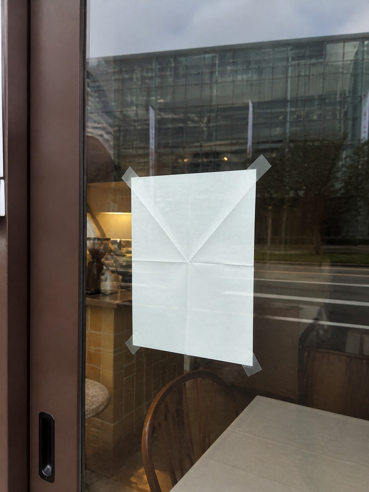

12월 3일부터 6일까지 나흘 동안 광교 수원컨벤션센터에서 수원메가쇼 2026 시즌2가 열립니다. 같은 지붕 아래에서 팔도밥상페어도 같이 섭니다. 성인 입장료는 1만 원이고, 홈페이지에서 미리 등록한 사람은 본인만 무료로 들어갑니다.

이 글은 행사 소개가 아닙니다. 행사장에서 걸어갈 수 있는 거리에 가게를 둔 사장님이 그 나흘을 어떻게 쓰면 되는지에 대한 이야기입니다.

어제 오후 메타 광고 라이브러리를 뒤지다가 이 행사 광고를 봤습니다. 첫 화면에 날짜와 장소, 그리고 '입장료 1만 원에서 0원'이라는 문장이 한 번에 들어와 있었습니다. 24초짜리 영상과 22초짜리 영상, 두 편이 돌고 있었습니다. 주최는 두 달 전부터 손님을 모으고 있었던 겁니다.

반대로, 행사장 옆에서 밥을 파는 가게가 같은 기간에 무엇을 했는지는 모르겠습니다. 다만 광고 라이브러리 첫 페이지에는 그런 광고가 없었습니다.

## 손님은 행사 이름으로 오고, 밥은 다른 말로 찾습니다

행사장에 오는 사람은 집에서 이런 말을 검색합니다. 수원메가쇼, 팔도밥상페어, 광교 전시회, 수원컨벤션센터 주차. 이 말들의 검색 결과 첫 화면은 주최 홈페이지와 티켓 안내, 몇 개의 블로그 후기가 나눠 갖습니다. 우리 가게가 여기 끼어들 자리는 거의 없습니다. 4일짜리 행사를 앞두고 그 자리를 새로 뚫는 건 시간 싸움에서 이미 진 싸움입니다.

손님이 행사장을 나온 뒤에 검색하는 말은 다릅니다. 여기서 갈립니다.

| 손님이 나중에 쓰는 말 | 답이 나오는 화면 | 오늘 손볼 곳 |
|---|---|---|
| 광교중앙역 맛집 | 네이버 플레이스, 구글 지도 | 소개글 첫 줄에 도보 시간 |
| 수원컨벤션센터 근처 식당 | 네이버 지도, 구글 지도 | 구글 프로필 게시물에 행사 주간 안내 |
| 광교 회식, 광교 저녁 | 플레이스, 블로그 | 단체석·예약 가능 인원 표기 |
| 광교 주차 | 지도, 블로그 | 주차 대수와 입구 사진 |

수원컨벤션센터는 경기도 수원시 영통구 광교중앙로 140, 광교중앙역과 같은 자리에 있습니다. 행사 보러 온 사람이 차를 대고 나오면, 점심시간에는 줄이 길고 오후 세 시쯤에는 한산합니다. 이 시간 차이를 아는 가게와 모르는 가게의 4일은 꽤 다릅니다.

## 검색은 이미 시작됐습니다

오늘 오후 네이버 데이터랩에서 '수원메가쇼'를 1년 일간으로 조회했습니다. 그래프에서 가장 높은 봉우리는 올해 3~4월, 시즌1 직전이었습니다. 오늘 화면 맨 오른쪽 끝의 봉우리는 지난해 12월 시즌2 직전 봉우리와 거의 같은 높이까지 올라와 있습니다.

이 말은 두 가지입니다. 하나는 손님이 이미 검색을 시작했다는 것, 다른 하나는 이번 주에 올린 안내가 지난주에 올린 안내보다 늦는다는 것입니다.

구글 쪽은 다릅니다. 오늘 낮 12시 3분 기준 구글 인기 검색어 25개는 축구 중계와 연예, 정치 뉴스가 다 차지하고 있었습니다. 실시간 목록은 뉴스가 만드는 화면이라, 동네 행사는 여기 올라오지 않습니다. 그러니 구글 실시간 목록에 우리 가게 이야기가 없다고 조급해할 이유는 없습니다. 다만 구글 지도에서 '광교중앙역' 주변을 보는 손님은 따로 있고, 그 화면은 우리가 손볼 수 있습니다.

## 플레이스 소식에 그대로 쓰는 세 문장

행사 주간에 플레이스 소식과 구글 프로필 게시물에 올릴 문장입니다. 숫자는 우리 가게 것으로 바꿔야 합니다.

> 12월 3일부터 6일까지 수원컨벤션센터에서 메가쇼가 열립니다.
> 저희는 광교중앙역에서 도보 O분, 행사장 입구에서 걸어서 O분 거리입니다.
> 행사 보시고 오시는 분들은 오후 5시 이후가 덜 붐빕니다. 주차는 O대까지 가능합니다.

여기서 중요한 건 두 번째 문장입니다. '가깝다'가 아니라 '몇 분'이라고 적어야 손님이 판단합니다. 지도 앱이 거리를 보여줘도, 손님은 소개글에서 한 번 더 확인하고 움직입니다.

블로그 글 제목은 행사 이름으로 뽑지 마세요. '수원메가쇼 맛집'으로 쓴 글은 주최 글과 대형 블로그 사이에서 묻힙니다. 대신 '수원컨벤션센터 근처 국밥, 행사 보러 온 날 점심'처럼 우리 가게와 손님의 상황을 붙이고, 본문 첫 문단에 행사 날짜를 한 줄 넣으세요. 검색도 잡고, 그 글을 읽는 사람도 우리 가게를 기억합니다.

행사용 페이지를 새로 만들 필요는 없습니다. 4일 쓰고 버릴 페이지보다, 원래 있던 소개글과 게시물을 고치는 편이 다음 행사에도 남습니다.

## 이 글의 한계

행사 효과는 업종과 거리에서 갈립니다. 행사장에서 차로 10분 넘는 곳은 이 나흘 동안 손님이 늘지 않는 경우가 많습니다. 주차 대수가 부족한 가게는 오히려 불편을 사고, 리뷰에 그 이야기가 남습니다. 관람객 규모와 연령대는 주최가 공개한 자료를 확인하지 못했습니다. 우리 업종 손님이 그 행사에 얼마나 오는지는 4일 지나 봐야 알 수 있습니다.

그래서 이 글은 '행사에 올인하라'는 말이 아닙니다. 이미 있는 소개글과 게시물에 날짜와 거리를 한 줄 더 넣는 일, 그 정도부터 하자는 이야기입니다. 비용은 0원이고, 안 했을 때 잃는 것만 조용합니다.

## 확인한 자료

- 수원메가쇼 2026 시즌2 관람일정·관람요금·장소: https://www.suwonmegashow.co.kr/
- 수원컨벤션센터 전시 일정(2026-12-03~06, 전시홀 1층): https://www.scc.or.kr/
- 네이버 데이터랩 검색어트렌드 「수원메가쇼」, 1년 일간, 2026년 11월 24일 조회: https://datalab.naver.com/
- 구글 인기 검색어 대한민국, 2026년 11월 24일 12시 3분 기준: https://trends.google.com/trending?geo=KR
- 메타 광고 라이브러리, 대한민국, 키워드 「수원메가쇼」·「연말」, 2026년 11월 24일 조회: https://www.facebook.com/ads/library/

## 자주 묻는 질문

### 입장료와 사전등록은 어떻게 되나요?

성인은 1만 원이고 단체 20인 이상은 5,000원입니다. 홈페이지에서 사전등록한 사람은 본인만 무료이고, 초·중·고 학생과 미취학 아동은 무료입니다. 사전등록자는 전시 전날 카카오톡으로 받은 QR 입장권을 보여 주면 됩니다.

### 행사 이름을 우리 가게 광고에 써도 되나요?

권하지 않습니다. 행사 이름 검색의 첫 화면은 주최가 가져가고, 우리 가게가 그 자리를 사려면 경쟁 입찰로 돈이 듭니다. 같은 돈이면 '광교중앙역 맛집' 쪽이 전화로 이어질 확률이 높습니다. 행사 이름은 광고 소재가 아니라 소개글 안내 문장에 쓰세요.

### 행사장과 거리가 있는데도 효과가 있나요?

지도에서 손님이 보는 범위 안이라면 있습니다. 네이버·구글 지도는 검색한 위치에서 가까운 순으로 보여 주기 때문에, 도보 15분 안쪽이면 후보에 듭니다. 대신 소개글에 이동 시간을 적어 두지 않으면 손님이 먼저 포기합니다.

### 언제까지 준비해야 하나?

12월 3일이 목요일입니다. 검색이 몰리는 건 행사 전날과 첫날이니, 늦어도 11월 30일까지는 소개글과 게시물을 올려 두는 편이 좋습니다. 당일 아침에 올리면 검색 반영 전에 손님이 지나갑니다.

## 마무리

행사 주간에 무엇을 먼저 고쳐야 할지 헷갈리면, 가게 이름과 동네만 [카카오톡 채널](https://pf.kakao.com/_xdMIvX/chat)로 보내 주세요. 지도에 지금 어떻게 보이는지부터 같이 보겠습니다.
