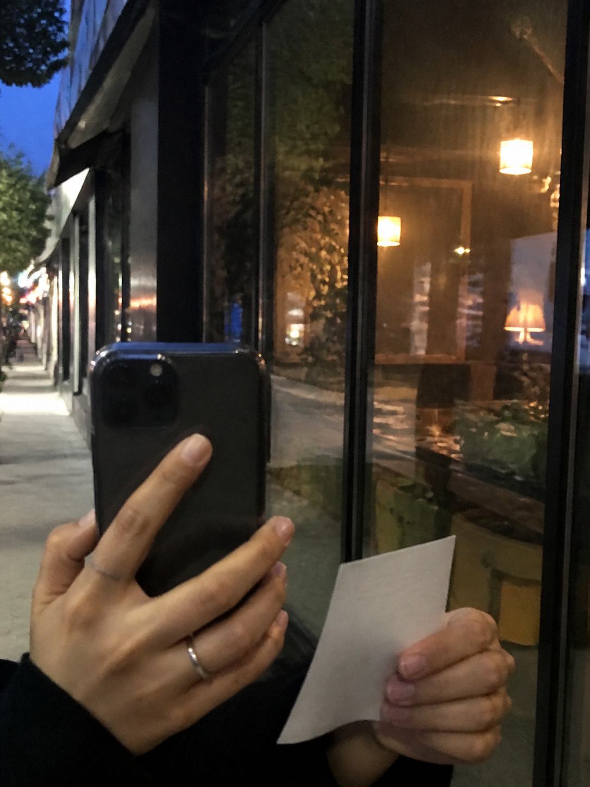

2026년 11월 24일 낮, 메타 광고 라이브러리에서 국가를 대한민국으로 두고 「연말」을 검색했습니다. 게재 중인 광고가 약 7,800건 나왔습니다. 노출 순으로 정렬한 첫 페이지 25건을 하나씩 열어 문구와 영상 길이를 적었습니다.

먼저 결론부터. 그 25건 중 동네 가게가 낸 광고는 한 건이었습니다. 나머지는 브랜드, 온라인 쇼핑몰, 금융사, 영화 배급사였습니다. 연말 광고 시장은 동네 가게의 자리가 아니라, 큰 지갑들이 계절을 선점하는 판입니다.

그런데 그 한 건이 나머지 24건보다 우리에게 쓸모 있습니다. 나머지는 예산으로 이기는 광고고, 그 한 건은 문장으로 이기는 광고였습니다.

## 25건을 업종으로 나눠 보면

| 업종 | 건수 |
|---|---|
| 패션·뷰티 | 10 |
| 금융·자산관리 | 3 |
| 전시·행사 | 2 |
| 게임, 영화, 취미 | 3 |
| 식품, 생활가전, 자동차 | 3 |
| 앱·비영리·지역 서비스 | 4 |

패션과 뷰티가 10건으로 가장 많았습니다. 연말 모임과 선물 수요를 겨냥한 「연말룩」, 「연말 사진 전」 같은 말이 반복해서 나왔습니다. 우리 동네 옷가게나 미용실도 이 수요 안에 있지만, 광고비로는 같은 판에서 못 놉니다.

## 반복해서 나온 문장 구조 여섯 가지

25건의 첫 줄과 마지막 줄을 나란히 놓고 보니 형태가 겹쳤습니다. 브랜드 이름을 지우면 거의 같은 틀이었습니다.

1. **질문으로 시작합니다.** "혹시 화이트 원피스 찾으셨나요", "[20대] 쌍수, 왜 다들 겨울에 할까". 손님이 이미 머릿속에 넣어 둔 문장을 대신 말해 주는 방식입니다.
2. **날짜와 기간을 숫자로 박습니다.** "딱 4일간만 20%", "12.3(목)~6(일)", "크리스마스까지만". 언제까지인지가 첫 화면에 없으면 손님은 미룹니다.
3. **댓글에 단어를 남기게 합니다.** "댓글에 '정보' 남겨 주시면 링크 전송", "댓글에 '어그'". 댓글 자체가 광고 확산이 되고, 남긴 사람에게는 1:1로 말 걸 명분이 생깁니다.
4. **가격을 세 개 늘어놓습니다.** 자동차 광고는 월 15만 원, 24만 원, 37만 원. 뷰티 플랫폼은 43,000원, 30,800원, 86,000원. 하나만 보여 주면 비교가 안 되고, 셋을 보여 주면 손님이 자기 자리를 고릅니다.
5. **손님이 한 말을 그대로 씁니다.** "5천 원 냈는데 1만 4천 원어치 넘게 받았어요". 브랜드가 쓴 문장이 아니라 손님이 쓴 문장처럼 보이게 만든 겁니다.
6. **영상 길이는 20~30초에 몰립니다.** 영상이 붙은 18편의 길이는 6초에서 49초까지 흩어져 있었고, 20~30초가 7편으로 가장 많았습니다. 가장 짧은 6초는 초콜릿 브랜드였고, 가장 긴 49초는 시술 전후를 비교하는 뷰티 광고였습니다.

## 동네 가게가 낸 그 한 건

대전 전민동의 헬스장 광고였습니다. 문구를 그대로 옮기면 이렇습니다. "대전 전민동 문지동 연중무휴 24시까지 운동 가능한 !!차짐 전민점", "연말/새해 이벤트 스타트", "지인소개/재등록률 1위", "DM or 042.863.7773".

문장이 매끈하지 않습니다. 이모지도 많고 느낌표도 겹칩니다. 그런데 이 광고가 눈에 띈 이유가 셋 있었습니다.

- 동네 이름을 두 번 썼습니다. 전민동, 문지동. 그 동네 사람만 반응하면 되는 광고입니다.
- 전화번호를 본문에 직접 적었습니다. DM으로만 받으면 앱을 안 쓰는 손님은 끊깁니다.
- 게재 시작일이 2024년 11월이었습니다. 1년 넘게 같은 광고를 켜 두고 있었습니다.

마지막 항목이 제일 중요합니다. 25건 중 게재 기간이 1년을 넘긴 광고는 두 건이었고, 둘 다 문구를 자주 바꾸지 않았습니다. 브랜드는 새 캠페인을 계속 갈아 끼우지만, 동네 가게는 한 문장을 오래 씁니다. 그게 지역 광고의 방식입니다.

## 우리 가게 광고에 옮길 세 줄

| 순서 | 할 일 | 예시 |
|---|---|---|
| 1 | 첫 줄에 동네 이름과 상황을 넣기 | "광교에서 회식 끝났을 때, 11시까지 여는 집" |
| 2 | 기간을 숫자로 박기 | "12월 1일부터 24일까지 예약 받습니다" |
| 3 | 연락 수단을 두 개 두기 | "전화 000-0000 / 카톡 채널 상담" |

여기에 하나 더. 가격이나 인원을 셋으로 나눠 보여 주세요. 2인, 4인, 단체. 손님이 자기 자리를 고르게 만드는 일이 설득보다 빠릅니다.

카드뉴스를 만든다면 첫 장은 질문으로, 둘째 장은 숫자로, 셋째 장은 연락처로 두는 구성이 이 25건에서 가장 많이 보인 순서였습니다. 배경 사진은 매장에서 찍은 실제 사진이면 충분합니다. 이 25건 중 스튜디오에서 찍은 듯한 컷을 쓴 동네 가게는 없었습니다.

## 이 글의 한계

첫 페이지 25건만 봤습니다. 7,800건 전체의 분포가 아닙니다. 정렬은 노출 순이지만 메타가 노출 수를 구간으로만 공개하기 때문에, 정확한 순위는 알 수 없습니다. 검색어를 「연말」 하나로 잡았으니 「송년회」, 「크리스마스」로 다시 검색하면 결과가 달라집니다. 업종도 패션과 뷰티에 기울어 있어서, 음식점이나 학원에는 해당하지 않는 패턴이 섞여 있습니다.

그리고 광고 문구를 그대로 가져다 쓰면 안 됩니다. 구조만 참고하고, 문장은 우리 가게 이야기로 새로 써야 합니다. 남의 광고를 베낀 티가 나는 순간, 손님은 그 가게를 신뢰하지 않습니다.

## 확인한 자료

- 메타 광고 라이브러리, 대한민국, 키워드 「연말」, 게재 중, 2026년 11월 24일 조회: https://www.facebook.com/ads/library/
- 수원메가쇼 2026 시즌2 일정·장소: https://www.suwonmegashow.co.kr/

## 자주 묻는 질문

### 광고 라이브러리는 로그인해야 볼 수 있나요?

로그인 없이 검색됩니다. 국가와 광고 유형만 고르면 게재 중인 광고의 문구와 영상, 게재 시작일이 나옵니다. 저는 로그인하지 않은 상태로 이 25건을 봤습니다.

### 경쟁 가게 광고는 어떻게 찾나요?

페이지 이름으로 검색하면 됩니다. 업종으로 찾을 때는 「연말」 같은 계절 단어보다 우리 동네 이름을 넣는 편이 정확합니다. 예를 들어 「광교 헬스」로 검색하면 그 동네에서 광고를 돌리는 곳이 나옵니다.

### 게재 기간이 길면 좋은 광고인가요?

꼭 그렇지는 않습니다. 오래 켜 두는 광고는 성과가 유지된다는 뜻일 수도 있고, 담당자가 손을 못 대고 있다는 뜻일 수도 있습니다. 다만 1년 넘게 같은 문장을 쓰는 동네 가게 광고는 대체로 전화가 끊기지 않는 곳입니다.

### 우리 동네에는 이런 광고가 하나도 없습니다.

그러면 기회입니다. 이 25건에서 확인한 것처럼, 지역 업종은 광고 판에서 소수입니다. 경쟁이 없으면 같은 예산으로도 노출이 남습니다. 다만 광고를 켜기 전에 플레이스와 지도 정보가 맞는지 먼저 보세요. 광고로 들어온 손님이 지도에서 영업시간이 틀린 걸 보면 그대로 나갑니다.

연말 광고 문구를 어디서부터 고쳐야 할지 모르겠으면, 지금 쓰는 광고 화면을 [카카오톡 채널](https://pf.kakao.com/_xdMIvX/chat)로 보내 주세요. 첫 줄과 기간 표기부터 같이 보겠습니다.
