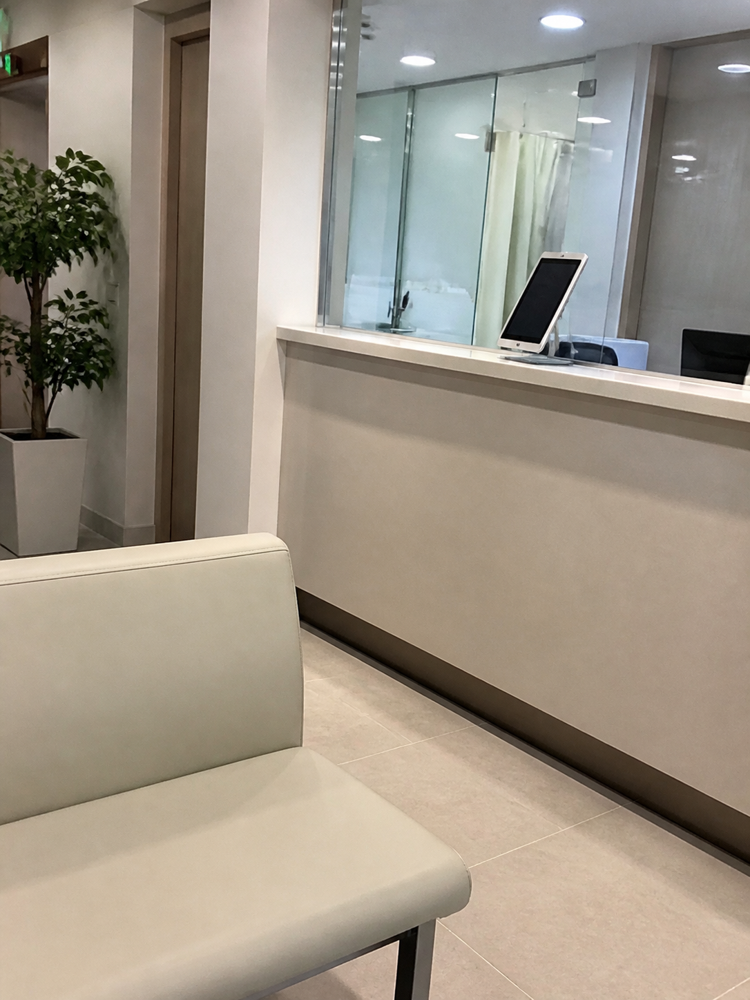

구글 비즈니스 프로필에서 예약과 저녁 식사 예약 링크를 사장님이 직접 켜고 끌 수 있게 됐습니다. 11월 23일(미국 시간) 구글의 리사 랜즈먼이 공개한 소식이고, 몇 주 전 배달·주문 링크에 붙었던 기능이 예약까지 넓어진 것입니다. 대상은 미용실, 병원·클리닉, 헬스장, 지역 서비스업, 음식점입니다.

지도에 붙는 예약 버튼은 남이 만든 자리였습니다. 손님이 어느 예약 업체 앱으로 들어가는지, 우리 가게는 대개 모른 채로 두었습니다. 오늘부터는 그 목록을 열어 보고 직접 고를 수 있습니다.

## 무엇이 달라졌나

구글 프로필 대시보드의 예약 섹션에서 파트너별로 켜고 끌 수 있습니다. 끄면 그 파트너 버튼이 지도에서 사라지고, 마음이 바뀌면 다시 켜면 됩니다. 예약 업체에 전화해서 피드를 끊어 달라고 하거나, 구글에 지원 요청을 넣던 절차가 없어졌습니다.

구글은 이번 안내에서 연말 이야기를 먼저 꺼냈습니다. 연말 예약과 송년 모임이 몰리는 시기이니, 이번 주에 2분만 시간을 내서 예약 섹션을 열어 보고 모든 링크가 정확한 예약 가능 시간으로 이어지는지 확인하라고 권했습니다. 우리 가게 이름으로 검색했을 때 손님이 보는 버튼이 우리가 아는 버튼과 같은지 보라는 뜻입니다.

지난 11월 5일 구글 소상공인 소식지에서 배달·주문 링크를 직접 끌 수 있게 됐다고 알렸을 때, 다음 질문이 거의 같은 문장으로 돌았다고 합니다. "예약도 되나요." 그 질문에 답이 나온 게 어제입니다. 지난 11월 5일 이야기는 [구글 지도 주문 버튼 글](/insights/google-profile-order-links-november/)에 정리해 두었습니다.

## 사장님이 모르는 버튼이 있습니다

이 기능이 필요한 이유가 여기 있습니다. 예약 버튼은 우리가 붙인 것만 붙지 않습니다. 예약 중개 업체와 연동이 되어 있으면, 그 업체 버튼이 지도에 올라옵니다. 사장님은 그 버튼으로 손님이 들어오는 걸 모른 채, 정산서에서 수수료만 봅니다.

그래서 오늘 먼저 할 일은 끄는 게 아니라 세는 것입니다. 예약 섹션을 열어 버튼이 몇 개인지, 각각 어느 업체인지 확인하세요. 그다음에 각 버튼을 눌러 실제 예약 화면을 봅니다. 여기서 갈립니다.

| 확인할 것 | 왜 봐야 하나 |
|---|---|
| 손님 1명당 비용 | 같은 예약이라도 업체마다 수수료가 다릅니다. 우리가 받는 금액이 줄어듭니다 |
| 예약자 연락처가 우리에게 오는가 | 안 오면 노쇼가 나도 연락할 방법이 없습니다 |
| 당일 변경과 취소를 우리가 다루는가 | 업체 앱에서만 처리되면 매장 장부와 어긋납니다 |
| 예약 가능 시간이 매장과 맞는가 | 지도에 있는 시간과 실제 영업이 다르면 손님이 헛걸음합니다 |

네 줄 중 두 줄이 비어 있으면, 그 버튼은 우리 가게 것을 대신하고 있는 겁니다.

## 남길 버튼을 정하는 세 줄

첫째, 수수료가 우리 매출에서 얼마인지 숫자로 알아야 합니다. 비율을 모르면 판단이 안 됩니다. 예약 업체 계약서와 월 정산서에 적혀 있으니, 지난달 정산서 하나만 옆에 두고 보세요.

둘째, 예약자 정보가 우리 장부에 남는지 확인합니다. 연락처를 우리가 갖고 있으면 변경과 노쇼를 우리 손으로 처리할 수 있습니다. 반대로 업체가 갖고 있으면 손님은 업체의 손님이지 우리 손님이 아닙니다. 단골이 되는 경로가 끊기는 겁니다.

셋째, 예약 채널을 두 개까지 줄여 보세요. 지도 버튼, 네이버 예약, 전화, 카톡. 네 개를 동시에 열어 두면 장부가 네 개가 됩니다. 두 개로 줄이면 남는 두 개의 데이터가 쌓이고, 그 데이터가 다음 달 판단을 바꿉니다.

여기서 흔한 실수가 하나 있습니다. 버튼을 다 끄는 겁니다. 구글도 안내문에서 섞어 두는 게 손님에게 유리할 수 있다고 적었습니다. 손님이 이미 쓰는 앱과 결제 정보가 있으면 그대로 예약이 됩니다. 목표는 버튼을 없애는 게 아니라, 우리가 설명할 수 있는 버튼만 남기는 것입니다.

## 대행사에 맡겼다면 이번 주에 받을 것

대행 계약에 예약 링크 관리가 들어 있다면, 이번 주에 세 가지만 요청하세요.

- 지금 지도에 붙어 있는 예약 버튼 목록과 각 업체 이름
- 업체별 수수료와 정산 방식(우리 계정으로 들어오는지, 업체를 거치는지)
- 예약 링크를 바꿀 때 누가 결정하는지

이 목록이 없으면 나중에 버튼 하나를 끄는 데도 설명이 길어집니다. 계약서에 넣을 문장은 [연말 대행 계약 기준](/insights/year-end-agency-contract-baseline/)에 정리해 두었습니다.

## 이 글의 한계

이번 발표에는 어느 나라까지 적용되는지가 적혀 있지 않았습니다. 구글은 예약 관련 기능을 일부 지역과 언어에서만 제공해 왔기 때문에, 한국 프로필의 대시보드에 이 메뉴가 아직 없을 수 있습니다. 화면에 안 보이면 기능이 없는 게 아니라 아직 오지 않은 것이니, 다음 달에 다시 열어 보세요.

예약 버튼을 꺼도 지도 노출과 리뷰는 그대로입니다. 검색 순위가 오르내리지 않습니다. 또 예약 업체 앱 안에서 이미 진행 중인 예약은 우리가 끈다고 사라지지 않습니다. 그 예약은 업체 화면에서 따로 처리해야 합니다.

## 확인한 자료

- Google 소상공인 소식지(2026년 11월 5일), 주문·배달 링크 제어와 예약 관련 안내: https://support.google.com/business/thread/476642299
- Search Engine Roundtable, 2026년 11월 23일(미국 시간) 보도, 구글 리사 랜즈먼 발표 인용: https://www.seroundtable.com/google-business-profiles-appt-book-dinner-reserve-42605.html
- 구글 비즈니스 프로필 도움말, 예약·주문 링크 관리: https://support.google.com/business/

## 자주 묻는 질문

### 한국에서도 지금 쓸 수 있나요?

대시보드에 예약 섹션이 있고 업체별 켜기·끄기 스위치가 보이면 쓸 수 있습니다. 안 보이면 아직 계정에 적용되지 않은 상태입니다. 구글은 이번 발표에서 국가 목록을 밝히지 않았습니다.

### 버튼을 끄면 예약이 줄지 않나요?

줄 수 있습니다. 그래서 한 번에 다 끄지 말고 하나씩 끄고 2주 보세요. 전화 문의가 늘어나는지, 예약 금액이 오르는지, 노쇼가 줄어드는지. 숫자로 확인되지 않으면 다시 켜면 됩니다.

### 병원이나 의원도 해당되나요?

대상에 클리닉이 들어 있습니다. 다만 의료광고는 별도 규정을 받으므로, 예약 화면에 진료 과목이나 비급여 가격이 어떻게 표시되는지는 원장님이 직접 확인해야 합니다. 예약 버튼을 끄는 일과 의료광고 심의는 다른 문제입니다.

### 대행사가 우리 동의 없이 예약 링크를 추가할 수 있나요?

프로필 관리 권한이 있으면 가능합니다. 그래서 예약 섹션을 분기에 한 번은 직접 열어 보세요. 이제는 사장님 계정에서 바로 끌 수 있으니, 발견한 날 정리하면 됩니다.

## 마무리

지도에 붙은 예약 버튼이 어디서 온 건지 모르겠으면, 가게 이름과 함께 [카카오톡 채널](https://pf.kakao.com/_xdMIvX/chat)로 화면을 보내 주세요. 어느 업체가 붙어 있는지 같이 확인하겠습니다.
