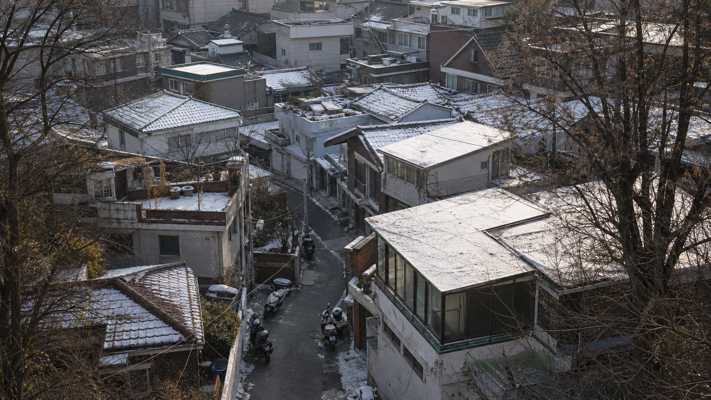

용인시가 11월 24일 수지구 신봉초 주변과 기흥구 흥덕지구를 골목형상점가로 지정했습니다. 두 곳에 있는 204개 점포가 온누리상품권 가맹 자격과 공모사업 참여 자격을 얻었습니다. 그리고 자격보다 먼저, 이 동네에는 손님이 부를 수 있는 새 이름이 하나 생겼습니다.

이름은 시가 붙여 줍니다. 그런데 그 이름을 우리 가게 정보에 붙이는 일은 아무도 대신해 주지 않습니다.

## 골목형상점가가 뭔가요?

큰 시장도 아니고, 백화점도 아닌 동네 골목 상권을 국가와 지자체가 '상점가'로 인정해 주는 제도입니다. 인정을 받으면 두 가지가 열립니다.

첫째, 온누리상품권을 받을 수 있는 가게가 됩니다. 손님은 충전한 상품권으로 결제하고, 가게는 그 돈을 정산받습니다. 둘째, 시설을 고치거나 경영 방식을 바꾸는 공모사업에 신청할 수 있습니다.

용인에서는 이번에 두 곳이 추가됐습니다. 신봉초 주변은 신봉1로 157 일대 8,454㎡에 110개 점포, 흥덕지구는 흥덕2로75번길 38 일대 9,175㎡에 94개 점포입니다. 용인시 전체로는 37곳이 됐습니다.

용인시는 이 두 곳을 "주거 단지를 배후에 둔 생활 밀착형 상권"이라고 설명했습니다. 큰길이 아니라 아파트와 학교 사이, 사람이 걸어서 오는 골목입니다.

## 왜 '이름'이 중요한가요?

손님은 주소를 검색하지 않습니다. "신봉1로 157"이 아니라 "신봉초 근처", "흥덕지구 국밥"처럼 자기가 아는 말로 칩니다.

이 말은 세 겹입니다. 동네 이름, 학교나 아파트 같은 생활 지명, 그리고 업종. 손님은 이 세 겹을 섞어서 검색합니다. 주소는 네 번째 겹인데, 손님이 거의 쓰지 않습니다.

그동안 '골목형상점가'는 담당자들 사이의 말이었습니다. 지정 이후에는 시 공지와 지역 뉴스, 주민 글에 이 말이 반복해서 나옵니다. 검색은 그렇게 단어를 배웁니다. 그리고 그 단어로 검색한 손님의 화면에는, 그 단어를 자기 소개글에 가진 가게가 먼저 나옵니다.

같은 골목, 같은 거리인데 한쪽은 이름표가 있고 한쪽은 없습니다.

## 오늘 30분이면 되는 세 가지

| 할 일 | 어디에 | 어떻게 |
| --- | --- | --- |
| 소개글 첫 문장에 동네 이름 넣기 | 네이버 플레이스 | "신봉초 사거리에서 도보 3분, 골목 쪽" |
| 같은 내용을 다른 문장으로 | 구글 비즈니스 프로필 | 구글은 네이버 소개글을 읽지 않습니다 |
| 가맹 신청 절차 확인 | 온누리상품권 담당 창구 | 자격과 등록은 다른 절차입니다 |

세 줄을 볼 때 기준은 하나입니다. **손님이 판단할 수 있는 숫자**가 들어갔는지. '가깝습니다'는 정보가 아니고, '도보 3분'은 정보입니다. '주차 가능'보다 '주차 4대'가 낫습니다.

한 가지 더 확인해 보세요. 지도 앱에서 우리 가게를 '저장'할 때 붙는 이름입니다. 우리가 쓴 이름과 저장 목록의 이름이 다르면, 손님은 나중에 그 목록에서 우리 가게를 찾지 못합니다. 이름은 한 번 정하면 바꾸기 어려우니, 이번 기회에 실제로 어떻게 보이는지 직접 확인하는 편이 좋습니다.

## 등록한 뒤에 할 일

가맹 등록이 끝나면 손님 화면에서 우리 가게가 어떻게 보이는지 직접 확인하세요. 지도 앱에서 상품권 가맹점 표시가 붙었는지, 검색했을 때 우리 가게가 나오는지, 소개글에 동네 이름이 보이는지. 세 가지를 휴대폰으로 한 번씩 해 보면 10분이면 끝납니다.

공모사업은 공고가 나오는 시기가 정해져 있습니다. 시설 현대화처럼 돈이 큰 사업은 준비 서류가 많아서, 공고를 보고 시작하면 늦는 경우가 많습니다. 지금부터 사업자등록증, 임대차계약서, 매장 사진, 최근 매출 자료를 한 폴더에 모아 두세요. 공고가 뜨면 그 폴더에서 꺼내 쓰면 됩니다.

## 여기서 많이들 놓치는 것

지정은 **자격**을 주는 일입니다. 가맹 등록을 따로 해야 손님이 상품권으로 결제할 수 있습니다. 등록을 미루면 상권 안에 있어도 손님 화면의 가맹점 목록에는 없습니다.

또 하나. 상권 이름이 같아지면 그 안의 가게들은 손님 눈에 한 줄로 섭니다. 그 줄에서 우리를 구분해 주는 건 상권 이름이 아니라 **무엇을 파는지 한 줄**입니다. "정육"이 아니라 "당일 손질, 소량 포장", "카페"가 아니라 "아이 의자 있는 카페"처럼요.

## 이 글의 한계

지정으로 실제 손님이 얼마나 늘었는지는 아직 아무도 모릅니다. 시도 보도자료에서 매출 효과를 말하지 않았습니다. 업종에 따라 효과가 거의 없는 경우도 있습니다. 배달 위주 가게는 상권 이름보다 배달 앱 안 노출이 중요하고, 예약으로 움직이는 가게는 예약 화면의 정보가 먼저입니다.

또 같은 문장을 모든 글에 복사하면 검색에서 좋게 보지 않습니다. 소개글 한 문장, 게시물 하나, 블로그 한 편. 이 정도로 나눠서 넣으세요.

## 확인한 자료

- 용인시 골목형상점가 추가 지정(제36호 신봉초, 제37호 흥덕지구, 2026-11-24): https://www.segye.com/newsView/20261124506459
- 용인시 누리집 고시·공고(골목형상점가 지정 현황): http://www.yongin.go.kr/
- 중소벤처기업부 온누리상품권 가맹점 안내: https://www.mss.go.kr/

## 자주 묻는 질문

### 골목형상점가로 지정되면 온누리상품권 가맹이 자동으로 되나요?

아닙니다. 지정은 신청할 수 있는 자격을 주는 것이고, 가맹 등록은 별도 절차입니다. 등록하지 않으면 손님이 그 가게에서 상품권을 쓸 수 없습니다.

### 우리 가게가 지정 구역 안에 있는지 어떻게 알 수 있나요?

용인시 누리집의 고시·공고에서 '골목형상점가'로 검색하거나 담당 부서에 문의하면 됩니다. 지정은 도로명과 면적으로 구역이 정해지기 때문에, 같은 골목이라도 경계 밖이면 해당되지 않습니다.

### 지정 구역 밖이면 아무것도 할 수 없나요?

상권 이름은 쓸 수 없지만 생활 지명은 쓸 수 있습니다. 손님이 실제로 검색하는 학교, 아파트, 공원 이름을 소개글에 넣는 방식입니다. 지도 앱은 검색어와 가게 정보가 맞는지를 봅니다.

우리 가게가 어느 상권에 들어가는지, 지금 지도에 어떻게 보이는지 궁금하면 가게 링크만 [카카오톡 채널](https://pf.kakao.com/_xdMIvX/chat)로 보내 주세요. 어디부터 손보면 좋을지 편하게 짚어 드리겠습니다.
