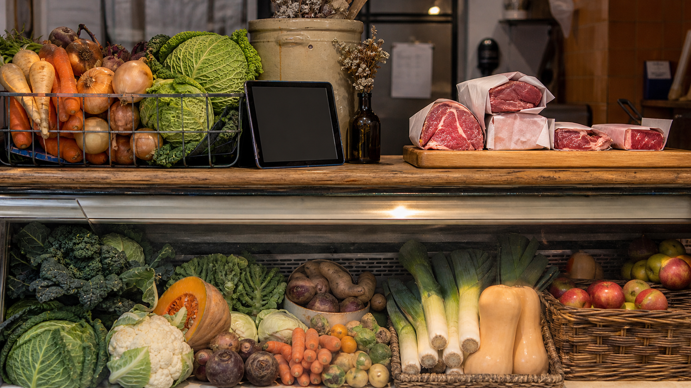

11월 26일부터 홈플러스 온라인 배송이 멈춥니다. 회사는 11월 23일 공지에서 상품 수급 차질을 이유로 들었고, 26일 이후로 배송이 예약된 주문은 자동 취소되고 결제금액은 전액 환불됩니다. 다시 시작하는 날짜는 아직 정해지지 않았습니다.

이건 대형마트 한 곳의 사정이 아닙니다. 이번 주 손님의 장보기 동선이 바뀌는 일이고, 그 동선이 어디로 꺾이는지에 따라 동네 가게의 한 주가 달라집니다.

## 1. 오늘 시장에서 벌어진 일

업계 보도에 따르면 지난 20일을 기점으로 신선식품 납품업체들이 공급을 끊으면서, 신선식품 납품률이 10%에 미치지 못하는 상황입니다. 영업 중인 67개 매장의 재고는 판매가 기준으로 200억 원 수준입니다.

숫자로 보면 이렇습니다. 지난달 홈플러스 신용카드 결제액은 722억 원으로 1년 전(5,297억 원)보다 83.8% 줄었습니다. 그중 온라인 결제가 203억 원, 28.1%였습니다. 온라인 배송은 대형마트 매출의 상당 부분을 차지합니다. 그 채널이 멈추면 손님은 다른 곳을 찾습니다.

참고로 동네 슈퍼 형태인 홈플러스 익스프레스는 6월에 다른 회사로 넘어가 온라인 주문이 정상으로 돌아갑니다. 매장 단위 재고는 매장마다 다릅니다.

같은 날 다른 소식도 있습니다. 중기부가 11월 24일 공고를 내고, 홈플러스 피해 소상공인 대상 정책자금 금리를 11월 25일 접수분부터 연 2.5% 고정으로 내렸습니다. 한도 1억 원, 2년 거치 후 3년 상환입니다. 대출 제한 요건도 15개에서 13개로 줄어 '부채비율 700% 초과'와 '매출액 초과 차입금' 두 항목이 빠졌습니다.

그리고 내일(26일)은 한국은행 금융통화위원회가 열립니다. 시장은 3.00%에서 3.25%로 오를 것으로 봅니다. 결과는 내일 나옵니다.

## 2. 지금 가게가 놓치고 있는 손님

집에서 장을 보던 사람이 배송을 잃으면 두 가지 중 하나를 합니다. 다른 온라인으로 옮기거나, 걸어서 갈 수 있는 곳으로 나옵니다. 앞의 하나는 우리와 상관이 없고, 뒤의 하나가 우리 몫입니다.

문제는 손님이 우리 가게를 떠올리는 순간 확인하려는 세 가지입니다. 오늘 뭐가 들어왔는지, 얼마인지, 지금 문을 열었는지. 이 세 가지가 지도와 블로그에 없으면, 손님은 앱을 닫고 다시 다른 앱을 엽니다.

대형마트가 잘하는 건 이 세 가지를 매일 갱신하는 것입니다. 동네 가게는 물건이 더 좋으면서 그 갱신을 하지 않습니다. 손님이 걸어서 오는 장보기에서는 이 차이가 더 크게 벌어집니다. 차를 대지 않으니 한 번에 많이 살 수 없고, 그래서 '오늘 뭘 사야 하나'를 자주 확인합니다.

| 손님이 확인하는 것 | 지금 없으면 | 오늘 채우는 법 |
| --- | --- | --- |
| 오늘 들어온 품목 | 다른 가게로 이동 | 플레이스 소식에 두세 줄 |
| 영업시간·준비 수량 | 헛걸음 | 게시물에 마감 시간 한 줄 |
| 위치·주차·입구 | 전화 문의로 끝남 | 소개글에 숫자로 |

## 3. 노티스랩이 이번 주에 하는 일

새로 촬영하러 가지 않습니다. 이미 갖고 있는 사진으로 아래 세 가지를 만듭니다.

- **오늘 입고 알림**: 진열대나 손질 장면 사진 한 장에 두세 줄. 플레이스 소식과 구글 프로필 게시물에 같은 내용을 다른 문장으로.
- **15초 짧은 영상**: 상자 열고 진열하는 15초. 손으로 찍은 세로 영상이면 충분합니다.
- **매장 안내물**: 입구에 붙일 A4 한 장. 오늘의 품목과 마감 시간.

사진은 지난 계절 것도 쓸 수 있습니다. 다만 사진에 다른 가게 간판이나 손님 얼굴이 크게 들어간 것은 피하고, 손님이 찍힌 사진은 양해를 먼저 구합니다.

## 이번 주, 순서대로 하면 이렇습니다

1. 오늘: 플레이스 소식에 오늘 들어온 품목 두세 개와 마감 시간을 올립니다. 사진 한 장을 붙입니다.
2. 내일: 같은 내용을 구글 프로필 게시물로 옮깁니다. 문장은 새로 씁니다.
3. 모레: 입구에 A4 한 장을 붙입니다. 오늘의 품목과 전화번호만.
4. 주말: 이번 주에 올린 소식을 보고, 손님이 가장 많이 본 사진이 무엇이었는지 확인합니다.

네 단계를 다 할 필요는 없습니다. 첫 단계만 해도 손님은 '여긴 오늘 것도 알려 주는 곳'으로 기억합니다.

## 이 글의 한계

중단이 며칠 이어질지 아무도 모릅니다. 회사는 재개 시점을 밝히지 않았습니다. 손님은 금방 원래대로 돌아갈 수 있고, 업종에 따라서는 이번 주에 달라지는 게 거의 없을 수도 있습니다. 그래서 재고를 크게 늘리는 판단은 권하지 않습니다.

이번 주에 가게가 가져갈 수 있는 건 판매량이 아니라 습관입니다. '오늘 입고'를 알리는 일을 한 주 해 두면, 이 상황이 끝난 뒤에도 남습니다.

## 확인한 자료

- 홈플러스 고객 공지(2026-11-23) 및 연합뉴스 보도(2026-11-24): https://www.yna.co.kr/view/AKR20261124019651030
- 한국경제, 신선식품 납품률·매장 재고·카드 결제액(2026-11-24): https://www.hankyung.com/article/2026112476451
- 중소벤처기업부 「2026년 소상공인 정책자금 융자사업 공고(변경)」 제2026-616호(2026-11-24): https://www.mss.go.kr/
- 한국은행 금융통화위원회 일정(2026-11-26)

## 자주 묻는 질문

### 온라인 배송이 멈추면 동네 가게 매출이 늘어나나요?

자동으로 늘지는 않습니다. 손님이 대체할 곳을 찾을 때 오늘 무엇이 있는지 확인되지 않으면 다른 온라인으로 갑니다. 공지는 그 확인을 만들어 주는 일입니다.

### 대형마트 오프라인 매장도 문을 닫나요?

닫지 않습니다. 중단되는 것은 온라인 배송이고, 오프라인 매장은 영업합니다. 홈플러스 익스프레스는 온라인 주문도 정상입니다.

### 납품하던 가게는 무엇부터 해야 하나요?

외상 잔액을 숫자로 확인하는 것부터입니다. 거래명세서와 입금 내역을 날짜별로 맞춰 두고, 11월 25일부터 적용되는 2.5% 고정금리 정책자금 조건을 소상공인시장진흥공단에서 확인하세요. 이미 대출받은 경우도 인하된 금리가 적용됩니다.

우리 가게 사진이 몇 장 있는지, 플레이스 소식이 언제 멈춰 있는지 궁금하면 가게 링크만 [카카오톡 채널](https://pf.kakao.com/_xdMIvX/chat)로 보내 주세요. 이번 주 기준으로 당장 손볼 한 곳부터 짚어 드리겠습니다.
