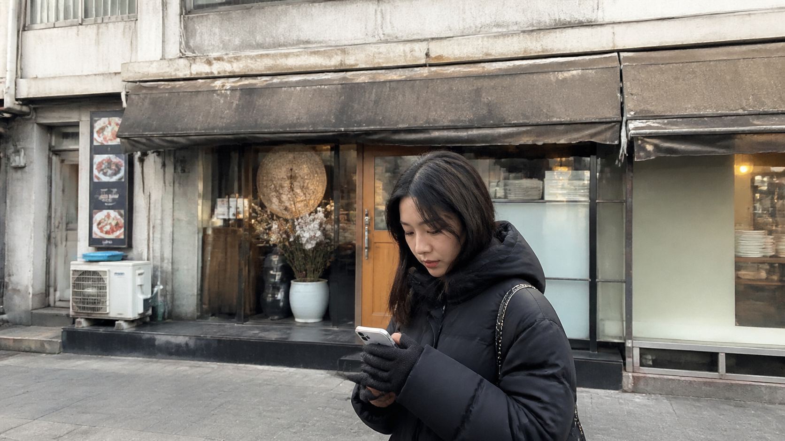

11월 들어 스마트플레이스 앱을 열 때마다 숫자 하나가 마음을 건드립니다. 블로그 리뷰 수입니다. 어제보다 두 개 줄어 있으면 누가 리뷰를 지운 건지, 순위가 빠지는 건지부터 생각하게 됩니다.

그런데 이번에 바뀐 건 가게 평가가 아니라 세는 방법입니다. 네이버는 블로그·카페 검색에 실제로 노출되는 글만 리뷰로 세도록 기준을 바꿨고, 이 변경이 플레이스 순위와 광고 순서에는 영향을 주지 않으며 방문자 리뷰 수는 그대로라고 안내했습니다. 숫자가 줄어든 가게와 늘어난 가게가 함께 나오는 이유도 여기 있습니다.

그래서 이 글은 리뷰를 더 모으는 방법이 아닙니다. 11월에 손님 화면에서 실제로 달라진 것, 그리고 동네 가게가 이번 주에 10분으로 확인할 세 칸에 대한 이야기입니다.

## 숫자를 보기 전에 손님 화면부터 보세요

이번 달 변화는 리뷰 탭이 아니라 검색 결과 화면에서 일어났습니다. 네이버는 10월 29일 공지에서 음식점 검색 결과에 업체명 아래 뱃지 영역을 시험 적용한다고 알렸고, 10월 말부터 11월 중순까지 일부 이용자에게만 보이게 했습니다.

| 손님 화면에서 달라진 것 | 이전 | 지금(시험 적용) |
|---|---|---|
| 업체명 옆 표시 | 네이버페이, 배달, 톡톡, 쿠폰 | 예약·주문 가능 여부, 동네 예약 순위, 재방문이 많은 가게 표시가 뱃지로 |
| 쿠폰과 예약 혜택 | 이름 옆에 붙음 | 사진 아래 카드로 내려감 |
| 손님이 묻는 창구 | 전화, 리뷰 | AI 브리핑 아래 질문창(음식점, 11월 12일부터) |

읽는 방법은 간단합니다. 이름 옆에 붙어 있던 작은 아이콘들이 사라지고, 그 자리에 "이 집은 예약이 되는가"를 알려 주는 표시가 올라옵니다. 손님이 첫 화면에서 보는 정보의 순서가 바뀐 겁니다.

## '동네 예약 순위'라는 말이 뜻하는 것

네이버가 공지에서 든 뱃지 항목에 동네 예약 순위가 있습니다. 이름 그대로 지역 단위의 예약 순위입니다. 어떤 기준으로 계산하는지, 우리 가게가 몇 위인지는 공개되어 있지 않습니다. 확인된 건 뱃지가 붙는다는 사실과, 뱃지 상당수가 네이버 예약과 연결된다는 점입니다.

그래서 판단할 것은 순위가 아니라 예약을 켤지 여부입니다. 예약을 켜면 손님 정보와 취소 처리가 우리 손에 남는지, 수수료가 손님 한 명당 얼마인지가 먼저입니다. 이 다섯 구간은 [플레이스 예약 점검 글](/insights/place-booking-five-gates/)에 정리해 두었습니다.

예약을 켜지 않기로 했다면 그건 그것대로 답이 있습니다. 대신 소개글 첫 줄에 "예약은 전화로 받습니다"처럼 손님이 다음에 할 행동을 적어 두세요. 화면이 뱃지 쪽으로 기울수록, 적혀 있지 않은 안내는 없는 것과 같아집니다.

11월 12일부터는 음식점 업체 상세의 AI 브리핑 아래에 질문창이 붙습니다. 손님이 "몇 시까지 해요", "주차돼요"를 AI에게 묻고, AI는 업체 정보와 블로그·카페·웹 문서를 근거로 답합니다. 지난겨울 가격표나 폐업 전 메뉴가 블로그에 남아 있으면 그 문장이 답변에 섞일 수 있습니다.

## 이번 주에 손볼 세 칸

| 순서 | 할 일 | 걸리는 시간 | 확인 방법 |
|---|---|---|---|
| 1 | 영수증 리뷰에 답글 세 개 | 하루 5분 | 플레이스 리뷰 탭, 최근 리뷰부터 |
| 2 | 영업시간·휴무·메뉴·가격·주차 최신화 | 20분 | 업체정보 관리 화면 |
| 3 | 내 휴대폰으로 내 가게 검색해 뱃지 확인 | 3분 | 지도 앱 최신 버전, 로그아웃 상태 |

1번이 왜 답글인지 궁금할 수 있습니다. 블로그 리뷰 숫자는 우리가 올린 글이 검색에 잡히느냐의 문제라, 오늘 손댈 수 있는 게 거의 없습니다. 반면 영수증 리뷰는 손님이 실제로 남긴 기록이고, 답글은 다음 손님이 읽습니다. 세 줄이면 충분한 이유는 [리뷰 답글 글](/insights/review-reply-three-lines/)에 적어 두었습니다.

2번은 AI 답변의 재료를 고치는 일이기도 합니다. 지난주에 바뀐 게 없더라도, 연말 휴무와 단체 예약 가능 시간은 아직 안 적혀 있을 가능성이 큽니다.

3번에서 뱃지가 안 보인다면 정상입니다. 시험 적용이라 사람마다 다르게 보입니다. 정식 적용 시점은 공지가 나와야 알 수 있습니다.

## 숫자가 줄었다고 리뷰 이벤트를 켜면 안 되는 이유

리뷰 수가 줄면 가장 먼저 떠오르는 처방이 리뷰 이벤트입니다. 그런데 2026년 기준에서 별점 조건을 걸거나 직원이 손님 영수증을 대신 찍어 주는 방식은 조작 예시에 가깝습니다. 기준은 [2026년 리뷰 기준 글](/insights/review-event-rules-2026/)에 정리해 두었습니다.

이번 변화에 대한 처방은 오히려 반대입니다. 세는 방법이 바뀐 숫자를 채우려고 새 리뷰를 사는 대신, 이미 있는 리뷰에 답을 다는 편이 손님에게 더 잘 보입니다. 리뷰 탭을 여는 손님은 개수보다 최근 대화를 봅니다.

## 이 글의 한계

뱃지는 시험이라 정식 적용 여부와 노출 범위가 정해지지 않았습니다. 업종에 따라서도 다릅니다. 확인된 공지는 음식점 화면을 기준으로 하고 있어서, 미용실·병원·소매점 화면에 같은 뱃지가 붙는지는 이 글에서 확인하지 못했습니다.

또 하나, 블로그 글 하나가 플레이스 예약으로 이어졌는지는 우리 가게 데이터로도 정확히 추적되지 않습니다. 그래서 "이 글을 쓰면 예약이 는다"는 식의 약속은 하지 않습니다. 확인할 수 있는 건 순위가 아니라 전화·길찾기·예약 버튼이 눌린 횟수입니다.

## 확인한 자료

- 네이버 스마트플레이스 음식점 검색 뱃지·AI 브리핑 질문창: 공지 2026년 10월 29일, 적용 11월 12일 — https://sharpen.co.kr/news.php?id=20261101-naver-smartplace-place-agent-ai-briefing-4dfa
- 스마트플레이스 11월 변화 4가지(리뷰 집계·뱃지·AI 답변·자동 광고), 2026년 11월 7일 — https://sajangnimnote.com/smartplace-update-2026-11/
- 네이버 스마트플레이스 사업주 고객센터 공지 — https://help.naver.com/notice/noticeList.help?serviceNo=30026
- 플레이스광고 노출 개수 변경 테스트, 네이버애즈 공지 2026년 10월 29일 — https://ads.naver.com/notice/35081

## 자주 묻는 질문

### 블로그 리뷰 숫자가 줄면 순위도 떨어지나요?

아니요. 네이버는 이번 집계 변경이 플레이스 순위와 광고 순서에 영향을 주지 않는다고 안내했습니다. 방문자 리뷰 수와 평점도 그대로입니다. 숫자가 줄었다면 검색에 노출되지 않는 글이 빠진 것이니, 리뷰를 새로 사거나 이벤트를 켤 이유는 없습니다.

### 동네 예약 순위는 어떻게 올리나요?

계산 기준이 공개되지 않아 올리는 방법을 단정할 수 없습니다. 다만 뱃지가 네이버 예약과 연결되어 있으니, 예약을 켜 두고 실제 예약이 쌓이게 하는 것 말고는 확인된 방법이 없습니다. 예약을 켤 때는 수수료와 예약자 정보, 취소 처리부터 확인하세요.

### 뱃지가 우리 가게에는 안 보입니다.

시험 적용이라 일부 이용자에게만 보입니다. 내 휴대폰에 안 보인다고 해서 손님 화면에도 없는 것은 아닙니다. 정식 적용 여부는 스마트플레이스 공지에서 확인하는 편이 정확합니다.

### AI가 우리 가게 영업시간을 틀리게 답하면 어떻게 하나요?

AI는 업체 정보와 블로그·카페 문서를 근거로 답합니다. 먼저 업체정보의 영업시간과 휴무일을 최신으로 고치고, 다음으로 블로그에 남은 옛 가격·옛 메뉴 글을 찾아 고치거나 내리는 순서가 맞습니다. AI 브리핑 자체를 끄는 설정도 있지만, 그러면 질문창도 함께 사라집니다.

연말에 무엇부터 손봐야 할지 헷갈리면 가게 이름과 동네만 [카카오톡 채널](https://pf.kakao.com/_xdMIvX/chat)로 보내 주세요. 지도와 플레이스에 지금 어떻게 보이는지부터 같이 확인하겠습니다.
