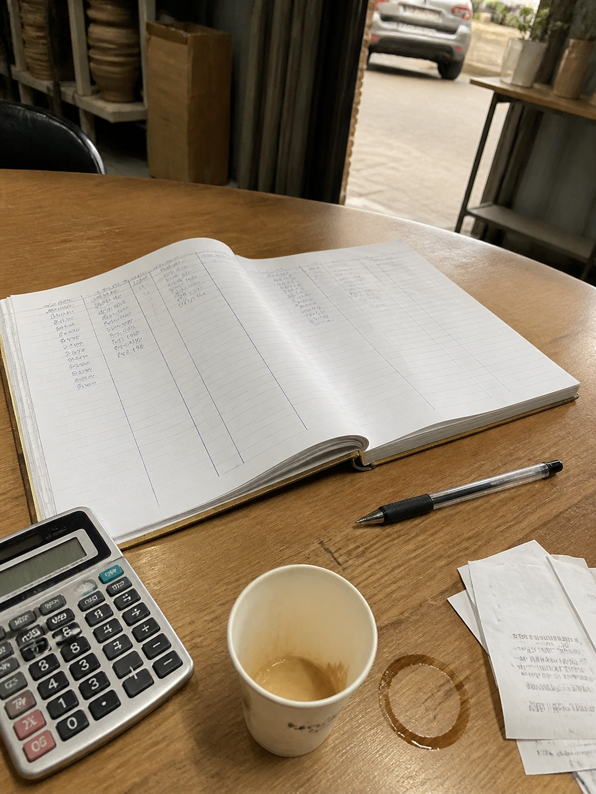

11월 넷째 주에 계산기를 꺼내 본 사장님이라면 이미 아실 겁니다. 내년 1월부터 최저임금이 시간당 10,700원입니다. 올해 10,320원에서 380원 오릅니다.

380원이면 커피 한 잔 값입니다. 그래서 많은 가게가 이 숫자를 그냥 넘깁니다. 그런데 사장님 통장에서 실제로 나가는 돈은 380원이 아닙니다. 주 40시간 직원 한 명 기준으로 한 달에 79,420원입니다. 직원이 셋이면 24만 원, 넷이면 32만 원입니다.

올해와 다른 게 하나 더 있습니다. 같은 1월에 국민연금 보험료율도 9.5%에서 10%로 오릅니다. 시급 인상과 요율 인상이 같은 달에 겹치는 겁니다.

숫자만 보면 답답한 이야기입니다. 그런데 이 글을 쓰는 이유는 반대쪽에 있습니다. 10인 미만 사업장에서 새 직원을 뽑으면 고용보험과 국민연금의 80%를 최대 36개월 돌려받는 제도가 있습니다. 두루누리라고 부릅니다. 인상분의 상당 부분이 여기서 상쇄되는데, 조건을 몰라서 신청하지 않은 가게가 많습니다.

## 380원이 456원이 되는 계산

최저임금은 시급만 보면 틀립니다. 주 15시간 이상 일하는 직원에게는 주휴수당이 붙습니다. 일한 날만큼이 아니라, 일주일치 근무일 하루를 더 얹어 주는 구조입니다. 그래서 계산할 때는 시급에 1.2를 곱합니다.

| 항목 | 2026년 | 2027년 | 차이 |
|---|---|---|---|
| 시급 | 10,320원 | 10,700원 | 380원 |
| 주휴 포함 실질 시급 | 12,384원 | 12,840원 | 456원 |
| 월 환산(주 40시간, 209시간) | 2,156,880원 | 2,236,300원 | 79,420원 |

표의 마지막 줄이 사장님이 실제로 내는 돈입니다. 380원이 아니라 8만 원입니다. 봉급명세서에 찍히는 시급만 보고 예산을 잡으면 이 차이를 놓치게 됩니다.

주 20시간 아르바이트라면 계산이 이렇게 됩니다. 20시간에 주휴 4시간을 더해 24시간분을 잡습니다. 2027년 기준으로 주 256,800원, 올해는 247,680원입니다. 주당 9,120원, 한 달로 치면 4만 원 안팎이 붙습니다.

## 급여표에 안 보이는 10%

급여 말고도 있습니다. 사업주가 따로 내는 4대보험료입니다. 국민연금 5%, 건강보험 3.595%, 장기요양보험료와 고용보험 사업주 부담분까지 더하면 급여의 10% 안팎입니다. 월 223만 원 급여라면 22만 원 정도가 급여 밖에서 더 나갑니다.

국민연금은 2027년부터 매년 0.5%p씩 오릅니다. 올해 9.5%, 내년 10%, 2033년 13%까지입니다. 한 번에 13%가 되는 게 아니라는 점은 다행이지만, 이제 매년 1월에 인건비를 다시 계산해야 하는 구조가 됐습니다.

## 되돌려 받는 창구, 두루누리

여기가 이 글에서 가장 중요한 부분입니다.

두루누리는 근로자 10명 미만 사업장에서 월평균보수 270만 원 미만인 직원의 고용보험·국민연금 보험료를 80%까지 지원합니다. 근로자 몫과 사업주 몫을 따로 지원하기 때문에 사업주 통장에서 나가는 돈이 줄어듭니다. 기간은 최대 36개월입니다.

| 조건 | 내용 |
|---|---|
| 사업장 | 근로자(대표 제외) 10명 미만 |
| 대상 | 월평균보수 270만 원 미만, 신청일 직전 1년간 고용보험·국민연금 가입 이력이 없는 사람 |
| 지원 | 고용보험·국민연금 보험료의 80%, 최대 36개월 |
| 사업주 월 최대 | 국민연금 87,400원 + 고용보험 21,160원 = 108,560원 |

사업주가 받는 금액만 월 10만 원이 넘습니다. 앞서 계산한 시급 인상분 8만 원보다 큽니다. 조건만 맞으면 인상분을 덮고 남는 셈입니다. 물론 모든 가게가 해당되는 건 아닙니다.

가장 많이 걸리는 조건은 신규가입자입니다. 이미 다니던 직원은 대상이 아닙니다. 기존 가입자 지원은 2021년에 끝났습니다. 그래서 두루누리는 직원을 새로 뽑을 때 쓰는 제도입니다. 12월에 채용 계획이 있다면 신청 시점을 그때 맞춰야 합니다.

전년도 재산세 과세표준 합계가 6억 원 이상이거나 종합소득이 4,300만 원 이상이면 제외됩니다. 여기서 걸리는 사장님도 있습니다. 신청은 4대사회보험정보연계센터나 근로복지공단에서 하고, 그달 보험료를 기한 안에 완납하면 다음 달 고지서에서 빠지는 방식입니다.

## 인건비를 시간으로 바꿔 보면

실질 시급 12,840원은 한 시간의 값입니다. 이 숫자를 가지고 계산을 하나 더 해 보면 다른 게 보입니다.

직원이 문의 답장에 하루 한 시간을 쓴다면 그 시간의 값은 12,840원입니다. 한 달 20일이면 25만 원입니다. 손님 한 명 응대에 30분이 걸린다면 6,420원입니다. 커피 한 잔보다 비쌉니다.

그래서 인건비를 줄이는 일은 사람을 줄이는 일이 아닙니다. 같은 답을 손으로 열 번 치지 않게 만드는 일입니다. 자주 쓰는 답변 네 개, 예약 링크, 채팅 가능 시간 안내. 이 세 가지를 채워 두면 야간 문의와 반복 질문이 사람 손을 거치지 않고 끝납니다. 설정 방법은 [카톡 채팅 설정 글](/insights/kakao-channel-chat-hours/)에 정리해 두었습니다.

## 12월에 정할 세 가지

| 순서 | 할 일 | 시점 |
|---|---|---|
| 1 | 1월 근무표를 새 시급으로 다시 계산 | 12월 첫째 주 |
| 2 | 새로 뽑을 사람이 있으면 두루누리 신청 시점 확인 | 채용 공고 전 |
| 3 | 1월 가격·세트 구성 공지 | 12월 중순 전 |

3번을 따로 강조하는 이유가 있습니다. 1월 1일에 손님이 처음 가격 인상을 보면, 그 손님은 그 자리에서 다른 가게를 검색합니다. 12월 중순에 "1월부터 이렇게 바뀝니다"를 미리 알린 가게는 같은 인상도 덜 아픕니다. 단골은 미리 아는 쪽을 편하게 여깁니다.

가격을 올릴지 말지 계산할 때는 [3분기 리포트 글](/insights/q3-2026-report-to-budget/)의 숫자를 같이 놓고 보세요. 기준은 매출이 아니라 남는 돈입니다.

## 이 글의 한계

업종과 근무 형태에 따라 결과가 다릅니다. 주 15시간 미만 단시간 근무자는 주휴수당이 붙지 않아 계산이 달라지고, 수당과 상여가 많은 가게는 4대보험료 기준도 함께 올라갑니다. 두루누리 지원 한도는 해마다 운영지침으로 바뀌므로 신청 전에 근로복지공단이나 국민연금공단에서 확인하세요.

최저임금 고시도 확정된 채로 남아 있지는 않습니다. 소상공인연합회는 2026년 8월 5일 고시 직후 취소 행정소송을 내기로 했습니다. 결과가 나오면 이 계산도 다시 해야 합니다.

노티스랩은 노무·세무 자문을 하는 곳이 아닙니다. 이 글은 공개된 고시문과 운영지침에 적힌 숫자만 정리한 것이고, 절감액을 약속하지 않습니다.

## 확인한 자료

- 고용노동부고시 제2026-60호, 2027년 적용 최저임금(시간급 10,700원, 월 환산 2,236,300원), 2026년 8월 5일 https://www.minimumwage.go.kr/
- 2026년 두루누리 사회보험지원사업 운영지침, 고용노동부, 2026년 6월 10일 https://www.moel.go.kr/info/publict/publictDataView.do?bbs_seq=20260600516
- 사회보험사각지대해소(두루누리 사회보험료 지원) 사업 안내, 고용24 https://www.work24.go.kr/cm/c/f/1100/selecSystInfo.do?systClId=SC00000124
- 국민연금법 부칙(법률 제20903호) 연금보험료 특례, 2027년 사업주 5% https://www.law.go.kr/
- 2027년 최저임금 고시와 소상공인연합회 행정소송, 2026년 8월 5일 https://www.m-economynews.com/news/article.html?no=69439

## 자주 묻는 질문

### 시급이 380원 오르면 직원 한 명에 월 얼마가 더 드나요?

주 40시간 근무 기준 월 79,420원입니다. 주휴수당을 포함한 실질 시급이 12,384원에서 12,840원으로 오르기 때문입니다. 주 20시간 아르바이트라면 월 4만 원 안팎입니다.

### 주 15시간 미만이면 계산이 다른가요?

주휴수당이 붙지 않아 시급 인상분만 반영됩니다. 다만 근무 시간이 들쭉날쭉해 15시간을 넘는 주가 생기면 그 주에는 주휴수당이 발생합니다. 근무표를 짤 때 이 선을 넘지 않게 관리하는 가게도 있습니다.

### 이미 다니는 직원도 두루누리를 받을 수 있나요?

받을 수 없습니다. 신청일 직전 1년 동안 고용보험·국민연금 가입 이력이 없는 신규가입자만 대상입니다. 기존 직원 지원은 2021년에 끝났습니다. 새로 채용할 때 신청하세요.

### 국민연금 요율은 얼마나 오르나요?

2027년 1월부터 10%입니다. 근로자와 사업주가 각각 5%입니다. 2026년은 9.5%에 4.75%씩이었으니 사업주 부담이 0.25%p 오릅니다. 2033년 13%까지 매년 0.5%p씩 오릅니다.

우리 가게 직원 수와 근무 시간을 넣어 1월 인건비를 같이 계산해 보고 싶으면 [카카오톡 채널](https://pf.kakao.com/_xdMIvX/chat)로 가게 이름과 직원 수만 보내 주세요. 숫자 정리부터 도와드리겠습니다.
