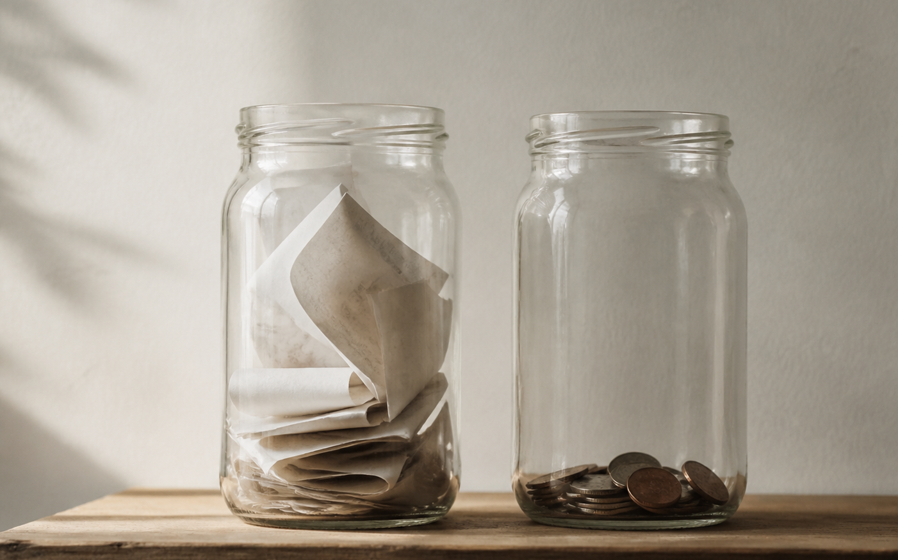

올해 1월부터 9월까지, 소상공인 사업장 한 곳이 벌어들인 평균 매출은 1억 3,630만 원입니다. 지난해 같은 기간보다 2.9% 늘었습니다. 그런데 같은 기간 사업장 한 곳이 남긴 이익은 3,208만 원으로, 지난해보다 176만 원 줄었습니다. 5.2% 줄었습니다.

매출이 늘었는데 이익이 줄었습니다. 이건 장사가 안 되는 이야기가 아니라, **잘 팔수록 남는 게 적어지는 구조**에 들어갔다는 이야기입니다. 이 글은 그 구조를 우리 가게 숫자로 바꿔 보는 방법과, 12월에 바로 손볼 수 있는 한 곳을 다룹니다.

## 먼저 숫자 세 개만 보겠습니다

| 지표 | 값 | 뜻 |
|---|---|---|
| 1~3분기 사업장당 매출 | 1억 3,630만 원 (전년 +2.9%) | 판매는 늘었다 |
| 1~3분기 사업장당 이익 | 3,208만 원 (전년 -176만 원, -5.2%) | 손에 남는 돈은 줄었다 |
| 3분기 개인사업자 대출 연체액 | 16조 4,000억 원 (전년 동기 +21.5%) | 갚지 못하는 가게가 늘었다 |

같은 조사에서 3분기 사업장당 분기 영업이익은 1,020만 원으로 8.3% 줄었습니다. 1분기에는 999만 원으로 2년 만에 1,000만 원 아래로 내려왔습니다. 배경도 무겁습니다. 10월 소상공인 체감경기지수는 73.2로 전월보다 3.3포인트 내렸고, 11월 전망은 88.5입니다. 3분기 전국 일반 상가 공실률은 13.7%로 조사 이래 가장 높았습니다.

## 매출이 늘어도 남는 돈이 줄어드는 이유

이유는 세 갈래이고, 셋 다 우리 가게 통장에서 확인할 수 있습니다.

**첫째, 원가율이 매출 증가율보다 빠르게 올랐습니다.** 재료비와 부자재 값이 오르면, 같은 메뉴를 같은 값에 팔아도 남는 돈이 줄어듭니다. 아래는 구조를 보여 주기 위한 계산 예시입니다.

| 항목 | 작년(예시) | 올해(예시) |
|---|---|---|
| 하루 매출 | 30만 원 | 31만 원 |
| 재료비(원가율 33% → 37%) | 9만 9,000원 | 11만 4,700원 |
| 고정비(임대·공과·인건비) | 9만 원 | 9만 3,000원 |
| 남는 돈 | 11만 1,000원 | 10만 2,300원 |

매출은 3만 원 늘었는데 남는 돈은 8,700원 줄었습니다. 원가율이 4%포인트 오르면 이렇게 됩니다.

**둘째, 고정비는 매출을 따라 오르지 않지만 내려가지도 않습니다.** 임대료, 전기·가스, 인건비, 카드 수수료, 배달 앱 수수료는 장사가 잘되는 날도 안 되는 날도 나갑니다. 배달 비중이 큰 가게는 주문이 늘수록 수수료도 같이 늘어, 매출 증가분이 그대로 비용으로 나갑니다.

**셋째, 이자입니다.** 개인사업자 대출 연체액이 1년 새 21.5% 늘었다는 건, 매출이 조금 늘어도 이자와 원금을 감당하지 못하는 가게가 그만큼 많아졌다는 뜻입니다. 빌린 돈이 있으면 영업이익이 줄어도 매달 빠져나가는 금액은 줄지 않습니다.

## 12월에 손볼 수 있는 한 곳

원가율을 낮추는 일은 하루아침에 되지 않습니다. 거래처를 바꾸고, 재료를 바꾸고, 손실을 줄이는 데 몇 달이 걸립니다. 반면 **손님 한 명이 한 번에 쓰는 금액**은 이번 주에 손볼 수 있습니다.

여기서 흔히 하는 오해가 있습니다. "값을 올린다"는 것만 떠올리는 것입니다. 값을 올리면 손님이 줄 수 있고, 줄어든 손님은 되돌리기 어렵습니다. 반대로 값은 그대로 두고 **고르는 방식을 바꾸는** 쪽이 안전합니다. 세트, 2인 구성, 사이드 한 접시, 포장 추가 옵션처럼요.

그리고 손님이 그 구성을 고르게 하려면, 고르기 전에 보이는 것이 바뀌어야 합니다. 손님은 메뉴를 정할 때 사진과 첫 문장을 봅니다. 지도 앱과 배달 앱에서 가장 먼저 보이는 사진 세 장이 모두 가장 싼 메뉴라면, 손님은 그 메뉴를 고릅니다. 우리가 팔고 싶은 구성은 사진이 없어서 선택지에 없는 셈입니다.

## 노티스랩이 이때 하는 일

새로 촬영하러 가지 않습니다. 이미 있는 재료로 세 가지를 정리합니다.

1. **사진 순서 바꾸기** — 지난 2년치 매장·메뉴 사진 중에서 구성이 보이는 사진을 골라 맨 앞에 둡니다. 새로 찍는 게 아니라 이미 있는 사진의 순서를 바꾸는 일입니다.
2. **첫 두 줄 다시 쓰기** — 소개글 첫 문장에 "무엇을 얼마에, 몇 명이서"가 들어가게 씁니다. 손님이 가격을 물어보기 전에 답이 보이게 하는 것이 목적입니다.
3. **구성 안내 한 장** — 메뉴판 사진을 다시 정리해 세트·추가 옵션을 한눈에 보이게 만듭니다. 디자인을 새로 그리는 게 아니라 기존 메뉴판의 글자와 사진을 다시 배치하는 작업입니다.

광고비를 두 배로 늘리는 결정은 하루면 되지만, 되돌리는 데는 두 달이 걸립니다. 사진 순서와 첫 문장은 오늘 저녁에도 바꿀 수 있고, 내일 바로 결과를 볼 수 있습니다.

## 주의할 점

이 글의 숫자는 업종 평균입니다. 카페와 음식점, 학원과 병원은 원가 구조가 다르고, 배달 비중이 큰 가게는 매출과 이익의 간격이 더 벌어집니다. 평균이 우리 가게의 형편은 아닙니다.

내년 세금도 변수입니다. 정부가 내놓은 내년도 세제개편안에는 신용카드 매출세액공제를 줄이는 내용이 담겼다고 소상공인연합회가 전했습니다. 공제율 1.3%에서 1.2%, 한도 1,000만 원에서 500만 원으로 낮아지는 안입니다. 다만 이는 **개편안 단계**이고 국회 통과 여부는 확정되지 않았습니다. 뉴스 제목만 보고 결제를 몰아서 하거나 광고를 끊는 판단은 이릅니다.

구성을 바꾸는 일에도 한계가 있습니다. 1인 가게는 세트를 만들 재료와 손이 없을 수 있고, 좌석이 좁은 가게는 2인 구성이 오히려 회전을 막습니다. 우리 가게에 맞는지부터 따져야 합니다.

바꾼 뒤에 볼 것도 정해 두세요. 사진 순서를 바꾸면 손님이 고르는 메뉴가 달라지고, 첫 문장을 바꾸면 문의 내용이 달라집니다. 두 주 동안 이 두 가지만 적어도 다음 판단이 됩니다.

## 오늘 할 일

세 가지입니다. 지난달 매출과 재료비를 적어 원가율을 계산해 보기, 지도 앱에서 우리 가게 사진이 어떤 순서로 보이는지 확인하기, 소개글 첫 두 줄에 가격대와 구성이 있는지 보기. 두 번째와 세 번째는 각각 5분이면 끝납니다.

지금 우리 가게 사진이 어떤 순서로 보이고, 첫 문장이 무엇을 말하고 있는지 궁금하시면 플레이스 링크만 [카카오톡 채널](https://pf.kakao.com/_xdMIvX/chat)로 보내 주세요. 보유 사진으로 어디부터 바꾸면 좋을지 짚어 드리겠습니다.

## 확인한 자료

- 한국신용데이터 분기별 매출동향 인용, 아주경제 2026년 11월 25일 — https://www.ajunews.com/view/20261125151306707
- 소상공인연합회 긴급 기자간담회(2026년 11월 25일) 자료와 신용카드 매출세액공제 개편안 관련 단체 추정치
- 소상공인시장진흥공단 체감경기지수(10월 73.2, 11월 전망 88.5), 한국부동산원 3분기 상가 공실률 13.7%

## 자주 묻는 질문

### 매출이 늘었는데 이익이 줄어드는 게 가능한가요?

가능합니다. 원가율과 고정비, 이자가 매출보다 빠르게 늘면 그렇게 됩니다. 올해 1~3분기 소상공인 사업장 평균이 실제로 매출 +2.9%, 이익 -5.2%였습니다.

### 사진 순서를 바꾸면 손님 1명이 쓰는 금액이 오르나요?

오른다고 보장할 수는 없습니다. 사진은 손님이 고르기 전에 보는 정보라 선택을 바꿀 수는 있지만, 결과는 업종과 손님층에 따라 다릅니다. 바꾼 뒤 2~4주 동안 주문 구성을 보고 판단하는 편이 정확합니다.

### 값을 올리는 것과 구성을 바꾸는 것 중 무엇이 먼저인가요?

구성을 먼저 보는 편이 안전합니다. 값을 올리면 손님이 줄 수 있고 줄어든 손님은 되돌리기 어렵습니다. 세트나 추가 옵션은 값표를 건드리지 않고도 손님 한 명의 결제 금액을 조정할 수 있습니다.
