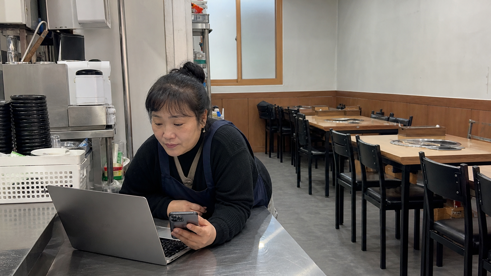

서울에서 3km 떨어진 두 동네에서 같은 질문을 했더니, 챗GPT가 추천한 음식점이 거의 겹치지 않았습니다. 겹침 비율은 1.3%. 반대로 같은 자리에서 같은 질문을 두 번 하면 34%가 겹쳤습니다. AI가 가게를 고르는 기준은 전국 순위가 아니라 손님이 서 있는 좌표에 가깝다는 뜻입니다.

이 글은 AI 검색 최적화를 팔자는 이야기가 아닙니다. 지난 24일 공개된 조사 하나를 놓고, 우리 가게가 지금 어디에 노출되고 어디서 빠지는지 확인하는 방법을 정리한 글입니다.

## 11월 24일 공개된 숫자 네 개

GEO 기업 애니모프가 지난 10월 11일 서울 9개 지점에서 조사를 했습니다. 삼성동을 중심으로 3km 간격으로 떨어진 옥수동, 성수동, 화양동, 잠원동, 삼성동, 잠실동, 서초동, 도곡동, 일원동입니다. 각 지점에서 "근처 저녁 맛집 추천해줘" 같은 15개 질문을 챗GPT와 제미나이에 두 번씩 넣었고, 모인 답변이 540건입니다.

숫자를 나눠 보면 이렇습니다.

| 비교 | 챗GPT | 제미나이 |
|---|---|---|
| 같은 지점에서 두 번 물었을 때 겹침 | 34.0% | 69.5% |
| 3km 떨어진 지점에서 물었을 때 겹침 | 1.4% | 7.1% |

지점 사이 평균 겹침은 챗GPT가 1.3%였습니다. 1회차에서 챗GPT가 저녁 맛집으로 꺼낸 음식점은 35곳인데, 두 개 이상 지점에서 다시 나온 가게는 한 곳도 없었습니다. 카페도 40곳 가운데 중복이 없었습니다.

업종별로 보면 차이가 더 선명합니다. 지점이 다를 때 겹침은 저녁 맛집 0%, 카페 0.2%, 미용실 1.4%였습니다. 가장 높은 업종은 은행으로 12.9%인데, 이건 지점명을 빼고 브랜드명으로 세었기 때문입니다. 다시 말해 같은 브랜드가 아니면 동네가 바뀌는 순간 추천에서 사라집니다.

제미나이 추천 장소의 81.9%는 질문한 지점에서 반경 1.5km 안이었습니다. 거리 중앙값은 634m였습니다. 코앞의 가게를 고른다는 뜻입니다.

## 전국 1위를 해도 옆 동네에서는 안 나옵니다

지역 검색 대행을 하다 보면 사장님들이 가장 많이 물으시는 게 "우리 가게가 몇 위냐"입니다. 그런데 AI 검색에서는 그 질문이 절반만 맞습니다. 몇 위인지가 아니라, 어디에서 물었을 때 나오는지가 먼저입니다.

미국 지역 검색 분석 기업 브라이트로컬 조사를 보면 최근 1년간 AI 도구로 지역 업체를 추천받은 소비자 비중이 지난해 6%에서 올해 45%로 뛰었습니다. 국내에서도 오픈서베이의 'AI 검색 트렌드 리포트 2026'에서 장소 관련 정보 검색이 40.6%로, 전체 AI 검색 목적 가운데 두 번째로 높았습니다. 이 두 숫자는 ZDNet이 11월 24일 보도에서 함께 전한 자료입니다.

손님은 이미 묻고 있습니다. 문제는 우리가 그 답을 볼 방법을 갖고 있지 않다는 점입니다. 네이버 검색 유입은 스마트플레이스 통계에서 보이지만, 챗GPT가 우리 가게를 몇 번 불렀는지는 어디에도 적히지 않습니다. 지금 할 수 있는 일은 추측이 아니라 직접 물어보는 것입니다.

## AI가 참고하는 건 결국 공개된 정보입니다

AI가 어떤 문서를 읽었는지는 공개되지 않습니다. 다만 장소 추천에 쓰이는 재료는 대체로 공개된 정보입니다. 매장 위치, 영업시간, 메뉴, 리뷰, 홈페이지, 블로그 글. 애니모프 대표도 매장 정보와 리뷰, 웹페이지 같은 공개 정보를 정확하게 갖추라고 권했습니다.

국내 플랫폼도 방향이 같습니다. 네이버는 지난 10월 29일 공지에서 11월 12일부터 음식점 상세 화면의 AI 브리핑 아래에 질문 입력창을 붙인다고 알렸습니다. 답변 근거는 플레이스에 등록된 업체 정보와 블로그·카페·웹 문서 검색 결과입니다. 손님이 전화 대신 AI에게 묻는 자리가 생긴 셈입니다. 이 변화는 [가게 이름을 검색하면 첫 문단은 AI가 씁니다](/insights/ai-briefing-first-paragraph/)에서 더 자세히 다뤘습니다.

구글도 이번 달 손을 댔습니다. 구글이 11월 5일 공개한 소상공인 소식지에 따르면 지도 화면의 '전화' 옆에 '메시지' 버튼이 붙고, 영업시간을 문장으로 적으면 칸으로 바꿔 주는 기능이 일부 지역·언어부터 들어갑니다. 한국에 언제 적용되는지는 아직 공지에 없습니다. 기능이 들어오기 전에 할 일은 하나입니다. 지금 프로필에 적힌 시간이 실제와 맞는지 보는 것.

## 오늘 10분, 세 칸

준비물은 휴대폰 하나입니다. 돈은 들지 않습니다.

1. **내 가게 근처에서 직접 물어보기.** 챗GPT와 제미나이에 "○○동 근처 저녁 맛집 추천해줘"처럼 우리 동네 이름을 넣어 물어보세요. 같은 질문을 우리 가게 쪽과 손님이 주로 오는 방향, 두 곳에서 각각 해보면 답이 달라지는 게 보입니다.
2. **플레이스와 구글 프로필의 시간·메뉴 맞추기.** 브레이크타임, 임시휴무, 가격이 바뀌었는데 그대로인 곳이 많습니다. AI는 확인하지 않고 읽은 대로 말합니다.
3. **옛 정보 지우기.** 내 가게 이름으로 블로그와 카페를 검색해 보세요. 몇 년 전 가격, 이전 주소, 예전 메뉴가 남아 있으면 그것도 재료가 됩니다.

세 칸을 다 채우는 데 걸리는 시간은 길어야 30분입니다. 대신 결과를 확인하는 데는 시간이 걸립니다. AI 답변은 매번 달라지니까요.

## 이 글의 한계

먼저 표본입니다. 540건은 서울 9개 지점, 15개 질문에서 나온 숫자입니다. 용인 처인구나 수원의 상권 구조와 같다고 볼 수 없습니다.

두 번째는 재현성입니다. 같은 자리에서 두 번 물었을 때 겹침이 챗GPT 34.0%, 제미나이 69.5%였습니다. 같은 질문에도 답이 달라진다는 뜻이라, 한 번 찍은 화면으로 순위를 말할 수 없습니다.

세 번째는 인과입니다. AI 추천에 나온 가게가 매출이 늘었다는 자료는 이번 조사에 없습니다. 노출과 매출 사이를 이어 주는 측정 도구도 아직 마땅치 않습니다. 우리가 말할 수 있는 건 추천이 지역 단위로 갈린다는 사실까지입니다.

지역마다 손님이 어떤 단어로 검색하는지가 다르다는 이야기는 [같은 처인구에서 '맛집'이 두 가지 뜻이 되는 이유](/insights/cheoin-age-gap-local-keywords/)에 정리해 두었습니다.

## 확인한 자료

- 애니모프 AI 장소 추천 분석(서울·도쿄·뉴욕·오스틴 36개 지점, 2,160건), ZDNet 2026년 11월 24일 — https://zdnet.co.kr/view/?no=20261124152229
- 구글 소상공인 소식지(지도 메시지 버튼, 자연어 영업시간, Gemini 사진 업로드), 2026년 11월 5일 — https://support.google.com/business/thread/476642299
- 네이버 스마트플레이스 음식점 AI 브리핑 내 질문창 안내(2026년 10월 29일 공지, 11월 12일 적용) — https://new.smartplace.naver.com/notices

## 자주 묻는 질문

### 우리 가게가 AI 추천에 나오는지 어떻게 확인하나요?

챗GPT나 제미나이를 열고 우리 동네와 업종을 넣어 질문하면 됩니다. 이때 한 번만 묻지 말고, 우리 가게 쪽과 손님이 오는 방향에서 각각 물어보세요. 조사에서도 지점이 바뀌면 추천이 거의 겹치지 않았습니다. 화면은 날짜와 함께 저장해 두면 나중에 비교하기 좋습니다.

### 플레이스에 정보를 다 채우면 AI가 우리 가게를 추천하나요?

보장할 수 없습니다. AI가 어떤 문서를 읽는지 공개되지 않고, 같은 질문에도 답이 달라집니다. 다만 장소 추천에 쓰이는 재료가 공개 정보인 만큼, 틀린 정보를 최신으로 바꾸는 것은 손해가 아닙니다.

### 전국 단위로 노출되는 게 더 좋은 것 아닌가요?

업종에 따라 다릅니다. 숙박이나 브랜드 체인은 전국 노출이 의미가 있지만, 동네 음식점과 미용실은 반경 몇 km 안에서 선택됩니다. 우리 가게에 손님이 오는 거리부터 정하는 게 순서입니다.

### 이걸 대행사에 맡기면 무엇을 받나요?

맡기기 전에 결과물을 정해야 합니다. 어느 AI에, 어느 위치에서, 어떤 질문으로 확인했는지 남기는지가 핵심입니다. 그 기록이 없으면 한 달 뒤에도 같은 질문을 다시 하게 됩니다.

지금 우리 가게 이름이 AI에게 어떻게 불리는지 궁금하면 [카카오톡 채널](https://pf.kakao.com/_xdMIvX/chat)로 가게 이름과 동네만 보내 주세요. 제가 직접 물어보고, 빠진 정보 세 가지를 짚어 드립니다.
