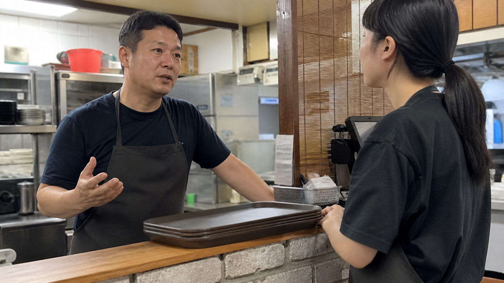

5인 미만 사업장에 근로기준법을 넓히는 일이 국정과제로 올라가 있습니다. 국회에는 관련 법안 6건이 계류 중이고, 정부 계획에는 2027년 상반기 연차휴가·공휴일 조항까지 확대한다는 문장이 들어 있습니다. 알바 두 명으로 돌아가는 가게에도 연차와 가산수당 계산서가 생길 수 있다는 뜻입니다.

아직 법이 바뀐 것은 아닙니다. 법안 6건은 한 건도 처리되지 않았습니다. 다만 12월은 근로계약을 새로 쓰는 달이고, 그때 서류를 맞춰 두지 않으면 나중에 다시 만져야 합니다.

찬반을 정리한 글이 아닙니다. 지금 어디까지 왔고, 사장님 가게에서 무엇이 달라지는지, 12월에 무엇을 확인하면 되는지를 적었습니다.

## 지금은 무엇이 빠져 있나

현행 근로기준법은 상시 5명 이상 사업장에 원칙적으로 적용됩니다. 4명 이하에는 대통령령으로 정한 일부 조항만 적용됩니다. 빠져 있는 것이 꽤 많습니다.

| 항목 | 지금 5인 미만 | 확대되면 |
|---|---|---|
| 해고 제한·부당해고 구제 | 적용 안 됨 | 정당한 이유 필요, 노동위 구제 신청 가능 |
| 연장·야간·휴일 가산수당 | 적용 안 됨 | 50% 가산 |
| 연차유급휴가 | 적용 안 됨 | 발생·사용 촉진 절차 필요 |
| 공휴일 유급휴일 | 적용 안 됨 | 유급 처리 |
| 직장 내 괴롭힘 금지 | 적용 안 됨 | 사업주 조치 의무 |

최저임금, 임금 지급, 퇴직금, 근로계약서 교부는 지금도 적용됩니다. 5인 미만이라고 전부 예외인 게 아니라는 점부터 짚어 두겠습니다.

## 법안 6건, 위원회에 올라간 채 멈춰 있습니다

국회 의안정보시스템 기준으로 5인 미만까지 적용을 넓히는 개정안 6건이 기후에너지환경노동위원회에 계류 중입니다. 2024년 8월 첫 발의 이후 6건 모두 상임위에 올라갔지만 처리된 것은 없습니다.

내용은 조금씩 다릅니다. 모든 조항을 한꺼번에 적용하자는 안, 시기를 시행령으로 정하게 하자는 안, 해고 제한은 공포 3개월 뒤·비용이 드는 조항은 1년 뒤부터 적용하자고 못 박은 안이 섞여 있습니다.

정부 계획은 더 구체적입니다. 대통령 직속 국정기획위원회는 2025년 8월 국정과제에서 직장 내 괴롭힘 금지와 모성보호부터 시작해 2027년 상반기에는 연차휴가·공휴일까지 넓혀 전면 적용하겠다고 밝혔습니다. 다만 첫 단계인 괴롭힘 금지 조항의 시행령 개정도 아직 이뤄지지 않았습니다.

고용노동부는 11월 10일 보도설명자료에서 "답을 정해놓지 않고 노·사, 전문가 및 관계 부처와 함께 사회적 대화를 통해 모두가 상생할 수 있는 방안을 마련하겠다"고 밝혔습니다. 방향은 정해졌고 속도와 범위는 열려 있습니다.

## 비용은 연 1조3538억 원으로 계산됐습니다

고용노동부 의뢰로 한국노동연구원이 2025년 6월 발간한 보고서는 5인 미만 사업장에 주 40시간 초과 근로의 50% 가산수당을 적용하면 월 약 1,128억 원, 연간 약 1조3538억 원이 더 든다고 추계했습니다. 야간근로수당과 휴일 연장근로는 이 숫자에 들어 있지 않습니다.

규모도 작지 않습니다. 국가데이터처 기준 2025년 8월 5인 미만 사업체의 임금노동자는 390만3000명으로 전체의 17.4%입니다. 다섯 명 중 한 명 가까이가 이 예외 안에서 일합니다.

같은 보고서에는 서울·대전 음식점·숙박·소매업 사업주 41명의 인터뷰가 담겨 있습니다. 확대하면 어떻게 하겠느냐는 질문에 32명(78.0%)이 인력 운용이나 임금·근로시간을 바꾸겠다고 답했습니다. 고용 조정 16명, 파트타임 활용 8명 순이었습니다. 어려운 조항으로는 해고 제한과 유급 연차휴가가 각각 20명이었습니다.

## 사장님 쪽 계산은 다릅니다

지난 11월 25일 소상공인연합회가 여의도에서 기자간담회를 열었습니다. 송치영 회장은 "이대로라면 내년 봄부터 줄폐업 쓰나미가 본격적으로 닥칠 것"이라며 노동관계법 개정 추진 중단을 요구했습니다.

연합회가 내놓은 숫자 가운데 확인된 통계는 이렇습니다. 올해 3분기 개인사업자 대출 연체액은 16조4000억 원으로 전년 동기보다 21.5% 늘었습니다. 사업장당 평균 매출은 4.36% 줄어 4,661만 원, 분기당 평균 이익은 8.30% 줄어 1,020만 원입니다.

이 자리에서 나온 44조 원 부담 주장은 성격이 다릅니다. 프리랜서·특수고용직 870만 명을 근로자로 간주하면 1인당 연 505만 원이 든다는 추정이고, 5인 미만 확대가 아니라 '일하는사람들 기본법'을 겨냥한 것입니다.

## 12월에 볼 세 가지

지금 할 일은 법이 아니라 서류입니다. 어느 쪽으로 결론이 나도 손해가 아닌 준비입니다.

1. **근로계약서에 시업·종업 시각, 휴게 시간, 근무 요일이 적혀 있는지.** "주 3일, 협의"로 끝나 있으면 가산수당을 계산할 기준이 없습니다.
2. **근무표와 급여명세서의 시각이 맞는지.** 실제로는 30분 더 일했는데 명세서에 4시간으로 찍혀 있으면 그 30분이 문제가 됩니다. 12월 근무표를 짤 때 지난달 명세서와 나란히 놓고 비교해 보세요.
3. **해고나 계약 종료를 말로만 하지 않았는지.** 서면 통지와 사유를 남기는 습관은 법이 바뀌어도 도움이 됩니다.

혼자 판단하기 어려우면 무료 창구가 있습니다. 중소벤처기업부와 소상공인연합회가 진행하는 '2026년 소상공인 법률·노무 현장 상담 지원사업'은 법률 50개사, 노무 50개사 총 100개 사업장에 전문가가 직접 방문해 1대 1 상담을 해 줍니다. 신청은 12월 4일까지입니다.

2027년 최저임금 계산은 [내년 시급은 380원 오르는데, 직원 한 명 월급은 8만 원 오릅니다](/insights/minimum-wage-2027-labor-cost/)에 정리해 두었습니다. 가게를 정리할 때 남는 것은 [가게를 넘길 때 지도와 리뷰는 누구의 것입니까](/insights/shop-handover-invisible-assets/)에 있습니다.

## 이 글의 한계

법은 아직 바뀌지 않았습니다. 6건 모두 계류 중이고 통과 시점과 범위는 알 수 없습니다. 시행령으로 정하는 부분이 많아, 통과돼도 적용 방식은 나중에 정해질 수 있습니다.

추계도 가정에 따라 달라집니다. 연 1조3538억 원은 주 40시간 초과분에 50%를 더 준다는 가정에서 나온 숫자이고, 임금체계를 조정하면 부담은 줄어들 수 있습니다. 사업주 41명 조사는 서울·대전 3업종에 한정돼 용인 식당에 그대로 대입할 수 없습니다.

이 글은 법률 자문이 아닙니다. 계약서와 해고 절차는 노무사 상담을 먼저 받으세요.

## 확인한 자료

- 한국경제 「'5인 미만 근로기준법' 시동 거는 정부」, 2026년 11월 9일 — https://www.hankyung.com/article/2026110957671
- 고용노동부 보도설명자료(근로기준법 단계적 적용 확대), 2026년 11월 10일 — https://moel.go.kr
- 시대 「내년 5인 미만 근로기준법 전면 적용한다는 정부…속도조절 필요」, 2026년 10월 20일 — https://www.sidae.com/article/2026101513065895682
- 뉴스핌 「이철규 의원, 5인 미만 사업장 근로기준법 확대 신중해야」, 2026년 10월 13일 — https://newspim.com/news/view/20261013000602
- 연합뉴스 「소상공인협회 '소상공인 줄폐업 위기…노동법 개정 중단해야'」, 2026년 11월 25일 — https://www.yna.co.kr/view/AKR20261125101100030
- 파이낸셜뉴스 「변호사·노무사가 직접 소상공인을 찾아갑니다」, 2026년 11월 25일 — https://www.fnnews.com/news/202611250615581914

## 자주 묻는 질문

### 지금도 5인 미만 사업장에 근로기준법이 전혀 적용되지 않나요?

그렇지 않습니다. 최저임금, 임금 지급, 근로계약서 교부, 퇴직금은 지금도 적용됩니다. 빠져 있는 것은 해고 제한, 가산수당, 연차유급휴가, 유급 공휴일, 직장 내 괴롭힘 금지 같은 조항입니다.

### 알바만 쓰면 5인 미만으로 볼 수 있나요?

상시 근로자 수로 판단합니다. 근무 기간과 형태를 따져 일정 기간 계속 쓰는 인원을 셉니다. 인원이 경계에 걸친다면 노무 상담을 받아 보세요.

### 법이 통과되면 언제부터 적용되나요?

법안마다 다릅니다. 공포 후 바로 적용하는 안, 3개월 뒤와 1년 뒤로 나눈 안, 시행령으로 정하게 한 안이 섞여 있습니다. 정부 계획은 2027년 상반기까지 연차·공휴일 조항을 넓히는 것입니다.

### 지금 근로계약서를 새로 쓰면 되나요?

새로 쓰는 계약서부터 시업·종업 시각과 휴게 시간을 구체적으로 적으세요. 이미 일하는 직원은 근무표와 급여명세서의 시각이 맞는지부터 확인하면 됩니다.

법이 바뀌기 전에 우리 가게 서류가 어디까지 정리돼 있는지 궁금하면 [카카오톡 채널](https://pf.kakao.com/_xdMIvX/chat)로 가게 이름만 보내 주세요. 확인해야 할 서류 세 가지를 짚어 드립니다.
