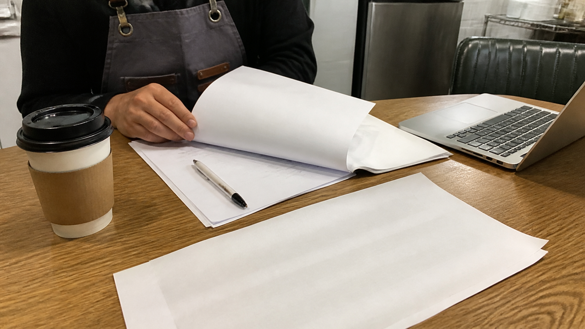

쇼핑몰 플랫폼으로 알려진 카페24가 동네 가게 마케팅 대행 시장에 들어왔습니다. 11월 25일 음식점·미용실·세탁소 같은 오프라인 매장의 홈페이지 제작부터 SNS 운영, AI 검색 노출까지 맡는 '가게 PRO'를 본격적으로 시작한다고 밝혔습니다. 첫 거점은 서울 동작구 신대방이고, 전통시장과 지역 상점가로 넓힌다는 계획입니다.

이 발표에서 사장님이 가져갈 것은 서비스 소개가 아닙니다. 대행을 고르는 질문이 바뀌었다는 사실입니다. "월 얼마인가"에서 "끝났을 때 무엇이 내 것으로 남는가"로요.

## 보도자료에 적힌 것

전자신문과 조선비즈가 11월 25일 전한 내용을 정리하면 이렇습니다.

| 항목 | 내용 |
|---|---|
| 시작 | 서울 동작구 신대방에서 시작, 전통시장·지역 상점가·로드숍으로 확대 |
| 홈페이지 | 자체 AI 홈페이지 빌더로 매장별 공식 홈페이지 제작·유지, 예약·문의·결제 연동, 다국어 지원 |
| 채널 정보 | 네이버·카카오·구글 등 주요 플레이스 채널 6곳의 영업시간·메뉴·위치 정보 통합 관리 |
| AI 검색 | 생성형 엔진 최적화(GEO), AI 답변에 매장 정보가 인용되도록 데이터 정비 |
| 콘텐츠 | 고객 특성에 맞춘 SNS 이미지·영상·문구 제작 |
| 진단 | 검색 노출 수준, 리뷰, 주변 경쟁 매장·상권 데이터를 분석한 진단 보고서와 실행 계획 |
| 진행 방식 | 컨설턴트 상담 → 점주가 매장 정보·사진 제공 → 전담 매니저가 결과물 제시 → 점주 확인·승인 → 채널 운영 대행 |

읽으면서 눈에 걸린 문장이 하나 있습니다. "소상공인은 전문 컨설턴트와 상담한 후 매장 정보와 사진 등을 제공하면 된다"는 대목입니다. 무촬영 원칙과 같은 방향입니다. 새로 찍으러 다니지 않고 이미 가진 사진에서 시작한다는 것.

## 보도자료에 없는 것

여기가 이 글의 핵심입니다. 기사 두 편을 다 읽었지만 다음 항목은 나오지 않았습니다.

- 가격. 초기 세팅비와 월 운영비가 얼마인지 적혀 있지 않습니다.
- 계약 기간과 해지 조건.
- 결과물을 몇 번까지 고쳐 주는지.
- 홈페이지 도메인과 6개 채널 계정의 소유자가 누구인지.
- GEO를 어떻게 확인하는지. 어느 AI에, 어느 위치에서, 몇 번 물어 성과를 말하는지.
- 해지했을 때 홈페이지와 올린 글·사진이 남는지.

없다고 문제가 있다는 뜻은 아닙니다. 보도자료는 원래 새 소식을 알리는 문서이고, 이 항목은 계약서에 들어가는 내용입니다. 다만 사장님이 상담 자리에서 이 여섯 개를 물어보지 않으면, 나중에 알게 됩니다.

## 이번 주에 물을 네 가지

서비스 이름이 무엇이든 대행을 고를 때 확인할 것은 같습니다. 아래 네 개는 카페24든 동네 대행사든 똑같이 물어야 하는 질문입니다.

1. **계정과 도메인의 주인이 누구인가.** 네이버 플레이스, 구글 비즈니스 프로필, 카카오 채널의 관리자 권한을 누구 이름으로 두는지 확인하세요. 홈페이지 도메인도 마찬가지입니다. 대행사 이름으로 만들어 두면 헤어질 때 가져오지 못하는 경우가 생깁니다.
2. **결과물을 몇 번 고칠 수 있는가.** 진단 보고서, 홈페이지 첫 화면, SNS 카드 문구. 수정 횟수가 계약서에 없으면 매번 눈치를 보게 됩니다.
3. **AI 노출을 어떻게 확인하는가.** "AI 검색에 나오게 해 드립니다"는 문장은 성과가 아닙니다. 어느 AI에, 우리 가게 주소 근처에서, 어떤 질문으로, 몇 번 물어 확인했는지 기록을 남기는지 물어보세요. 이 기록이 없으면 한 달 뒤에도 같은 질문을 다시 하게 됩니다.
4. **해지하면 무엇이 남는가.** 홈페이지 파일, 도메인, 올린 사진과 글, 리뷰 답글 이력. 목록으로 받아 두세요.

## 세 가지 방식, 무엇이 다른가

| 항목 | 직접 하기 | 작은 대행사 | 플랫폼 대행 |
|---|---|---|---|
| 비용 | 0원에 가깝지만 시간이 든다 | 월 단위, 협의 | 아직 공개되지 않음 |
| 속도 | 느리다 | 상담에 따라 다르다 | 표준화된 절차로 빠를 수 있다 |
| 맞춤 | 전부 직접 | 우리 가게에 맞출 수 있다 | 정해진 범위 안에서 움직일 가능성 |
| 채널 통합 | 6곳을 각각 관리 | 일부만 가능할 수 있다 | 6곳 통합을 내세운다 |
| 남는 것 | 전부 내 것 | 계약에 따라 다르다 | 계약에 따라 다르다 |

표에서 보시면 아시겠지만, 규모가 결론을 만들어 주지 않습니다. 큰 회사는 속도와 통합에서 강하고, 작은 곳은 맞춤에서 강합니다. 사장님이 비교해야 하는 것은 회사 크기가 아니라 계약서에 적힌 범위와 남는 자산입니다.

## 작은 대행사가 낫다는 뜻은 아닙니다

솔직하게 적겠습니다. 저희도 대행을 하는 쪽이라 이 글에는 이해관계가 있습니다.

오히려 반가운 부분이 있습니다. 플레이스 채널 6곳의 정보를 한 번에 맞춘다는 발상은 옳습니다. 영업시간이 네이버와 구글에서 다르게 적혀 있는 가게를 저는 수도 없이 봤습니다. 큰 회사가 이걸 표준 상품으로 만들면, 사장님들이 "채널마다 시간이 다르면 안 되는구나"를 자연스럽게 배우게 됩니다.

문제는 그다음입니다. 정보를 맞추는 일은 한 번 하면 끝나지만, 12월 임시휴무, 바뀐 메뉴, 새로 생긴 주차장은 계속 생깁니다. 누가 그것을 얼마나 빨리 반영하는지가 성과를 가릅니다. 이건 회사 규모가 아니라 담당자와 절차로 정해집니다.

## 이 글의 한계

첫째, 가게 PRO는 시작 단계입니다. 신대방 한 곳에서 출발해 전국으로 넓히는 중이고, 요금과 세부 조건이 공개되지 않았습니다. 나중에 공개되면 판단이 달라질 수 있습니다.

둘째, GEO의 성과 측정은 업계 전체가 아직 정리되지 않았습니다. AI 답변은 같은 질문에도 매번 달라지고, 노출 횟수를 집계하는 공식 도구도 없습니다. 어떤 대행사든 "AI에 나오게 해 준다"는 약속은 확정이 아니라 방향입니다.

셋째, 저희 기준도 정답이 아닙니다. 계약서에서 무엇을 봐야 하는지에 대한 실무 관점이고, 최종 판단은 사장님 몫입니다.

블로그 대행을 맡기기 전에 볼 항목은 [블로그 대행 맡기기 전, 월 관리비보다 먼저 확인할 5가지](/insights/agency-checklist-before-hiring/)에, 구글 프로필이 막혔을 때의 절차는 [구글 프로필 이의신청은 한 번뿐입니다](/insights/google-profile-appeal-one-shot/)에 정리해 두었습니다.

## 확인한 자료

- 전자신문 「홈페이지 제작부터 AI 검색까지…카페24, 로컬 매장 DX 지원」, 2026년 11월 25일 — https://www.etnews.com/20261125000470
- 조선비즈 「카페24, 동네 가게 '디지털 대행'까지 나선다…서울 신대방서 첫발」, 2026년 11월 25일 — https://biz.chosun.com/distribution/channel/2026/11/25/3LTLC6XGK5A6BIVRA43CXGUQP4/
- 구글 소상공인 소식지(프로필 메시지·영업시간 편집 변경), 2026년 11월 5일 — https://support.google.com/business/thread/476642299

## 자주 묻는 질문

### 가게 PRO 가격은 얼마인가요?

보도자료와 기사에 요금이 나오지 않았습니다. 상담 후 제시하는 구조로 보입니다. 상담을 받으실 때 초기 세팅비와 월 운영비를 따로 적어 달라고 요청하시고, 채널이 늘어날 때 추가 비용이 붙는지도 함께 물어보세요.

### 큰 플랫폼에 맡기면 안전한가요?

규모와 계약 안전성은 다른 문제입니다. 큰 회사일수록 표준 약관이 정해져 있어 조항을 바꾸기 어려울 수 있습니다. 계정 소유권, 수정 횟수, 해지 시 자산 처리는 회사 규모와 무관하게 계약서에서 확인해야 합니다.

### AI 검색 최적화는 실제로 효과가 있나요?

방향은 맞지만 측정이 어렵습니다. AI가 어떤 문서를 읽는지 공개되지 않고, 같은 질문에도 답이 달라집니다. 효과를 주장하는 업체를 만나면 어떤 AI에, 어느 위치에서, 어떤 질문으로 확인했는지 기록을 요청하세요.

### 직접 하는 게 나을까요?

매장 정보 정리와 사진 교체는 직접 하셔도 됩니다. 채널이 6곳으로 늘어나면 시간이 급격히 늘어납니다. 하루에 쓸 수 있는 시간이 30분 이하라면, 정보 최신화만이라도 맡기는 편이 낫습니다.

지금 받고 있는 견적서에 위 네 가지가 적혀 있는지 궁금하면 [카카오톡 채널](https://pf.kakao.com/_xdMIvX/chat)로 업체 이름과 항목만 보내 주세요. 빠진 조항을 같이 짚어 보겠습니다.
