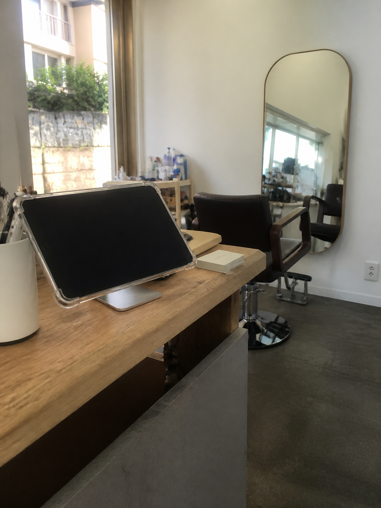

8월 6일, 네이버 플레이스 검색 결과 위에 작은 버튼 하나가 붙었습니다. place+라고 적힌 필터입니다.

손님이 「정자역 맛집」을 검색하다가 이 버튼을 누르면, place+를 켠 가게만 남습니다. 나머지는 그 화면에서 사라집니다. 순위가 한 칸 밀리는 게 아니라 목록에 아예 없습니다.

처음엔 식당 이야기였습니다. 그런데 11월 기준 네이버 고객센터 안내를 보면 헤어짱을 쓰는 미용실·네일샵·바버샵, 인투씨엔에스를 쓰는 동물병원도 대상에 들어 있습니다. 요식업 하나의 문제가 아니게 된 겁니다.

## 필터는 정리가 아니라 제외입니다

place+는 매장의 포스(POS)나 고객관리 프로그램 데이터를 플레이스에 연결하는 서비스입니다. 연결되면 매장 사진 옆에 배지가 붙고, 주간 인기 메뉴, 붐비는 시간대, 평균 결제 금액 같은 정보가 검색 화면에 함께 뜹니다.

핵심은 정보가 아니라 자리입니다. 검색 결과 위쪽에 place+ 매장만 모아 보는 필터가 생겼고, 식당 검색에는 요일과 시간대에 맞춰 추천 매장을 채우는 칸이 따로 생겼습니다. 이런 추천 칸은 「정자역 맛집」, 「송도동 식당」처럼 지역이나 역 이름으로 검색할 때 주로 나타납니다.

손님이 필터를 한 번 누르는 순간, 비교 대상에서 빠집니다. 가격도 메뉴도 리뷰도 경쟁하지 못합니다.

## 11월에 이 필터가 뉴스가 된 이유

11월 2일 토스플레이스가 네이버를 공정거래위원회에 신고했습니다. 자사 포스가 place+ 연동 대상에서 빠졌다는 이유입니다. 토스가 밝힌 토스포스 이용 매장은 약 15만 곳, 그중 음식점·카페가 10만 곳이 넘습니다.

네이버는 특정 업체를 배제하거나 차별한 사실이 없고, 공개한 기준에 따라 순차적으로 연동을 넓혀 왔다는 입장입니다. 8월 6일 공지에 적힌 연동 포스는 15종이고, 그 목록에 토스포스는 없습니다. 옳고 그름은 공정위가 판단할 일입니다.

가게 입장에서 확인해야 할 사실은 세 가지입니다.

네이버는 연동 여부가 일반 검색 순위를 떨어뜨리지는 않는다고 안내합니다. 맞습니다. 다만 필터와 추천 칸은 place+ 매장만 들어갑니다. 그리고 연동하지 않은 가게가 손님을 얼마나 잃는지 공개된 숫자는 아직 없습니다. 겁먹을 근거도, 무시할 근거도 없는 상태입니다.

## 우리 가게가 들어가는지 확인하는 순서

포스가 있는데도 신청을 안 해서 빠져 있는 가게가 꽤 있습니다. 연동 목록에 있는 것과 실제로 켜지는 것은 다른 문제라서, 신청까지 해야 합니다.

1. 스마트플레이스에 로그인하고 내 업체 → 솔루션 → place+를 엽니다.
2. 지금 쓰는 포스가 지원 목록에 있는지 봅니다. 없으면 네이버폼으로 직접 신청합니다. 이 경우 검수에 최대 10일이 걸립니다.
3. 목록에 있으면 place+ 사용하기 → 포스 선택 → 약관 동의 → 사업자등록번호 확인 순서로 신청합니다.
4. 검수는 10일 이내, 신청 후 보통 1~2일 안에 쓸 수 있습니다. 배지가 안 보이면 먼저 포스에서 매출 데이터가 전송 중인지 확인합니다.
5. 포스에 등록된 메뉴명을 실제 메뉴판과 같게 맞춥니다. 인기 메뉴에는 포스에 적힌 이름이 그대로 나옵니다.
6. 마지막으로 손님처럼 확인합니다. 지도앱에서 우리 동네 역 이름이나 동네 이름을 검색하고 place+ 필터를 눌러 보세요. 우리 가게가 보이면 끝이고, 안 보이면 그 자리에서 할 일이 정해집니다.

신청 자체는 5분이면 끝납니다. 오래 걸리는 건 검수와 데이터 전송이라, 12월 대목 전에 켜 두려면 이번 주에 손을 대는 편이 낫습니다.

## 표로 보면 이렇습니다

| 손님이 보는 화면 | 우리 가게가 나오는 조건 | 오늘 확인할 것 |
|---|---|---|
| 일반 플레이스 검색 | 검색어 관련성, 인기도, 거리, 매장 정보 | 업체 정보·영업시간·메뉴 최신 여부 |
| place+ 필터 | 포스 연동 + 신청 + 검수 완료 | 솔루션 → place+ 신청 상태 |
| 요일·시간대 추천 칸 | place+ 매장 중 지역·역 검색에서 선별 | 역 이름으로 검색해 실제 노출 확인 |

## 켜기 전에 알아야 할 두 가지

먼저, 평균 결제 금액은 자동으로 계산됩니다. 여러 명이 한 번에 계산한 금액도 포함되기 때문에, 손님이 이걸 1인당 가격으로 읽을 수 있습니다. 항목만 골라 숨기는 기능은 없습니다. 연동을 해제하면 배지와 결제 기반 정보 노출이 같이 멈춥니다. 메뉴판에 정식 가격과 세트 가격을 분명히 적어 두는 이유가 하나 늘었습니다.

그리고 지금은 무료입니다. 다만 베타 기간이라는 단서가 붙어 있고, 포스사나 네이버 정책에 따라 이용료가 생길 수 있다고 공지되어 있습니다. 무료라는 말이 영구라는 뜻은 아닙니다. 포스를 바꿔야 한다면 장비값과 기존 계약 해지 조건을 먼저 계산하세요. 연동 때문에 포스를 갈아타는 건 순서가 뒤집힌 결정입니다.

## 리뷰 숫자와는 다른 이야기입니다

11월에는 리뷰 세는 법도 바뀌었습니다. 블로그·카페 리뷰 수를 검색에 실제로 보이는 글만 세고, 18일부터는 저장 수를 지금도 저장해 둔 사람 기준으로 매일 다시 셉니다. 숫자가 줄었다고 순위가 떨어진 것은 아니라고 네이버가 안내했습니다.

이 두 가지를 한꺼번에 걱정하실 필요는 없습니다. 리뷰와 저장 수는 숫자가 달라지는 것이고, place+는 자리가 생기거나 사라지는 것입니다. 뒤엣것이 더 급합니다.

## 이 글의 한계

place+ 노출이 매출을 올렸다는 공개 수치는 없습니다. 업계에서 9월 순위 변동 때 place+ 매장이 먼저 보였다는 관찰이 나오지만, 한 대행사의 운영 기록일 뿐 통계가 아닙니다.

대상 업종도 좁습니다. 지금은 음식점, 일부 뷰티 매장, 동물병원 중심입니다. 카페 일부와 서비스 업종은 해당되지 않습니다. 필터를 누르는 손님이 얼마나 되는지도 네이버가 공개하지 않습니다.

그래서 이건 상위노출 전략이 아니라 누락 방지에 가깝습니다. 필터를 켠 손님 앞에서 우리 가게만 안 보이는 상황을 막는 일입니다. 지도 필터에서 빠지면 목록에 없다는 이야기는 [지도 필터에서 빠진 가게는 목록에 없습니다](/insights/map-filter-five-switches/)에, 소개글에 쓸 수 없는 표현은 [「비 오는 날 국물」은 소개글에 써도 안 됩니다](/insights/place-theme-two-slots/)에 정리해 두었습니다.

## 확인한 자료

- 네이버 스마트플레이스 공지 「플레이스 플러스(beta) 전용 검색 필터와 추천 영역이 추가되었어요!」, 2026년 8월 6일
- 네이버 스마트플레이스 사업주 고객센터 「플레이스 플러스(beta) 소개」(연동 포스 목록 2026년 9월, 뷰티 2026년 11월 기준) — https://help.naver.com/service/30026/contents/24284
- 네이버 플레이스 place+ 안내 — https://place.naver.co.kr/placeplusbeta
- 스마트비즈 「토스, 네이버 POS 연동 공정위 제소」, 2026년 11월 9일 — https://www.smartbizn.com/news/articleView.html?idxno=158686
- 플레이스데일리 「토스, 네이버 플레이스플러스 공정위 신고」, 2026년 11월 3일 — https://placedaily.kr/news/naver-place-plus-toss-pos-dispute/

## 자주 묻는 질문

### place+를 안 하면 검색 순위가 떨어지나요?

네이버는 연동 여부가 일반 검색 순위에 영향을 주지 않는다고 안내합니다. 다만 검색 결과 위의 place+ 필터와 요일·시간대 추천 칸은 연동 매장만 들어갑니다. 순위가 아니라 별도의 자리에서 빠지는 구조입니다.

### 포스를 쓰지 않는 가게는 어떻게 하나요?

현재는 포스나 고객관리 프로그램 연동이 조건입니다. 지원 목록에 우리 포스가 없으면 네이버폼으로 신청할 수 있고, 검수에 최대 10일이 걸립니다. 연동 대상이 아닌 업종이라면 지금 할 수 있는 일은 없습니다.

### 평균 결제 금액을 숨길 수 있나요?

항목별로 골라 숨기는 기능은 없습니다. 원하지 않으면 연동을 해제해야 하고, 그러면 배지와 결제 기반 정보 노출이 함께 중단됩니다. 공개되는 숫자의 성격을 미리 알고 결정하시는 편이 낫습니다.

### 무료인가요?

현재 베타 기간에는 별도 이용료가 없습니다. 포스사나 네이버 정책에 따라 향후 이용료가 생길 수 있고, 그때는 사전 공지한다고 안내되어 있습니다.

우리 가게가 필터에 들어가는지 헷갈리면, 가게 이름과 지금 쓰는 포스 이름만 [카카오톡 채널](https://pf.kakao.com/_xdMIvX/chat)로 보내 주세요. 신청 메뉴 위치와 확인 순서를 짚어 드리겠습니다.
