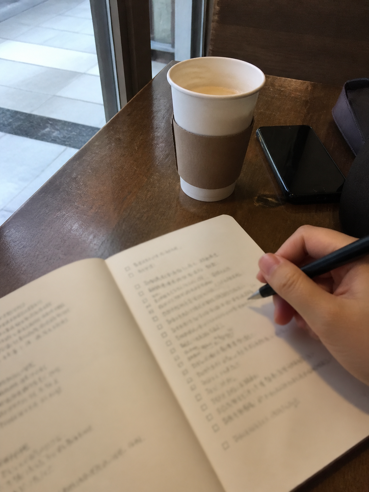

11월 27일부터 식품 등의 표시·광고에 관한 법률 개정안이 시행됩니다. AI로 만든, 실제 사람과 구분하기 어려운 가상의 전문가가 식품이나 건강기능식품을 추천하는 것처럼 보이는 광고는 부당 광고가 됩니다. 의사, 치과의사, 한의사, 약사, 한약사, 대학교수 같은 사람이 보증하거나 추천하는 것처럼 오인하게 만들면 걸립니다.

첫 적발이면 영업정지 15일입니다. 두 번째는 한 달, 세 번째는 두 달입니다.

이 조항이 겨냥하는 건 AI를 쓴 광고가 아닙니다. AI로 만든 전문가입니다. 그리고 그 영상을 만드는 사람은 대개 사장님이 아니라 대행사입니다.

## 표시하면 되는 것과, 표시해도 안 되는 것

여기서 많이 헷갈립니다. 올해 6월 1일부터 공정거래위원회의 추천·보증 표시·광고 심사지침이 바뀌어, AI로 만든 가상인물이 추천하는 광고에는 그 인물이 가상인물임을 표시해야 합니다. 블로그라면 제목 앞에 [가상인물 포함]을 붙이고, 영상이라면 인물 옆에 '가상인물' 자막을 계속 띄우는 방식입니다. 표시만 하면 쓸 수 있습니다.

식약처 규정은 다릅니다. 식품, 건강기능식품, 축산물, 의약품, 화장품은 표시를 해도 안 됩니다. 전문가로 오인하게 하는 것 자체가 금지입니다. 의료기기는 12월 10일부터 같은 규제가 시작됩니다.

| 구분 | 공정위 심사지침 | 식약처 시행규칙 |
|---|---|---|
| 시행 | 2026년 6월 1일 | 2026년 11월 27일 (의료기기 12월 10일) |
| 대상 | 업종 구분 없이 추천·보증 광고 | 식품·건강기능식품·축산물·의약품·화장품·의료기기 |
| 가상인물 표시 | 표시하면 게시 가능 | 표시해도 금지 |
| 처분 | 시정 요청 중심 | 영업정지·광고업무정지 |

처분 기준도 업종마다 다릅니다. 식품과 건강기능식품은 15일, 1개월, 2개월 순으로 올라갑니다. 화장품은 2개월에서 시작해 4개월, 6개월, 12개월까지 갑니다. 의약품은 품목 광고업무정지 1개월부터 시작해 최대 6개월입니다.

## 처분은 가게가 받습니다

대행 계약서에는 흔히 이런 문장이 들어갑니다. "소재에 대한 법적 책임은 광고주에게 있다." 표준 약관에 가까워서, 사장님은 서명하면서 이 줄을 잘 보지 않습니다.

그런데 이 조항이 있는 계약에서 대행사가 AI로 만든 한의사가 제품을 권하는 15초 영상을 올리면, 처분은 가게 이름으로 나옵니다. 대행사는 다음 계약을 받으면 되지만, 영업정지 15일은 그 가게의 매출입니다.

그래서 이 규정은 광고 제작 규정이 아니라 계약 점검 규정에 가깝습니다.

## 대행사에 맡기기 전에 물어야 할 세 가지

1. 지금 만드는 소재에 AI로 생성한 인물이 들어가는지, 들어간다면 화면에 '가상인물' 표시가 들어가는지. 이건 공정위 기준이고, 표시가 있으면 일반 업종은 괜찮습니다. 다만 우리가 식품이나 화장품을 판다면 표시와 무관하게 금지됩니다.
2. 광고 규정 위반으로 행정처분이 나왔을 때 책임과 비용을 누가 지는지. 계약서에 문구로 있는지 확인하세요. 말로 "걱정 마세요"라고 하는 것과 조항으로 남기는 것은 다릅니다.
3. 우리 가게 이름으로 올라간 콘텐츠 목록을 받을 수 있는지, 내가 바로 내릴 권한이 있는지. 계정 권한이 대행사에만 있으면 문제가 생겼을 때 손을 쓸 수 없습니다.

## 이미 올라간 광고를 확인하는 방법

메타 광고 라이브러리(facebook.com/ads/library)를 열고 국가를 대한민국, 광고 범주를 모든 광고로 두면 검색창이 열립니다. 광고주 이름이나 우리 업종 키워드로 찾으면 지금 돌고 있는 소재가 나옵니다. 각 광고의 점 세 개 메뉴 안 '이 광고 정보'에 AI 정보 라벨이 붙는 경우가 있습니다. 다만 라벨이 없다고 AI를 쓰지 않았다는 뜻은 아닙니다. 메타도 순차 적용 중이라 모든 광고에 표시되지는 않는다고 안내합니다.

블로그와 인스타에 올린 체험형 콘텐츠도 같은 기준으로 봅니다. AI로 만든 사람이 먹어 본 것처럼 쓴 글이라면, 표시가 없을 때 문제가 커집니다. 리뷰와 체험단 기준은 [2026년 리뷰 기준](/insights/review-event-rules-2026/)에 정리해 두었습니다.

## 우리 업종이 어디에 걸리는지

| 우리가 파는 것 | 이번 규제 | 확인할 것 |
|---|---|---|
| 식품, 건강기능식품, 축산물 | 11월 27일부터 금지 | 전문가로 보이는 가상 인물이 소재에 있는지 |
| 화장품 | 11월 27일부터 금지 | 피부과 의사·연구원 설정이 있는지 |
| 의약품, 의약외품 | 11월 27일부터 금지 | 약사·한약사 추천 형식이 있는지 |
| 의료기기 | 12월 10일부터 금지 | 그전에 올린 소재 정리 필요 |
| 의류, 서비스, 교육 등 | 이 법의 대상 아님 | 공정위 가상인물 표시는 적용 |

식당이 직접 만든 반찬을 파는 경우처럼 식품을 다루는 가게도 해당됩니다. 메뉴 사진에 전문가가 추천하는 것처럼 자막을 넣었다면 다시 보셔야 합니다.

## 표시 문구는 이렇게 씁니다

일반 업종이라 표시하고 쓰는 경우, 문구는 대충 만들어도 되는 게 아닙니다. 블로그나 카페 글이라면 제목 앞에 [가상인물 포함]을 붙이거나, 본문 맨 앞에 AI를 기반으로 생성된 가상인물이 포함된 게시물이라는 문장을 넣습니다. 사진과 영상은 인물이 나오는 동안 옆에 '가상인물' 또는 '가상의 전문가'라고 적어야 하고, 끝에 한 번 띄우거나 설명란에만 적는 방식은 예시와 다릅니다.

표시를 했더라도 체험을 지어내면 다른 조항에 걸립니다. 가상인물이 먹어 보고 좋았다고 쓰는데 그런 경험이 없다면, 표시 여부와 상관없이 부당 광고가 됩니다.

## 이 글의 한계

조항의 문구는 "오인하게 할 우려가 있는 광고"입니다. 흰 가운을 입고 전문용어를 쓰면 전문가로 보이고, 평범한 옷을 입고 제품만 들고 있으면 다르게 판단될 수 있습니다. 문구와 연출을 함께 봐야 하고, 판단 여지가 남아 있습니다.

오늘 시행 첫날이라 실제 처분 사례는 아직 없습니다. 어디까지 처분으로 이어지는지는 앞으로 쌓일 사례를 봐야 합니다.

그리고 이 법은 모든 업종에 적용되지 않습니다. 의류, 서비스, 교육 같은 업종은 이 조항의 대상이 아닙니다. 다만 공정위의 가상인물 표시 의무는 업종을 가리지 않습니다. 저희도 대행을 하는 쪽이라 이 글에는 이해관계가 있습니다.

## 확인한 자료

- 식품의약품안전처 보도자료 「AI 가짜 의사 추천 광고행위 금지 본격 시행」, 2026년 11월 26일 — https://www.mfds.go.kr/brd/99/view.do?seq=50527
- 식품 등의 표시·광고에 관한 법률(법률 제21707호, 2026년 5월 26일 공포, 2026년 11월 27일 시행) 제8조 제1항 제11호 — https://law.go.kr/LSW/lsRvsDocListP.do?chrClsCd=010202&lsId=013094&lsRvsGubun=all
- 식품 등의 표시·광고에 관한 법률 시행규칙(총리령 제2173호, 2026년 11월 26일 공포, 2026년 11월 27일 시행)
- 연합뉴스 「AI로 만든 '가짜 의사' 광고 내일부터 금지…위반시 영업정지」, 2026년 11월 26일 — https://www.yna.co.kr/view/AKR20261126027000017
- 공정거래위원회 「추천·보증 등에 관한 표시·광고 심사지침」 개정, 2026년 6월 1일 시행
- Meta 고객 센터 「Meta에서 광고 속 AI로 생성한 이미지가 식별되고 레이블이 지정되는 방식」 — https://www.meta.com/ko-kr/help/artificial-intelligence/355108217670024/

## 자주 묻는 질문

### AI 모델을 광고에 쓰면 무조건 안 되나요?

아닙니다. 금지 대상은 전문가로 오인하게 하는 경우입니다. 제품을 든 일반 모델이라도 흰 가운, 청진기, 전문용어 자막이 붙으면 전문가처럼 보일 수 있습니다. 우리 업종이 식품·화장품·의약품이라면 특히 보수적으로 판단하시는 편이 안전합니다.

### 사장님이 직접 나오면 괜찮나요?

실제 본인이나 직원이 나오는 것은 이 조항의 가상 전문가가 아닙니다. 다만 효능·체험 표현은 별도 규제를 받습니다. 먹어 보지 않은 제품을 먹은 것처럼 쓰거나, 건강기능식품의 질병 치료 효능을 암시하면 다른 조항에 걸립니다.

### 이미 올린 콘텐츠는 어떻게 해야 하나요?

먼저 목록을 만드세요. 우리 가게 이름과 제품명으로 검색해 블로그, 인스타, 유튜브, 광고 소재를 한 장에 적습니다. 그중 AI로 만든 인물이 전문가처럼 등장하는 것부터 내리거나 수정 요청을 남기세요. 대행사에 요청할 때는 메신저 내용도 기록으로 남겨 두면 나중에 근거가 됩니다.

지금 받은 견적서나 계약서에 이 조항들이 있는지 궁금하면, 업체 이름과 항목만 [카카오톡 채널](https://pf.kakao.com/_xdMIvX/chat)로 보내 주세요. 빠진 문구를 같이 짚어 보겠습니다.
