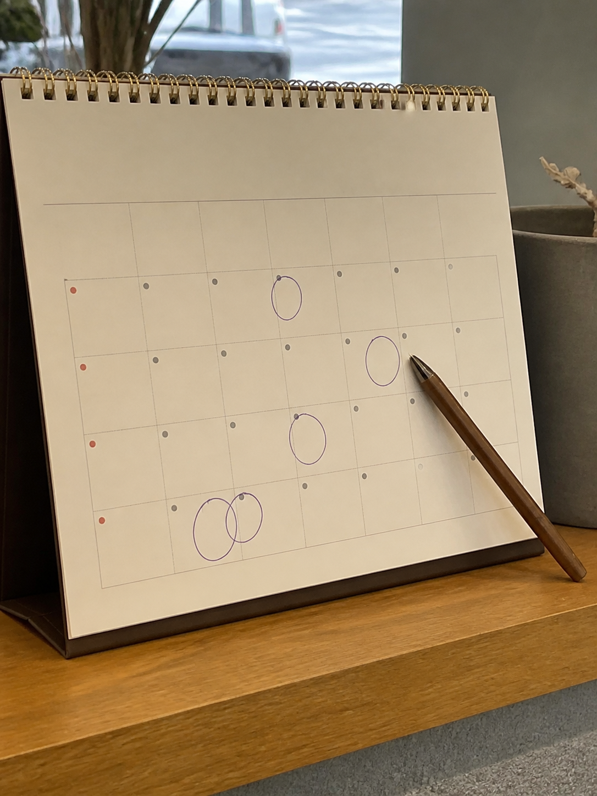

오늘은 11월 27일 금요일입니다. 12월 6일 토요일 저녁 모임을 잡으려는 손님은 대체로 어제, 그러니까 11월 26일에 마음을 정했습니다. 예약 전화는 다음 주에 오겠지만, 그 손님이 어느 가게를 볼지는 이미 지난 며칠 사이에 끝난 일입니다.

겨울 예약은 여름보다 빠릅니다. 네이버 광고가 공개한 업종별 예약 리드타임을 보면, 11월 말에 문의가 없다고 12월이 비어 있는 게 아닙니다. 손님이 고르는 시점과 사장님이 광고를 켜는 시점이 어긋나 있을 뿐입니다.

## 예약일과 이용일 사이, 겨울에는 며칠입니까

네이버애즈가 2026년 11월 5일 올린 겨울 검색 트렌드 자료에 업종별 예약 리드타임이 표로 실려 있습니다. 겨울 평균과 연간 평균을 나란히 놓으면 이렇게 됩니다.

| 업종 | 겨울 평균 | 연간 평균 | 해석 |
|---|---|---|---|
| 픽업 서비스 | 9.1일 | 5.5일 | 연말 픽업 주문이 더 이릅니다 |
| 뷔페 | 10.3일 | 7.4일 | 연말 모임 때문에 예약이 앞당겨집니다 |
| 프랜차이즈 레스토랑 | 5.0일 | 3.7일 | 짧게 보여도 겨울엔 하루이틀 깁니다 |
| 펜션 | 16.1일 | 19.2일 | 여름 성수기보다 오히려 임박 예약 |

재미있는 건 펜션입니다. 여름에는 한 달 전에 잡히던 숙소가 겨울에는 보름 남짓으로 짧아집니다. 눈 오는 주말을 당일치기로 바꾸는 사람이 늘기 때문일 겁니다. 반대로 밥을 먹는 자리는 겨울에 더 빨리 닫힙니다. 모임 날짜가 정해져 있고, 인원이 많고, 술자리 뒤에 다른 일정이 붙기 때문입니다.

같은 자료에는 이런 숫자도 있습니다. 지난겨울 크리스마스 관련 광고 클릭의 98%가 12월에 몰렸고, 11월에 이미 평소의 8배를 넘었습니다. 연말연시 검색은 77%가 12월에 집중됩니다.

여기서 사장님이 자주 거꾸로 읽습니다. "12월에 클릭이 몰리니 12월에 광고를 켜면 되겠다." 클릭은 12월에 몰리지만 결정은 그 전에 끝납니다. 12월 1일에 소재를 바꾸면, 이미 자리를 정한 손님의 목록에는 우리 가게가 없습니다.

## 열흘 차이가 만드는 세 칸

리드타임이 길어지면 손님이 확인하는 정보가 달라집니다. 마음이 급할 때는 전화번호부터 보고, 여유가 있을 때는 조건부터 봅니다. 그래서 겨울에는 아래 세 칸이 비어 있으면 문의 자체가 줄어듭니다.

1. **날짜와 인원이 숫자로 적힌 칸.** "단체 환영"이라는 문장은 손님 계산을 대신해 주지 못합니다. 12월 몇째 주까지 예약을 받는지, 최소·최대 인원이 몇 명인지가 숫자로 있어야 비교가 됩니다.
2. **마감이 보이는 칸.** 12월 5일, 6일, 12일 저녁이 이미 찼다면 그 사실을 먼저 적어 두세요. 손님이 전화해서 "안 된다"는 말을 듣는 것보다, 보고 다른 날짜를 고르는 편이 낫습니다. 마감 안내는 매출을 줄이는 글이 아니라 남은 날짜를 파는 글입니다.
3. **예약을 받는 경로가 열려 있는지.** 플레이스 예약 버튼이 꺼져 있거나, 전화를 못 받는 시간대에 아무 안내도 없으면 손님은 그 자리에서 다른 가게로 갑니다. 12월에는 저녁 시간대 전화를 못 받는 일이 잦습니다. 그 시간에 예약이 되는지, 안 되면 몇 시에 답이 오는지 한 줄 적어 두세요.

## 오늘 15분이면 되는 점검

12월 첫 주에 손을 대면 늦습니다. 오늘 닫는 시간 전에 세 가지만 확인해 보세요.

- **플레이스의 예약 설정.** 예약 버튼이 켜져 있는지, 예약 가능 인원과 시간대가 실제 영업과 맞는지 봅니다. 연말에 임시 휴무를 넣을 날이 있으면 지금 넣어 둡니다.
- **가게 소식이나 공지에 남은 날짜 적기.** "12월 6일, 13일 저녁 예약 마감. 평일 점심 단체 가능"처럼 날짜와 조건을 같이 씁니다. 사진 한 장과 이 두 줄이면 충분합니다.
- **전화를 못 받는 시간의 대체 문장.** 카카오톡 채널이나 문자 자동 응답에 "저녁 6시 이후 문의는 다음 날 오전에 답 드립니다. 12월 예약은 채팅으로도 받습니다"를 넣습니다. 답이 늦는 것과 답이 없다는 것은 손님에게 전혀 다른 일입니다.

이 세 가지는 광고비를 쓰지 않고도 할 수 있습니다. 반대로 광고를 켜 놓고 이 세 칸이 비어 있으면, 클릭은 나가는데 예약은 남지 않습니다.

## 우리 가게 숫자는 직접 세는 게 낫습니다

업종 평균은 방향을 알려 주지만, 우리 가게의 리드타임은 기록에 있습니다. 최근 예약 20~30건만 골라 두 날짜를 나란히 적어 보세요. 예약을 받은 날과 손님이 오는 날입니다. 그 차이를 늘어놓고 가운데 값(중앙값)을 보면 감이 아니라 숫자가 나옵니다.

예를 들어 차이가 3일, 4일, 5일, 6일, 12일, 14일처럼 몰려 있다면 가운데는 5~6일 근처입니다. 이 숫자가 우리 가게의 리드타임이고, 다음 달 광고와 공지를 켜야 하는 시점도 여기서 나옵니다. 평균보다 중앙값을 보는 이유는, 한 달 전에 잡힌 단체 예약 하나가 평균을 통째로 끌어올리기 때문입니다.

세어 보면 대개 두 무리가 나옵니다. 당일이나 하루 전에 잡히는 손님, 그리고 열흘 전에 미리 정하는 손님입니다. 이 두 무리는 원하는 정보도 다릅니다. 앞쪽은 지금 비어 있는지, 뒤쪽은 그 날짜에 자리가 있는지와 조건을 봅니다. 그래서 가게 화면에는 두 문장이 같이 있어야 합니다. 오늘 예약 가능, 그리고 다음 주 날짜별 마감.

## 이 방식이 통하지 않는 경우

리드타임은 업종 평균입니다. 같은 음식점이라도 회사 앞 점심집은 당일 예약이 많고, 룸을 갖춘 곳은 열흘 전에 닫힙니다. 펜션처럼 오히려 임박 예약이 늘어나는 업종도 있습니다. 우리 가게의 실제 리드타임은 최근 예약 기록을 날짜별로 세어 보는 편이 정확합니다. 예약이 거의 없는 업종이라면 이 글의 숫자를 그대로 적용할 이유가 없습니다.

또 하나, 네이버 광고 자료의 수치는 광고 클릭을 기준으로 집계한 값입니다. 검색 전체의 행동과 완전히 같지는 않습니다. 방향을 읽는 데 쓰고, 절대값으로 인용하지는 마세요.

## 확인한 자료

- 네이버애즈 「겨울 광고 준비, 지금부터! 올 겨울 네이버 검색 트렌드」, 2026년 11월 5일 — https://ads.naver.com/sub/insight/success/222
- 네이버 데이터랩 「통합 검색어 트렌드」 지표 설명(조회 기간 최다 검색 시점을 100으로 두는 상댓값), 네이버 개발자 센터 — https://developers.naver.com/docs/serviceapi/datalab/search/search.md

지난 11월 20일에 쓴 [송년회 단체 예약은 '송년회'로 검색되지 않습니다](/insights/year-end-group-booking-search/)에서는 손님이 붙이는 조건 키워드 네 가지를 정리했습니다. 오늘 글은 그 앞단, 언제 결정하는지에 대한 이야기입니다. 한파가 시작될 때 예약 공지를 어떻게 바꾸는지는 [한파가 시작되면 손님은 '지금 갈 곳'이 아니라 '미리 정할 곳'을 찾습니다](/insights/december-booking-notice-cold-snap/)에 있습니다.

## 자주 묻는 질문

### 12월 예약 광고는 언제 켜야 하나요?

네이버 자료는 11월 셋째 주부터 단체 예약 광고를 켜고, 11월 말부터 12월 둘째 주까지 평일 입찰을 높이라고 안내합니다. 오늘이 11월 27일이니 이미 그 구간 안입니다. 늦었다면 예산을 크게 잡기보다 남은 날짜를 정확히 알리는 쪽이 낫습니다.

### 예약이 이미 다 찼는데 광고를 꺼야 하나요?

꺼도 되지만, 끄기 전에 대기 예약을 받을지 정하세요. 12월에는 취소가 나옵니다. 대기 명단을 받아 두면 취소분을 그대로 채울 수 있습니다. 광고를 끄는 대신 소재를 "대기 접수"로 바꾸는 방법도 있습니다.

### 플레이스 예약을 안 쓰는데 꼭 켜야 하나요?

전화만 받아도 됩니다. 다만 예약 버튼이 없는 가게는 비교 화면에서 한 단계 뒤로 밀립니다. 켜기 어렵다면 영업시간과 전화 응대 가능 시간을 정확히 적는 것부터 하세요. 그것만으로도 전화 문의가 줄어드는 일은 없습니다.

12월 예약 화면을 어디서부터 고쳐야 할지 막막하면, 가게 이름과 12월 마감된 날짜만 [카카오톡 채널](https://pf.kakao.com/_xdMIvX/chat)로 보내 주세요. 지금 비어 있는 칸 세 가지만 무료로 짚어 드리겠습니다.
