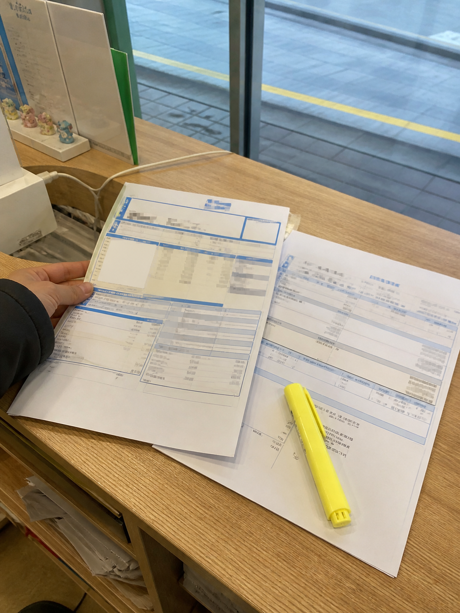

가게에 돈이 없어서 못 쓰는 경우보다, 받아 놓고 못 써서 사라지는 돈이 더 아깝습니다. 소상공인 경영안정 바우처 25만원이 그렇습니다. 신청 마감은 12월 18일 오후 6시, 사용 기한은 12월 31일입니다. 12월 중순에 신청하면 실제로 쓸 수 있는 날은 2주 남짓입니다.

오늘(11월 27일) 기준으로 신청 마감까지 21일, 사용 기한까지 34일이 남았습니다. 숫자만 보면 여유가 있어 보이는데, 12월 고정비 결제일이 25일 전후에 몰려 있다는 걸 감안하면 지금 결정해야 25만원을 다 씁니다.

## 이 돈의 성격부터

2026년 사업은 중소벤처기업부 공고 제2026-37호로 시행됐습니다. 예산 5,790억원, 대상은 약 230만 곳, 사업체당 최대 25만원입니다. 현금으로 통장에 들어오는 게 아니라, 신청할 때 고른 카드사에 포인트로 붙고 결제할 때 자동으로 차감됩니다.

| 항목 | 2026년 기준 |
|---|---|
| 대상 매출 | 2025년 연매출 0원 초과 ~ 1억 400만원 미만 |
| 개업일 | 2025년 12월 31일 이전, 신청일 기준 영업 중 |
| 지원 금액 | 사업체당 최대 25만원 |
| 신청 기간 | 2026년 2월 9일 ~ 12월 18일 18시(잠정), 예산 소진 시 조기 마감 |
| 사용 기한 | 2026년 12월 31일, 남은 금액은 원칙적으로 회수 |
| 사용처 | 전기·가스·수도요금, 4대 보험료, 사업용 차량 연료비, 전통시장 화재공제료 |
| 신청처 | 소상공인24 또는 소상공인경영안정바우처.kr |

작년과 달라진 부분이 두 개 있습니다. 전통시장 화재공제료가 사용처에 새로 들어왔고, 통신비가 빠졌습니다. 작년 글을 보고 통신비를 계산에 넣어 두셨다면 올해는 그 칸이 비어 있습니다. 고정비 자동이체를 짜 둔 사람일수록 이 차이를 놓치기 쉽습니다.

## 반전은 카드에 있습니다

바우처를 받는 순간 "25만원 생겼다"고 생각하기 쉽습니다. 실제로는 조건이 하나 더 붙습니다. 포인트는 신청할 때 고른 카드사에만 붙고, 받은 뒤에는 카드사도 카드 종류도 바꿀 수 없습니다. 법인카드와 가족카드는 쓸 수 없고, 사장님 본인 명의의 개인 신용·체크카드여야 합니다.

그래서 순서가 중요합니다. 보통은 "지원금이니까 일단 신청"하고 카드를 아무거나 고릅니다. 그런데 전기요금과 보험료를 자동이체하는 카드가 A사인데 바우처를 B사로 받으면, B사 카드로 결제해야 포인트가 빠집니다. 자동이체를 바꾸지 않으면 25만원은 카드 안에 그대로 남아 있다가 12월 31일에 사라집니다.

신청 전에 이 세 줄만 확인하세요.

1. **고정비를 결제하는 카드가 어느 카드사인지.** 전기요금, 가스요금, 4대 보험료를 지금 어느 카드로 내고 있는지 봅니다. 그 카드사로 신청하는 게 가장 빠릅니다.
2. **본인 명의 개인카드가 있는지.** 없다면 신청 전에 만들어야 합니다. 카드 발급에 걸리는 시간이 있어서 12월 중순에는 늦을 수 있습니다.
3. **신청 정보의 개업일.** 사업자등록증의 개업연월일을 넣어야 합니다. 발급일자를 넣는 실수가 흔합니다.

## 오늘 할 일은 신청이 아니라 확인입니다

이미 신청했는지부터 보세요. 2월에 신청했다면 카드사에서 온 알림톡이나 문자를 찾아보면 남아 있습니다. 신청한 기억이 없으면 소상공인24에서 접수 상태를 확인합니다.

아직 안 했고 대상에 들어간다면, 오늘 신청까지 끝내는 편이 좋습니다. 신청은 서류 없이 온라인으로 하고, 국세청 과세정보로 요건을 확인합니다. 면세사업자처럼 매출 확인이 안 되는 경우에만 증빙을 요청받습니다.

신청한 뒤에는 12월 결제일에 맞춰 쓰는 순서를 정합니다. 12월 전기요금과 12월 보험료가 25일 전후에 빠져나간다면, 그 두 건이면 대부분 채워집니다. 25만원을 넘는 금액과 사용처가 아닌 결제는 사장님 부담이니, 한도가 남았는지 결제 전에 확인하세요.

## 12월 고정비 달력에 먼저 적어 두세요

바우처는 결제할 때 자동으로 먼저 차감됩니다. 그래서 12월에 어떤 결제가 예정돼 있는지 먼저 적어 두면 계산이 쉬워집니다. 전기요금, 가스요금, 수도요금, 4대 보험료, 차량 연료비. 이 다섯 줄이면 대부분입니다.

적으면서 두 가지를 확인하세요. 결제일이 서로 다른 카드로 흩어져 있지는 않은지, 그리고 그 카드가 바우처를 받은 카드사인지입니다. 흩어져 있다면 바우처 카드로 몰아 두는 편이 낫습니다. 12월 25일 전후에 전기요금과 보험료가 같이 빠져나가는 가게라면 두 건으로 한도의 상당 부분이 채워집니다.

중복도 조심해야 합니다. 같은 공과금이나 보험료를 다른 지원사업으로도 지원받으면 그쪽에서 환수될 수 있다고 공고에 적혀 있습니다. 경영안정 바우처와 별개로 지자체 지원을 받고 있다면, 같은 항목에 두 번 쓰지 않도록 결제 내역을 나눠 두세요.

## 이 방식으로 안 되는 경우

대상이 아닌 가게가 있습니다. 2026년에 새로 문을 연 사업장, 2025년 매출이 1억 400만원을 넘은 곳, 유흥주점이나 가상자산 매매처럼 정책자금 제외 업종, 신청일 기준 휴업·폐업 상태인 곳입니다. 한 사람이 여러 사업체를 운영해도 한 곳만 신청할 수 있습니다.

12월 18일은 공고에 '잠정'으로 적힌 날짜입니다. 예산이 먼저 바닥나면 그 전에 닫힙니다. 신청하기 전에 소상공인24에서 접수 중인지 확인하세요.

그리고 이 25만원은 매출을 만드는 돈이 아니라 고정비를 줄이는 돈입니다. 12월 광고비를 여기서 쓰겠다고 계획했다면 사용처가 아니라서 결제가 막힙니다. 광고비는 따로 계산해야 합니다.

## 확인한 자료

- 중소벤처기업부 공고 제2026-37호 「소상공인 경영안정 바우처 지원사업 시행 공고」, 2026년 1월 28일
- 중소벤처기업부 충북지방중소벤처기업청 보도자료 「영세 소상공인 고정비 부담 던다! 바우처 25만원 지급」, 2026년 1월 27일 — https://www.mss.go.kr/site/chungbuk/ex/bbs/View.do?bcIdx=1065085&cbIdx=180
- 소상공인24 지원사업 공고, 2026년 11월 확인 — https://www.sbiz24.kr/
- 경제시그널 「25만원 아직 안 받았다면… 소상공인 바우처 12월 18일 마감, 31일 지나면 0원」, 2026년 11월 13일 — https://www.economicsignal.co.kr/news/articleView.html?idxno=2056

12월에 쓴 돈이 1월에 돌아오는지 계산하는 방법은 [3분기 소상공인 리포트를 12월 광고 예산으로 옮기는 계산](/insights/q3-2026-report-to-budget/)에, 이자와 고정비가 매출을 어떻게 갉아먹는지는 [매출은 늘었는데 통장은 비는 이유](/insights/small-often-spending/)에 정리해 두었습니다.

## 자주 묻는 질문

### 12월 18일에 신청하면 25만원을 다 쓸 수 있나요?

쓸 수는 있지만 현실적으로 어렵습니다. 12월 18일 신청, 카드 등록, 결제일까지 계산하면 남은 결제 기회가 한두 번입니다. 12월 31일이 지나면 남은 금액은 원칙적으로 회수되니, 늦어도 12월 첫째 주에는 신청과 카드 등록을 끝내는 편이 안전합니다.

### 이미 받았는데 카드사를 바꾸고 싶습니다.

바우처를 받은 뒤에는 카드사와 카드 유형을 바꿀 수 없습니다. 다만 그 카드로 사용처 결제를 하면 되니, 자동이체 카드만 그 카드사로 옮기면 됩니다. 자동이체 변경은 카드사나 결제처 앱에서 직접 해야 합니다.

### 25만원을 다 못 쓰면 남은 돈은 어디로 가나요?

사용 기한이 지나면 원칙적으로 국고로 회수됩니다. 개인에게 현금으로 돌려주지 않습니다. 12월 31일 전에 사용처 결제가 한 번이라도 남아 있다면, 전기요금이나 보험료 결제일을 앞당길 수 있는지 확인해 보세요.

바우처 대상인지, 어느 카드사로 신청해야 하는지 헷갈리면 가게 이름과 2025년 매출 구간만 [카카오톡 채널](https://pf.kakao.com/_xdMIvX/chat)로 보내 주세요. 지금 확인할 세 가지만 무료로 짚어 드리겠습니다.
