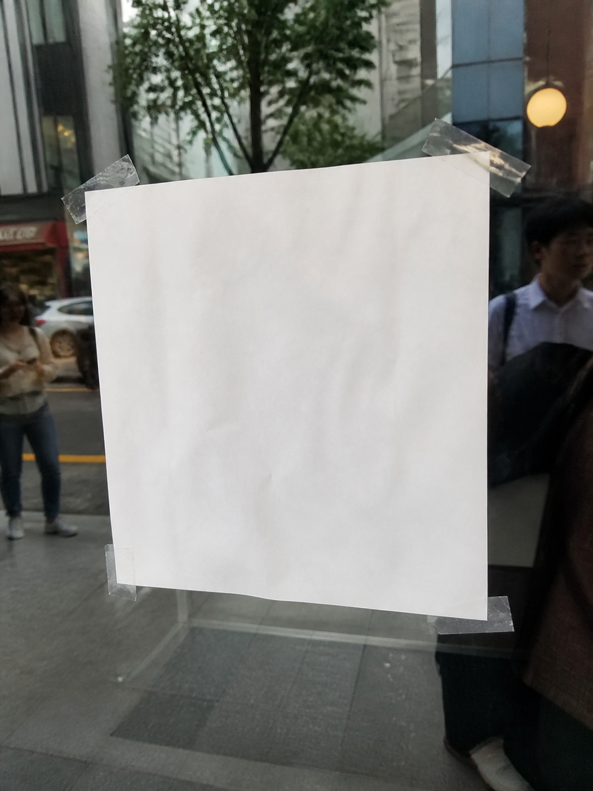

오늘은 11월 27일, 블랙프라이데이입니다. 동네 가게도 이날만큼은 가격표를 새로 씁니다. 문제는 "50% 할인"이라고 쓴 그 50%가 어디서 나온 숫자냐는 것입니다. 사장님 기억속 '원래 가격'이 아니라, 최근 20일쯤 사이에 실제로 판 최저가가 기준이 됩니다.

이 기준은 취향이나 관행이 아니라 공정거래위원회 고시에 적힌 계산법입니다. 대법원도 같은 방향으로 판단했습니다. 오늘 하루 할인 문구를 다는 가게라면, 내일 아침 민원 한 통으로 끝날 일이 아니라는 점부터 짚고 갑니다.

## 기준 가격은 직전 가격이 아닙니다

공정위 「부당한 표시·광고행위의 유형 및 기준 지정고시」는 종전거래가격을 이렇게 정의합니다. 같은 상품을 최근 상당기간(과거 20일 정도) 동안 판매한 적이 있으면, 그 기간에 붙인 가격이 기준입니다. 그 사이 실거래가격이 바뀌었다면 변동된 가격 중 최저가를 기준으로 봅니다.

대법원 2022년 4월 28일 선고 2019두36001 판결도 이 정의를 주요 기준으로 인정했습니다. 이 판결에서 고추장 한 품목의 광고상 종전거래가격은 21,700원이었고, 광고 직전 판매가격과 같았습니다. 그런데 광고 전 20일 동안의 최저 판매가격은 14,900원이었습니다. 법원은 이 경우 광고상 기준가격이 실제보다 높다고 볼 수 있어 거짓·과장 광고에 해당할 여지가 크다고 봤습니다.

숫자로 보면 차이가 이렇게 갈립니다. 어떤 가게가 앞선 12일은 20,000원에, 행사 직전 8일은 25,000원에 팔았고 오늘 18,000원에 판다고 합시다.

| 기준으로 삼은 가격 | 할인율 계산 | 표시할 수 있는가 |
|---|---|---|
| 직전 판매가 25,000원 | 28% 할인 | 기준이 20일 최저가가 아니므로 위험 |
| 20일 중 최저가 20,000원 | 10% 할인 | 고시의 정의에 맞음 |

같은 18,000원인데 할인율이 두 배 넘게 벌어집니다. 행사 전에 가격을 올려 두고 그 가격을 기준으로 다는 방식은 고시가 따로 적어 둔 부당 표시 유형이기도 합니다. 특별히 인정할 만한 사유 없이 20일 이상 실제 거래한 적이 없는 가격을 종전거래가격으로 쓰는 행위입니다.

## 비교 가격은 네 가지, 다만 밝혀야 합니다

공정위가 2025년 10월 21일 낸 설명자료는 "할인율은 무조건 직전 20일 가격으로만 계산해야 한다"는 보도를 바로잡았습니다. 비교 가격을 표시하는 방법은 네 가지입니다. 종전거래가격, 희망소매가격, 시가, 타사가격을 현재 판매가격과 비교하는 방식입니다.

다만 종전거래가격 방식을 쓸 때는 20일 최저가가 원칙입니다. 그리고 어떤 기준을 썼든 그 사실을 밝혀야 합니다. 고시는 비교가격의 기준을 명시하지 않은 표시도 부당 광고로 봅니다.

동네 가게가 자주 쓰는 문장으로 바꾸면 이렇습니다. "정상가 20,000원 → 18,000원"에서 정상가가 지난 20일 중 최저가와 다르면 그 문장은 틀린 문장이 됩니다. 반대로 "지난 20일 최저가 20,000원, 오늘 18,000원"이라고 쓰면 기준이 분명해집니다. 글자가 작아도, 현수막이어도 같은 기준이 적용됩니다.

## 오늘 문구를 달기 전에 세 줄

1. **최근 20일 판매가를 뽑아 봅니다.** 포스 기록이나 카드 정산 내역에서 상품별 일별 판매가를 확인합니다. 가격을 바꾼 적이 없다면 직전 가격과 최저가가 같으니 그대로 쓰면 됩니다. 바꾼 적이 있다면 낮은 쪽을 기준으로 다시 계산합니다.
2. **기준과 기간을 문구에 넣습니다.** "20일 최저가 기준", "11월 27일 하루"처럼 짧게 붙입니다. 할인 기간이 끝나면 현수막과 게시물을 그날 바로 내립니다. 고시는 행사가 끝난 뒤에도 표시물을 남겨 두는 행위도 부당 광고로 봅니다.
3. **재고를 확인합니다.** 할인 기간에 팔 수 있는 수량이 실제로 있는지 봅니다. 재고가 없는데 "한정 수량"만 크게 쓰는 것도 문제가 됩니다.

광고를 대행사에 맡겼다면 이 세 줄을 대신 확인해 달라고 요청하세요. 할인율을 계산한 근거 자료, 비교 기준을 문구에 표시한 시안, 행사 종료 후 광고를 내리는 일정. 이 세 가지를 문서로 받아 두면 나중에 문제가 생겼을 때 사장님이 설명할 수 있습니다. 계약서에 "표시광고법 준수" 한 줄만 있는 것은 확인이 아니라 위임입니다.

## 온라인몰·배달앱은 정산 자료로 봅니다

매장과 온라인을 같이 하는 가게라면 온라인 쪽 기록이 오히려 깔끔합니다. 오픈마켓이나 배달앱은 상품별 판매가와 할인 적용 내역을 정산 자료로 남깁니다. 행사 전 20일치를 내려받아 상품별 최저 판매가를 뽑으면, 손으로 계산하지 않아도 기준이 나옵니다.

주의할 점은 채널마다 기준가가 다를 수 있다는 것입니다. 매장에서 20,000원에 팔고 배달앱에서는 수수료를 반영해 22,000원에 올려 둔 상품이라면, 배달앱 안에서 22,000원을 기준으로 계산한 할인율을 매장 가격과 섞어 쓰지 마세요. 어느 채널의 가격인지 문구에 적는 편이 안전합니다.

가격을 자주 바꾸는 가게라면 오늘부터라도 바꾼 날짜와 가격을 한 줄씩 적어 두세요. 20일치 기록을 남기는 습관이 다음 할인 때 그대로 기준표가 됩니다.

## 이 기준으로 안 되는 것

가게마다 20일치 판매 기록이 깔끔하게 남아 있지는 않습니다. 현금 결제가 많거나 가격을 자주 바꾸는 가게라면 기준을 잡기 어렵습니다. 그럴 때는 종전거래가격 대신 시가나 희망소매가격을 비교 기준으로 쓰고, 그 사실을 문구에 밝히는 방법이 있습니다. 다만 이 경우에도 기준이 사실과 달라서는 안 됩니다.

이 글은 법률 자문이 아닙니다. 과징금과 시정명령은 위반의 내용과 정도에 따라 달라지고, 같은 문구라도 상품과 맥락에 따라 판단이 갈립니다. 판매가 기록이 없다고 해서 기준을 대충 잡아도 된다는 뜻은 아닙니다.

## 확인한 자료

- 공정거래위원회 「부당한 표시·광고행위의 유형 및 기준 지정고시」, 2019년 12월 12일 시행 — https://www.law.go.kr/admRulInfoR.do?admRulSeq=2100000184414
- 대법원 2022년 4월 28일 선고 2019두36001 판결 — https://www.law.go.kr/LSW/precInfoP.do?precSeq=220843
- 공정거래위원회 「공정위 '온라인 할인율 거짓·과장 표시광고 엄중 조치 중' 관련 설명자료」, 2025년 10월 21일 — https://www.korea.kr/briefing/actuallyView.do?newsId=148952606

리뷰 이벤트 문구의 기준은 [별점 5점 주시면 음료, 그 이벤트가 리뷰 탭을 지웁니다](/insights/review-event-rules-2026/)에, 12월에 대행을 시작할 때 계약서에 넣을 조항은 [12월에 대행을 시작하면 성과를 잘못 봅니다](/insights/year-end-agency-contract-baseline/)에 정리해 두었습니다.

## 자주 묻는 질문

### 20일 동안 가격을 한 번도 안 바꿨으면 그냥 써도 되나요?

됩니다. 직전 가격과 20일 최저가가 같으니 계산 결과도 같습니다. 다만 그 사실을 기록으로 남겨 두세요. 나중에 기준을 물었을 때 보여 줄 수 있어야 합니다.

### 온라인몰과 오프라인 매장 가격이 다르면 어느 쪽이 기준인가요?

같은 상품을 판매한 가격이라면 채널별로 따로 보는 것이 안전합니다. 온라인몰에서 20일간 판 가격과 매장에서 판 가격이 다르면, 각 채널의 판매 기록을 기준으로 계산하고 문구에도 어느 채널의 가격인지 밝히는 편이 분명합니다.

### 대행사가 만든 광고 문구의 책임은 누구에게 있나요?

표시광고의 주체는 사업자입니다. 대행사가 문구를 만들었더라도 광고를 낸 가게가 책임을 지게 됩니다. 그래서 근거 자료를 받아 두는 것이 중요합니다. 반대로 대행사 입장에서도 산출 근거를 남겨 두면 나중에 분쟁이 줄어듭니다.

오늘 단 할인 문구가 기준에 맞는지, 대행사에 무엇을 요구해야 하는지 헷갈리면 가게 이름과 지금 쓰는 문구 한 줄만 [카카오톡 채널](https://pf.kakao.com/_xdMIvX/chat)로 보내 주세요. 고칠 곳 세 가지만 무료로 짚어 드리겠습니다.
