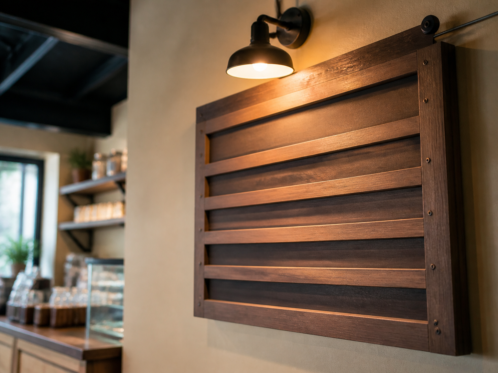

12월 31일, 생맥주 주세 경감이 예정대로면 끝납니다. 500mL 한 잔으로 환산하면 세금이 약 **127원** 붙습니다. 작아 보이지만 이 127원은 파는 잔마다 붙습니다. 하루 40잔이면 한 달 13만 원, 100잔이면 33만 원입니다. 문제는 이 숫자를 모른 채 "업계가 500~1,000원 올린다더라"만 듣고 메뉴판을 고치는 것입니다.

## 오늘의 시의성: 12월 31일에 끝나는 한시 제도

2020년 맥주 과세가 가격 기준에서 용량 기준으로 바뀌면서, 8리터 이상 용기로 유통되는 생맥주에는 일반 맥주 세율의 80%를 적용해 왔습니다. 두 차례 연장됐고, 이번에는 정부가 연장하지 않겠다는 방침입니다.

| 항목 | 내용 |
|---|---|
| 근거 | 주세법 제8조제1항제2호다목, 2026년 12월 31일까지 |
| 일반 맥주 주세 | 1㎘당 88만 5,700원 |
| 경감 생맥주 주세 | 1㎘당 70만 8,500원 |
| 종료 시 증가 | 출고 단계 1㎘당 약 25만 3,400원 = 500mL당 약 127원 |
| 업계 추정 판매가 | 500~1,000원 인상 가능성 (추정) |

127원은 출고 단계의 세금 증가분입니다. 가게가 실제로 사는 가격은 유통 단계에 따라 다르고, 최종 판매가는 사장님이 정합니다. 국회에 연장 법안이 발의돼 있어 12월 처리 결과도 확인해야 합니다.

## 가게 매출 손실: 계산 없이 올릴 때 생기는 일

127원을 이유로 잔당 1,000원을 올리면, 하루 40잔 기준 한 달 104만 원이 됩니다. 원가 상승분(약 13만 원)의 여덟 배입니다. 올리는 것 자체가 문제는 아닙니다. 문제는 **근거를 설명할 수 없을 때**입니다. 손님은 "가격을 핑계로 올렸다"고 느끼고, 그 기억은 리뷰에 남습니다.

두 번째 손실은 온라인에 남은 옛 가격입니다. 매장 메뉴판만 바꾸면 지도 앱의 메뉴 사진, 블로그 리뷰 속 사진, 배달앱 가격, 예약 페이지 안내가 그대로 남습니다. 손님이 매장에서 "여기 가격이 다르네요"라고 말하는 순간, 그 방문은 다시 오지 않습니다.

## 노티스랩의 무촬영 실무 해결: 세 단계로 정리합니다

노티스랩은 새로 촬영하지 않습니다. 이미 있는 메뉴 사진과 지난 글을 이용해 바뀐 가격을 알리는 세트를 만듭니다.

1. **우리 가게 숫자로 환산합니다.** 최근 한 달 생맥주 판매 잔 수를 뽑아 127원을 곱합니다. 이번 인상이 우리 가게에 미치는 월 원가가 나오면, 올릴 금액을 감이 아니라 계산으로 정할 수 있습니다. 127원 상승분을 덮는 200~300원 선이 현실적인 출발점입니다.
2. **바뀌는 것과 그대로인 것을 같이 적습니다.** "12월 1일부터 생맥주 한 잔 200원 인상, 안주 가격과 세트는 그대로"처럼 쓰면 손님이 받아들이는 온도가 달라집니다. 근거는 한 줄이면 충분합니다.
3. **온라인 세 곳을 같은 날 고칩니다.** 지도 앱 메뉴, 배달앱, 예약·문의 화면. 하루를 정해 한꺼번에 바꾸고, 옛 가격이 찍힌 사진은 새 안내로 교체합니다. 기존 사진을 그대로 쓰되 가격 안내 한 장을 더하는 방식이라, 촬영 일정을 잡지 않아도 됩니다.

## 첫 문의는 카톡 한 줄이면 됩니다

바뀌는 가격과 지금 쓰는 메뉴판 사진 한 장만 [카카오톡 채널](https://pf.kakao.com/_xdMIvX/chat)로 보내 주세요. 새 가격 안내 세트와 온라인 세 곳의 수정 목록을 24시간 안에 무료로 보내드립니다. 영업 전화는 걸지 않습니다.

## 확인한 자료

- 이택스뉴스, 「생맥주 주세 경감 종료 앞두고…소상공인 1만1465명 연장 촉구」, 2026년 11월 25일 — https://www.etaxnews.com/news/articleView.html?idxno=11015
- 주세법 제8조제1항제2호다목(8리터 이상 용기 생맥주, 일반 맥주 세율의 80% 적용, 2026년 12월 31일까지)

## 자주 묻는 질문

### 잔당 127원이면 가격을 얼마나 올려야 하나요?

정해진 답은 없습니다. 최근 한 달 판매 잔 수에 127원을 곱해 월 원가 상승분을 먼저 구하고, 그 금액을 덮는 선에서 정하는 것이 순서입니다. 하루 40잔 기준이면 잔당 200~300원이 계산상 출발점이 됩니다. 임대료와 인건비, 주변 가격에 따라 달라집니다.

### 연장될 수도 있나요?

정부는 연장하지 않는 방침을 밝혔지만, 국회에 연장·확대 법안이 발의돼 있습니다. 12월 중순 이후 국회와 재정경제부 발표를 확인하고 메뉴판을 고치는 편이 안전합니다.

### 가격을 올리면 광고에 표시된 가격도 바꿔야 하나요?

바꿔야 합니다. 온라인에 남은 옛 가격은 손님에게는 다른 가격표입니다. 특히 "원래 6,000원 → 5,500원"처럼 기준 가격을 쓰는 문구는 최근 판매가를 기준으로 판단되므로, 인상 후에는 이전 가격을 근거로 한 할인 문구를 내리는 편이 안전합니다.
