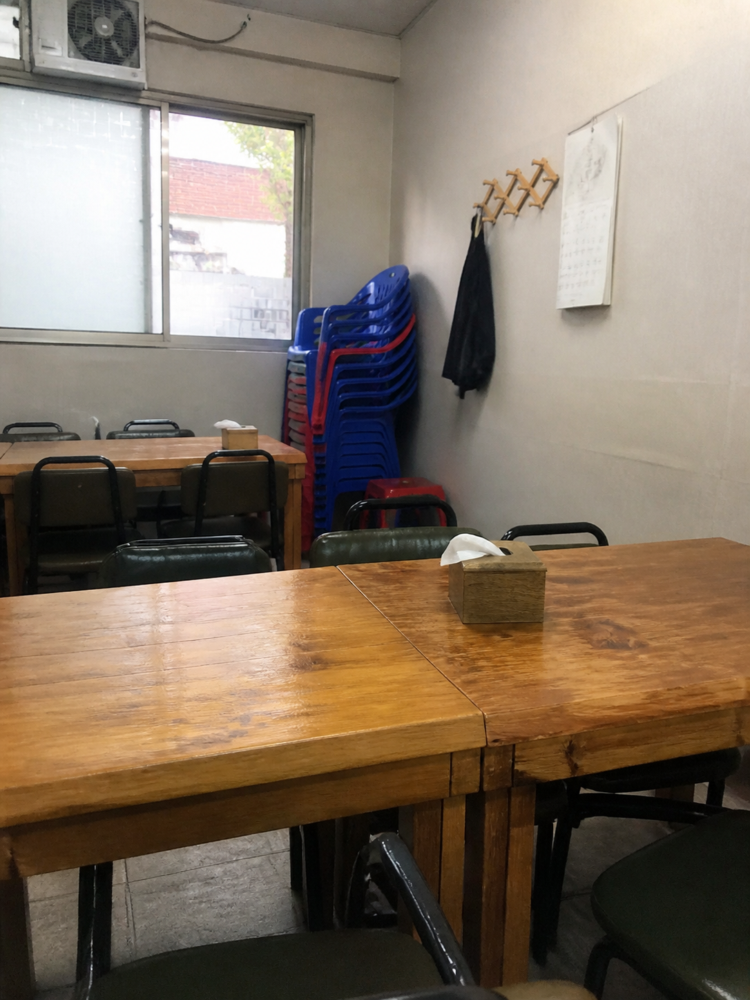

신청 마감이 11월 30일 월요일입니다. 네이버가 예약을 쓰지 않는 음식점을 모아 '예약 루키 2026'을 돌리고 있고, 이용자 추천 상위 1,000곳 가운데 12월 7일까지 예약을 열면 네이버페이 포인트 15만 원을 줍니다. 그런데 이 캠페인의 값은 15만 원이 아닙니다. 예약이 열린 가게는 손님이 비교하는 화면에서 보이는 정보가 달라집니다.

## 신청 자격부터 확인합니다

디지털데일리 11월 6일 보도와 네이버 스마트플레이스 공지를 보면 조건이 좁습니다. 네이버 예약을 지금 쓰지 않는 음식점이 대상입니다. 여기서 많이 걸리는 게 하나 있습니다. 예전에 예약을 썼던 가게도 최근 6개월 동안 예약 접수 이력이 없으면 참여할 수 있습니다. "우리는 한때 했으니까" 하고 넘기면 그냥 지나갑니다.

| 확인할 것 | 내용 |
|---|---|
| 지금 예약을 쓰는가 | 쓰고 있으면 이 캠페인 대상이 아님 |
| 최근 6개월 예약 접수 이력 | 없으면 과거 사용 경험이 있어도 신청 가능 |
| 업종 | 음식점 대상 (카페·소매 등은 공지 확인) |
| 신청 마감 | 2026년 11월 30일 |
| 예약 설정 완료 | 2026년 12월 7일까지 |

두 날짜를 같이 봐야 합니다. 30일에 신청만 해 두고 예약 설정을 안 하면 지원 대상이 되지 않습니다. 신청과 연동이 한 묶음입니다.

## 15만 원보다 큰 것: 예약이 되는 가게의 화면

토요일 저녁 6시를 생각해 보세요. 손님이 지도 앱에 「처인구 고기집」을 칩니다. 목록에는 스무 곳이 뜹니다. 사진도, 리뷰 수도 어딘가 비슷합니다. 이때 손님이 마지막으로 보는 건 전화번호가 아니라 예약 버튼입니다. 전화를 걸어 "자리 있나요" 물어보는 사람보다, 앉을 시간을 미리 정해 두고 싶은 사람이 요즘은 더 많습니다.

예약이 열려 있으면 손님은 그 자리에서 시간을 고릅니다. 예약이 없으면 손님은 목록으로 돌아가 다음 가게를 봅니다. 이 차이는 순위가 아니라 동선에서 갈립니다. 조회수가 모자라서가 아니라, 마지막 한 번의 클릭에서 갈린다는 뜻입니다.

네이버는 이번 캠페인에서 지원금을 받지 못해도 신청과 예약 개설 요건을 채운 매장을 내년 '예약 루키 기획전'에 참여시키고, 네이버지도 예약탭에 소개할 기회를 준다고 밝혔습니다. 포인트는 추천 순위에 달려 있지만, 예약을 열어 둔 상태는 내년까지 남습니다. 제가 가게를 볼 때 지원금보다 이쪽을 먼저 봅니다.

## 오늘 10분이면 끝나는 순서

새로 사진을 찍을 일은 없습니다. 이미 플레이스에 올려 둔 메뉴 사진과 가게 사진으로 예약 상품을 만들 수 있습니다.

1. **스마트플레이스에 로그인해서 예약 상태를 봅니다.** 꺼져 있는지, 켜져 있는데 안 쓰는 상태인지부터 확인합니다.
2. **캠페인 신청을 먼저 넣습니다.** 30일이 마감이라 설정보다 신청이 급합니다. 신청 화면의 대상 조건을 그대로 읽고 넘깁니다.
3. **예약 상품을 하나만 만듭니다.** 처음부터 모든 메뉴를 열지 마세요. 회전이 잘 되는 대표 메뉴 하나, 2~4인, 30분 단위 정도로 시작하면 관리가 됩니다.
4. **손님 입장에서 직접 예약해 봅니다.** 예약하고, 확인 알림이 오는지 보고, 취소까지 해 봅니다. 이 네 단계에서 막히면 손님도 막힙니다.
5. **7일 전에 한 번 더 확인합니다.** 예약 설정을 저장만 하고 공개를 안 한 경우가 흔합니다.

예약을 켜면 응대가 하나 늘어납니다. 예약 확인, 변경, 취소, 노쇼. 전화를 받던 시간이 앱 알림으로 바뀌는 것뿐이지만, 알림을 못 보면 손님은 문 앞에서 기다립니다. 예약을 켜는 날에는 알림을 켜 두세요.

## 이 캠페인이 안 맞는 가게도 있습니다

먼저 분명히 해 둘 것이 있습니다. 예약을 켠다고 검색 순위가 올라간다는 보장은 없습니다. 네이버가 그런 효과를 안내한 적도 없고, 이번 캠페인도 예약 도입 지원이지 노출 상승 상품이 아닙니다. 예약을 켜서 좋아지는 건 목록에서 손님이 고를 때 생기는 정보와 동선입니다.

포인트도 확정이 아닙니다. 추천 상위 1,000곳에 들지 못하면 지원금은 없습니다. 총 지원 규모가 1억 5,000만 원으로 정해져 있어서, 신청자가 많으면 그 안에서 갈립니다. 인원이 정해진 상품이라고 보시면 됩니다.

회전이 아주 빠른 작은 가게는 예약이 독이 될 수도 있습니다. 점심에 20분씩 돌아가는 곳에 예약을 열면 빈자리 계산이 더 어려워집니다. 이런 가게는 예약 대신 대기 등록이나 전화 응대를 정리하는 편이 낫습니다. 업종과 기간, 세부 조건은 캠페인 공지가 바뀔 수 있으니 신청 화면에서 마지막으로 확인하세요.

예약을 켠 뒤에 생기는 응대 문제는 [네이버 플레이스 예약이 늘지 않을 때 확인할 다섯 구간](/insights/place-booking-five-gates/)에 정리해 두었습니다. 11월 26일부터 바뀐 예약자 번호 가림은 [예약자 전화번호가 가려집니다](/insights/naver-booking-masking-november-26/)에서 따로 확인하실 수 있습니다.

## 확인한 자료

- 디지털데일리, 「"전화·현장 대기 식당, 온라인 예약 지원"…네이버, '예약 루키 2026' 오픈」, 2026년 11월 6일 — https://www.ddaily.co.kr/page/view/2026110616594426750
- 네이버 스마트플레이스 공지, 예약 루키 2026 캠페인 안내 (신청 11월 30일, 예약 설정 12월 7일, 추천 상위 1,000곳 포인트 15만 원) — 디지털데일리 보도로 확인

## 자주 묻는 질문

### 신청만 하면 포인트를 받을 수 있나요?

아닙니다. 신청과 함께 12월 7일까지 실제로 예약을 받을 수 있는 상태를 만들어야 하고, 그중 이용자 추천 상위 1,000곳에 들어야 지급됩니다. 추천을 많이 받아도 신청과 설정이 없으면 대상이 아닙니다.

### 예약금을 꼭 받아야 하나요?

캠페인 조건으로 예약금을 요구한다는 내용은 확인되지 않았습니다. 노쇼가 반복되는 가게라면 예약금을 두는 편이 안전하고, 처음 예약을 켜는 단계라면 예약금 없이 시작해 응대 흐름을 먼저 익히는 편이 낫습니다. 세부 조건은 신청 화면에서 확인하세요.

### 이미 다른 예약 서비스를 쓰고 있으면 안 되나요?

이 캠페인은 네이버 예약을 쓰지 않는 음식점을 대상으로 합니다. 다른 채널 예약을 쓰더라도 네이버 예약이 꺼져 있고 최근 6개월 접수 이력이 없다면 신청할 수 있습니다. 다만 예약을 두 곳에서 받으면 자리 계산이 꼬이니, 한쪽으로 모으는 편이 관리하기 쉽습니다.

우리 가게가 대상인지 헷갈리면 가게 이름과 플레이스 예약 화면 캡처 한 장만 [카카오톡 채널](https://pf.kakao.com/_xdMIvX/chat)로 보내 주세요. 신청 자격과 예약 설정에서 빠진 곳 세 가지만 무료로 짚어 드립니다.
