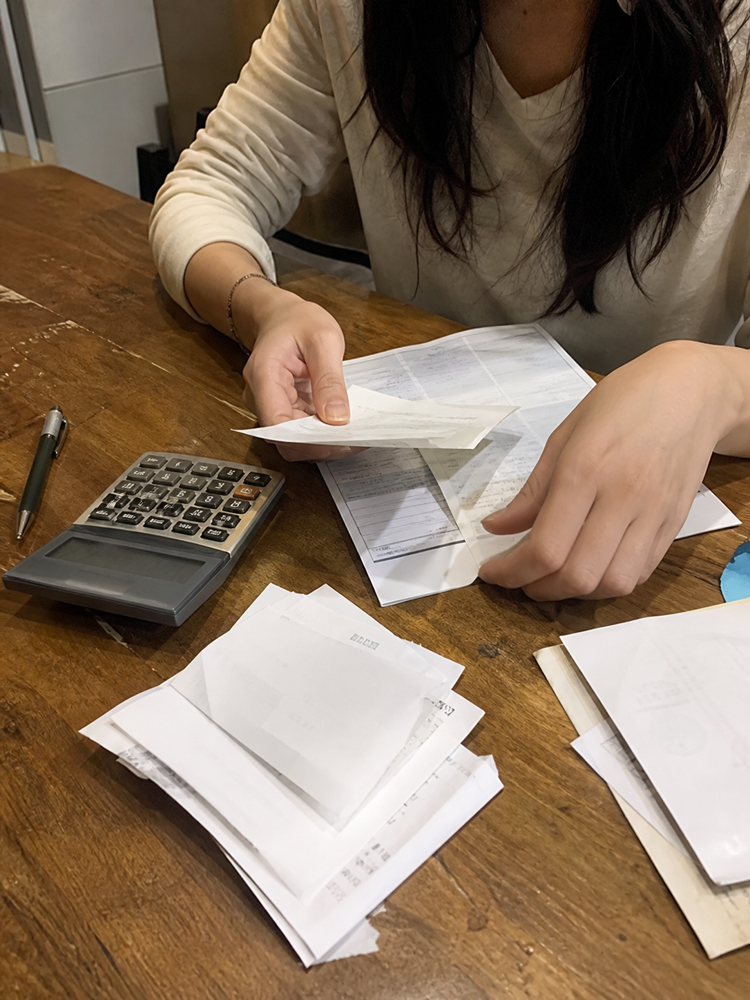

지원금이 없어서 못 받은 게 아니었습니다. 11월 24일 중기부가 홈플러스 피해 소상공인 정책자금에서 대출 제한 두 가지를 없앴는데, 그 두 항목이 그동안 반려 사유의 24.2%였습니다. 자격은 갖췄는데 서류 위 숫자에서 막힌 경우가 네 건 중 하나였습니다.

## 11월 24일 바뀐 것

중기부가 2026년 소상공인 정책자금 융자계획을 변경 공고했습니다. 홈플러스 피해 소상공인 대상 일시적 경영애로자금의 금리를 연 2.5% 고정으로 낮췄습니다. 그전에는 정책자금 기준금리에서 0.5%포인트를 빼는 방식이었으니, 기준금리가 오르면 이자도 같이 올랐습니다. 이제 대출 기간 중에는 2.5%로 고정됩니다.

새 금리는 11월 25일부터 적용되고, 완화된 심사 기준도 25일 접수분부터 적용됩니다. 이미 이 자금을 빌린 업체도 인하 대상에 들어갑니다. 구체적인 적용 시점과 절차는 대출 취급기관에 확인해야 합니다.

한도와 기간은 그대로입니다. 1억 원, 2년 거치 후 3년 상환입니다.

같은 날 대출 제한 항목도 손봤습니다. 소진공 신청안내 자료를 비교해 보면 제한 항목이 15개에서 13개로 줄었습니다. 빠진 것이 '부채비율 700% 초과'와 '매출액 초과 차입금'입니다. 세금 체납, 대출 연체, 한계기업, 휴폐업 관련 요건은 그대로 남았습니다.

## 그런데 왜 네 명 중 세 명이 못 받았나

숫자를 보면 이상합니다. 지원은 넉넉한데 신청이 안 몰립니다.

지난 9월 20일까지 홈플러스 납품·입점업체 지원용 정책자금 1,400억 원 가운데 집행된 금액은 312억 원이었습니다. 22%입니다. 중진공 400억, 기보 500억, 소진공 500억으로 나뉜 재원 중 소진공 몫만 보면 11월 20일까지 136억 원, 집행률 27.2%였습니다.

반려도 많았습니다. 9월 말 기준 소진공에 접수된 대출 신청 659건 중 331건, 절반이 조금 넘는 50.2%가 반려됐습니다. 반려 사유 가운데 매출액 초과 차입금이 67건, 부채비율 초과가 13건이었습니다. 두 항목을 합치면 전체 반려의 24.2%입니다.

| 반려 사유 | 뜻 | 내 가게라면 볼 곳 |
|---|---|---|
| 매출액 초과 차입금 | 가계자금을 뺀 총차입금이 매출액보다 큼 | 작년 표준재무제표 매출과 대출잔액 |
| 부채비율 700% 초과 | 자기자본 대비 부채가 일곱 배를 넘음 | 재무상태표의 부채와 자본 |
| 세금 체납·연체 | 그대로 유지되는 요건 | 국세·지방세 완납, 연체 이력 |
| 한계기업·휴폐업 | 그대로 유지되는 요건 | 기관 안내 기준 확인 |

첫 줄이 핵심입니다. 매출이 줄어서 운영자금을 빌리러 갔더니, 매출이 줄어서 대출이 막히는 구조였습니다. 자금난이 심할수록 심사에서 불리해지는 셈입니다.

이번 조치로 그 두 항목은 사라졌습니다. 부결됐던 업체가 다시 문을 두드릴 수 있게 된 이유입니다.

## 다른 가게도 지금 볼 숫자 세 개

이 완화는 홈플러스 피해 업체에만 해당합니다. 그래도 심사에서 보는 숫자는 다른 정책자금도 크게 다르지 않습니다. 지금 미리 정리해 두면 다음 공고가 열렸을 때 서류 만드는 시간이 줄어듭니다.

1. **작년 표준재무제표의 매출액과 총차입금을 나란히 적어 봅니다.** 가계자금 대출은 빼고 봅니다. 차입금이 매출보다 크면, 그 이유를 한 줄로 설명할 수 있어야 합니다. 재고 때문인지, 보증금 때문인지, 코로나 때 빌린 돈인지.
2. **부채비율을 계산합니다.** 부채를 자본으로 나눕니다. 숫자가 크면 줄이는 것보다 설명이 먼저입니다. 어떤 부채가 언제 끝나는지 표로 만들면 심사에서도, 상담에서도 같은 말을 하게 됩니다.
3. **체납과 연체 이력을 확인합니다.** 이건 완화 대상이 아닙니다. 밀린 세금이 있으면 지원금보다 완납 계획이 먼저입니다.

한 가지 더. 정책자금은 최근 5년 안에 세 번 이상 받으면 제한됩니다. 다만 특별경영안정자금은 이 횟수에 들어가지 않고, 시설자금이나 직접대출을 성실하게 상환한 업체는 한 번 더 지원받을 수 있습니다. 내가 몇 회인지 모르겠으면 소진공 상담에서 먼저 확인하세요.

## 지원금이 나온 뒤를 먼저 생각해야 합니다

금리가 2.5%로 고정됐다고 해서 갚는 돈이 줄어드는 건 아닙니다. 1억 원을 5년에 나눠 갚으면 원금만 한 달에 160만 원이 넘습니다. 여기에 이자가 붙습니다. 2년 거치라면 그 2년 뒤부터 이 부담이 시작됩니다.

지원금이 급한 가게일수록 이 표를 먼저 만들어 보시길 권합니다. 2년 뒤 월 상환액, 그때 예상 매출, 남는 돈. 숫자가 안 맞으면 빌리는 금액을 줄이는 게 낫습니다.

## 이 조치로도 안 되는 경우

집행률이 낮은 이유가 금리만은 아니라는 지적이 나옵니다. 대출 심사 요건, 기존 채무, 연체 여부가 함께 작용합니다. 두 항목이 빠졌다고 승인이 보장되는 것도 아닙니다.

여기 적은 집행률은 보도 시점과 기관별 집계가 섞여 있습니다. 9월 20일 기준 전체 22%와 11월 20일 기준 소진공 27.2%는 모수가 다릅니다. 같은 잣대로 비교한 숫자가 아니라는 점을 감안해 주세요.

거래처 세무·회계 처리는 개별 사정에 따라 달라집니다. 이 글은 공고와 보도에 적힌 조건을 정리한 것이고, 대출 가능성이나 한도를 판단한 것이 아닙니다.

은행이 매출의 모양을 보는 방식은 [매출이 들쭉날쭉한 가게는 은행에서 불리합니다](/insights/bank-reads-your-passbook/)에, 무료로 열린 신청과 유료 대행을 가르는 기준은 [무료로 받을 수 있는 신청을 30만 원에 해 준다는 말](/insights/free-support-application-paid-agency/)에 정리해 두었습니다.

내 가게 서류에서 어디가 걸릴지 혼자 보기 어려우면, 업종과 최근 매출 구간만 [카카오톡 채널](https://pf.kakao.com/_xdMIvX/chat)로 보내 주세요. 심사에서 자주 걸리는 항목 세 가지를 짚어 드립니다.

## 확인한 자료

- 중소벤처기업부, 2026년 소상공인 정책자금 융자사업 공고(변경) 제2026-616호, 2026년 11월 24일 — https://mss.go.kr/common/board/Download.do?bcIdx=1072683&cbIdx=310&streFileNm=8370ee0f-1e3f-48de-ad98-3bb1c57bcfc5.pdf
- 뉴스토마토, 「(단독)홈플러스 피해 소상공인 대출 금리 2.5%로…과다채무 제한도 푼다」, 2026년 11월 24일 — https://www.newstomato.com/ReadNews.aspx?no=1321643
- 아시아포커스, 「홈플러스 피해 소상공인 정책자금 금리 2.5%로 인하…기존 대출자도 적용」, 2026년 11월 28일 — https://www.asiafocus.co.kr/ko-kr/articles/2687

## 자주 묻는 질문

### 홈플러스와 거래하지 않으면 해당이 없나요?

네. 이번 금리 인하와 제한 완화는 홈플러스에 납품하거나 입점한 피해 업체를 대상으로 합니다. 피해 사실을 확인할 수 있는 서류가 필요합니다. 일반 소상공인은 별도 공고를 봐야 합니다.

### 정책자금을 세 번 받으면 정말 안 되나요?

최근 5년 안에 세 번 이상 받은 경우 제한됩니다. 다만 특별경영안정자금은 횟수에 포함되지 않고, 시설자금이나 직접대출을 연체 없이 상환한 업체는 한 번 추가 지원이 가능합니다. 내 이력은 소진공에서 조회하는 게 정확합니다.

### 금리 2.5%는 계속 유지되나요?

이번 변경으로 기준금리와 무관한 고정금리가 됐습니다. 대출 기간 중 기준금리가 올라도 이자는 2.5%입니다. 다만 정부 정책에 따라 조건이 바뀔 수 있다고 공고에 적혀 있으니, 실행 전 취급기관에서 확인하세요.
