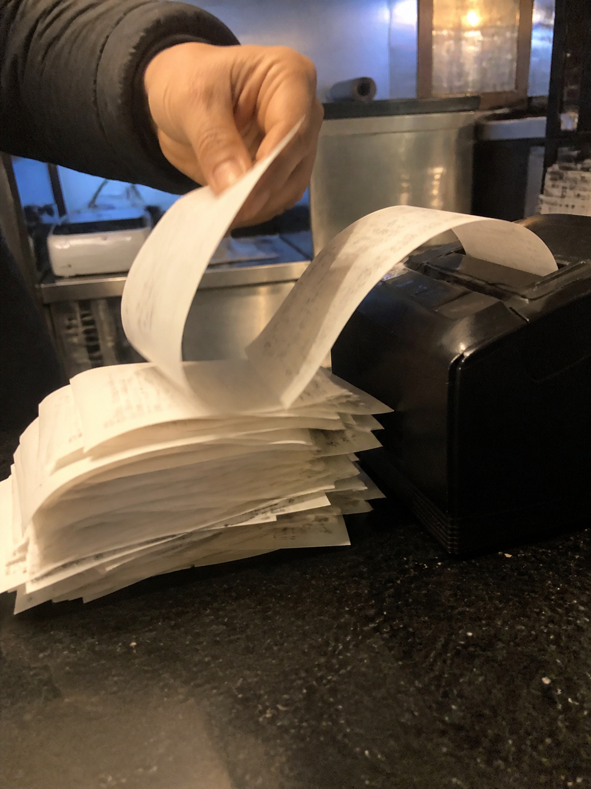

배달 수수료를 15% 안팎으로 묶자는 법이 국회에 있습니다. 그런데 2만 원짜리 주문에서 앱에 나가는 6,116원을 뜯어 보면, 배달비가 3,400원입니다. 나머지 2,716원이 수수료와 결제비용입니다.

수수료 항목만 15%로 묶는 안이라면, 이 가게는 지금도 13.6%입니다. 법이 지나가도 통장에 남는 돈은 거의 그대로입니다.

## 국회에 올라와 있는 세 가지

11월 27일 기준 국회 정무위원회에 계류 중인 법안은 세 건입니다. 셋 다 "15%"를 말하지만, 무엇을 15% 안에 넣느냐가 다릅니다.

| 법안 | 묶는 범위 | 배달비 |
|---|---|---|
| 이강일 의원안 | 중개·결제수수료와 광고비를 15% 이내 | 상·하한을 따로 정함 |
| 김남근 의원안 | 영세 업체 우대 수수료율 | 배달방식과 분담 수준을 가게가 선택 |
| 박정훈 의원안 | 수수료 등 비용과 배달비를 모두 15% 이내 | 포함 |

가장 센 쪽은 세 번째입니다. 가게가 내는 돈을 전부 합쳐 15%를 넘기지 말자는 것입니다. 첫 번째는 수수료와 광고비만 묶고, 라이더 배달비는 별도 기준으로 두겠다는 것입니다.

11월 25일 법안심사소위에서는 세 건 모두 상정되지 않았습니다. 11월 30일 제2법안심사소위에 오를지가 다음 관전 포인트입니다.

## 6,116원을 뜯어 보면

국회 예산정책처가 2025년 11월에 낸 소상공인 지원 재정사업 평가 보고서에 사례 하나가 실려 있습니다. 2024년 배달플랫폼 상생안 기준으로, 서울에서 배달앱 매출 상위 35%에 속한 점포가 2만 원어치를 팔면 앱 비용으로 6,116원이 빠져나갑니다. 주문금액의 30.6%입니다.

이 6,116원 가운데 배달비가 3,400원입니다. 그러면 나머지는 2,716원, 13.6%입니다. 여기에 중개수수료와 결제수수료가 섞여 있습니다. 항목별로 얼마씩인지는 이 사례에 나와 있지 않습니다.

그래서 계산이 이렇게 갈립니다.

- **수수료만 15%로 묶으면**: 이 가게의 나머지 2,716원은 이미 15% 아래입니다. 상한이 생겨도 줄어드는 돈이 거의 없습니다. 광고비를 어디까지 포함하느냐에 따라 달라질 수는 있습니다.
- **배달비까지 15%로 묶으면**: 2만 원의 15%는 3,000원입니다. 지금 6,116원에서 3,000원으로 줄면 한 건에 3,116원이 남습니다. 하루 30건이면 9만 원이 넘습니다.

같은 "15%"인데, 어느 안이 통과하느냐에 따라 우리 가게 통장이 달라집니다.

## 그런데 업주들은 왜 걱정할까

수수료가 줄면 좋은 것 아닌가 싶은데, 현장 반응은 다릅니다. 11월 27일 세계일보가 인터뷰한 사장님들의 말은 같은 방향입니다. 수수료가 낮아져도 라이더 배달비는 사라지지 않고, 배달비가 소비자에게 붙거나 무료배달이 줄면 주문 자체가 줄어든다는 것입니다.

한 분식집 사장님은 "수수료 몇백 원 줄어드는 것보다 주문이 계속 들어오는 게 훨씬 중요하다"고 말했습니다. 배달 한 건에 라이더가 4,000~5,000원은 받아야 한다는 이야기도 함께 나옵니다.

소비자 쪽 숫자도 있습니다. 배달앱 이용자 1,000명을 조사했더니 10명 중 7명이 "수수료 상한제로 배달비가 오르고 무료배달이 사라지면 주문을 줄이겠다"고 답했습니다. 가게에 남는 돈이 늘어도, 주문이 줄면 남는 게 없습니다.

## 지금 내 가게에서 할 세 가지

법을 기다리지 않고 오늘 할 수 있는 일입니다.

1. **최근 정산서 한 장을 항목별로 쪼갭니다.** 중개수수료, 배달비, 결제수수료, 광고비, 부가세를 각각 적고, 2만 원 주문 기준으로 환산해 보세요. 합계만 보면 어디가 큰지 안 보입니다.
2. **배달·홀·포장 비중을 적습니다.** 배달 의존도가 높은 가게일수록 상한제 영향이 큽니다. 홀이 절반 이상이면 법이 바뀌어도 체감이 작습니다.
3. **가격 표시를 점검합니다.** 한국소비자연맹이 11월 27일 공개한 조사에서, 방문 조사한 음식점 45곳 중 31곳(68.9%)이 배달앱 가격을 매장보다 높게 받았습니다. 차이는 메뉴 하나에 400원에서 3,500원, 1,000원이 가장 많았습니다. 그중 54.8%는 포장 주문에도 배달가를 적용했습니다.

세 번째는 법과 별개로 지금 손님에게 보이는 숫자입니다. 배달가와 매장가를 다르게 받는 것 자체가 문제는 아닙니다. 다만 포장 주문에도 배달가가 붙으면, 손님은 그 차이를 리뷰에 적습니다. 플랫폼에서 포장 가격을 따로 설정할 수 있는지 확인해 두세요.

## 법이 지나가도 달라지지 않는 것

세 법안 모두 계류 중입니다. 통과 여부도, 시행 시기도, 최종 숫자도 정해지지 않았습니다. 11월 30일 소위에 오르지 않으면 논의는 다음으로 또 밀립니다.

상한제가 시행되면 비용이 사라지는 게 아니라 부담 주체가 바뀔 수 있습니다. 라이더 보수가 줄거나, 소비자 배달비가 오르거나, 플랫폼이 다른 항목을 조정할 수 있습니다. 어느 쪽이든 가게의 주문량에 영향을 줍니다.

여기 적은 6,116원은 2024년 사례 한 건입니다. 매출 상위 35% 구간에 적용되는 상생요금제 기준이라, 하위 구간이거나 다른 지역이면 숫자가 다릅니다. 내 가게 정산서와 같은 잣대로 비교하지 마세요.

정산서에서 어디를 먼저 봐야 하는지는 [배달 매출 100만 원 중 26만 원이 플랫폼으로](/insights/delivery-platform-cost-262/)에, 플랫폼 없이 손님을 만드는 방법은 [수수료 협상권이 생겨도, 협상할 손님이 없으면 소용없습니다](/insights/outside-platform-customers/)에 정리해 두었습니다.

우리 정산서에서 어느 항목이 큰지 혼자 보기 어려우면, 업종과 최근 달 배달 매출 구간만 [카카오톡 채널](https://pf.kakao.com/_xdMIvX/chat)로 보내 주세요. 먼저 줄일 수 있는 항목 세 가지를 짚어 드립니다.

## 확인한 자료

- 세계일보, 「"배달앱 수수료 상한제 시행되면 동네 식당 문 닫아"…업주들 우려 확산」, 2026년 11월 27일 — https://www.segye.com/newsView/20261127512348
- 연합뉴스, 「소비자연맹 "배달 매장 68.9% 이중가격…포장에도 배달가 적용"」, 2026년 11월 27일 — https://www.yna.co.kr/view/AKR20261127072000030
- 머니투데이, 「"공짜 배달이라 좋아했는데"…사장님도 손님도 웃지 못하는 이유」, 2026년 11월 23일 — https://www.mt.co.kr/living/2026/11/23/2026112219544755147
- 얼리어답터뉴스, 「소상공인의 절규 외면하는 국회, 온플법·배달수수료 상한제 또 상정 무산」, 2026년 11월 25일 — https://www.eanews.kr/news/1059183

## 자주 묻는 질문

### 상한제가 되면 수수료가 바로 내려가나요?

아닙니다. 법이 국회를 통과하고 시행령이 만들어져야 요율과 범위가 정해집니다. 지금은 법안 세 건이 위원회에 계류 중이고, 11월 25일 소위에는 상정되지 않았습니다.

### 배달비까지 15%에 묶이면 가게에 유리한가요?

단기적으로는 한 건당 나가는 돈이 줄 수 있습니다. 다만 플랫폼이 배달비 분담 구조를 바꾸거나 무료배달 혜택을 줄이면 주문량이 줄 수 있습니다. 비용과 주문량을 같이 봐야 합니다.

### 지금 당장 무엇을 확인해야 하나요?

최근 정산서에서 중개수수료·배달비·결제수수료·광고비를 항목별로 나눠 보고, 배달이 전체 매출에서 차지하는 비중을 적는 것입니다. 그 두 숫자가 있으면 어떤 법안이 와도 내 가게 영향을 계산할 수 있습니다.
